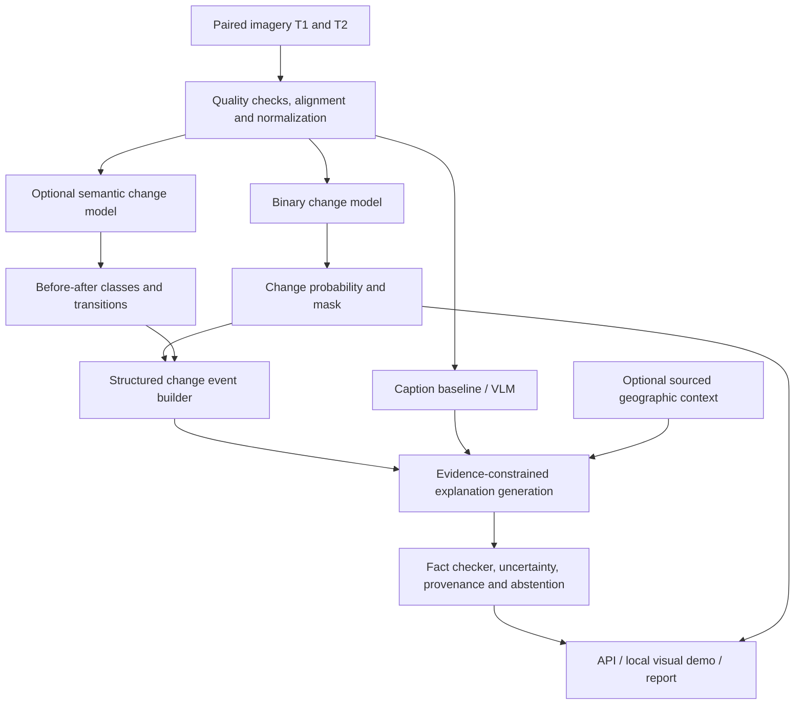

> **Status: Research and implementation blueprint, not a frozen specification.** The broad TerraWatch problem statement was **approved in principle** by the assigned TA. The project, dataset selection, architecture, scope and experimental hypothesis are still under investigation. The **official course requirements** are separated below from **team proposals**, so implementation agents must never treat a candidate model, target metric, or feature as already approved or implemented.

# 1. Executive decision and reading guide

**TerraWatch** will investigate how to detect meaningful changes between two remote-sensing observations, identify *what* changed where labels permit, quantify those changes where spatial metadata allow, and produce **evidence-grounded natural-language explanations** that communicate the observed change and cautiously discuss potential consequences. The main academic contribution must remain **trained/evaluated deep-learning models**, not a standalone map dashboard or an LLM wrapper.

**Recommended design: a modular multi-model, multi-dataset system.** Different datasets supervise different tasks; explicit interfaces tie them together. Use a paired-image detection model for *where*, a semantic model for *what*, a captioning/VLM or structured-language module for *description*, and optional sourced geospatial context for *possible implications*. Do **not** pretend a binary change mask tells us forest loss, flood cause, ecological impact, or a verified reason for change.

**Suggested MVP (deadline-safe):** binary change detection with two trained baselines, a reproducible evaluation pipeline, and an interpretable report containing masks + a descriptive caption from a separately evaluated method. **Suggested research extension:** test whether using predicted change masks and/or semantic transitions as explicit evidence improves caption factuality, especially when image quality or location changes. **Stretch:** robust semantic transitions, georeferenced area, retrieval-supported implications, domain adaptation, or a lightweight jointly trained multitask head.

**Do now:** submit Milestone 1 literature/problem research by **22 October**, audit dataset access and labels by **29 October**, demonstrate an end-to-end subset pass by **5 November**. The platform is secondary to trained-model results. No project metrics, novel architecture, field results, production model or real-world impact is claimed at this stage.

## 1.1 Formal project statement (approved broad scope; preserved in substance)

TerraWatch — Intelligent Satellite Image Change Detection and Analysis: develop an intelligent system for detecting, analyzing, and interpreting changes in Earth's surface using satellite imagery captured at different times. Explore deep learning and computer vision methods to identify meaningful changes and distinguish them from seasonal variations, lighting, and image-quality differences. Optionally investigate multimodal AI and generative methods for context-aware descriptions, plausible causes and potential impacts. Choose specific applications, datasets and methods following feasibility research. Tags: Deep Learning, Computer Vision, Remote Sensing, Change Detection, Image Segmentation, Multimodal AI, Generative AI.

## 1.2 Decision log (initial proposals, revise through PRs)

| Decision | Current position | Status | Evidence needed / owner |
|---|---|---|---|
| Topic | TerraWatch, satellite change detection + interpretation | Team chosen; TA approved in principle | Keep original PS in `docs/problem_statement.md` |
| Academic focus | Train/evaluate bi-temporal DL, not simply call an LLM | Recommended | Baseline experiment + ablation |
| Architecture | Modular task-specific models; shared structured change-event contract | Proposed | Demonstrate on 5-10 held-out samples |
| Detection benchmark | LEVIR-MCI plus optional LEVIR-CD+/S2Looking | Preferred candidates | Confirm labels, splits, license, download |
| Semantic changes | SECOND, separately trained and evaluated | Optional Phase 2 | Availability, split metadata, label harmonization |
| Captioning | LEVIR-CC / LEVIR-MCI paired captions | Preferred candidate | Confirm label alignment and caption split |
| Consequences | Strictly conditional, source-backed statements or clearly marked possibilities | Optional | Context retrieval and verification rubric |
| Application | Local Streamlit demo or Gradio/Hugging Face Space | Proposed | TA deployment guidance, hardware constraints |
| Public repository | `Group-7-DS-and-AI-Lab-Project` | TA required | Create, members access, license chosen |

# 2. Official course obligations and working constraints

**Official sources:** [Guidelines](https://bsc-iitm.github.io/dsai-lab-project/guidelines.html) · [Milestones](https://bsc-iitm.github.io/dsai-lab-project/milestones.html) · [Reference](https://bsc-iitm.github.io/dsai-lab-project/reference.html). These web pages take precedence over the plans in this document; verify updates prior to each deadline.

- Team consists of **four people**. Group submits its own approved DL or Generative AI problem statement.
- Project is **40 marks**: milestone completion **15**, novelty/complexity **5**, final presentation **20**.
- **Six milestones** and mandatory TA review meetings, with detailed written submissions, slides and relevant code; there are individual and group components.
- Public GitHub repository with source, reproducible training/inference, documentation and **weekly individual worklog**. TA requests the exact repository name `Group-7-DS-and-AI-Lab-Project` and access for all team members. Avoid posting secrets, private keys, restricted imagery, giant datasets or checkpoints without permission.
- Milestone 1 submission is specifically **Markdown** in GitHub, with literature and stakeholder analysis. Milestone 2 requires dataset provenance, ownership/permissions, quantity, quality, duplicates, splits, leakage checks and **alignment between multiple datasets and subtasks**. Milestone 3 requires a **working subset through the complete end-to-end pipeline**, not only architecture slides.
- Final presentation (tentatively starting **21 December**, weeks 10-11): live demo, code walkthrough and project report. Course staff may issue additional phase-specific rules.

| Milestone | Official due | Must show | Planned TerraWatch artifacts |
|---|---|---|---|
| M1: Problem + literature | **Oct 22** | Boundaries, stakeholder, measurable objectives, research/industry landscape, literature gaps; Markdown | `docs/milestones/M1_Problem_and_Literature.md`, matrix with 12+ papers, methodology comparison, deck, individual worklog |
| M2: Dataset | **Oct 29** | Sources/rights/quality/distributions, no leakage, reproducible preprocessing, multi-dataset task mapping | `data/README.md`, `configs/datasets/*.yaml`, `data/manifests/*.csv`, 1 EDA notebook, sample visualization, dataset cards |
| M3: Architecture | **Nov 5** | Shapes, architectural rationale, losses/metrics, **real subset end-to-end** | Architecture diagram, typed contracts, model registry, 5-10 sample forward passes, CLI report JSON and demo stub |
| M4: Training | **Nov 19** | Training runs, LR/optimizer/regularization experiments, logs, checkpoints, observations | ≥2 properly tracked trainable baselines; model cards; configs; curves; reproducibility logs |
| M5: Evaluation | **Nov 26** | Quant + qual metrics, failure analysis, limitations | Held-out tests, class breakdown, error categories, change-mask/caption audit, ablations, confidence intervals |
| M6: Deployment | **Dec 10** | Runnable demo/API/Space, polished docs and report | Local or hosted demo, README install, model artifacts/weights instructions, report, final deck |
| Final | **~Dec 21 onward (tentative)** | Demo, code walkthrough, report, team understanding | Rehearsed presentation and individually explained contributions |

**Important:** Weekly meeting schedules and actual submission procedures remain subject to TA confirmation; do not manufacture dates for weekly calls.

# 3. The real-world problem and stakeholders

## 3.1 Problem

Regularly captured aerial and satellite images contain both genuine surface changes and confounders: sunlight, shadows, cloud, haze, off-nadir viewing, different sensors/resolutions, seasonal vegetation, tidal/water variation, geometric misregistration and compression. Manual interpretation across many dates and locations is time-consuming; automated binary change detection often says only *a pixel changed*, not the object class, direction, size, evidence or uncertainty. Generic VLM descriptions may be fluent but incorrectly infer causes, counts or context. The system should connect measurable detections with explanations while making uncertainty and dataset limits explicit.

## 3.2 Who benefits?

| Stakeholder | Need | Defensible output |
|---|---|---|
| Environmental NGOs / forestry monitors | Screen changing vegetation/land use | Flag mapped change candidates for human investigation |
| Urban planners / local authorities | Examine development patterns | Before/after changes; building-change localization if labeled |
| Disaster / infrastructure analysts | Review altered areas | Change overlays, not operational risk certification |
| Remote-sensing researchers | Reproducible benchmarks and explainability | Model checkpoints, metrics, error taxonomies, datasets, citations |
| Students / public analysts | Understand imagery changes | Plain-language descriptions with supported observations and limitations |

**Non-goals in initial term:** verified legal deforestation claims, real-time nationwide surveillance, causal identification from two images, financial damage estimates, proven biodiversity impact, parcel boundaries or accurate area measures without CRS/GSD. Satellite imagery alone cannot establish who acted, why, or the actual consequences.

# 4. Task taxonomy: multiple tasks, models and datasets

The modular approach is good because change detection, semantic classification, captioning and consequence analysis have different targets and supervision requirements. **But it is not a license to train on unrelated datasets and concatenate arbitrary outputs.** Align modality, spatial scale, class definitions, image ordering and evaluation protocols before claiming a coherent end-to-end system.

| Module / task | Input | Supervision | Candidate dataset | Candidate model | Required output | MVP? |
|---|---|---|---|---|---|---|
| A. Data quality + co-registration | two same-location images + metadata | mostly rules; optional registration | all paired sets; optional HLS | rasterio, cloud/quality masks, ECC/feature alignment | normalized paired tensors, valid-pixel/quality flags | Yes |
| B. Binary change detection (*where*) | pre/post RGB | binary change mask | LEVIR-MCI, LEVIR-CD+, S2Looking | absdiff threshold → Siamese U-Net → ChangeFormer | probability + binary mask | **Yes** |
| C. Semantic change (*what*) | pre/post + paired masks | t1/t2 semantic masks or transitions | SECOND; optionally other verified semantic sets | two-time semantic segmentation, SCanNet/ChangeStar family | before/after class map or transition events | Optional |
| D. Captioning (*describe*) | images; optionally mask/events | human descriptions | LEVIR-CC, LEVIR-MCI | retrieval/templates baseline → RSICCformer/Chg2Cap → LoRA VLM | caption grounded in image evidence | **Yes, modest version** |
| E. Geospatial measurements | georeferenced mask + metadata | validated mapping rather than trained labels | raw Sentinel-2/HLS demo AOIs only | polygons + raster transforms | area/count with units and provenance | Optional |
| F. Causes/implications | validated events + trusted contextual records | curated sources and human annotations | no ready causal ground truth assumed | constrained templates + optional RAG/LLM | conditional possible interpretations and citations | Stretch |
| G. Interactive reporting | output of modules A-F | integration tests, usability | demo samples | Streamlit/Gradio; optional FastAPI | overlay, slider, events, evidence and caveats | Yes |

## 4.1 Why train different models?

- Labels differ: a **binary building-change mask** never specifies a vegetation-to-water transition; a **caption** is not a pixel-accurate segmentation ground truth.
- Tasks have different resolutions and metrics: spatial IoU/F1 vs transition IoU/SeK vs human-fact precision.
- Separate models can be trained, versioned, ablated and replaced without blocking the rest of the pipeline.
- Shared infrastructure (encoders, preprocessors, splits, reporting) may save compute, but joint training should be justified experimentally rather than adopted from the start.

## 4.2 Three integration strategies

1. **Recommended: modular late fusion.** Train detector and captioner independently, convert mask to events, pass structured evidence to a caption generator and audit its factual consistency. Low integration risk, strong comparisons.
2. **Research extension: mask-aware captioning.** Provide crop/mask/regions explicitly as tokens/features to a captioning decoder or VLM adapter; compare with non-mask-aware captioning. Requires **image+mask+caption** alignment (LEVIR-MCI is attractive).
3. **Stretch: multitask shared encoder.** Shared bi-temporal backbone with detection and caption heads, optionally semantic head. Combined loss `L = lambda_cd * L_cd + lambda_cap * L_cap + lambda_sem * L_sem`; only activate each task loss where that sample has required ground truth. Requires dataset-aware batching/missing labels and careful task-interference ablations.

## 4.3 Critical compatibility warning

S2Looking/LEVIR-CD+ images emphasize certain building/object changes; SECOND has land-cover transitions; LEVIR-CC focuses on short image change descriptions. These datasets do **not** share a universal label ontology, satellite platform, resolution or georeferencing. **Do not** report cross-dataset IoU or caption metrics as though all annotations represent identical targets. For comparisons: (a) evaluate within each dataset's own test split, (b) report cross-dataset transfer only on aligned classes/taxonomies, (c) identify unannotated change categories as *unknown/unlabeled*, not false positives, and (d) deduplicate overlapping LEVIR family imagery across variants.

# 5. Dataset research register and priorities

Access/ownership, licensing and exact splits must be re-audited in Milestone 2. The figures below describe sources, **not files already downloaded**. Keep a provenance file with URL, access date, version/hash and conditions. Links are original project/source pages whenever possible.

| Rank | Dataset | What it actually labels | Indicative size / characteristics | TerraWatch use | Caveat and source |
|---|---|---|---|---|---|
| **1** | **LEVIR-MCI** | Paired RGB + change masks + captions | Project download roughly 2.77 GB; confirm number of pairs locally | Best bridge for **detection + caption grounding** | LEVIR-CC derivative; inspect split overlap and academic usage terms. [Official code](https://github.com/Chen-Yang-Liu/Change-Agent), [data](https://huggingface.co/datasets/lcybuaa/LEVIR-MCI) |
| **2** | **LEVIR-CC** | Paired RGB + multiple human descriptions per pair | **10,077 pairs**, **50,385 captions** | Change caption training/evaluation | Not a land-cover cause dataset; inspect relation to LEVIR-MCI. [Dataset](https://github.com/Chen-Yang-Liu/LEVIR-CC-Dataset), [HF](https://huggingface.co/datasets/lcybuaa/LEVIR-CC) |
| **3** | **LEVIR-CD / CD+** | Binary building change | Original **637** pairs, 1024x1024, 0.5 m/pixel, building-oriented; CD+ extended | Binary detector external benchmark / pretraining | Overlaps possible with LEVIR derivatives; geospatial resolution not interchangeable with Sentinel-2. [Official](https://github.com/justchenhao/LEVIR), [CD+ directory](https://github.com/S2Looking/Dataset) |
| **4** | **SECOND** | Before/after land-cover semantic categories / transitions | Often **2,968 base image pairs** and **4,662 in expanded protocols**; 512x512 | What-changed semantic transition model | Confirm which dataset variant/split used; do not mix published scores across protocols. [SCanNet implementation](https://github.com/DingLei14/SCanNet), [2026 analysis](https://www.sciencedirect.com/science/article/pii/S0924271626003035) |
| **5** | **S2Looking** | Binary change under varied viewpoint/illumination | **5,000 pairs** described in original dataset literature | Robustness/out-of-condition tests | Acquire via dataset authors; verify labeling scope and download availability. [Dataset](https://github.com/S2Looking/Dataset) |
| **6** | **SYSU-CD** | Binary change with variety incl. roads/vegetation | **20,000 pairs**, 256x256, 0.5m aerial Hong Kong | Secondary transfer/stress test | Different change ontology, location/sensor. [Official](https://github.com/liumency/SYSU-CD) |
| **7** | **NASA HLS / Sentinel-2** | Observations, **not supervised change labels** | Surface reflectance, QA layers, spatial/temporal metadata | Georeferenced proof-of-concept; environmental indices | 30m HLS resolution; don't apply 0.5m building model without adaptation. [NASA HLS](https://hls.gsfc.nasa.gov/), [HLS products](https://hls.gsfc.nasa.gov/data-products/) |
| **8** | **ChangeChat-87k / 105k** | Instruction/Q&A about paired imagery, often generated/synthetic | 87k instructions in ChangeChat; 105k in later derivative | Stretch: RS VLM instruction tuning / question-answer evaluation | Generated labels can inherit errors, licensing/access/version check. [ChangeChat](https://github.com/hanlinwu/ChangeChat), [105k](https://huggingface.co/datasets/hlwu/changechat-105k) |

**Preferred initial acquisition order:** LEVIR-MCI (same-image joint supervision), LEVIR-CC (captions), a building-change benchmark (LEVIR-CD+/S2Looking), and SECOND only after the team decides to support categorical changes this semester. For genuinely environmental use cases, plan a **small honest Sentinel-2/HLS observational showcase** or choose a labeled land-cover dataset; don't imply training solely on building labels yields validated deforestation detection.

## 5.1 Dataset selection gates (must pass by M2)

| Gate | Pass condition | Action if not met |
|---|---|---|
| Access and license | Download works; lawful academic/public demo use; attribution known | Replace data or negotiate permission |
| Metadata | Image dates, sensor, dimensions, units, label meanings inspected | Restrict claims/features; record unknowns |
| Reproducibility | Manifest IDs, source hashes, exact split, preprocessing script | Block training until fixed |
| Paired alignment | Matching regions and order verified on ≥30 randomly sampled pairs | Build registration/quality filter |
| Data balance | Changed/nonchanged percentages and rare transitions measured | Stratify/report metrics, loss weighting |
| Leakage | No shared scene/original image/event leakage across partitions | Regenerate scene-level partitions |
| Task fit | At least one test set truly assesses each claimed task | Remove claim or collect suitable annotations |
| Compute | One end-to-end batch fits available hardware with reproducible settings | Smaller crop, AMP, accumulation, freeze encoder |

## 5.2 Semantic labels and translation matrix

Define a dataset-specific label ontology and explicit mapping table, e.g. `class_ontology.yaml`: `building`, `vegetation`, `water`, `bare_ground`, `road`, `other`, `unknown`. Map only with documented evidence; never silently map `playground -> bare_ground` or unknown/unlabeled -> unchanged. Semantic transitions such as `vegetation -> built_surface` only when BOTH date-specific class predictions are validated. Building appearance/removal can come from building-change labels; neither establishes a true natural-cover conversion if a prior class is missing.

**Example supported vs unsupported statements:**

- Supported by high-resolution registered imagery + mask: "A new built structure is visible in the eastern area" (if verified).
- Requires semantic labels: "Low vegetation was replaced by buildings".
- Requires real map geometry: "The changed region is approximately 3.2 hectares".
- **Not justified from imagery alone:** "The municipality cleared protected forest for an illegal factory, increasing flood risk by 34%."

# 6. Existing approaches, literature map and genuine research opportunities

**Classical baseline:** spectral/image differencing, change vector analysis (where comparable multispectral data exist), Otsu thresholding, morphology and registration. Fast, interpretable, but sensitive to illumination/sensor differences.

**CNN families:** FC-EF / FC-Siam-conc / FC-Siam-diff and Siamese U-Net/ResNet encoders; effective low-compute baselines with supervised change masks. **Transformer families:** BIT and ChangeFormer for bitemporal feature interaction. **Weak/single-temporal:** ChangeStar. **Semantic:** SCanNet and other spatiotemporal segmentation models. **Caption:** RSICCformer, Chg2Cap, Change-Agent. **Vision-language:** ChangeChat, CCExpert, newer domain-specific VLMs. Do not call any of these a novel TerraWatch invention.

| Prior work / resource | Key contribution | Limit / question for us | Reading/source |
|---|---|---|---|
| Daudt et al., FC-Siam (2018) | Early fusion and Siamese CNN strategies | Simple trainable comparator, robustness to radiometry | [Paper](https://arxiv.org/abs/1810.08462) |
| Chen et al., BIT (2021/2022) | Bi-temporal image transformer | Compare model complexity with controlled data/splits | [Paper](https://arxiv.org/abs/2103.00208) |
| Bandara & Patel, ChangeFormer (2022) | Transformer Siamese detection | Strong transformer baseline, implementation effort | [Official code](https://github.com/wgcban/ChangeFormer), [Paper](https://arxiv.org/abs/2201.01293) |
| Zheng et al., ChangeStar (ICCV 2021) | Change learning with single-temporal labels | Data efficiency vs full paired supervision | [CVF paper](https://openaccess.thecvf.com/content/ICCV2021/html/Zheng_Change_Is_Everywhere_Single-Temporal_Supervised_Object_Change_Detection_in_Remote_ICCV_2021_paper.html) |
| SCanNet (2024) | Joint spatial-temporal semantic change | Semantic shift vs simple class differencing | [Code](https://github.com/DingLei14/SCanNet) |
| LEVIR-CC | Image-pair natural language caption benchmark | How to ensure region-count fact grounding? | [Dataset](https://github.com/Chen-Yang-Liu/LEVIR-CC-Dataset) |
| Liu et al., Change-Agent (IEEE TGRS 2024) | Detection + caption + LLM interaction | **Direct precedent:** integration alone is not novelty | [Paper](https://ieeexplore.ieee.org/document/10591792), [Code](https://github.com/Chen-Yang-Liu/Change-Agent) |
| Deng et al., ChangeChat (2024) | Bi-temporal VLM interactive instruction tuning | Generated instruction quality and robustness | [arXiv](https://arxiv.org/abs/2409.08582), [Code](https://github.com/hanlinwu/ChangeChat) |
| CCExpert (2024) | Difference-aware multimodal captioning; CC-Foundation | Resource intensive; strong state of practice | [Paper](https://arxiv.org/abs/2411.11360) |
| Remote sensing change captioning meets large language and vision models (2026) | VLM methods + fact-based evaluation | Text metrics can miss unsupported details | [ISPRS journal](https://www.sciencedirect.com/science/article/pii/S0924271626003035) |

**Commercial / operational landscape to study, not presumed equivalent competitors:** Google Earth Engine (analysis platform), Copernicus Browser (satellite imagery exploration), NASA HLS (harmonized Earth observations), open satellite ML toolchains. Compare functions/features through a dated evidence matrix, rather than claiming these tools cannot explain changes or lack AI. [GEE](https://earthengine.google.com/), [Copernicus Browser](https://browser.dataspace.copernicus.eu/), [NASA HLS](https://hls.gsfc.nasa.gov/).

## 6.1 Publishable research hypotheses (choose ONE primary after M1)

- **H1 — Mask-grounded caption factuality (recommended):** Providing explicit predicted change masks and localized object counts as evidence to a captioning/VLM module reduces unsupported visual claims compared with paired images alone, on held-out LEVIR-MCI/LEVIR-CC data.
- **H2 — Radiometric robustness:** Paired-image training with controlled radiometric perturbations and temporal consistency loss improves F1 under illumination/season-like shifts without degrading in-domain F1.
- **H3 — Semantic grounding:** Using per-time semantic transition maps improves correct **type** descriptions compared with binary masks alone, when the test dataset genuinely labels those classes.
- **H4 — Lightweight deployment:** A compact Siamese CNN + structured caption module offers a favorable factuality/latency/VRAM frontier compared with large end-to-end vision-language models.

**Novelty bar:** Change-Agent already trains on LEVIR-MCI, so H1 requires an **unseen or systematically quantified improvement** (e.g. an evidence verification/gating mechanism with human fact audit), not just calling an LLM after segmenting. Pre-register baselines and metrics, search very recent related work, and allow a well-documented negative result.

# 7. Proposed system architecture



## 7.1 Structured contracts (central design)

Store each paired observation as a unique `scene_id` with the two image identifiers, original source, license, acquisition dates if known, sensor, CRS/GSD if known, normalization info, split, and data hashes. The canonical outputs are:

```json
{
  "schema_version": "1.0",
  "scene_id": "example-001",
  "source_dataset": "LEVIR-MCI",
  "time_1": {"image_uri": "data/sample/t1.png", "date": null},
  "time_2": {"image_uri": "data/sample/t2.png", "date": null},
  "geospatial": {"crs": null, "meters_per_pixel": null},
  "quality": {"registered": true, "cloud_fraction": null, "warnings": []},
  "detection": {
    "model_id": "siamese_unet_v1",
    "probability_uri": "outputs/predictions/example-001-prob.tif",
    "binary_mask_uri": "outputs/predictions/example-001-mask.png",
    "threshold": 0.5
  },
  "events": [
    {
      "event_id": "event-001",
      "label": "visible_structural_change",
      "before_class": "unknown",
      "after_class": "building",
      "pixel_area": 321,
      "area_m2": null,
      "confidence": 0.81,
      "evidence": ["mask:example-001/event-001"],
      "status": "model_prediction"
    }
  ],
  "narrative": {
    "observed": "A newly visible structure is indicated by the change map.",
    "possible_implications": [],
    "verified_causes": [],
    "caveats": ["Building type and cause are not established."],
    "supporting_event_ids": ["event-001"]
  }
}
```

**Schema rules:** an example JSON is illustrative, not ground truth. `unknown` means unknown, not negative. `area_m2 = null` when georeferencing/scale absent. Dates null when unavailable. Event confidences require later calibration; do not treat them as probabilities if uncalibrated. Every generated factual assertion references an event/image/cited document. Report generator must fail safely if a field is missing.

## 7.2 Major interfaces

- `ingest_pair(input) -> SceneRecord`: read images + labels, validate pair identity and temporal order.
- `preprocess(scene) -> PairTensor, ValidMask, Metadata`: shape/channel transforms; preserve transform history.
- `detect(pair, checkpoint) -> P_change[H,W]`: model probabilities; threshold by validation only.
- `semantic(pair, checkpoint) -> LabelsT1, LabelsT2, transition_map`: optional, dataset-specific ontology.
- `extract_events(mask, classes?, metadata?) -> List[ChangeEvent]`: connected components, quantification and locations.
- `caption(pair, events?, model_id) -> CandidateCaption`: vision/caption module; references visible evidence.
- `verify_caption(caption, events, source) -> SupportedText, Flags`: counts/types/locations check and caveat insertion.
- `render_report(scene, outputs) -> JSON + optional HTML/PDF`: source/provenance, overlays, no unsupported causal certainty.

# 8. Data engineering specification

## 8.1 Repository manifests

Data manifest columns: `scene_id, dataset, source_uri, source_version, original_group_id, t1_path, t2_path, mask_path, sem_t1_path, sem_t2_path, caption_ids, split, width, height, channels, pixel_size, crs, acquisition_date_1, acquisition_date_2, sensor_1, sensor_2, license, sha256_t1, sha256_t2, sha256_label, notes`.

Use *one manifest per dataset* and join views rather than combining folders blindly. Each row represents one **original scene pair**, while crops/tiles record their `parent_scene_id` to prevent leakage. Treat derivative copies as potential duplicates across LEVIR datasets; use filenames, metadata and perceptual hashes to audit overlap. Any test example used for selecting prompts/checkpoints becomes validation and is removed from the untouched final test.

## 8.2 Preprocessing order

1. Verify downloads/checksums; read license/citation. Decode TIFF/PNG and check image/label dimensions.
2. Establish T1/T2 date order where available, band-order conventions, masks, ignored labels and no-data pixels.
3. Reproject/co-register only for appropriate georeferenced raw data; retain reprojection/resampling metadata. Do not assume benchmark PNG patches possess trustworthy GIS transforms.
4. Cloud/shadow/invalid-pixel handling for real Sentinel/HLS scenes. Exclude invalid pixels from loss and metrics rather than labeling them unchanged.
5. Preserve train/val/test *before* augmentation; prevent neighboring tiles of the same scene entering separate splits.
6. Use per-dataset normalization fitted **on training only** and jointly spatial transforms on both dates and mask. Apply radiometric augmentation intentionally and individually where justified.
7. Resize/crop: a suggested 256x256 prototype (later 512), with reflection/padding; nearest-neighbor interpolation for class masks.
8. Run label value validation, duplicate scans, change ratio histograms, visual pair overlays and pixel-class distribution plots.
9. Record reproducible processed artifact hashes and config; keep raw data untouched.

**Spatial and spectral warning:** LEVIR/S2Looking RGB aerial-style imagery with sub-meter detail ≠ multispectral 10/20m Sentinel-2 or 30m NASA HLS. A model trained to identify small buildings in LEVIR is not validated for Sentinel imagery. If adding real Sentinel scenes, treat them as **qualitative domain-shift demos** until trained/evaluated with compatible labels.

## 8.3 Data augmentation and robustness test design

- Training: flips, 90° rotations, mild photometric perturbations, cropping; same spatial transform for paired images and masks. Avoid vertical flips if orientation matters to geospatial interpretation.
- Robustness diagnostics: brightness/contrast, color cast, JPEG compression, modest paired misregistration, blur, synthetic shadows. Report synthetic corruption severity separately; **not** equivalently labeled actual seasons/clouds.
- Do not introduce unrealistic geometric changes that invalidate annotations. Vary one factor at a time for ablations.
- Optional multispectral: indices `NDVI=(NIR-Red)/(NIR+Red)`, `NDWI` with specified formula and bands, only when imagery has correctly calibrated required channels.

# 9. Model implementation and experiment plan

## 9.1 Binary change detection: core trained component

**Naive baselines:** pixel absolute RGB difference after alignment; SSIM/threshold; Otsu threshold; optional feature differencing. Evaluate precision/recall carefully; these often produce lighting-induced false positives.

**Baseline DL B1:** fully convolutional early-fusion U-Net receiving concatenated T1/T2 RGB (6-channel). **B2:** Siamese U-Net with shared ResNet18/34 or light convolutional encoder, feature absolute-difference fusion and decoder. **B3 (optional):** ChangeFormer or BIT with paper-matched preprocessing. Avoid reimplementing all SOTA methods under deadline.

**Starter hyperparameters (to tune, not established):** AdamW, batch size 4-16 as memory permits, 256x256 crops, 30-80 epochs/early-stop, learning rates in `{1e-3, 3e-4, 1e-4}`, weight decay `{1e-4, 1e-2}`, cosine schedule, AMP, 3 fixed seeds, checkpoint best **validation** F1. Compare BCE+Dice vs focal/Tversky for sparse change positives; record exact configs, GPU, time, effective batch size and FLOPs/parameters.

**Metrics:** change-class F1, precision, recall, IoU, PR-AUC on probability outputs, unchanged-class specificity, per-scene performance and area/size strata. Aggregate both macro scene means and global pixel counts (clearly labeled). Select threshold on validation only; test once after decisions freeze. Report confidence intervals from bootstrapping scene IDs or per-seed variance, and paired error visualizations.

**Acceptance gate by M4:** deterministic data loader, forward/backward on a batch, two trained comparable baselines, validation curves and sample predicted masks. No arbitrary performance promise.

## 9.2 Semantic change model: optional second trained component

For SECOND (or any audited semantic benchmark), prefer a simple, reproducible **two-head semantic segmentation model**: shared encoder processes T1/T2 separately and decodes each to a land-cover class map; transitions are computed via class-to-class pair, optionally conditioned on binary change mask. Compare with semantic prediction on each date followed by differencing, and a dedicated model such as SCanNet if feasible. Report before/after class IoU, semantic change F1, SeK/kappa-derived metrics when appropriate and exact dataset protocol. Provide transition-confusion matrix (e.g. vegetation → built surface). **Never evaluate semantic land-cover transitions on datasets carrying only binary labels.**

**Gate:** only include as an assessed claim if reliable semantic labels are accessible and the M4 detector/caption integration is secure; otherwise document as future work and prioritize primary research hypothesis.

## 9.3 Change captioning and vision-language model

**Caption baseline C0:** deterministic template over the **ground-truth or predicted** change events (clearly label mode); produce localization/count only when those fields are available. **C1:** fine-tune or reproduce an established paired-image caption architecture (RSICCformer or Chg2Cap) on LEVIR-CC; reasonable for DL requirement if time/compute permit. **C2:** run an openly licensed pretrained VLM in inference mode with T1/T2 tiled side-by-side, mask/region evidence and constrained output; optionally use LoRA if hardware and dataset/terms permit. **C3 research treatment:** mask-aware captioning, evidence injection, or fact-validation against events. Compare C1/C2 with and without event grounding on **matched held-out pairs**.

**Text metrics:** BLEU-1/4, METEOR, ROUGE-L, CIDEr/SPICE where benchmark-compatible; these are not enough. Add human blinded annotation of event presence, object type, direction, counts, localization, hallucinated objects, unsupported causes, uncertainty/abstention (e.g. 100+ diverse independent test pairs if feasible, 2 annotators, adjudication and agreement). Compute supported-claim precision, omission rate, contradiction rate, per-change factual recall, and consistency under corrupted imagery. Clearly separate *references* from model-created annotation/teacher data.

**Grounding research:** use LEVIR-MCI aligned masks/captions to generate event IDs. Compare (i) T1/T2 images only, (ii) + predicted mask, (iii) + ground-truth mask **oracle upper bound only**, (iv) + automatically extracted structured events, (v) + verification filter. Don't claim oracle as real-world achievable. Stratify by false positive/false negative masks to understand upstream error propagation.

**Synthetic caption risk:** any LLM-generated instruction or caption is a pseudo-label. Store generator name, prompt, temperature, image links, provenance, contamination check and manual quality audit. Never train on synthetic examples derived from evaluation scenes. Prefer human reference captions for primary evaluation.

## 9.4 Consequences and contextual interpretations

**Observed**: what image/masks substantiate, e.g. "Several new roof-like regions appear". **Possible implications**: conditional reasoning, e.g. "If this corresponds to replacement of permeable vegetation with impervious surface, local runoff may increase". **Verified causes**: NONE without independent dated evidence. **Uncertainty**: explicit cloud/missing dates/unknown classes.

A first implementation may use domain-neutral, deterministic conditional templates; a second may retrieve from trusted scientific documentation and synthesize a short paragraph with **source URLs and publication dates**. A deployed LLM should receive only structured events, image metadata and retrieved sources; do not ask it to invent labels, dates, measurements, policies, named entities or statistics. Require separate fields `observations`, `possible_interpretations`, `unverified_hypotheses`, `references`, `limitations`. Test refusal/"insufficient information" on ambiguous and no-change cases.

**Important causal boundary:** "why did this happen" is usually unidentifiable from two satellite images. At best generate *plausible hypotheses*, optionally testable with outside records; causal explanation is explicitly out of MVP. Human review for consequential decisions.

# 10. Evaluation protocol and benchmark integrity

## 10.1 Evaluation matrix

| Research question | Comparator/control | Primary metric | Further checks |
|---|---|---|---|
| Detect actual change? | absdiff/Otsu vs early-fusion vs Siamese | Changed-class F1/IoU | PR-AUC, per-scene, rare changes |
| Robust to image differences? | baseline model vs augmentation/consistency | F1 drop vs clean | corruption severity curves, exact nuisance type |
| Identify type/direction? | semantic differencing vs learned semantic head | per-transition F1, mIoU | confusion, unknown classes, frequency |
| Caption the change? | templates vs caption net vs VLM | human fact precision | BLEU/CIDEr, false claims, omitted changes |
| Does mask/evidence help text? | images only vs predicted mask/events | Δ fact precision with CIs | oracle upper bound and error propagation |
| Is it efficient? | lightweight vs transformer/VLM | latency+VRAM+params | same device/batch/image size, total pipeline runtime |
| Do explanations stay honest? | unconstrained vs evidence-constrained | unsupported claims per report | no-change / false mask / missing metadata |

## 10.2 Statistical and ethical practices

- Fix split + primary metric *before* final test. No scene-level test leakage via neighboring tiles, prompt examples, pretraining or derivative datasets where identifiable.
- Benchmark training from scratch vs fine-tuning clearly; show comparable tuning budgets. Do not compare incompatible literature numbers with unreported differences.
- Prefer 3 reproducible seeds for main DL models, stratified paired bootstrap over original scene IDs for differences and confidence intervals; if resource limited, disclose it.
- Document exclusions and keep corrupted-image tests separate from natural condition shifts.
- Annotate caption audit with at least two independent raters and sample-level disagreements if possible.
- Include honest negative examples and failure taxonomy: false positives from light/season, missed thin/small objects, registration shift, dataset label omissions, semantic confusion, ungrounded descriptions, domain transfer failure.

# 11. Scope staging and fallback paths

| Phase | Included | Definition of done | What is NOT implied |
|---|---|---|---|
| **Minimum passing research MVP** | one audited dataset; classical + 2 DL models; mask metrics; overlay; rule/evidence caption | fully reproducible train/eval/inference, M1-M6 artifacts | semantic classification, verified cause, publication |
| **Recommended complete TerraWatch** | LEVIR-MCI detection+caption, C0/C1/C2 comparison, mask-grounding ablation, one deployment demo | one rigorous main hypothesis with human fact audit | unrestricted land-cover categories |
| **Ambitious extension** | SECOND semantics, cross-dataset robustness, multi-task loss, georeferenced demonstration | aligned data, separate metrics, measured gains | real-world hazard causality |
| **Post-course research** | domain adaptation to Sentinel/HLS, larger labeled environmental change corpus, open vocabulary labels | dedicated annotated external benchmark | achievable by Dec 10 without new labels |

**Fallback rules:** If LEVIR-MCI acquisition fails, use LEVIR-CD+ for detection and LEVIR-CC for captions with **separate evaluations**; don't invent aligned masks. If VLM training is compute-heavy, keep pretrained inference and train the detector+captioner or a small mask-aware classifier. If SECOND cannot be audited by Oct 29, defer semantics and document decision. If hosted GPU unavailable, use offline cached predictions plus a reproducible local inference path and a CPU-safe light model.

# 12. Technical stack, hardware and deployment

**Recommended Python-first stack (not mandatory):** Python 3.11, PyTorch 2.x, torchvision, timm, segmentation-models-pytorch, torchmetrics, Hugging Face Transformers/PEFT for optional VLM, NumPy, pandas, Pillow/OpenCV, rasterio and geopandas for actual GIS layers, scikit-image, Albumentations, Hydra/OmegaConf or YAML config, pydantic for schemas, pytest and Ruff, TensorBoard or W&B/MLflow. Resolve compatible versions in lockfile. Do not hard-code versions that have not been tested together.

**Compute tiers:** CPU for EDA/tests/small inference; a laptop RTX 4060 8GB for prototyping 256px CNNs; shared A100/H100 if legitimately available for larger transformer/VLM experiments. Record VRAM used rather than asserting fit. Use AMP, dataloader caching, grad accumulation, patch sampling, freeze larger encoders before full fine-tune. A hosted demo should not depend on always-on high-end GPUs unless budget and availability are confirmed. Prefer offline pretrained caption model inference or lightweight quantized LLM where license permits.

**Development workflow:** Windows-native Python/PowerShell fine for development; use a container only if reproduction/hosting requires it. Make commands portable via `python -m src...`, avoid shell-specific environment commands in docs. GitHub Actions CI for unit tests, format/lint and tiny synthetic data; prohibit full model training on CI.

**UI:** first deployment Streamlit or Gradio with two uploaded/sample images, side-by-side/slider, detected mask transparency overlay, per-scene status, optional labeled events, evidence-backed description and caveats. Add download JSON/report, dataset/model selector and reproducibility metadata. Later optional FastAPI + web frontend. No promise of worldwide Google-Maps-style live historical imagery in MVP.

# 13. Exact repository layout recommended by TA (expanded)

```text
Group-7-DS-and-AI-Lab-Project/
├── README.md
├── LICENSE                      # Choose after reviewing datasets/dependencies
├── .gitignore
├── pyproject.toml               # Or requirements.txt + locked environment
├── CONTRIBUTING.md
├── CHANGELOG.md
├── WORKLOG.md                    # Four authors; weekly verifiable updates
├── docs/
│   ├── problem_statement.md
│   ├── PROJECT_MASTER_PLAN.md   # Copy of this document or link
│   ├── literature_matrix.csv
│   ├── architecture.md
│   ├── ethics_and_limitations.md
│   ├── milestones/
│   │   ├── M1_Problem_and_Literature.md
│   │   ├── M2_Data.md
│   │   ├── M3_Architecture.md
│   │   ├── M4_Training.md
│   │   ├── M5_Evaluation.md
│   │   └── M6_Deployment.md
│   ├── presentations/           # Milestone PDFs/slides
│   └── final_report/
├── data/
│   ├── README.md
│   ├── sample/                   # tiny redistribution-permitted examples
│   ├── raw/                      # .gitignore: external datasets
│   ├── interim/                  # .gitignore
│   ├── processed/                # .gitignore
│   ├── manifests/                # train/val/test metadata, no secrets
│   └── dataset_cards/
├── notebooks/
│   ├── 01_Data_EDA.ipynb
│   ├── 02_Preprocessing_QA.ipynb
│   ├── 03_Detection_Baselines.ipynb
│   ├── 04_Caption_and_Grounding.ipynb
│   └── 05_Error_Analysis.ipynb
├── configs/
│   ├── datasets/
│   ├── models/
│   ├── training/
│   └── inference.yaml
├── src/
│   └── terrawatch/
│       ├── __init__.py
│       ├── cli.py
│       ├── data/                 # download manifests, dataset readers, transforms
│       ├── schemas/              # event/report typed contracts
│       ├── models/               # binary, semantic, captioning, shared
│       ├── training/             # datamodules, optimizers, trainers
│       ├── inference/            # orchestrator
│       ├── explain/              # event extraction, caption, verified context
│       ├── evaluation/           # spatial and language eval, human audit
│       ├── geospatial/           # optional CRS/area computations
│       └── utils/
├── scripts/
│   ├── download_dataset.py
│   ├── audit_dataset.py
│   ├── prepare_splits.py
│   ├── train.py
│   ├── evaluate.py
│   ├── run_inference.py
│   └── export_report.py
├── app/
│   └── streamlit_app.py
├── models/
│   ├── README.md
│   └── checkpoints/              # ignored or release/cloud linked
├── outputs/
│   ├── metrics/
│   ├── predictions/
│   ├── figures/
│   ├── reports/
│   └── logs/
├── tests/
│   ├── test_dataset_integrity.py
│   ├── test_transforms.py
│   ├── test_models.py
│   ├── test_event_schema.py
│   ├── test_evidence_checks.py
│   └── test_end_to_end.py
└── .github/workflows/ci.yml
```

**Git policy:** never commit raw giant datasets, personal access tokens, private imagery, external copyrighted papers, secret API keys or bulky ML weights. Keep reproducible scripts, manifests and download/checksum instructions. Consider Git LFS/Releases only if license and quota permit. Add paper/data attributions in README.

# 14. Agent-ready task graph and acceptance criteria

Use GitHub issues/PRs with dependencies. An agent must **inspect repository state**, inspect official course pages, and understand data licenses and existing implementation before coding. Never silently choose a dataset subset, rewrite split or fabricate results.

| Issue | Owner role | Depends on | Deliverable and acceptance criteria |
|---|---|---|---|
| TW-001 Official scope and bibliography | Research lead | none | M1 problem/objectives/stakeholders + ≥12 relevant cited works + gaps, source/version table |
| TW-002 Data provenance and audit | Data lead | none | download instructions, access/rights log, hashes, label dictionary, histograms, 30 visual pairs |
| TW-003 Split/augmentation library | Data/ML lead | TW-002 | scene-level splits, leakage audit, deterministic paired transforms + tests |
| TW-004 Change baseline classical | ML lead | TW-003 | absdiff+Otsu reproducible evaluation with stored masks |
| TW-005 Trainable U-Net + Siamese | ML lead | TW-003 | 2 trainable baselines, configs, logs, validation F1/IoU, no test tuning |
| TW-006 Caption dataset + simple benchmark | NLP/Vision lead | TW-002 | LEVIR captions audited, C0 template & baseline C1/C2 run on valid split |
| TW-007 Unified evidence schema | Integration lead | TW-002 | typed JSON, unknown/missing rules, 100% passing unit tests |
| TW-008 Pipeline smoke test | Integration lead | TW-004/005/006/007 | 5-10 pairs produce consistent mask + verified narrative JSON |
| TW-009 Mask-grounding ablation | Research/ML lead | TW-005/006/008 | paired evaluation, predicted vs oracle mask, evidence audit, reproducible script |
| TW-010 Semantic extension | Optional lead | TW-003 | SECOND split audited, class ontology, per-class metric; gated by core progress |
| TW-011 Robustness experiment | Research lead | TW-005 | controlled perturbation configs, clean/corrupt F1 curves, error examples |
| TW-012 Demo and docs | Integration lead | TW-008/009 | local clean setup, sample demo, screenshot, report download, caveats |
| TW-013 Human caption annotation | ≥2 raters | TW-009 | blinded audit rubric, adjudications, agreement and claim-level scores |
| TW-014 Final reproducibility | All | all required | clean environment install, seed + checkpoint provenance, model/data cards, full run commands |

**Mandatory CI tests:** train-only stats; label values; paired transform correspondence; shape/dtype; split intersection empty; parent-scene exclusion; threshold only from validation; null GSD implies null metric area; no invented dates; stable schema; CPU small forward pass; sample pipeline output loadable by UI.

# 15. Suggested commands and configuration conventions (blueprint, not working commands)

Use these as **target CLI contracts** once agents implement the code; they are **not available yet**.

```bash
python scripts/download_dataset.py --dataset levir_mci --manifest-only
python scripts/audit_dataset.py --dataset levir_mci --config configs/datasets/levir_mci.yaml
python scripts/prepare_splits.py --dataset levir_mci --seed 42
python scripts/train.py --config configs/training/siamese_unet.yaml --seed 42
python scripts/evaluate.py --config configs/training/siamese_unet.yaml --split test --checkpoint models/checkpoints/best.pt
python scripts/run_inference.py --t1 data/sample/t1.png --t2 data/sample/t2.png --out outputs/reports/example.json
streamlit run app/streamlit_app.py
pytest -q
```

Example training config outline:

```yaml
project: terrawatch
dataset: levir_mci
split_manifest: data/manifests/levir_mci.csv
model: siamese_unet
encoder: resnet18
image_size: 256
batch_size: 8  # tune to VRAM
epochs: 50
optimizer: adamw
learning_rate: 0.0003
weight_decay: 0.0001
loss: bce_dice
seed: 42
mixed_precision: true
early_stop_patience: 10
metric_for_best_model: val_change_f1
threshold_selection: validation_only
```

# 16. Team work division: four members, individual accountability

| Role (rotate/assign names later) | Main ownership | Independent graded contribution examples |
|---|---|---|
| Member A: data & geospatial | licenses, manifests, preprocessing, registration, EDA | dataset audit plots, leakage tests, preprocessing code, M2 segment |
| Member B: change detection | baselines, training, robustness | B1/B2 training, model ablations, F1/IoU tables, training pipeline |
| Member C: caption / semantic research | LEVIR-CC, caption comparisons, optional SECOND | C0/C1/C2 comparisons, fact rubric, ablation, literature |
| Member D: integration & evaluation | output schemas, quality controls, app, test harness | evidence verification, end-to-end demo, M3/M6 pipeline, reproducibility |

All four should read core papers, review each other's pull requests, present their own work at every milestone, and understand the full end-to-end architecture. The GitHub `WORKLOG.md` should include **week, date, member, task, PR/commit, experiment ID, artifact/result, blockers and next actions**, with evidence rather than vague "worked on model" statements. Assign names only after team confirmation.

# 17. Timeline: actions and exit criteria

## Sprint A — Oct 18-22, M1

- Agree which problem is **primary**: robust binary detection + fact-grounded captioning; freeze only the initial benchmark hypothesis, not final model choice.
- Split literature into detection, semantic changes, captioning/VLM, geospatial noise/quality; capture paper title, dataset, split, architecture, train setup, metric, limitation, relevance and license/code URL.
- Read and discuss Change-Agent as direct prior art; define measurable value-add beyond attaching an LLM.
- Write stakeholder needs, current practices, limitations, data feasibility and no-go claims. Submit M1 Markdown + slides + worklog; TA review.

## Sprint B — Oct 23-29, M2

- Access LEVIR-MCI/CC, inspect ground-truth image/mask/caption alignment and licensing; a conditional SECOND feasibility check.
- Data audit: missing pairs, duplicate scenes, class ratios, image size/channel, unknown coordinates, caption consistency, split and parent-scene hash check.
- Create 5-10 permitted samples and manifest, synchronized transformations and test cases; upload only sample assets allowed for redistribution.

## Sprint C — Oct 30-Nov 5, M3

- Define all typed payloads and model input shape. Build B0 threshold baseline and instantiate B1/B2.
- Set up caption C0 or pretrained C2 and event extraction. Build a complete 5-10-pair example chain, including empty-change case.
- Produce architecture image, losses/metrics, model rationale, loss/gradient smoke test, end-to-end JSON and review slides.

## Sprint D — Nov 6-19, M4

- Train B1/B2, tune few systematic axes, checkpoint, log every run with seeds/config/hardware. If viable train C1 or LoRA adapter; optional semantic pilot.
- Mid-sprint freeze: choose single primary hypothesis and feasible experimental contrasts. Keep comparative run budget fair.
- M4 report: curves, benchmark table, hyperparameter table, bottlenecks and negative findings.

## Sprint E — Nov 20-26, M5

- Final held-out segmentation evaluation; robustness shifts; factuality ablation and human audit (or a clearly labeled pilot if insufficient raters).
- Show representative successes and failures; report CIs; explain dataset-annotation limits and why model does not infer real cause.
- Submit evaluation figures, error taxonomy, tables and decision log.

## Sprint F — Nov 27-Dec 10, M6

- Stabilize sample inference, local/UI deploy, cache demo samples, package model and source download instructions, add tests and clean-install walkthrough.
- Write project report + README, deployment screenshots, demo walkthrough, reproduction instructions, final milestone slides.

## Sprint G — Dec 11-21+ final readiness

- Rehearse TA questions: why Siamese, why change masks, split leakage, what labels ground captions, uncertainty/causality, metric selection, generalization and module dependencies. Prepare backup recorded demo if network fails. Extend experiments only if everything is stable.

# 18. Risks, mitigations and go/no-go board

| Risk | Severity | Mitigation / pivot | Gate |
|---|---|---|---|
| Multiple data modalities don't align | **High** | task-specific data loaders, explicit label ontology, evaluation per dataset, no fake cross-task labels | M2 |
| Dataset license/download restrictions | **High** | audit now; store download script/README; replace inaccessible candidates | M2 |
| Duplicate data/leakage across LEVIR variants | **High** | parent scene hashes, remove overlapping samples from cross-dataset evaluations | M2 |
| Caption makes false causal claims | **High** | evidence-only observed statements, separate conditional hypotheses, verification/human audit | M3/M5 |
| Domain mismatch: 0.5m RGB vs Sentinel-2 10-30m | **High** | demo only or separately adapt/train with compatible labels | M1 scope |
| Overbuilding too many models | **High** | prioritize B1/B2 + C0/C1/C2; gate SECOND and fine-tuned VLM after M4 core | Weekly |
| Label imbalance/small objects | Medium | Dice/focal, size-stratified recall, precision-recall curves | M4/M5 |
| Cloud/season/misalignment false positives | Medium | quality mask, paired normalization, synthetic stress test, optional co-registration | M2/M5 |
| Large VLM cost | Medium-high | inference-only/offline templates, LoRA if resources, lightweight models | M4 |
| Zero novelty vs Change-Agent | **High** | pre-register measurable grounding/generalization hypothesis, systematic ablation and related work | M1 |
| Hosted GPU unavailable | Medium | local demo, precomputed examples, small CPU variant + exact reproduction command | M6 |
| Member contribution gaps | **High** | weekly PRs/worklogs, owned artifacts, shared review/presentation | Every week |

# 19. Experiment and reporting templates

## 19.1 Experiment registry fields

`experiment_id | git_sha | date_utc | researcher | dataset_version | split_hash | model | pretrained_weights | seed | train_params | optimizer | loss | LR | epochs | image_size | augmentation_config | GPU | VRAM_peak | train_hours | val_metric | test_metric (after freeze only) | artifact_links | notes`.

## 19.2 Main results table (fill with measurements only)

| Experiment | Dataset + split | Clean F1 | Corrupt F1 | IoU | PR-AUC | Human fact precision | VRAM | Inference latency |
|---|---|---:|---:|---:|---:|---:|---:|---:|
| B0 absdiff/Otsu | TBD | TBD | TBD | TBD | TBD | n/a | TBD | TBD |
| B1 early-fusion U-Net | TBD | TBD | TBD | TBD | TBD | n/a | TBD | TBD |
| B2 Siamese U-Net | TBD | TBD | TBD | TBD | TBD | n/a | TBD | TBD |
| B3 ChangeFormer (optional) | TBD | TBD | TBD | TBD | TBD | n/a | TBD | TBD |
| C1 image-only caption | TBD | n/a | n/a | n/a | n/a | TBD | TBD | TBD |
| C2/C3 mask-grounded caption | TBD | n/a | n/a | n/a | n/a | TBD | TBD | TBD |

Do not replace `TBD` with fabricated values. Reproduction evidence includes split hashes and evaluation code.

## 19.3 Per-sample caption audit rubric

Annotator sees original T1/T2, reference labels if available, predicted mask and generated text but **not** treatment assignment. Count each claim as `supported`, `unsupported`, `contradictory` or `unverifiable`; separately flag `correct_type`, `correct_direction`, `correct_location`, `correct_count`, `missed_change`, `unsupported_cause`, `uncertainty_appropriateness`. Annotators must not infer exact geography from unknown metadata. Report rater agreement and interannotator disagreement examples.

# 20. Definition of done: research, engineering, course

**Research:** one sharp primary hypothesis; contemporary prior art positioned honestly; leakage-free benchmarks; at least two ML training comparisons; ablations with effect sizes; qualitative error analysis; non-invented outcomes.

**Engineering:** reproducible data access, schemas, deterministic scripts, checkpoints and configs, unit+pipeline tests, readable commits, functioning demonstration, model/data cards, no hidden copyrighted/training artifacts.

**Course:** six milestone packs with specific documents/slides/code, individual worklogs, public repository and final presentation with real explanation by each member. Check official milestone page before submission.

# 21. Questions to resolve in the next team meeting

1. What **single real-world use case** will be highlighted (urban construction, general land-cover change, vegetation change, etc.) while keeping broad architecture extensible? The initial labels favor building-oriented change, so environmental claims must remain conditional until suitable data exist.
2. Primary research hypothesis: **grounded caption factuality** (H1) or **robust detection under nuisance shifts** (H2)? Doing both fully may exceed milestone time.
3. Which paired dataset is actually downloadable and redistribution-appropriate today? Audit LEVIR-MCI, LEVIR-CC and SECOND; assign an owner and decision date.
4. Do we train a caption model (recommended if compute possible), fine-tune a VLM adapter, or use pretrained inference as a secondary component? Detector training remains mandatory core.
5. What compute and deployment environment is reliably available to *all four*, not just one member?
6. Who owns M1 paper matrix, M2 data card, M3 model forward pass, and weekly worklog? Assign by name in GitHub issues.
7. How will evaluation ensure change claims are supported: which reference captions, images, masks, annotation rubric, two-rater sample and metrics?
8. Who will create the public repo and invite all members, and what is the workflow for PR review and demo artifacts?

# 22. Coding agent handoff instructions

> **Read this entire plan, the current repository, and official IITM milestone guidelines before making changes.** The document is a living proposal, not an implementation claim. Respect confirmed decisions, but treat model/dataset choices as experiments to validate. First inspect the current git state, README, commits, data manifests and open issues. Do not overwrite teammates' work or execute expensive training without explicit resource/time estimates.
>
> Build in dependency order: provenance + splits + schema → reproducible baseline → trained detector → end-to-end structured report → caption benchmark → research grounding ablations → UI. Never merge unrelated dataset test partitions. Never generate unverified causal assertions. Keep `.gitignore` and model/data licenses secure. When an external dataset is inaccessible, report the blocker and a documented fallback, not synthetic results. Every PR must include modified code, purpose, tests, exact command to reproduce, seed/config, artifact URLs and limitations. At each milestone produce its specific Markdown report, slides outline, worklog entries and commit references. Ask before changing the primary research hypothesis or public API contracts.

## Suggested agent acceptance checklist

- [ ] Official requirements, data rights and repo state checked.
- [ ] Dataset provenance, image/label/sample pairing, split hash documented.
- [ ] Unit tests pass and end-to-end runs on sample without privileged credentials.
- [ ] Every tensor/API interface documented with shape, dtype and valid/unknown semantics.
- [ ] Training configs, seeds, checkpoint selection and hardware reported.
- [ ] Train/validation/test kept separate; no hidden test tuning or prompt contamination.
- [ ] Claims in textual output tied to explicit visual/source evidence and caveats.
- [ ] No fabricated results, citations, dataset licenses or deployed links.
- [ ] README, worklog, changelog and milestone report updated appropriately.

# 23. References and exact URLs (starting bibliography)

**Course documents**

1. IITM DSAI Lab, **Guidelines**: https://bsc-iitm.github.io/dsai-lab-project/guidelines.html
2. IITM DSAI Lab, **Milestone specifications**: https://bsc-iitm.github.io/dsai-lab-project/milestones.html
3. IITM DSAI Lab, **Reference**: https://bsc-iitm.github.io/dsai-lab-project/reference.html

**Datasets and Earth observation**

4. LEVIR-CD, official source: https://github.com/justchenhao/LEVIR
5. LEVIR-CD+ and S2Looking, dataset source: https://github.com/S2Looking/Dataset
6. LEVIR-CC, source and paper links: https://github.com/Chen-Yang-Liu/LEVIR-CC-Dataset
7. LEVIR-MCI, original code/data: https://github.com/Chen-Yang-Liu/Change-Agent ; https://huggingface.co/datasets/lcybuaa/LEVIR-MCI
8. SECOND semantic benchmark information and code: https://github.com/DingLei14/SCanNet
9. SYSU-CD, official dataset: https://github.com/liumency/SYSU-CD
10. NASA Harmonized Landsat Sentinel-2: https://hls.gsfc.nasa.gov/ ; https://hls.gsfc.nasa.gov/data-products/
11. USGS STAC imagery metadata: https://www.usgs.gov/landsat-missions/spatiotemporal-asset-catalog-stac
12. LEVIR caption data HF: https://huggingface.co/datasets/lcybuaa/LEVIR-CC

**Methods, benchmarks, captioning and factual grounding**

13. Daudt et al., Siamese change detection: https://arxiv.org/abs/1810.08462
14. Chen et al., BIT: https://arxiv.org/abs/2103.00208
15. Bandara & Patel, ChangeFormer: https://arxiv.org/abs/2201.01293 ; https://github.com/wgcban/ChangeFormer
16. Zheng et al., ChangeStar (ICCV 2021): https://openaccess.thecvf.com/content/ICCV2021/html/Zheng_Change_Is_Everywhere_Single-Temporal_Supervised_Object_Change_Detection_in_Remote_ICCV_2021_paper.html
17. SCanNet, semantic change detection: https://github.com/DingLei14/SCanNet
18. Liu et al., Change-Agent (IEEE TGRS 2024): https://ieeexplore.ieee.org/document/10591792 ; https://github.com/Chen-Yang-Liu/Change-Agent
19. Deng et al., ChangeChat (2024): https://arxiv.org/abs/2409.08582 ; https://github.com/hanlinwu/ChangeChat
20. ChangeChat-105k instruction data, 2026 descendant: https://huggingface.co/datasets/hlwu/changechat-105k
21. CCExpert (2024), difference-aware image captioning: https://arxiv.org/abs/2411.11360
22. *Remote sensing change captioning meets large language and vision models* (2026): https://www.sciencedirect.com/science/article/pii/S0924271626003035
23. ChangeStar reference implementation in TorchGeo: https://github.com/microsoft/torchgeo

**Contextual platforms (not claimed as equivalent competitors)**

24. Google Earth Engine: https://earthengine.google.com/
25. Copernicus Browser: https://browser.dataspace.copernicus.eu/

---

**Document governance:** Draft v1.0, 18 October 2026. Update this document via PR as datasets are downloaded, licenses checked, milestone-specific instructions arrive, and results are measured. Keep a changelog and a separate approved problem statement. **No results, deployed system, or publication are asserted in this plan.**
