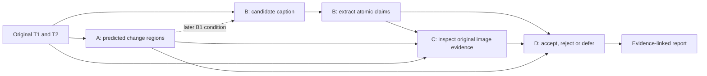

# B execution plan: from image pairs to auditable change descriptions

**26 October 2026 — proposed approach; no datasets or weights downloaded and no model runs performed.**

This implements the starting strategy for [work package B](B_captioning.md), under the [shared protocol](SHARED_PROTOCOL.md) and [data subset policy](../research/02_data_and_subset_protocol.md). Implementation starts after review of this plan. Keep the work inside `POC/`; preserve the submitted report and root application.

## 1. Outcome and central question

Build a reproducible captioning baseline that answers: **What visibly changed between these two images, and how accurately can different models describe it?**

The first comparison is a specialist change-captioning model versus a general multi-image VLM. Evaluate useful factual content, invented details, missed changes and resource cost. Do not assume either family wins.

Deliver two things:

- **Academic:** a fixed dataset manifest, reproducible inference, a paired model comparison, human factual judgments and structured candidate claims for the reliability experiment.
- **Manager demonstration:** a short visual story showing the original pair, contrasting model descriptions, human-audited errors and an aggregate view of quality versus runtime. Potential value is helping analysts interpret change imagery; review-time savings remain a later user-study question.

B produces **candidate descriptions and claims**. It does not verify them or establish that TerraWatch's proposed checker works.

## 2. Dataset decision and access status

The supplied [team Drive folder](https://drive.google.com/drive/u/0/folders/1owJDnk_zr2O7tn6chP4uX4S70PEBb9ta) redirects an unauthenticated request to Google sign-in. The web reader also could not open it. No connected Drive plugin was available when planning. **Its contents, file IDs, archive sizes, completeness and versions are unverified.** The choices below are provisional until the folder inventory is available.

| Dataset | Decision for B | Reason and boundary |
|---|---|---|
| LEVIR-MCI | Preferred primary asset bundle, if present and complete | Original image pairs, change masks and captions support the shared A–D manifest. B0 uses only images at inference. |
| LEVIR-CC | Caption-reference source and image fallback | Designed for change captioning. If MCI already includes the matching `LevirCCcaptions.json`, reuse it after verification; do not download duplicate imagery. |
| LEVIR-CD / LEVIR-CD+, S2Looking, SYSU-CD | Defer for B's first benchmark | Detection supervision alone does not provide paired reference captions. Useful later for explicitly labelled manual transfer audits. |
| SECOND | Defer | Semantic transitions answer a different task; do not substitute its labels for caption truth. |
| ChangeChat instructions | Defer | Instruction/adaptation data require image-provenance checks; derived responses are not independent human caption references. |

The [author dataset source](https://github.com/Chen-Yang-Liu/LEVIR-CC-Dataset) identifies LEVIR-CC's paired images and descriptions. The [Change-Agent source](https://github.com/Chen-Yang-Liu/Change-Agent#levir-mci-dataset) identifies MCI as its extension and documents `A` as earlier, `B` as later, and `label` as change masks. These sources establish intended structure, not the contents of the supplied Drive copy.

**Fallback order:** complete MCI bundle → LEVIR-CC images and caption JSON → metadata-only preparation while access is resolved. Missing masks do not block image-only B0. If neither caption dataset is available, do not silently use a detection dataset and call it a caption benchmark. Public author mirrors are documented alternatives, not assumed substitutes for the requested Drive copy.

### Inventory before image inspection

1. List folder paths, file IDs, bytes, archive types and any source/rights notes. Read archive member lists and caption metadata before bulk extraction where packaging permits.
2. Join earlier/later paths, caption records and official splits by stable pair ID. Attach masks only when actually available. Report duplicates, missing entries and split conflicts.
3. Confirm source/version, caption schema, reference count per pair, image dimensions, T1/T2 ordering and parent-scene mapping where recoverable. Verify image equivalence across CC/MCI before reusing IDs; check hashes of selected assets and record any encoding differences.
4. Freeze the shared subset; inspect only selected images. Keep reference captions, human judgments and masks outside B0's inference inputs. A label is never a model prompt accidentally loaded from a neighbouring directory.
5. Record dataset/checkpoint terms and any restrictions relevant to a manager demonstration; keep source assets local rather than republishing them.

## 3. Fixed small-data protocol

Reuse the proposed Track M allocation; counts are targets, pending actual split and scene audits.

| Role | Target unique pairs | Use |
|---|---:|---|
| Development, from official train | 50 | Pairing/EDA, prompt development, claim-parser development and demo examples. First 10 are the common smoke fixture. |
| Screening, from official validation | 100 | Fair model comparison and finalist selection. Begin factual auditing on the same 10 pairs per model to estimate review effort. |
| Sealed evaluation, from official test | 100 | Frozen finalists only; one final comparison after prompts, settings and annotation rules are locked. |
| Total | 250 | Shared across A–D; captions, crops and model reruns do not add independent pairs. |

Select deterministically, initially with seed 42, respecting official partitions and grouping by parent scene where recoverable. Apply the existing 20% default cap within each split and across the unique-pair union; reduce target counts if necessary. Include all earlier POC image use in the register. Existing policy's 30% ceiling is not an automatic expansion target.

Use representative seeded sampling for headline rates. Check changed/unchanged coverage on development/validation. Additional selected hard cases must be marked diagnostic and remain inside the budget. Do not hand-pick final test cases for coverage after viewing outputs. Report small or absent strata honestly.

Do not inspect test images for the demo before settings are frozen. Use development examples for the narrative, explicitly labelled illustrative; report aggregate held-out results separately. Record specialist checkpoint training exposure; an official test subset does not by itself establish unseen geographic or zero-shot evaluation.

## 4. Models and experiment order

| Order | Candidate | Purpose / execution decision |
|---|---|---|
| 1 | C04: `Qwen/Qwen3-VL-4B-Instruct` | First general multi-image caption adapter. Use publisher processor/chat template, explicitly ordered T1/T2 images and a fixed prompt. Feasibility and accuracy remain unmeasured. |
| 2 | C02: RSCaMa, author checkpoint | Specialist comparison, using its native tokenizer, preprocessing, vocabulary and decoder. Isolate its Linux/CUDA/Mamba environment. |
| 3 | C07: `HuggingFaceTB/SmolVLM2-2.2B-Instruct` | Smaller general-model resource control and fallback if Qwen does not fit. |
| Later | C01 Chg2Cap; C03 MCINet; C05 Gemma; C06 InternVL; C08 TEOChat | Preserve the eight-candidate registry. Screen feasible remaining candidates by the existing priorities after first-wave comparison works; record run/block/defer reasons. They are not required before the first demo. |

The first demo aims for **two working learned captioners**, preferably RSCaMa plus Qwen. If the specialist is blocked, Qwen plus SmolVLM2 is a valid comparison with a narrower question; do not label it specialist-versus-general. Time-box an initial install attempt to the shared 90-minute limit. Do not replace blocked models without changing their recorded identity.

The [RSCaMa author instructions](https://github.com/Chen-Yang-Liu/RSCaMa) require a separate Mamba setup and native evaluation assets. General model integration follows the publisher cards for [Qwen3-VL](https://huggingface.co/Qwen/Qwen3-VL-4B-Instruct) and [SmolVLM2](https://huggingface.co/HuggingFaceTB/SmolVLM2-2.2B-Instruct). Pin successful code/checkpoint revisions during implementation; source availability is not a successful local load.

Use the local machine for metadata preparation and result inspection. Use the existing Colab Pro+ allocation for CUDA inference, measuring the actual assigned device/VRAM first. The current workspace is on macOS; do not assume local WSL or CUDA. Run one model at a time, batch size 1, with isolated environments and persistent cached outputs. No initial fine-tuning or paid API dependency.

### Conditions

- **B0, first deliverable:** original image pair only, with each model's required processor. Preserve the full original images and log effective resolution/tiling. Same pair IDs and task scope; no optional enhancement stack.
- **B1, after A provides predicted regions:** same instruction-capable model and pairs, adding declared uncertain predicted evidence. Compare within model to B0. A specialist without that interface is `unsupported_condition`.
- **B2, optional diagnostic:** oracle regions/masks in a separate run; excluded from deployable performance.

Use B's existing two-sentence prompt for instruction-capable models: describe visible building/road changes, use image-relative locations, avoid unsupported counts and causes, and state insufficient evidence or no relevant change when appropriate. Select output/token limits on development data and freeze before final evaluation. Specialist models retain native generation; do not imply prompt-following or truncate their output into artificial compliance.

The evidence-template control is useful once predicted regions exist, reporting only candidate changed regions and their image-relative positions. It is not an image-only learned model or a semantic building counter.

## 5. Pipeline position and handoff

B0 can run before A, C or D. Its captions remain fixed for later checker comparisons, isolating the effect of verification from regeneration.

Save three linked outputs: raw captions, extracted claims and run records. Each caption retains `pair_id`, `run_id`, model/checkpoint revision, condition, raw text, prompt/settings, completion status and measured generation time. Each claim retains `claim_id`, its originating run/pair, exact `source_span` and source character offsets, and the existing `object`, `action`, `location`, `quantity` fields.

Begin with deterministic extraction plus manual audit. Preserve qualifiers such as “possibly”, negation and approximate quantities in source-linked parser metadata; never turn them into categorical or exact claims. Missing quantities are null. Start `candidate_region_ids` empty when no region is available; prose such as “upper-right” does not establish pixel coordinates. Include explicit no-change assertions in the factual audit. Do not silently correct generated text during extraction.

Use [the existing claim contract](templates/claim_decision.json); leave evidence and decision fields unpopulated until their stages run. Add source-run linkage and parser metadata in B's wrapper record when implementing, without silently breaking the shared schema. Human reference facts and judgments remain in separate evaluation files. Extraction accuracy is checked separately from caption accuracy; a perfect parser can faithfully extract a false claim.

## 6. Evaluation and success criteria

Two reviewers first establish observable in-scope reference facts from originals without model outputs. Then assess anonymised captions/claims, preserving initial disagreements and adjudication. Begin with 10 common validation pairs per model; expand after measuring annotation effort, aiming for the 100-pair held-out comparison of finalists.

| Measure | Question it answers |
|---|---|
| Supported-claim precision | What fraction of all emitted factual claims do the images support? Keep unsupported, contradicted and unverifiable claims in the strict denominator. |
| Reference-fact recall | How much observable relevant change does the description cover? Use adjudicated facts; reference captions can omit visible changes. |
| Error breakdown | Are errors in object type, added/removed direction, location, quantity, or false change? Retain unsupported versus contradicted versus unverifiable labels. |
| No-change false-alarm rate | On human-audited unchanged pairs, how often does a caption assert relevant change? |
| BLEU-4, METEOR, ROUGE-L, CIDEr-D | How closely does wording match references under one pinned scoring/tokenisation recipe using all available references? Supplementary measures. |
| Median/p95 runtime, peak VRAM, completion rate | What does each configuration cost to run on the measured hardware? Separate model load, generation, extraction and Drive I/O. |

Report raw counts, emitted claims per pair and pair/scene-grouped uncertainty. Zero-claim precision is undefined; useful coverage and factual recall must remain visible. Keep all output variants of a pair together when resampling. Never interpret verbal model confidence as calibrated correctness.

**B is ready for the first demo when:** data joins and split checks pass; two captioners complete the same 10-pair smoke fixture with saved provenance; validation screening and factual audit support a documented two-model shortlist; structured claims pass manual extraction checks; and illustrative successes and failures can be replayed. This is a feasibility demo, not a final benchmark claim.

**B is ready for the academic handoff when:** frozen finalists complete the sealed comparison, with metrics, uncertainty, failures and captions/claims joined by stable IDs. A tie or negative result remains useful. Do not promise a quality percentage or latency target before measurement.

## 7. Demonstration narrative

Working title: **“Two images, two AI descriptions: which details survive inspection?”**

1. Show an obvious development image pair and let the viewer inspect the change.
2. Reveal anonymised specialist/general captions on the same pair.
3. Highlight factual spans: object, direction, location and any claimed quantity. Show reviewer judgments labelled **human audit**, not automated verification.
4. Repeat with an unchanged pair and an ambiguous/small-change case, if available within the development set. Include a real model failure; label any injected example separately.
5. Show supported-claim precision versus reference-fact recall, with measured latency alongside. State sample size and selection limits. Use validation results until the sealed experiment is complete and label them accordingly.
6. Explain the next research step: C/D will test whether automated reinspection can improve those candidate reports at comparable useful coverage.

A simple local results viewer with original images, caption comparison and an audit table is enough for the first demo. Use cached real outputs for a reliable walkthrough and label playback; measure fresh inference separately. Viewer construction is an implementation step after this plan.

## 8. Implementation checkpoints after plan review

| Checkpoint | Concrete output / exit condition |
|---|---|
| 1. Resolve source access and inventory | Team folder listing and dataset decision confirmed; source IDs, versions, archive paths and missing assets recorded. |
| 2. Audit and freeze data | One hashed subset manifest, reference-only mapping, exclusion report and shared usage register; selected pairs only. |
| 3. First working caption | Colab environment record and Qwen output on one development pair, then the 10-pair fixture; valid ordered images and saved raw output. |
| 4. Fair first-wave comparison | Specialist plus general model on identical validation IDs; Smol fallback/resource control; errors and resource records retained. |
| 5. Claims and human audit | Audited extraction, common validation review, shortlist and C/D-compatible cached handoff. |
| 6. Story and frozen evaluation | Development walkthrough; final settings frozen; sealed finalist report when ready. |

Planned tracked artifacts: preparation/inference/evaluation scripts, pinned per-model environment recipes, small configuration files, manifest metadata and demo narrative. Keep images, weights, caches, per-pair captions/claims and generated reports under the existing ignored `POC/benchmarks/data/`, `weights/`, `cache/` and `runs/` directories. Do not commit, publish or submit as part of this planning step.

**Immediate dependency:** authenticated access to the supplied folder, or a folder/file inventory supplied through another authorised route. This blocks confirming assets from that folder, not reviewing the approach above.
