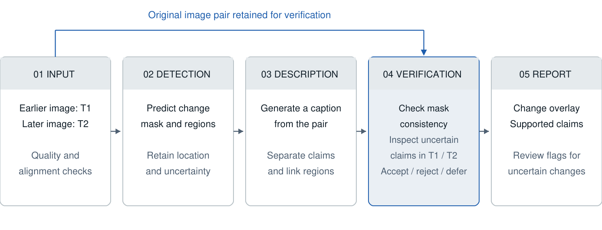

# TerraWatch: Team Handbook and Defence Guide

**Group 7 | IIT Madras DS & AI Lab | Updated 26 October 2026**

**Internal working reference. Do not submit this handbook as the Milestone 1 report.**

## 1. Start Here: Brief, Status and Reading Map

**Thirty-second explanation.** TerraWatch compares two images of the same place, locates visible building and road changes, and describes them in ordinary language. Its research focus is checking whether those descriptions are supported by the images. When evidence is insufficient, the system should flag uncertainty rather than supply a confident explanation.

**Central question.** Does targeted reinspection of the original pair reduce incorrect claims compared with mask-only checking, without omitting more relevant changes?

| Status | What the reviewed repository establishes |
|---|---|
| Completed documentation | Revised M1 report, research comparison, proposed architecture, work packages, source metadata and output templates |
| Source-checked candidates | Published code/model pages and checkpoint inventories; revisions recorded in the benchmark audit |
| Not established by these artifacts | Successful candidate-model runs, trained TerraWatch weights, benchmark gains, calibrated decisions or operational usefulness |
| Team-confirmed resources | Colab Pro+ and WSL/CLI access; actual GPU allocation and remote automation require session checks |

This handbook does not establish whether teammates have done additional work outside the recorded repository. Update run records before making progress claims. A public checkpoint listing is not a successful local run.

### Reading map

- **2–4:** terminology, the pipeline, contribution and prior art.
- **5–6:** data, label compatibility, split integrity, preprocessing and robustness.
- **7–9:** detectors, caption/inspection models, decision models and calibration.
- **10–13:** metrics with examples, comparisons, human review and custom-score development.
- **14–15:** ownership, compute, execution, reproducibility and demonstration.
- **16–17:** defence answers, milestone checklist and sources.

**Reading rule:** distinguish observation, prediction and independently reviewed reference. A mask, a VLM observation and a decision score are all fallible predictions. Human reference judgments evaluate them; they must not become hidden inference inputs.

The concise report preserves the original project approach. This handbook supplies the implementation and evaluation detail removed during editing, including internal POC limits. It is a preparation and execution reference, not evidence that those experiments have already succeeded.

<!-- PAGEBREAK -->

## 2. Problem, Scope and Vocabulary

The primary users are building/estate officers reviewing possible changes. Planners and researchers are secondary users. The intended benefit is clearer, better-prioritised review; reduced workload is unmeasured and would require a separate user study.

| Term | Meaning here |
|---|---|
| T1 / T2 | Earlier / later observation of the same area; preserve order |
| Co-registration | Aligning observations into a common spatial frame |
| Binary change | Changed versus unchanged pixels within a defined label scope |
| Semantic change | Object classes or transitions, such as ground to building; needs corresponding labels |
| Change captioning | Describing differences between an image pair |
| Claim | One checkable statement about an object, action, location or quantity |
| Grounding | Linking text to visual evidence; not guaranteed truth |
| Visual witness / inspector | Model examining original images/crops and returning observations |
| Decision policy | Rules/model accepting, rejecting or deferring a claim |
| GSD / CRS | Ground sampling distance / coordinate reference system |

### Worked claim example

“Three new buildings appeared in the upper-right” asserts a class, addition direction, exact count and location. A building-change mask may support only a candidate region. Each additional assertion needs evidence.

Touching roofs can merge into one component; one roof can fragment into several. If T1 is obscured, apparent addition may be a visibility difference. A safer description can identify a candidate change and state that its count is uncertain, but the building category itself still needs support.

### Boundaries to defend

- **Visible change is not illegality:** ownership and authorisation require external records and human review.
- **Two dates are not a trajectory:** they do not establish the exact event date, intervening sequence or cause.
- **Image-relative is not geographic:** upper-right is not northeast without orientation information.
- **Scale matters:** resizing coarse imagery cannot restore roof detail absent in the sensor observation.
- **Labels have scope:** no labelled building change does not mean nothing changed.

Groundwork, removal and road claims remain in scope only where observable and supported by the task's labels or explicit human references. Geographic measurements require suitable spatial metadata; dimensions alone do not establish metres per pixel.

<!-- PAGEBREAK -->

## 3. Pipeline and Interface Contracts



*Figure 1. Verification receives original imagery, rather than relying exclusively on the detector's mask.*

| Stage | Input / output | Main error to inspect |
|---|---|---|
| Input checks | Pair and metadata; quality flags, transforms, valid overlap | Wrong pairing, reversed dates, misalignment |
| Perception | RGB tensors per date; probabilities/labels and regions | Missed change, shadows, wrong boundaries |
| Description | Pair and declared evidence; caption and claim spans | Wrong object, count, direction or location |
| Inspection | Matched T1/T2 crops plus scene context; observations | Occlusion, lost context, correlated errors |
| Decision/report | Claims and evidence; accept/reject/defer, reasons, links | Blind agreement, excessive rejection, unsupported confidence |

Use `[B,3,H,W]` per RGB image with model-specific processing. Join outputs by pair, region and claim IDs. Coordinates use original T1 pixels and boxes `[x0,y0,x1,y1)`; preserve explicit T2 transforms and valid overlap.

### Minimum evidence record

Retain the original caption, exact claim span, region IDs, mask ontology, crop paths, transforms, witness output, decision outcome and reasons. Record raw responses, model/prompt versions and run IDs. Unknown dates, GSD/CRS, exact counts and probabilities remain null.

**Accept** means support under the configured checker, not certified truth. **Reject** means conflict under the declared evidence rule. **Defer** means insufficient evidence or unresolved disagreement. Human annotation uses a separate label scheme in Section 12.

Reference captions, oracle masks and human correctness labels must stay outside normal inference. Oracle conditions are valuable diagnostics only when explicitly separated. The interface should preserve uncertain inputs rather than silently turning unknown metadata or missing supervision into a confident claim.

<!-- PAGEBREAK -->

## 4. Contribution, Prior Art and the TA's Concern

**Defensible statement:** “We test whether targeted inspection of the original images improves claim decisions when predicted change evidence is imperfect, compared with mask consistency and a direct visual judge.”

Modularity enables controlled substitutions, but is not itself novel. Mask conditioning, interactive questions, visual grounding and factual evaluation already have precedents. The report does not claim that previous systems lack all checking.

| Prior work | Established capability | Our comparison must address |
|---|---|---|
| Change-Agent | Joint detection/caption perception and agent tools | Checking under faulty predicted evidence |
| ChangeChat | Interactive descriptions, quantities and localisation | Explicit claim decisions versus generated answers |
| CCExpert / KCFI | Change-sensitive features guide language | Additional checking after generation |
| FMScore | Fact-oriented description evaluation | Reference-fact scoring versus inference-time inspection |
| Spot-the-shift | Grounded change units and no-change tests | Relevant evaluation principles in another image domain |
| TerraScope | Pixel-grounded EO reasoning | Value beyond adding grounding alone |

The main report contains the analytical literature matrix and primary references. These studies motivate the hypothesis; they do not establish that our exact policy is unprecedented. Full method/code comparison remains necessary before stronger novelty claims.

### What makes this more than assembly?

1. Specify the trigger, inspection budget and decision rule reproducibly.
2. Compare with mask rules, image-observation rules and a direct visual judge.
3. Hold detector output and candidate captions fixed for the checker contrast.
4. Include natural detector errors; report injected errors separately.
5. Demonstrate factual benefit at comparable useful coverage and cost.

Compare full, targeted and random inspection at matched budgets; otherwise a gain might simply reflect more inference. A disagreement-only trigger can miss confident shared errors. Add quality/uncertainty triggers, audit untriggered claims and measure missed-trigger errors.

Different models may share training data or visual biases. Agreement is corroboration, not independent proof. If the policy does not help, report the failure modes and describe the contribution as an empirical study or adaptation rather than a proven new architecture.

<!-- PAGEBREAK -->

## 5. Data Portfolio, Labels and Leakage

Start with LEVIR-MCI for aligned masks and captions. The nine-release portfolio does not represent nine independent image populations: several LEVIR variants and instruction derivatives share imagery.

| Sources | Intended use | Compatibility issue |
|---|---|---|
| LEVIR-MCI / LEVIR-CC | Core image-pair evidence and captions | Shared imagery; not independent transfer |
| LEVIR-CD / CD+ / S2Looking | Building detection and challenging views | Scene overlap and checkpoint exposure |
| SYSU-CD | Broader change / transfer | Labels extend beyond buildings |
| SECOND | Semantic transitions | Different classes; optional task head |
| ChangeChat-105k | Optional instruction adaptation | Trace instructions to underlying pairs |
| OSCD | Coarser multispectral extension | Separate modality and scale |

Audit T1/T2/label/caption joins, missing/corrupt files, ordering, mask values/ignore labels, dimensions, scene IDs and terms. Code licences do not automatically license imagery or weights. Missing task labels are excluded from that loss, not treated as negatives.

**Track M:** primary MCI pipeline. Proposed allocation: 50 train/development pairs, 100 validation-screen pairs and 100 sealed test pairs; the 10 smoke pairs come from development. These 250 IDs are not established as selected. Confirm official partitions, scene grouping and subset ceilings first; reduce counts if necessary.

**Track D:** separate LEVIR-CD detector comparison, preserving official splits and selected fractions. Do not combine its scores with caption results. Building-only detectors on MCI require an audited building-label projection rather than evaluation against all road/vegetation changes.

### Why separation matters in an academic project

A training crop reappearing through another release can inflate evaluation. Hashes catch exact duplicates but not every adjacent crop. Check parent/geographic overlap where recoverable; keep all captions/instructions of a pair together. Preserve official protocols and label any separate spatial diagnostic clearly.

Record known and unknown pretrained exposure. Inference without our fine-tuning does not prove unfamiliar geography. Reserve a compatible unseen domain only after overlap/ontology checks.

**Internal POC rule:** default 20%, maximum 30% of unique pairs per selected source, cumulatively across training, inspection, prompting, annotation and evaluation. All members reuse the central manifest instead of drawing fresh subsets. This operational rule still applies although it was removed from the submission report.

<!-- PAGEBREAK -->

## 6. Preprocessing and Robustness

Preprocessing should satisfy input contracts and reduce measured nuisance variation. It cannot guarantee that unrelated sensors become compatible or recover spatial detail absent in the original observations.

| Condition | Test | Main risk / control |
|---|---|---|
| P00: required processing only | Native normalisation and paired tiling/padding | Mandatory baseline |
| P01: shared percentile scaling | Pair-level contrast rule | Clipping meaningful information |
| P02: luminance CLAHE | Local contrast adjustment | Amplifying noise or changing evidence |
| P03: histogram matching | Radiometric diagnostic | Removing genuine surface differences |
| P04: bounded ECC | Small translation/euclidean registration | Aligning away real changes; weak convergence |
| P05: ORB + robust affine fit | Feature-based registration | Unstable matches and excessive deformation |

Test one switch at a time with a frozen detector. Carry useful settings to a finalist witness later. Preserve originals/transforms and reject unreliable alignment rather than silently applying it everywhere.

### Geometry and resolution

Synchronise ordinary spatial augmentation across both images and labels. A deliberately one-date shift is a separate test. Evaluate in one coordinate frame with valid overlap and nearest-neighbour interpolation for discrete masks. Photometric operations must not change label values.

GSD is physical pixel size, not pixel count. Resizing a 10 m observation cannot create 0.5 m roofs. Geographic area needs an appropriate transform/units and projected or geodesic handling as applicable; nominal dataset resolution does not establish exact per-image georeferencing.

### Robustness tests

Start with brightness/contrast, blur/JPEG and small shifts at validation-selected severities. Report clean scores, corrupted scores and each drop. A smaller drop is not useful if clean quality became much worse.

Synthetic brightness is not seasonal robustness; synthetic translation is not all viewpoint variation. Real cloud, season and view-angle claims need suitable held-out observations and quality labels or an exclusion policy. Do not pool these with artificial-corruption results.

Double building edges suggest registration issues. Widespread colour differences may be radiometric. Missing small structures can follow aggressive resizing. High overall accuracy with missed changes can indicate class imbalance. Inspect examples before deciding that a visually improved image is a better model input.

<!-- PAGEBREAK -->

## 7. Detector Models, Losses and Learning

Sarthak owns the manifest and detection. Start FC-EF, BIT-R18 and ChangeFormer-B0 plus absdiff/Otsu; expand after the shared evaluator works.

| IDs | Model pool | Reason / source status |
|---|---|---|
| D01–D03 | FC-EF, FC-Siam-conc, FC-Siam-diff | Simple fusion comparisons; Open-CD files listed |
| D04–D05 | SNUNet-CD C16, STANet-PAM | Nested/attention CNNs; files listed |
| D06–D08 | BIT-R18, ChangeFormer-B0, Changer-Ex R18 | Context/feature-interaction comparisons; files listed |
| D09 | MambaBCD-Tiny | State-space challenger; author task-weight links |

Work package A records the eight matched Open-CD configs/checkpoints. Match recipes and pin source revisions. Encoder-pretraining weights are not a full trained detector. Mamba and Open-CD dependencies need isolated compatible environments.

### Architecture basics

**Early fusion** combines image inputs before the encoder. **Siamese fusion** encodes dates, often with shared weights, then compares features. Concatenation retains both feature sets; differencing highlights discrepancies. Transformers model context; state-space designs offer another feature-processing family. Names alone do not prove superiority.

### Training choices to understand

For binary labels, BCEWithLogitsLoss combines sigmoid-based binary classification with stable logit handling. Do not apply an extra sigmoid before this loss. Respect ignore masks. Dice encourages region overlap; focal loss is an alternative for reducing easy-example influence. These are candidates to compare, not three losses that must always be stacked.

One binary soft Dice loss is `1 - (2*sum(p*g)+eps)/(sum(p)+sum(g)+eps)`, with probability p and label g. State reduction, smoothing and empty-label conventions. Multi-class tasks need compatible heads/losses; do not arbitrarily collapse semantic labels. Measure actual class proportions rather than claiming every dataset is 99% background.

Record optimiser, learning rate, batch, seed, augmentations and selection rule. Change one axis at a time. A short pilot checks gradients, loss behaviour, memory and runtime; it does not establish convergence.

**POC caps:** at most two compact configurations, initially seed 42; stop at 500 optimiser steps, two epochs or 45 minutes per run, whichever occurs first. Later repeated seeds and full-project training need a focused budget. Separate scratch/subset-trained results from full-source pretrained inference; their training exposures are unequal.

<!-- PAGEBREAK -->

## 8. Captions, Claim Extraction and Visual Witnesses

Sujal owns descriptions/claims; Priyanshu owns visual inspection and preprocessing. Reusing a checkpoint across roles does not create independent evidence.

| Caption IDs | Model pool | Initial priority |
|---|---|---|
| C01–C03 | Chg2Cap; RSCaMa; MCINet from Change-Agent | RSCaMa first; specialist controls follow |
| C04–C07 | Qwen3-VL-4B; Gemma-3-4B; InternVL3.5-4B; SmolVLM2-2.2B | Qwen3-VL and SmolVLM2 first |
| C08 | TEOChat | Optional temporal EO comparator |

**Inspector pool:** W01 Qwen2.5-VL-3B; W02 Qwen3-VL-4B; W03 Gemma-3-4B; W04 InternVL3.5-4B; W05 SmolVLM2-2.2B; W06 MiniCPM-V-4.5. Start W01/W04; W06 is larger and optional.

Access statements are dated audit findings: publisher weight inventories exist for the listed VLMs and RSCaMa/MCINet/TEOChat; Chg2Cap has an author Drive link; Gemma is gated. ChangeChat's official weight section was coming soon. CCExpert's author Baidu links are reserve options, not verified local installations.

### Control the evidence condition

The image-only baseline receives T1/T2 and no mask. Evidence-conditioned generation receives only declared predicted evidence. A specialist without that interface is unsupported for that condition, not a model that simply ignored evidence. Preserve its native decoder/tokenizer contract.

Request visible changes, image-relative location and uncertainty; avoid causes, legality or unsupported exact counts. Use comparable output budgets where supported, but do not truncate specialist sentences arbitrarily. Save raw responses before parsing.

Extract claims without inventing information. Retain source spans and distinguish parser errors from caption/checker errors. A manual/rule extraction baseline is useful before benchmarking a further parser. References can omit true events, so literal caption matching is not a complete truth judgment.

### Inspection procedure

Use corresponding T1/T2 crops with shared coordinates/padding and full-scene context. Explicitly label order. Crop-only inspection can lose the evidence of occlusion or neighbouring objects. Compare it with full-image inspection under controlled budgets.

Ask the witness for visibility, type, action, location/count uncertainty and evidence, rather than another persuasive version of the claim. Shared frozen weights are practical initially; a different-family witness is an ablation, not proof of independent errors.

LoRA freezes base weights and learns small low-rank updates. It still needs memory, suitable data and validation. Use at most one selected adapter pilot, capped at 200 steps or 30 minutes after a fit check; do not pretrain every captioner during the POC.

<!-- PAGEBREAK -->

## 9. Decision Models and Calibration

Shoaib owns decisions and integration. Native decision models score supplied choices; general VLMs can also be judges. Neither design automatically establishes image truth.

| ID | Candidate | Important qualification |
|---|---|---|
| J01 | d3-mini, 4B class | Model-specific bounded readout/runner |
| J02 | Kev-4B | Text-only base + adapter + pointer head |
| J03 | Clef-flash, 9B | Multimodal; verify endpoint and precision |
| J04 | Clef, 27B | Larger optional candidate; memory/access gate |
| J05 | Qwen3-4B-Instruct-2507 | Text-only structured-judge control |
| J06–J07 | Qwen3-VL-4B; InternVL3.5-4B | Direct visual judges; shared checkpoints |
| J08 | Jev release family | Optional hosted comparator; cost/access unresolved; checked image support experimental |

**Common-evidence comparison:** every candidate gets the same textual observations and claim/mask summary. **Image-backed comparison:** compatible candidates additionally get images. A multimodal gain over a text-only judge can be an information advantage, not merely a better decision architecture.

### Scores, confidence and probabilities

A detector score is not a verified event probability. A decision probability ranks supplied options under its model. A confidence/concentration field or generated “90% sure” is not automatically a 90% correctness probability.

Calibration asks whether predictions grouped near probability p are correct approximately p of the time. Use validation reliability plots and a proper scoring rule where actual probabilities exist. For binary y and probability p, Brier loss is mean `(p-y)^2`; a positive example with p=0.8 contributes 0.04. One example does not demonstrate calibration. ECE depends on bins/sample size and is supplementary.

Choose acceptance thresholds from validation risk/coverage tradeoffs, not a presumed universal 0.5 cutoff. Preserve insufficient evidence as defer rather than calling it false. Test answer-order and wording sensitivity and pin the served version/runtime digest.

Implement no-check, mask-rule and image-observation-rule controls first. Retain a learned policy only if it improves quality/cost against rules and a direct judge. Probe the installed local decision API; do not assume that `generate()` implements a specialised readout or switch silently to paid cloud service.

<!-- PAGEBREAK -->

## 10. Metrics with Worked Examples

### Changed-pixel measures

| Measure | Formula | Interpretation |
|---|---|---|
| Precision | TP / (TP + FP) | Fraction of predicted changed pixels that are labelled changed |
| Recall | TP / (TP + FN) | Fraction of labelled change found |
| F1 | 2TP / (2TP + FP + FN) | Precision/recall balance |
| IoU | TP / (TP + FP + FN) | Predicted/reference change overlap |

**Illustration, not a result:** TP=80, FP=20, FN=40 gives precision 0.80, recall 0.667, F1 0.727 and IoU 0.571. An all-unchanged predictor can have high overall accuracy while missing every relevant change.

Use valid pixels and a stated ontology. Distinguish micro pixel aggregation from macro pair/scene averages. Define zero-denominator handling. When both masks are empty, state the IoU convention and report no-change performance separately. mIoU needs a class list and background policy.

### Descriptions: truth and information retained

**Strict supported-claim precision:** supported emitted factual claims / all emitted factual claims. Unsupported, contradicted and unverifiable claims remain in the denominator. **Reference-fact recall:** unique supported reference facts conveyed / adjudicated in-scope observable reference facts. Deduplicate repeated wording.

**Illustration:** 10 emitted claims contain 8 supported claims conveying 8 of 12 reference facts: precision 0.80, recall 0.667. Removing only the two false claims gives precision 1.00 with unchanged recall. Keeping just one true claim also gives precision 1.00, but recall falls to 0.083; that is not useful reliability.

An optional harmonic summary `2PR/(P+R)` requires aligned claim/fact matching rules; always show P/R separately. An empty report on a changed pair has zero recall and undefined precision, not perfect reliability. On unchanged pairs report false-change rate and correct no-change behaviour separately.

### Other required distinctions

Report contradictions, unverifiable claims, missed facts, claim retention, mean emitted claims and report coverage. Region-count MAE concerns connected regions under a fixed rule; building-count MAE requires validated instances. BLEU/METEOR/ROUGE/CIDEr measure caption similarity using a pinned recipe; they do not establish factual truth.

Report cold load, warm median/p95 latency and peak memory on stated hardware. Cached comparisons are not fresh pipeline timing. Do not invent probabilities for calibration when only labels or prose are available.

<!-- PAGEBREAK -->

## 11. Experiments and Definition of Success

The report's simple success statements require controlled evidence rather than arbitrary numerical promises.

| Objective | Evidence to produce |
|---|---|
| O1: detection | Fair F1/IoU comparison on identical labelled data; small-object/no-change failures |
| O2: robustness | Smaller loss under declared variations without unacceptable clean-score loss; fix tolerance on validation |
| O3: descriptions | Fewer false claims at comparable useful coverage, without hidden loss of reference-fact recall |
| O4: practicality | Repeatable demo, measured resources and explicit quality/cost tradeoff |

### Five settings

1. Image-only caption.
2. Predicted-evidence-conditioned caption.
3. Same candidate caption plus mask consistency.
4. Same candidate caption plus direct original-image judgment.
5. Targeted reinspection plus accept/reject/defer policy.

For settings 3–5 freeze detector outputs and captions. Compare rules/learned judges on identical evidence, and full/targeted/random inspection at similar budgets. Changing the detector, captioner and checker together cannot isolate the checking effect.

Use a separate oracle-mask diagnostic and separate manual/oracle crops from predicted-region tests. Include natural detector failures, unchanged pairs and ambiguity. Injected count/type/action/location errors test sensitivity; their prevalence does not estimate deployment error rates.

### Selection and uncertainty

Screen on validation and retain at most two candidates per role. Freeze prompts, thresholds, processing, matching rules and the primary contrast before opening sealed results. Repeated test inspection is test reuse.

Report paired effects and intervals, ideally resampling independent parent scenes. Otherwise resample pairs and state the spatial-dependence limitation. Keep each pair's claims/captions together. An interval spanning zero is inconclusive, not proof of equality; a positive interval supports the particular declared endpoint/design, not universal superiority.

Choose one primary contrast rather than searching for whichever result wins. Report per-domain outcomes and failure counts. A pilot estimates feasibility/variance, not guaranteed power or geographic generalisation.

All-defer fails the usefulness test. If no benefit appears, retain a simpler baseline and report negative findings. The project can contribute a careful empirical result without inventing a new architecture or claiming success on every objective.

<!-- PAGEBREAK -->

## 12. Human Review and Annotation

The report proposes at least 100 test pairs with two reviewers. Use a development pilot to estimate time, error prevalence and needed sample size. If inadequate for the intended claim, revise the plan before final testing and document why.

### Procedure

1. Establish observable reference facts from original images and labels without predictions.
2. Judge anonymised outputs in random order, without model/treatment identities.
3. Split statements into claims and connect judgments to evidence or visibility limits.
4. Save both independent labels, disagreements and adjudication separately.
5. Resolve difficult cases with another member and report agreement with label counts.

| Human label | Rule | Example |
|---|---|---|
| Supported | Visible evidence supports the claim | Distinguishable new roof in T2, absent from a clearly visible T1 location |
| Contradicted | Evidence shows the claim is wrong | A clearly visible change is placed on the opposite side |
| Unsupported | Adequate evidence exists but support is absent | An asserted road change is absent in a clearly visible area |
| Unverifiable | Evidence is insufficient or ambiguous | Exact count where roofs merge or T1 is obscured |

If absence cannot be established reliably, use unverifiable instead of inventing a contradiction. Refine the rubric on development examples before blind review. A reference caption is not exhaustive; allow true paraphrases and observable events omitted from it.

Record pair/output/claim/rater IDs, source span, object/action/location/count correctness, judgment, evidence region, ambiguity and missed-reference IDs. Machine decisions use accept/reject/defer; any mapping to human labels must be stated rather than assumed.

Cohen's kappa adjusts agreement using marginal label frequencies; rare classes can make it unstable. Show raw agreement, confusion counts and disagreement examples too. Agreement does not establish that the reference inventory is complete.

Creating reference facts and judging generated claims are separate tasks. Predicted masks cannot define their own truth. Rotate batches across all members; the integration owner must not be sole producer and evaluator of the claimed improvement.

<!-- PAGEBREAK -->

## 13. Custom Pipeline Score: Proposed, Not Validated

A useful pipeline score should expose correct wording attached to a wrong region and accurate masks paired with misleading text. It should not let one strong component hide another's failure.

**Status:** no formula, thresholds, weights or improvement is validated. Component metrics remain primary.

### Development path

1. Define an event: object/type, action, location and evidence region, with unknown fields allowed.
2. Match predicted/reference events one-to-one using declared spatial/semantic rules.
3. Consider grounded-event precision/recall/F1 with localisation required for a match. This is a candidate, not an established TerraWatch measure.
4. Penalise duplicate/wrong/false/missed events; specify no-change and deferral behaviour.
5. Report robustness per domain/corruption; aggregate only when annotations/sample support justify it.
6. Validate rankings against blinded human preferences on development data, then freeze before test.

| Stress case | Expected diagnostic behaviour |
|---|---|
| Empty caption | Poor coverage, not perfect reliability |
| Repeated true sentence | No repeated recall credit |
| Right object, wrong region | Spatial grounding failure |
| Right region, wrong action | Direction/semantic failure |
| Invented count or cause | Unsupported claim penalty |
| Useful deferral | Visible risk/coverage tradeoff, not blanket reward |

A weighted average can allow fluency to compensate for bad detection. A product can double-count correlated errors or collapse under legitimate abstention. Not every dataset labels every dimension. Do not fill missing labels with zeros or tune weights to make the proposed system win.

**Defence answer:** “We plan to develop and validate a task-level measure. Current success claims use detection performance and independently reviewed factual correctness/coverage. The custom score remains supplementary until its behaviour and human alignment are demonstrated.”

Keep its definitions, matching examples and sensitivity checks with the implementation. A useful benchmark contribution needs demonstrated insight beyond repackaging several conventional numbers.

<!-- PAGEBREAK -->

## 14. Ownership, Compute and First Runs

| Owner | Deliverable | Start with |
|---|---|---|
| Sarthak | Manifest, nine detector candidates, pixel evaluator | FC-EF, BIT-R18, ChangeFormer-B0; Otsu |
| Sujal | Eight caption candidates, claim spans, caption evaluator | RSCaMa, Qwen3-VL, SmolVLM2; template |
| Priyanshu | Six inspectors and six input comparisons | Qwen2.5-VL, InternVL; P00 input |
| Shoaib | Eight decision/judge candidates, contracts, calibration, integration | Qwen3 text, d3-mini; rules/no-check |

The registry has 31 role entries and 25 distinct model identities. Shared checkpoints are explicit; different quantisations are configurations, not independent families. All members help annotate and understand upstream/downstream interfaces.

**Order:** shared IDs/ontology/contracts → same 10 smoke pairs → validation screen → at most two finalists per role → one integrated chain → controlled checking tests → sealed evaluation.

B can start with images; C with manual development crops; D with a hand-checked development bundle. These fixtures are diagnostics, not final results. Avoid a full 9×8×6×8 search; cache frozen outputs and time-box initial install troubleshooting to 90 minutes per candidate.

### Colab and WSL

Pro+ does not guarantee an A100, identical devices, four concurrent sessions or permanent storage. WSL does not inherit a Colab GPU. Probe actual hardware and isolate Open-CD, Mamba/specialist, VLM and decision environments.

```powershell
cd POC/benchmarks
python scripts/probe_environment.py --output runs/environment.json
```

For scheduling, begin with compact models. A 2–4B model may fit a 16GB-class session with bounded inputs, but must be measured. Larger 8–9B/27B candidates need more memory or a separately logged supported quantisation route. Weights alone are not total memory: image tokens, KV cache and runtime buffers matter. Use FP16/BF16 supported by the actual GPU.

Copy the selected working set to session-local disk for timing; incrementally save outputs/configs/checkpoints to durable authorised storage. Do not mix Drive transfer with inference timing. Existing subscriptions do not authorise new top-ups or paid API requests.

M2 on October 29 needs data evidence; M3 on November 5 needs real end-to-end outputs. Those take priority over finishing every optional model. Keep the internal subset and short-training caps in force.

<!-- PAGEBREAK -->

## 15. Reproducibility, Demo and Troubleshooting

Record model/role ID, source/checkpoint revision/hash, known training exposure, manifest/split, processor/crops, precision, prompt/decoding, seed, environment, timing/memory, status, raw outputs and parse failures. Null means unavailable, not zero.

Cache keys need input hashes, checkpoint, processor, prompt and evidence condition; otherwise stale results can enter comparisons. Keep references outside inference paths. Pin assets/environments without committing bulky imagery, weights or credentials. Git history preserves earlier report revisions.

### Demonstration contract

Show T1/T2, predicted overlay, concise description, deferred claims and evidence links. Clearly label precomputed samples and fresh inference. Do not invent geographic coordinates, counts or legal status. Save machine-readable JSON alongside the readable view and keep core inference separate from the UI.

Measure cold load versus warm latency; synchronise GPU timing and state device/batch. Cached checking is not fresh end-to-end timing. Report failures/timeouts, common-valid sample counts and overall completion, rather than silently dropping failed outputs.

| Failure | First response |
|---|---|
| Out of GPU memory | Reduce image/context/batch budgets or resident models; log any supported precision/offload change |
| MMCV/Open-CD import errors | Check matched Python/PyTorch/CUDA/toolbox versions in its own environment |
| Mamba build fails | Check CUDA extension/toolchain; time-box and defer if unresolved |
| Empty/inverted masks | Inspect label values, logits/threshold, ordering and resize mapping |
| Addition/removal reversed | Check T1/T2 order, prompt labels and visibility |
| Checker accepts everything | Check leaked evidence, prompt bias, threshold and agreement with wrong masks |
| Checker rejects everything | Inspect coverage/recall, default decisions and malformed observations |
| High score, implausible images | Audit split overlap, ontology, denominators and cache keys |

Before a review, run a changed pair, an unchanged pair and an ambiguous pair; verify setup instructions and one full failure explanation. Keep a permitted offline example/backup clearly labelled. A polished UI is not evidence of model quality.

For subsequent deployment, package the selected model versions, data instructions, sample assets allowed for redistribution, model/data cards and reproduction commands. Do not promote unmeasured capabilities into the public feature list.

<!-- PAGEBREAK -->

## 16. Defence Questions and Milestone Readiness

| Question | Answer to practise |
|---|---|
| What is the problem? | A localised account of visible urban change whose claims can be checked against imagery. |
| Where is the contribution? | Targeted reinspection/decisions under faulty predicted evidence; novelty and benefit remain to be demonstrated. |
| Why not just a large VLM? | It is a necessary baseline; extra stages must justify their quality/cost. |
| Why multiple models? | Different roles need different outputs/supervision. More components are useful only if comparisons support them. |
| Why not trust the mask? | It can be wrong; agreement alone cannot independently verify a sentence. |
| Can you count buildings? | Only with adequate instance evidence; connected regions are not verified structures. |
| How is reliability measured? | Fewer false claims at comparable useful coverage, independently reviewed on fixed pairs. |
| What if precision rises but recall falls? | Show both; withholding useful changes can create artificial gains. |
| Why care about split leakage? | Shared scenes/derived data can overstate generalisation. |
| Will nine datasets guarantee robustness? | No; audit modality, labels and overlap, then test a compatible unseen domain. |
| Are decision models hallucination-free? | No; bounded choices can still be wrong. Validate evidence, calibration and wording stability. |
| What if no improvement appears? | Report effects/failures honestly, keep a simpler baseline and qualify the contribution. |

### Milestone evidence

- **M2, Oct 29:** sources/terms, labels, duplicate/scene audit, split manifest and paired examples.
- **M3, Nov 5:** architecture rationale, tensor/report interfaces, losses/metrics and real subset outputs.
- **M4, Nov 19:** training configurations, controlled changes, curves, checkpoints and limitations.
- **M5, Nov 26:** frozen quantitative/qualitative comparisons, human audit and failures.
- **M6, Dec 10:** repeatable demonstration, setup instructions and final documentation.

Each member should explain their artifacts and one adjacent interface. Bring logs and examples, not only slides. Recheck the course space for changed deadlines/review rules. Apply the TA's resubmission policy to the actual relevant message, not relative dates copied into an old transcript.

<!-- PAGEBREAK -->

## 17. Source Documents and Further Reading

This handbook follows the polished report and benchmark plan as recorded on 26 October 2026. It is not an exhaustive survey or completed experiment report. Recheck dated access statements before execution.

### Team source of truth

- `POC/milestone1_v2/Milestone1_Report.md` and generated PDF: concise submission.
- `POC/benchmarks/A_detection.md`, `B_captioning.md`, `C_visual_evidence.md`, `D_decisions.md`: detailed work packages and exact model IDs.
- `POC/benchmarks/SHARED_PROTOCOL.md`: tracks, run budgets, controlled comparisons and annotation.
- `POC/benchmarks/SOURCE_AUDIT.md`, `source_metadata.json`, `candidate_registry.json`: primary model links, pins, weights/access and not-started status.
- `POC/benchmarks/templates/`: run and claim contracts.
- `POC/research/` and `POC/DOCS/`: prior research/context; written TA feedback outranks noisy automatic summaries.

Online navigation: https://github.com/shoaib2000857/Group-7-DS-and-AI-Lab-Project/tree/main/POC

### Primary defence reading

- Change-Agent: https://arxiv.org/abs/2403.19646
- ChangeChat: https://arxiv.org/abs/2409.08582
- CCExpert: https://arxiv.org/abs/2411.11360
- Fact matching: https://doi.org/10.1016/j.isprsjprs.2026.06.003
- Spot-the-shift: https://arxiv.org/abs/2609.10356
- TerraScope supplemental: https://openaccess.thecvf.com/content/CVPR2026/supplemental/Shu_TerraScope_Pixel-Grounded_Visual_CVPR_2026_supplemental.pdf
- LoRA: https://arxiv.org/abs/2106.09685

### Technical / course references

- Metrics: https://scikit-learn.org/stable/modules/model_evaluation.html
- Calibration: https://scikit-learn.org/stable/modules/calibration.html
- BCEWithLogitsLoss: https://docs.pytorch.org/docs/stable/generated/torch.nn.BCEWithLogitsLoss.html
- Colab limits: https://research.google.com/colaboratory/faq.html
- Course milestones: https://bsc-iitm.github.io/dsai-lab-project/milestones.html

The main report contains the full literature bibliography; the source audit contains publisher model/runtime links. Full method/code comparison is still needed before claiming exact reproduction or stronger novelty. Metric/loss/LoRA documentation supports definitions, not project-quality claims. Worked numbers here are illustrations; actual results require saved runs and independent evaluation.
