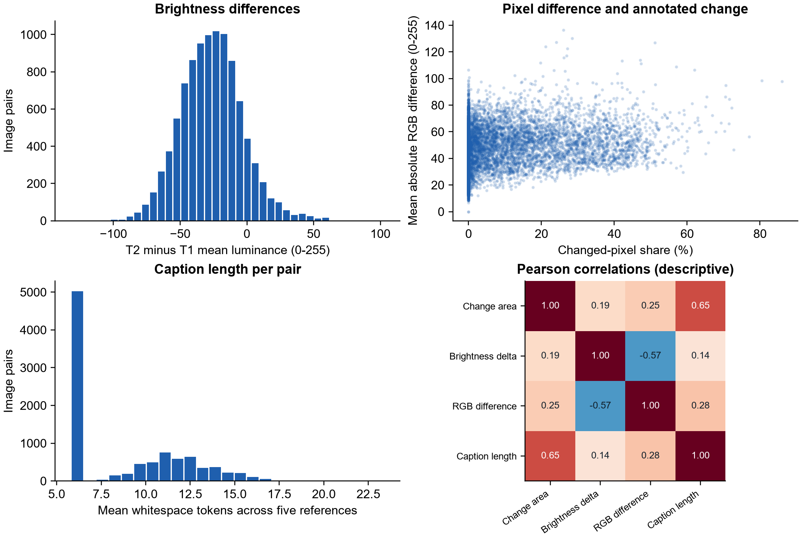

# Milestone 2 - Detailed EDA

Executed over every LEVIR-MCI source pair. This document records dataset preparation, not model performance or new human factuality annotations.

## Coverage and source integrity

- Source records: 10,077; usable input representations: 10,077.
- Missing archive members: 0; duplicate caption keys: 0.
- Archive SHA-256: `8f7d52298fa3ca32aec983e84addef80f61ad7d981c0ff97a92c5880c4b83e9d`.
- Release revision: `dff09c709999b5b1f1f1806024811c65a6b14dfe`.
- All test pixels were examined for dataset quality, not model selection. The new preparation does not describe them as unopened.

## Source and retained populations

| Population | Train | Validation | Test | Total |
|---|---:|---:|---:|---:|
| Source release | 6,815 | 1,333 | 1,929 | 10,077 |
| Prepared joint-task records | 6,444 | 1,242 | 1,858 | 9,544 |

## Class balance

| Population | Unchanged | Building only | Road only | Both |
|---|---:|---:|---:|---:|
| Source | 4978 | 1708 | 682 | 2709 |
| Prepared | 4743 | 1611 | 497 | 2693 |

## Conflicts, duplicates and exclusions

- Exact repeated unordered image-pair groups: 16; redundant records: 16; groups spanning official splits: 5.
- Cross-split dHash candidates: 5; nonexact candidates: 0. These are similarity candidates, not confirmed scene duplicates.
- Unique records excluded from the strict joint-task package: 533. Reason counts below overlap.

- exact_repeated_pair: 16.
- inconsistent_duplicate_targets: 12.
- mask_caption_changeflag_conflict: 511.

Exact duplicates retain test before validation before train, then lexical pair ID. Nonexact cross-split perceptual matches exclude the lower-priority partition record conservatively. Reference/mask conflicts are quarantined without rewriting source captions or masks. This is a strict training cohort, not a claim that every excluded annotation is objectively wrong. All raw records remain recoverable. Scene-level geographic independence cannot be certified without parent-scene coordinates.

## Geometry, small changes and directions

- Source changed pairs below 1% changed pixels: 408.
- Positive changed-area quantiles: `{"min": 1.52587890625e-05, "q1": 0.0439300537109375, "median": 0.1259613037109375, "q3": 0.2649078369140625, "max": 0.86065673828125}` (fractions).
- Pairs with at least one location/direction term in a reference: 3,121.
- Pairs with at least one numeric/count term: 7,420. These lexical flags do not establish verified instance counts.
- Grid labels refer to image coordinates, not geographic north/east. Counts of connected mask components are shape diagnostics, not building-instance labels.

## Captions and reference agreement

- Mixed lexical change/no-change reference sets: 0.
- Source changeflag versus nonzero mask conflicts: 511.
- Unchanged-reference template sets: 1; most common set occurs on 5,039 pairs.
- Retaining five references preserves alternative wording. A lexical consistency check does not certify semantic agreement on action, location or count. No new independent human adjudication is claimed.

## Image variation, outliers and correlations

| Feature | IQR lower fence | IQR upper fence | Flagged pairs |
|---|---:|---:|---:|
| changed_fraction | -0.1921 | 0.3202 | 892 |
| brightness_delta | -87.8922 | 33.8719 | 195 |
| pair_mae | 2.7465 | 90.1236 | 71 |
| caption_words_mean | -3.2000 | 20.8000 | 2 |

Outliers are retained unless another integrity rule excludes the record: a large true change can be a valid tail observation. Brightness differences and pixel MAE are descriptive, not proof of misregistration or physical change. Correlations are associations and are not causal or performance claims.

## Threshold sensitivity

The 50-pixel threshold belongs to the earlier automatic caption evaluator; it is not a dataset label rule and is not used to erase small regions in this preparation.

| Minimum class pixels | Building-present pairs | Road-present pairs |
|---|---:|---:|
| 1 | 4,417 | 3,391 |
| 10 | 4,399 | 3,391 |
| 50 | 4,356 | 3,391 |
| 100 | 4,310 | 3,386 |

## Reproduce and inspect

Run `scripts/fetch_primary.py`, `scripts/prepare_and_audit.py`, `scripts/prepared_dataset.py`, then `scripts/eda_figures.py`. Exact inputs, hashes and settings are in `evidence/full_audit/summary.json`; per-pair values, near-pair candidates, exact groups and exclusion reasons are alongside it. Training data stays in `data/` and is not redistributed through Git.

## Separate SECOND-CC transfer preparation

The author-linked source index contains 10,855 original/augmented records. Excluding filenames marked `_random_augment` leaves 6,041 originals: 4,219 train, 595 validation and 1,227 test.
The original-pair archive signatures contain 389 cross-split CRC/size candidate groups. These are not independently confirmed decoded-pixel duplicates. This source is used only for transfer evaluation, without project training on its partitions.

The deterministic 100-pair original-validation probe contains compatible 256 x 256 RGB images, semantic maps and five captions per pair. Its building-change projection has 65 positive pairs at one pixel and 63 at 50 pixels. 9 source change-positive pairs have no building-change pixel; source captions can describe other classes, so this is not automatically an annotation error. No road-negative supervision is inferred from building-only masks.

Acquired source members pass ZIP CRC and length checks and receive SHA-256 hashes. Generated masks and the probe manifest also have hashes; references are separate. This is dataset preparation, not a new model experiment or human audit. Raw files stay local under `data/transfer/SECOND-CC/`; `evidence/second_probe_summary.json` records settings, selection and counts.
