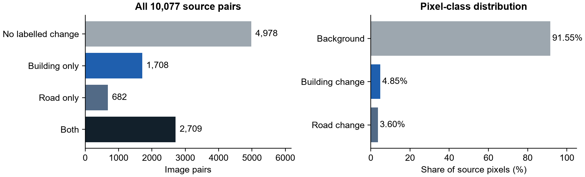
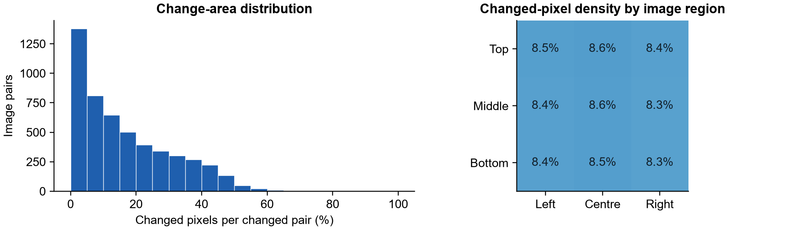
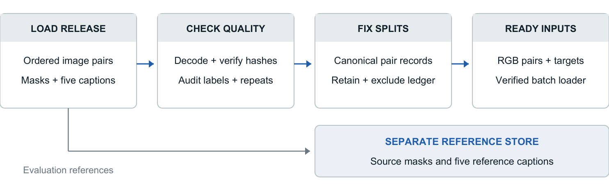

# TerraWatch: Intelligent Satellite Image Change Detection and Analysis

**DS & AI Lab Project (BSDA4001) | Indian Institute of Technology Madras**

**Milestone 2: Dataset Preparation | Group 7 | October 2026**

| Team member | Student email | GitHub |
|---|---|---|
| Priyanshu Agarwal | 23f2003488@ds.study.iitm.ac.in | 23f2003488 |
| Sarthak Saini | 23f2005347@ds.study.iitm.ac.in | Sarthak-Saini265 |
| Sujal Raj Pradhan | 23f2004759@ds.study.iitm.ac.in | SujalPradhan |
| Shoaib SSM | 24f2000857@ds.study.iitm.ac.in | shoaib2000857 |

## 1. Introduction

TerraWatch analyses two images of the same location to detect visible building and road changes, describe them in natural language and check whether the descriptions are supported by the images. Milestone 2 establishes the data foundation: identified sources, verified image-label joins, exploratory analysis, consistent target formats and reproducible training, validation and test records [1].

The prepared primary package contains **9,544 image pairs**, each with a categorical change mask and five reference captions. The preparation is supported by an audit of all **10,077 source pairs** and a loader check of every retained record. Dataset readiness is distinguished from trained-model accuracy.

## 2. Dataset Identification

| Dataset | Purpose and selection | Source and disposition |
|---|---|---|
| LEVIR-MCI / LEVIR-CC [2,3] | Primary paired imagery, building/road masks and five captions on the same records. Supports detection and description without joining unrelated collections. | Author-linked Hugging Face release. LEVIR-CC supplies the captions; it is not an independent dataset added to the training total. |
| SECOND-CC [4,5] | Transfer evaluation with different imagery and semantic change annotations. Tests whether behaviour observed on LEVIR transfers to another source. | Author-linked Zenodo release, CC BY 4.0. Kept separate from primary training and from its augmented copies. |
| WHU-CDC [6] | Building-change transfer candidate examined in the earlier experiments. | The inspected captioned mirror has no stated derivative licence. Excluded from the governed training package; historical screening is kept separate. |

LEVIR-CD and S2Looking were considered for detection-only work. LEVIR-MCI was selected for the shared package because it provides both masks and captions. Supplementary datasets are not pooled into a claim of universal robustness.

## 3. Dataset Description and Schema

The primary release contains 10,077 pairs and 50,385 captions. Each pair consists of an earlier RGB image, a later RGB image, a mask and five separate descriptions. All input images are **256 x 256 pixels**. The source describes nominal 0.5 m imagery from Texas, USA [2,3]. Per-tile dates and geographic coordinates are absent from the acquired record schema; they are stored as null, not estimated.

| Record group | Representation | Meaning |
|---|---|---|
| Identity and inputs | Dataset/split/filename key; two RGB PNGs | One ordered temporal pair; input shape 2 x 256 x 256 x 3 |
| Detection target | Categorical PNG; 256 x 256 after lossless channel reduction | 0 = background, 128 = road change, 255 = building change |
| Description target | Five caption strings and source IDs in JSON | Alternative reference descriptions, not five additional image pairs |
| Provenance | Revision, archive paths, SHA-256 hashes and exclusion ledger | Reproducible joins, source verification and split membership |

For example, retained record **train_000010** links the matching A/B images, a mask containing both change classes and five captions. One reference reads: "some buildings appear at the bottom of the scene." The complete record example is included in the data dictionary.

<!-- PAGEBREAK -->

## 4. Data Governance

| Area | Recorded decision | Application |
|---|---|---|
| Source and rights | Retain author attribution and source-specific terms. The LEVIR-MCI card does not provide a separate blanket data licence; a code licence is not treated as an imagery licence. SECOND-CC is CC BY 4.0 [2,4]. | Research workflow; raw imagery remains local. The submission distributes code, identifiers, hashes and aggregate findings, without asserting commercial or redistribution rights. |
| Privacy and ethics | No owner identities or personal identifiers are required by the input schema. | Descriptions concern visible physical change; ownership, legality and causes are not inferred from imagery. No claim of complete privacy anonymity is made. |
| Quality and provenance | Preserve original files; record conflicts and exclusion reasons. Pin the source revision and hash the acquired archive. | Labels are not silently corrected. The strict joint-task package excludes incompatible supervision while retaining the original release for traceability. |
| Bias and reproducibility | Record geography, restricted mask classes, caption repetition and exact processing settings. | Findings apply to the inspected release and prepared cohort. Nominal source resolution does not establish per-tile measurement accuracy. |

## 5. Exploratory Data Analysis

The audit decoded **40,308 image/label files**: A, B, categorical label and colour label for every source pair. There were **no missing joins, invalid image dimensions, empty captions or duplicate caption keys**. All masks use the expected class values. The stored grayscale label has three identical channels; the colour copy maps background to black, road change to yellow and building change to red. These representations agree pixel by pixel.

Figure 1. Complete-release statistics, calculated from all 10,077 pairs. Pair classes and pixel shares use different denominators.

| Finding | Audit result | Interpretation |
|---|---|---|
| Mask-level balance | 4,978 unchanged; 1,708 building only; 682 road only; 2,709 both | Report class-specific and unchanged-case behaviour. |
| Pixel imbalance | 91.55% background; 4.85% building; 3.60% road | Overall pixel accuracy alone can hide missed changes. |
| Small changes | 408 of 5,099 changed masks contain under 1% changed pixels | Preserve spatial detail and retain genuine small regions. |
| Mask/caption flag conflicts | 511 of 10,077 pairs (5.07%) | Exclude from the strict joint-task cohort without declaring either annotation automatically correct. |
| Caption repetition | All 5,039 caption-flagged unchanged pairs reuse one five-sentence set | Text similarity alone can reward generic no-change descriptions. |

<!-- PAGEBREAK -->

### 5.1 Image variation, location and reference consistency

Figure 2. Change-area distribution among changed source pairs and changed-pixel density across image regions. Top/left refer to image coordinates, not geographic north/west.

Among changed masks, the median changed area is **12.60%**. Changes occur across the image, rather than only at its centre. Brightness differences also vary substantially: the median T2-minus-T1 luminance difference is **-26.67** on a 0-255 scale. Such differences are not themselves proof of physical change or poor registration.

The analysis flags 195 brightness-difference outliers using the 1.5-IQR rule. These are retained unless a separate integrity rule excludes them: extreme values can represent valid imagery. Pixel-difference, change-area, caption-length distributions and descriptive correlations are documented in the accompanying EDA record. Correlations are not treated as evidence of causation.

A lexical check found no pair mixing standard no-change phrases with change descriptions among its five references. This checks coarse change/no-change agreement, not complete agreement on object counts, direction or location. Background in a mask means **no annotated building/road change**, not absence of every possible visual change; vegetation descriptions can therefore fall outside mask coverage.

The earlier caption evaluator used a **50-pixel class-presence threshold**. This is an evaluator setting, not a dataset requirement: source building-positive pairs fall from 4,417 at one pixel to 4,356 at 50 pixels. The prepared masks retain the original small regions. Connected components are not treated as building-instance counts.

## 6. Data Preprocessing

- **Validate and join:** decode the paired inputs and both label forms; verify shapes, non-empty captions, class values and unique record keys. Store SHA-256 hashes of file bytes and decoded pixels. Hashing verifies identity; it is not encryption. No required input is imputed.
- **Resolve supervision conflicts:** quarantine records whose mask and caption change flags disagree, or whose repeated imagery has inconsistent targets. Preserve the source annotations and each reason in an exclusion ledger.
- **Standardise targets:** verify identical channels before reducing the grayscale label. Map values 0/128/255 to class indices 0/1/2 for background/road/building. No interpolation is applied to the native masks.
- **Prepare images:** retain RGB uint8 images for vision-language processors. The detector loader emits contiguous float32 tensors in [0,1], with temporal order preserved. No histogram matching, learned correction or automatic registration is applied.
- **Prepare text:** retain all five trimmed reference strings separately. Pair-level grouping is preserved when using multiple text targets. Checkpoint-specific tokenisation and image normalisation belong to the model processor; no fabricated merged caption is introduced.

<!-- PAGEBREAK -->

## 7. Dataset Integration

A canonical **dataset / official split / filename** key now identifies every prepared primary pair. The same record supplies detection inputs, captioning inputs and the separate evaluation references. This resolves the ambiguity of joining component-specific pilot identifiers by filename alone.

| Component | Model input | Training or evaluation target |
|---|---|---|
| Change detection | Earlier and later RGB images | Supplied categorical mask during training; predicted mask evaluated against it |
| Change description | Both images; predicted regions in the mask-guided configuration | Five source captions, stored separately from inference requests |
| Visual inspection / claim checking | Original images, predicted regions and the generated claim | Source references for automatic diagnostics; no new human factuality labels are claimed |

At inference, the detector produces the mask from the two images. The captioner uses the images and predicted evidence; reference masks and captions are not supplied as answers. This input contract does not imply that a complete trained pipeline has already been evaluated.

SECOND-CC supplies a separate **100-pair original-validation probe** at 256 x 256 pixels, with 500 reference captions. Building-change targets use building pixels in its semantic **change** maps, not arbitrary land-cover maps. Neither it nor WHU-CDC contributes to primary training. SECOND-CC checksum matches span its source splits; no new within-source training/test claim is made.

## 8. Data Augmentation

**Zero additional augmented samples** are materialised in this package. Native pairs and annotations are preserved. Unconditional flips, rotations and temporal reversals are excluded from the prepared captioning records because they can invalidate left/right, top/bottom or appearance/disappearance descriptions. Constructed claim fixtures from the decision experiments are software checks and are excluded from the real-imagery dataset counts.

## 9. Dataset Splitting and Leakage Prevention

Official split membership is preserved; records are excluded rather than moved across partitions. SHA-256 checks confirm **16 repeated image-pair groups**, including **five spanning training and test**. One copy is retained with priority test, then validation, then training. Groups with conflicting mask targets are quarantined. A cross-split perceptual-hash screen finds the same five exact pair matches and no additional candidates at the documented threshold; visual similarity is not asserted to prove scene identity.

| Partition | Source pairs | Prepared pairs |
|---|---:|---:|
| Training | 6,815 | 6,444 |
| Validation | 1,333 | 1,242 |
| Test | 1,929 | 1,858 |
| **Total** | **10,077** | **9,544** |

The resulting ratio is **67.52% / 13.01% / 19.47%**. All 533 exclusions have recorded reasons; reason counts can overlap. Parent-scene coordinates are unavailable, so these checks establish detected content separation, not geographic independence. Test imagery was inspected for data quality during this audit, without model fitting or checkpoint selection; it is not described as unopened.

<!-- PAGEBREAK -->

## 10. Final Prepared Dataset

The final strict primary package contains **9,544 pairs, 19,088 RGB inputs, 9,544 categorical targets and 47,720 reference captions**. Its mask classes are **4,743 unchanged, 1,611 building only, 497 road only and 2,693 both**. Background, building and road occupy **91.24%, 5.11% and 3.65%** of retained pixels respectively. These figures describe the cleaned cohort, not the original release or a balanced sampling assumption.

Figure 3. The preparation links source files, quality decisions and fixed partitions to a verified loader. Evaluation references remain separate from image-only prediction records.

All retained records passed hash, decoding and reference checks. Detector batches have image shape **B x 2 x 3 x 256 x 256** and target shape **B x 256 x 256**. Verified image-only inference records exclude targets and captions. Training uses the supplied loader without repeating cleaning, joins or splits.

## 11. Challenges and Limitations

Duplicate imagery, inconsistent supervision and label-vocabulary differences required explicit preparation rules. The strict cohort resolves identified conflicts without declaring source annotations infallible. Background imbalance, repeated captions and limited geographic/class coverage remain dataset limitations; preparation checks do not establish generalisation. The curated cohort is distinct from the original benchmark.

## 12. Deliverables Produced

| Deliverable | Contents |
|---|---|
| Prepared records | Separate train/validation/test manifests; image-only inference records; local source archive and reference store |
| Quality evidence | Full per-pair profile, exact duplicate groups, candidate checks, exclusion ledger, summary statistics and loader validation |
| Reproducible code | Source retrieval, full audit/preparation, dataset loader, figure generation and report builder |
| Documentation | Detailed EDA, data dictionary, source/usage register, document change log and contribution record |

Raw data, prepared records, evidence and report outputs are separated. Versioned scripts and metadata reproduce the handover from the pinned release.

## 13. Summary

The full-release audit produces reproducible primary data ready for detection and captioning training, with verified inputs, explicit labels and recorded exclusions. The loader and fixed partitions complete the data handover. Dataset readiness does not imply model accuracy or independently human-audited factuality.

<!-- PAGEBREAK -->

## References

1. IIT Madras DS & AI Lab. *Milestone 2: Dataset Preparation*. https://bsc-iitm.github.io/dsai-lab-project/milestones.html#milestone-2
2. Liu, C. et al. (2024). *Change-Agent: Toward Interactive Comprehensive Remote Sensing Change Interpretation and Analysis*. IEEE TGRS. Author code and LEVIR-MCI release: https://github.com/Chen-Yang-Liu/Change-Agent ; https://huggingface.co/datasets/lcybuaa/LEVIR-MCI
3. Liu, C. et al. (2022). *Remote Sensing Image Change Captioning With Dual-Branch Transformers*. IEEE TGRS. Author dataset: https://github.com/Chen-Yang-Liu/LEVIR-CC-Dataset
4. Karaca, A. C. et al. (2025). *Robust Change Captioning in Remote Sensing: SECOND-CC Dataset and MModalCC Framework*. IEEE JSTARS. https://doi.org/10.1109/JSTARS.2025.3600613 ; author-linked dataset: https://doi.org/10.5281/zenodo.16937571
5. Yang, K. et al. (2022). *Asymmetric Siamese Networks for Semantic Change Detection*. IEEE TGRS. SECOND label conventions: https://captain-whu.github.io/SCD/
6. Ji, S., Wei, S. & Lu, M. (2019). *Fully Convolutional Networks for Multisource Building Extraction From an Open Aerial and Satellite Imagery Data Set*. IEEE TGRS. WHU imagery: https://gpcv.whu.edu.cn/data/building_dataset.html ; captioned mirror inspected: https://huggingface.co/datasets/hygge10111/RS-CDC

## Document Change Log

| Revision | Review point | Incorporated change |
|---|---|---|
| 29-30 October 2026 | Initial M2 preparation and technical review | Documented dataset roles, input contracts, mask limitations, reference separation and readiness evidence. |
| 31 October 2026 | Expand EDA; resolve duplicates, conflicts and record-ID alignment | Completed full-release EDA, verified hashes, explicit exclusions, canonical records and loader checks. |
| 31 October 2026 | Clarify labels, rights and report completion | Explained the actual mask encodings, five-caption structure and dataset dispositions; replaced preparation plans with measured findings and removed future-scope material. |

## Individual Contributions

| Team member | Milestone 2 contribution |
|---|---|
| Priyanshu Agarwal | Visual-evidence and claim-grounding input requirements from the approved design. |
| Sarthak Saini | Detection input/target requirements; report review and evaluation discussion. |
| Sujal Raj Pradhan | Captioning preparation, source audit, captioner experiments, transfer screens and initial draft. |
| Shoaib SSM | Decision benchmarks; consolidated preparation/EDA, verified handover and report revision. |

## Team Review and Approval

Approval confirms review of this report and its findings.

| Team member | Initials | Approval date | Signature / confirmation |
|---|---|---|---|
| Priyanshu Agarwal | PA |  |  |
| Sarthak Saini | SS |  |  |
| Sujal Raj Pradhan | SRP |  |  |
| Shoaib SSM | SSSM |  |  |
