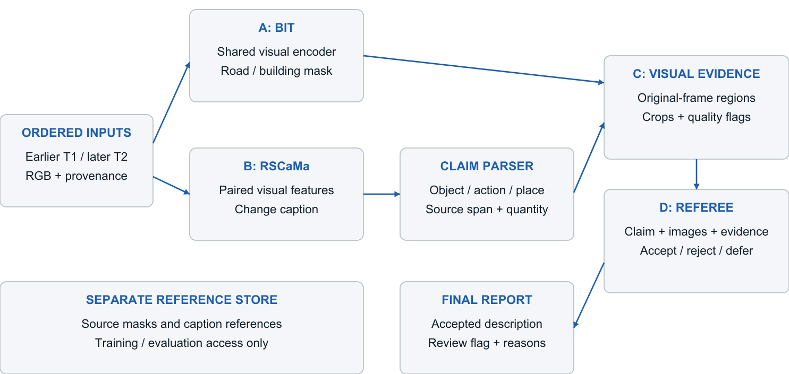
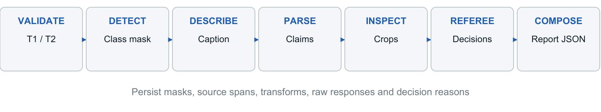
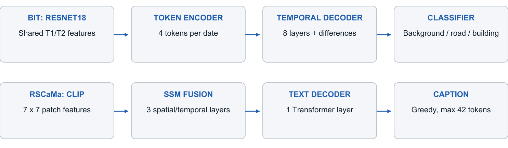
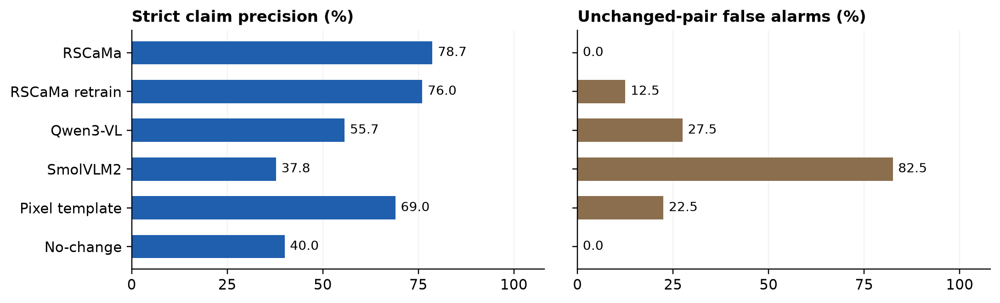

# TerraWatch: Intelligent Satellite Image Change Detection and Analysis

**DS & AI Lab Project (BSDA4001) | Indian Institute of Technology Madras**

**Milestone 3: Model Selection and System Architecture | Group 7 | November 2026**

| Team member | Student email |
|---|---|
| Priyanshu Agarwal | 23f2003488@ds.study.iitm.ac.in |
| Sarthak Saini | 23f2005347@ds.study.iitm.ac.in |
| Sujal Raj Pradhan | 23f2004759@ds.study.iitm.ac.in |
| Shoaib SSM | 24f2000857@ds.study.iitm.ac.in |

## 1. Introduction

TerraWatch identifies visible building and road changes between two satellite images and produces descriptions linked to visual evidence. Milestone 3 establishes the model choices, module interfaces, training configuration and complete input-to-output architecture [1]. The system combines pixel-level detection, domain-specific captioning, structured claims, crop-based evidence and an accept/reject/defer referee.

The data contract uses the Milestone 2 strict LEVIR-MCI package: **9,544 pairs**, partitioned into **6,444 training, 1,242 validation and 1,858 test records** after the documented exclusions. Source masks and five reference captions support supervised learning and evaluation. Inference consumes ordered images and model-generated intermediates. The local POC run below reads the original downloaded archive, which has a 1,929-pair test split; its subset results must not be presented as results on the cleaned 1,858-pair handover.

## 2. Overall System Architecture

Figure 1. Detection and captioning operate on the same image pair. Predicted regions and caption claims meet at the evidence stage. Evaluation references occupy a separate store.

| Layer | Technology and role |
|---|---|
| Data and persistence | Python, NumPy, Pillow; immutable image sources, split manifests, JSON/JSONL records and file hashes |
| Detection and description | PyTorch; BIT three-class detector and RSCaMa captioner in dedicated model environments |
| Evidence and decisions | OpenCV, Pydantic and isolated Transformers workers; explicit coordinates, typed records and decision gates |
| Execution and interaction | Colab/WSL/local CLI; two ordered image paths and a configuration file produce a JSON report and crop evidence |

Model weights are acquired from their author repositories or Hugging Face. The inference design runs through local workers with cached weights. Evidence retrieval uses run IDs and file paths; the task does not require a vector database or document-retrieval stage.

<!-- PAGEBREAK -->

## 3. End-to-End Workflow

| Stage | Input | Output and control |
|---|---|---|
| Validate the pair | Earlier T1 and later T2 RGB images | Matching dimensions, temporal-order declaration and SHA-256 provenance; incompatible pairs raise an input error |
| Detect changes | Normalised temporal tensors | Background/road/building mask; nearest-neighbour restoration to original image dimensions |
| Generate and parse | Full-frame images; captioner output | Caption plus atomic object/action/location/quantity claims, source spans and parser provenance |
| Localise and inspect | Claim, predicted class mask and original images | Matching connected region, padded T1/T2 crops, transform record, visibility flags and structural observations |
| Referee and gate | Claim, fallible evidence and original images | Raw accept/reject/defer decision; probability validity and operating-threshold checks |
| Compose and store | Gated claim records | Accepted-description text, review flag, per-claim reasons, raw responses and auditable report JSON |

Connected components identify candidate regions; they are not building-instance counts. Claim locations use the image-relative 3 x 3 grid. Matching regions retain original-T1 half-open pixel coordinates. Unlocalised claims use full-image context and receive a review reason.

The implementation executes each learned stage in a separate process, releases its memory on exit and records request, response and log files. A new run directory preserves earlier deliveries. Worker timeouts and missing referee outputs yield explicit error/review records. Insufficient visibility, an unsupported legal inference or an exact count without independent instance evidence produces a defer decision.

Figure 2. The operating pipeline retains intermediate evidence and raw decisions. Report composition uses accepted claim spans and carries review requirements into the final output.

<!-- PAGEBREAK -->

## 4. Model Architecture Selection

| Module | Selected architecture | Size, representation and integration |
|---|---|---|
| A - change detection | BIT with a shared ResNet18 backbone and three-class output head [2] | Four semantic tokens per temporal stream; one token-encoder layer and eight decoder layers. Class indices: 0 background, 1 road, 2 building. |
| B - change description | RSCaMa with CLIP ViT-B/32, spatial/temporal state-space fusion and a Transformer language decoder [3] | 7 x 7 patch features, 768-dimensional fusion, three fusion layers, eight attention heads and one decoder layer; greedy output capped at 42 tokens. |
| C - visual evidence | Custom crop and structural witness | Parameter-free OpenCV processing: LAB luminance mean shift, Sobel edges, rectilinear orientation, local anomalies, visibility and registration diagnostics. |
| D - claim referee | Qwen3-VL-4B-Instruct image-backed judge; Qwen3-4B-Instruct-2507 shared-evidence comparator [4,5] | Approximately 4B language-model scale; original images plus structured evidence for VL, evidence text for the text comparator. Closed accept/reject/defer outputs. |

Figure 3. BIT predicts dense class targets. RSCaMa translates paired visual features into text. These modules remain independently replaceable and trainable.

BIT is the detector architecture selection, justified by its compact shared backbone and temporal context mechanism. Detector training uses ImageNet visual initialisation and a new three-class task head. RSCaMa's tested interface consumes two RGB images; detector masks enter the downstream claim-localisation and verification path. This distinction preserves the actual captioner input contract.

The selected captioning comparison includes the released RSCaMa checkpoint and a subset-trained RSCaMa implementation initialised from public CLIP weights. Both referees use the exact checkpoint revisions recorded in the supplied run metadata.

<!-- PAGEBREAK -->

## 5. Justification and Experimental Evidence

The captioning comparison uses a fixed **100-pair LEVIR screen**, including **40 unchanged pairs**. The original B0 results and Sarthak Saini's local rerun use automatic claim/reference checks. Strict precision counts all extracted claims; in-scope precision evaluates claims covered by the annotation scope. Cells show **B0 / local** values [6,9].

| Captioning configuration | Strict precision (%) | In-scope precision (%) | BLEU-4 |
|---|---:|---:|---:|
| Released RSCaMa | 78.69 / 78.69 | 88.89 / 88.89 | 0.6223 / 0.6223 |
| RSCaMa, 20%-budget retrain | 79.17 / 76.04 | 87.96 / 82.02 | 0.5786 / 0.5793 |
| Qwen3-VL-4B | 58.33 / 55.70 | 72.92 / 71.74 | 0.0267 / 0.0183 |
| SmolVLM2-2.2B | 38.58 / 37.76 | 48.41 / 47.13 | 0.0102 / 0.0000 |
| Pixel-difference template | 69.00 / 69.00 | 69.00 / 69.00 | 0.0000 / 0.0000 |
| Always no change | 40.00 / 40.00 | 40.00 / 40.00 | 0.2798 / 0.2798 |

**RSCaMa is the selected captioner.** Its released checkpoint reproduces the stored B0 aggregates at the reported precision and leads the local screen on both precision measures and BLEU-4. Local ROUGE-L is **0.7464**, CIDEr-D **1.3184** and reference-fact recall **76.8%**, with **0/40 unchanged-pair false alarms**. The retrained model records 5/40 false alarms, Qwen3-VL 11/40 and SmolVLM2 33/40. The no-change control also records zero alarms, but its 40% strict precision demonstrates the need to measure change coverage alongside false positives.

<<<<<<< HEAD

=======
These captioning values are the original committed B0 aggregate results. Local implementation checks reproduce the released RSCaMa values and the two deterministic controls on the same seeded 100-pair screen. The local 20%-budget retrain does **not** reproduce its original aggregate: it scores 76.04% strict precision, 82.02% in-scope precision and 0.5793 BLEU-4, versus 79.17%, 87.96% and 0.5786 in B0. Its local deltas are −3.13 and −5.94 percentage points, and +0.0007 BLEU-4. SmolVLM2 locally scored 37.76% strict, 47.13% in-scope and 0.0000 BLEU-4, versus 38.58%, 48.41% and 0.0102 in B0. Qwen3-VL locally scored 55.70%, 71.74% and 0.0183, versus 58.33%, 72.92% and 0.0267 in B0. The two 100-pair transfer screens reproduce their original strict, in-scope and BLEU-4 aggregates exactly (48.04% / 50.00% / 0.2426 on SECOND-CC; 55.56% / 66.67% / 0.4717 on WHU-CDC). Referee comparisons remain historical pending local reruns. These are parity checks on the same evaluation populations, not new held-out evidence. See the separate [implementation evidence report](sarthak/Benchmark_Report.md) for run provenance, hashes, confidence intervals, vocabulary exposure, timing and the full side-by-side evaluation proof.

The transfer screens use 100 records each from SECOND-CC and WHU-CDC. Released RSCaMa strict precision is **48.0%** and **55.6%**, respectively. This source dependence supports explicit evidence checking and source-specific evaluation. WHU remains a historical transfer screen with its separate usage-rights disposition.
>>>>>>> 4192b3d (pushed benchmark files)

Figure 4. Automatic claim precision and false alarms on 40 unchanged pairs. Higher precision and lower false-alarm rates are preferred.

The reproducibility screen retains the raw-release selection and upstream vocabulary construction from official-split captions. The strict 9,544-pair Milestone 2 package supplies the separate training-data contract. The controlled retrain uses **1,313 training pairs and 50 development pairs**, with a training-subset vocabulary. The original Apple M4/MPS batch-one screen records median caption times of **0.139 s** for RSCaMa and **7.605 s** for Qwen3-VL; these timings retain their original hardware context.

<!-- PAGEBREAK -->

### 5.1 Detector, Transfer and Referee Evidence

The local **BIT-ResNet18 two-epoch experiment** uses **100 training pairs, 25 validation pairs and a separate 100-pair evaluation population**, including 45 unchanged pairs. Both detector outputs are reduced to binary any-change predictions for the F1 comparison [9].

| Detector | Binary any-change F1 | Unchanged-pair false alarms |
|---|---:|---:|
| BIT-ResNet18 | 45.8% | 31/45 (68.9%) |
| Otsu pixel-difference control | 16.7% | 45/45 (100.0%) |

BIT improves binary F1 by **29.1 percentage points** and reduces false alarms by 14 unchanged pairs. Its road/building class-mean IoU is **26.8%**; the Otsu control's binary change IoU is **9.1%**. These IoUs describe different target spaces and are reported separately. BIT's compact backbone, temporal context and three-class output support region localisation. The measured false-alarm rate motivates downstream visual checking.

<<<<<<< HEAD
Released RSCaMa transfer reruns use 100 pairs per source:

| Transfer source | Strict / in-scope precision | BLEU-4 |
|---|---:|---:|
| SECOND-CC | 48.04% / 50.00% | 0.2426 |
| WHU-CDC | 55.56% / 66.67% | 0.4717 |

These aggregates match the stored transfer results at the displayed precision. Source dependence supports separate reporting and evidence-grounded verification. WHU usage follows its recorded source-rights disposition.

The L4 referee screen uses **30 validation pairs and 150 constructed annotation-proxy claims**, evaluated before the 0.8 acceptance gate.

| Referee configuration | Proxy claims | Raw decision agreement |
|---|---:|---:|
| Qwen3 text, common evidence | 150 | 41.3% |
| Qwen3-VL, common evidence | 150 | 45.3% |
| Qwen3-VL, image-backed | 150 | 56.7% |

Image-backed Qwen3-VL achieves the strongest agreement in this controlled comparison and is the selected visual referee. The text judge supplies a shared-evidence comparator. Caption checks, detector overlap and referee agreement measure distinct component behaviours; each retains its own evaluation population.
=======
BIT complements these choices through dense localisation and a smaller shared backbone. A local two-epoch BIT-R18 pilot now runs on the RTX 4060 Ti: on 100 held-out pairs from the original archive it reached 45.8% binary any-change F1; mean road/building IoU was 26.8%, and 31 of 45 unchanged pairs contained a predicted change pixel. This small pilot verifies the detector path, not BIT's superiority or a converged score. The comparison with the Otsu control, training subset and exact boundaries are in the Sarthak evidence report. Alternative transformer detectors and Siamese CNNs remain in the benchmark registry and have not been run locally.
>>>>>>> 4192b3d (pushed benchmark files)

<!-- PAGEBREAK -->

## 6. Model Inputs and Outputs

| Contract | Representation |
|---|---|
| Detector input/output | Paired B x 2 x 3 x 256 x 256 tensors; BIT scaling to [-1,1]; B x 3 x 256 x 256 logits and categorical mask |
| Captioner features | Author CLIP processor: 224-pixel RGB views, CLIP mean/std; temporal patch features and checkpoint-matched word vocabulary |
| Structured claim | Object, action, optional exact quantity, image-relative location and exact caption source span |
| Evidence | Original-frame box, padded crops, transform metadata, mask/witness producer IDs, quality flags and fallible observations |
| Referee/report | Checkpoint chat template, closed decisions, raw response, probability semantics, gated outcome, reason codes and accepted-description text |

The RSCaMa retrain builds its vocabulary from training-subset captions and preserves start/end/padding tokens. The released checkpoint uses its matching vocabulary. Qwen uses the publisher tokenizer/processor and temporal-order prompt. Reference captions, human labels and source masks are excluded from inference requests.

## 7. Training Strategy

| Component | Training configuration and checkpoint rule |
|---|---|
| BIT task training | ImageNet visual initialisation; backbone frozen for five epochs, then trained at 1e-5; temporal/head parameters at 1e-4. AdamW, weight decay 0.01; cosine schedule, 50-epoch cap; batch eight with four-step accumulation. |
| Detector loss/selection | Equal mixture of class-weighted focal loss (gamma 2; background/road/building weights 0.10/0.45/0.45) and soft Dice. Validation macro-IoU selects checkpoints; patience eight. Paired detector flips preserve masks. |
| RSCaMa retraining | Public CLIP visual initialisation; temporal fusion and caption decoder trained through the upstream trainability policy. Token cross-entropy, Adam 1e-4, batch 12 pairs, 40-epoch cap, patience eight and seed zero. Development BLEU-4 selects best weights. |
| Witness and referee | Structural witness uses fixed image-processing rules. Qwen weights remain frozen; prompt, image budget, model revision and the 0.8 operating gate are recorded. |

<<<<<<< HEAD
The detector row specifies the task-training configuration. The two-epoch experiment in Section 5.1 uses its own 100/25/100-pair protocol; the 50-epoch configuration defines the full task-training profile. The captioner row records the implemented subset-retraining script. Training and validation retain their fixed source partitions; test records are reserved for evaluation. Checkpoint files and histories preserve model configuration, epoch and selection score.
=======
The table specifies the planned task-training configurations; it does not imply that all full schedules completed. The captioner row records the implemented subset-retraining script and its historical hosted result. Sarthak's local BIT run was a two-epoch fit diagnostic over 100 training pairs, with 25 validation pairs and a separate 100-pair test sample; it kept the ImageNet ResNet-18 backbone frozen and is not the 50-epoch schedule above. Its checkpoint and metrics are retained in the local-only run folder described in the Sarthak evidence report.
>>>>>>> 4192b3d (pushed benchmark files)

Colab supplies GPU training/inference, with L4-class evidence from the returned decision sessions. Model workers use separate environments because captioner and referee library versions differ. Sequential residency and stored intermediates control memory without loading the complete model stack simultaneously.

<!-- PAGEBREAK -->

## 8. Pipeline Implementation and Verification

The pipeline entrypoint accepts two image paths and a model configuration. Separate workers execute BIT, RSCaMa and the referee; the coordinator performs claim extraction, predicted-region matching, crop inspection and final composition. Model checkpoints, upstream source directories and worker interpreters are explicit configuration fields. This keeps the architecture reproducible across Colab, WSL and local environments.

Acceptance requires a valid decision record and the configured operating gate. Missing evidence and invalid probability vectors produce review reasons. Exact counts require independent instance evidence; connected-region counts do not satisfy that requirement. Output descriptions concern visible changes and preserve uncertainty through the defer state.

| Verification evidence | Executed scope |
|---|---|
<<<<<<< HEAD
| Local component suite | **83 passing tests**, including the Torch-dependent shim checks, in the supplied local run summary |
| Visual witness | 50/50 synthetic outcomes; 2/3 coarse mask-region-presence checks across three authored real-image cases over two source pairs |
| Captioning | Six configurations rerun on 100 LEVIR screening pairs; two 100-pair transfer reruns |
| Decision exports | Six checksum-verified ZIPs, five session IDs and 40 distinct image pairs; successful Qwen text/VL outputs and preserved failure records |
| Orchestration | CPU test doubles exercise localisation, reference isolation, decision gating, failure review and preservation of existing run directories |

The real-image witness checks measure coarse mask-region presence. Claim wording, structural observations and referee decisions retain separate fields. Decision-session exports use a frozen Qwen visual witness. Component protocols retain their run identities and separate metrics.
=======
| Consolidated CPU suite | **83 passing tests** in the current isolated local environment; no skips |
| Detector | BIT-R18 trained for two epochs on 100 pairs, validated on 25 and evaluated on 100 held-out original-archive pairs; any-change F1 45.8%, mean road/building IoU 26.8% |
| Detector control | Validation-selected abs-RGB-difference/Otsu control on the same 100 test pairs; any-change F1 16.7%; false alarm on 45/45 unchanged pairs |
| Visual witness | Nine unit tests; generated fixture rerun 50/50; local two-pair demonstration matched coarse source-mask region presence in 2/3 hand-authored cases |
| Captioning | Released RSCaMa rerun on 100/100 seeded screening pairs; strict/in-scope precision and BLEU-4 reproduce 78.7%/88.9%/0.6223; other five B0 configurations and both transfer screens remain historical |
| Decision exports | Historical report records six ZIP exports, five session IDs and 40 distinct image pairs; not re-run locally |
| Orchestration | CPU test doubles exercise localisation, reference isolation, decision gating, failure review and preservation of existing run directories |

The synthetic witness result is a controlled-fixture regression only. Its local average was 3.96 ms per claim; this timing is not comparable with a learned-model latency. In the local real-image diagnostic, the authored road claim was flagged as changed even though its manual crop contained no nonzero source-mask pixels. This is a mismatch, not a verified road detection. Decision-session exports use a frozen Qwen visual witness and remain separate historical evidence.
>>>>>>> 4192b3d (pushed benchmark files)

The detector pilot was the only learned model stage executed locally. Although the coordinator routes the complete A/B/C/D contracts, this run did not produce a learned caption, referee decision or full end-to-end report. RSCaMa and referee scores above are historical screens, not fresh local results. No independent human-rated factuality results are available.

The planned human assessment uses SUPPORTED, CONTRADICTED, UNSUPPORTED and UNVERIFIABLE judgements from two independent raters. Agreement and Cohen's kappa precede third-rater adjudication using the original images and contextual crops. SUPPORTED maps to accept, CONTRADICTED/UNSUPPORTED to reject and UNVERIFIABLE to defer. This measures claim factuality separately from mask overlap, reference-caption similarity and automated proxy decisions. The project has no completed independent human-rating file yet.

The architecture defines the data flow, model choices and planned training controls. The delivered scripts provide model-worker interfaces, the local detector pilot, evidence records and auditable output generation, supported by the consolidated experiment register. The full learned pipeline and the remaining candidate screens are next implementation work.

<!-- PAGEBREAK -->

## References

1. IIT Madras DS & AI Lab. *Milestone 3: Model selection and pipeline design*. https://bsc-iitm.github.io/dsai-lab-project/milestones.html
2. Chen, H., Qi, Z. and Shi, Z. (2022). *Remote Sensing Image Change Detection with Transformers*. IEEE TGRS. https://arxiv.org/abs/2103.00208 ; official implementation: https://github.com/justchenhao/BIT_CD
3. Liu, C. et al. (2024). *RSCaMa: Remote Sensing Image Change Captioning With State Space Model*. IEEE GRSL. https://doi.org/10.1109/LGRS.2024.3404604 ; https://github.com/Chen-Yang-Liu/RSCaMa
4. Qwen Team. *Qwen3-4B-Instruct-2507: model card and configuration*. https://huggingface.co/Qwen/Qwen3-4B-Instruct-2507
5. Qwen Team. *Qwen3-VL-4B-Instruct: model card and configuration*. https://huggingface.co/Qwen/Qwen3-VL-4B-Instruct
6. TerraWatch Group 7. *Captioning implementation and aggregate screens*. Commit 8328ba7. https://github.com/shoaib2000857/Group-7-DS-and-AI-Lab-Project/tree/8328ba7/POC/execution
7. TerraWatch Group 7. *Visual evidence inspector and component tests*. Commit 54b713a. https://github.com/shoaib2000857/Group-7-DS-and-AI-Lab-Project/commit/54b713a
8. TerraWatch Group 7. *Consolidated experiment register and preservation evidence*. https://github.com/shoaib2000857/Group-7-DS-and-AI-Lab-Project/tree/poc-consolidation/POC/consolidation

9. Saini, S. (2026). *TerraWatch local benchmark summary*. Team experiment report, 9 November 2026. Preserved source and transcribed metrics: `POC/milestone3/sources/received_2026-11-10/` and `POC/milestone3/evidence/`.

## Team Sign-off

The team has reviewed and approved this Milestone 3 report.

| Team member | Initials | Approval date |
|---|---|---|
| Priyanshu Agarwal | PA | 10 November 2026 |
| Sarthak Saini | SS | 10 November 2026 |
| Sujal Raj Pradhan | SRP | 10 November 2026 |
| Shoaib SSM | SSSM | 10 November 2026 |
