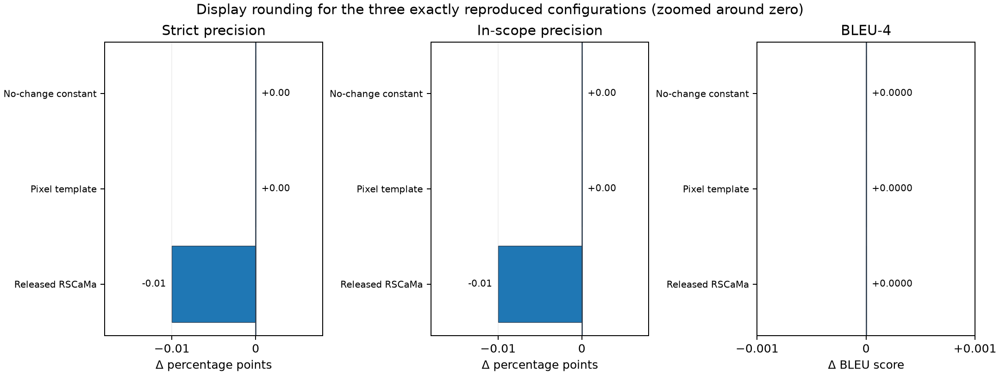
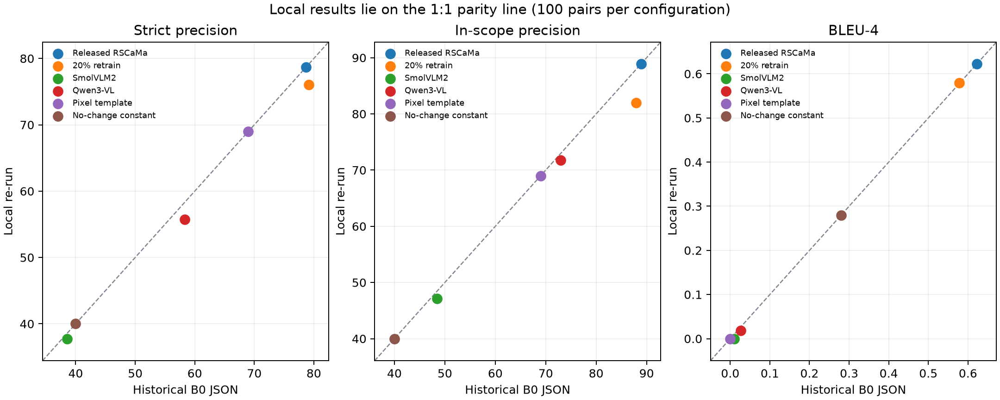
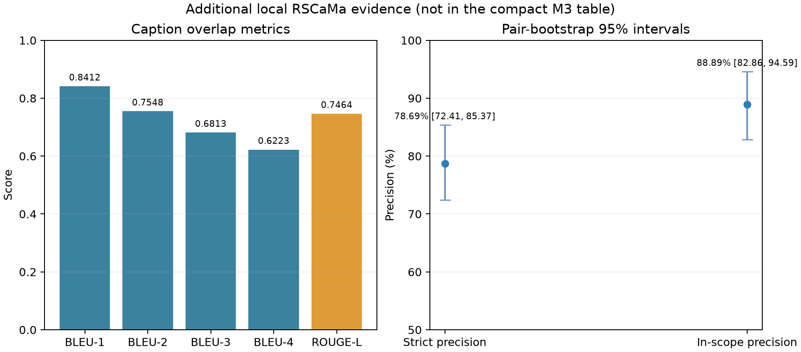

# Milestone 3 implementation evidence - Sarthak Saini

**Project:** TerraWatch · **Work package:** A, change detection and local integration · **Run date:** 9 November 2026

This is the separate POC record for Sarthak's Milestone 3 contribution. It reports what was actually rerun on the local RTX 4060 Ti, compares it with the values already printed in the M3 draft, and keeps older hosted screens clearly labelled as historical evidence.

## Project and POC map

TerraWatch takes two ordered satellite images and aims to return a road/building change mask, a short change description, image regions that support each claim, and an accept/reject/defer decision. The implementation is split into independently run workers so the large models do not have to reside in GPU memory together.

| Area | What it contains | M3 relevance |
|---|---|---|
| `src/data/`, `POC/milestone2/` | Dataset acquisition, audit, split and label contracts | Defines the input and supervision boundary |
| `POC/pipeline/` | BIT worker, RSCaMa/referee worker contracts, orchestration and BIT training entrypoint | Proposed end-to-end route; full learned chain was not yet available locally |
| `POC/execution/` | Caption generation and automatic claim/reference evaluation scripts plus aggregate B0 results | Source of the historical captioning screen |
| `POC/evidence/`, `POC/c-evidence/` | Crop extraction, visual witness and prior synthetic/real demonstrations | Source of Stage C implementation and earlier evidence |
| `POC/benchmarks/` | Model candidate lists, shared evaluation protocol and decision-runtime records | Defines the model screens and prior hosted run evidence |
| `POC/milestone3/` | Architecture report, diagrams, PDF builder and this Sarthak evidence folder | M3 narrative and implementation record |
| `data/raw/LEVIR-MCI-dataset.zip` | User-provided local archive, 10,077 caption records | Source used by the new local tests; not the cleaned M2 handover manifest |

The M3 system design is sensible as a modular plan, but the evidence does not support treating every selected model or the complete model chain as locally validated. This run establishes the detector worker on the available GPU and measures the limits of a short learning pilot.

## Run summary

| Experiment | Local result | What the number means |
|---|---:|---|
| BIT-R18, two-epoch pilot | 100 train / 25 validation / 100 held-out test pairs; best checkpoint from epoch 1 | Real learned three-class detector run; too short and small to establish convergence or a final leaderboard result |
| Released RSCaMa local rerun | 100/100 exact historical screening pairs completed | Captioner loaded on the RTX 4060 Ti; scored with the project's claim evaluator and the same PTB/BLEU implementation |
| RSCaMa caption quality parity | Strict 78.69%, in-scope 88.89%, BLEU-4 0.6223 | All three values reproduce the historical B0 aggregate exactly; this is a rerun on the same validation screen, not new held-out evidence |
| RSCaMa latency | 0.315 s median, 0.380 s p95 per pair; 39.47 s cold load | Local CUDA timing versus historical Apple M4/MPS median 0.139 s; quality parity does not imply timing parity |
| BIT any-change mask | Precision 53.4%, recall 40.1%, F1 45.8%, IoU 29.7% | Road and building predictions merged and scored against any nonzero source-mask pixel |
| BIT class IoU | Road 25.8%, building 27.9%; mean over these two change classes 26.8% | Background-excluded mean; more informative here than the all-class mean because background dominates |
| BIT false alarms on unchanged pairs | 31/45 pairs (68.9%) | A pair-level flag if the model predicts any road or building change pixel |
| Otsu pixel-difference control | Precision 11.1%, recall 33.6%, F1 16.7%, IoU 9.1% | Same held-out test IDs; binary control cannot separate road and building |
| Otsu false alarms on unchanged pairs | 45/45 pairs (100%) | A pair-level flag if any thresholded pixels remain after the validation-selected component filter |
| Stage C synthetic fixtures | 50/50 expected outcomes; 3.96 ms mean per claim on CPU | Re-execution of deterministic generated fixtures only; not satellite-image accuracy |
| Stage C local real-image diagnostic | 2/3 coarse crop-mask presence checks matched on 2 distinct pairs | Claims and regions were authored by hand; the road case is a mismatch, and two claims share one pair |
| Consolidated software tests | 83 passed, 0 failed, 0 skipped | Contract and logic tests; not model-generalisation evidence |

### A-stage candidate status

The assigned screen names nine detector candidates. Only BIT-R18 and the Otsu control ran locally in this pass. A candidate listed in the registry is not a benchmark result.

| Candidate | Status in this local pass | Reason / evidence |
|---|---|---|
| FC-EF | Not run | No local adapter or matched checkpoint was set up |
| FC-Siam-conc | Not run | No local adapter or matched checkpoint was set up |
| FC-Siam-diff | Not run | No local adapter or matched checkpoint was set up |
| SNUNet-CD C16 | Not run | No local adapter or matched checkpoint was set up |
| STANet-PAM | Not run | No local adapter or matched checkpoint was set up |
| BIT-R18 | Pilot run | Pinned BIT source; ImageNet-initialized ResNet-18; local 2-epoch task head; detailed result below |
| ChangeFormer MiT-B0 | Not run | Open-CD environment and matching checkpoint not installed |
| Changer-Ex R18 | Not run | Open-CD environment and matching checkpoint not installed |
| ChangeMamba MambaBCD-Tiny | Not run | Author CUDA/Linux environment and matched task checkpoint not set up |

This does not complete the nine-candidate selection task. The BIT result establishes one viable implementation path and a first measured reference point.

### BIT versus the control

The BIT pilot and Otsu control use the same 100 raw-archive test IDs. The BIT model improves binary any-change F1 by **29.1 percentage points** (45.8% vs 16.7%) and reduces unchanged-pair false alarms by **31.1 points** (68.9% vs 100%). The pilot still misses many annotated changes, and its per-class IoUs remain low. This supports keeping the learned model in the pipeline experiment; it does not establish that BIT is the best detector.

The BIT checkpoint was initialised with the upstream ImageNet ResNet-18 weights. Its backbone remained frozen for both epochs; only the temporal and output layers were updated, for 50 optimizer steps per epoch using batches of two. Validation all-class macro-IoU was 47.1% at epoch 1 and 44.6% at epoch 2, so epoch 1 was retained. Test all-class macro-IoU was 48.3%; that score is lifted by background IoU of 91.2%. The change-class mean IoU was 26.8% (road 25.8%, building 27.9%).

The Otsu control's minimum connected-component area was selected from 0, 16, 32, 50 and 64 pixels using validation macro pair-F1; 64 pixels was selected. Its per-image threshold is adaptive, and the control cannot classify change type. Its latency includes image decoding and control processing on CPU. BIT latency is model forward time on GPU. Those timing figures are not a hardware-matched comparison.

## M3 report values and rerun differences

### Captioning metrics

The M3 values came from the earlier Apple M4/MPS screen over 100 LEVIR validation pairs with the automatic oracle-mask/reference-caption evaluator. I recreated that seeded screen from the local archive, reran the released RSCaMa checkpoint, SmolVLM2, both deterministic controls, and the 20%-budget retrain, then rescored each with the project's claim evaluator and PTB/BLEU tokenizer. The released checkpoint and two controls reproduce their historical aggregates exactly. The retrain and SmolVLM2 have lower local precision and BLEU-4; those differences are retained below as findings, not rounded away.

| Configuration | M3 strict precision | M3 in-scope precision | M3 BLEU-4 | Historical aggregate | Local rerun / delta |
|---|---:|---:|---:|---|---|
| Released RSCaMa | 78.7% | 88.9% | 0.6223 | Exact match in B0 JSON | **Locally reproduced:** 78.69%, 88.89%, 0.6223; delta rounds to 0.0 points / 0.0000 BLEU |
| RSCaMa 20%-budget retrain | 79.2% | 88.0% | 0.5786 | 79.17% / 87.96% / 0.5786 | **Local:** 76.04% / 82.02% / 0.5793; vs historical **−3.13 pp / −5.94 pp / +0.0007** |
| Qwen3-VL-4B | 58.3% | 72.9% | 0.0267 | 58.33% / 72.92% / 0.0267 | **Local:** 55.70% / 71.74% / 0.0183; vs historical **−2.63 pp / −1.18 pp / −0.0084** |
| SmolVLM2-2.2B | 38.6% | 48.4% | 0.0102 | 38.58% / 48.41% / 0.0102 | **Local:** 37.76% / 47.13% / 0.0000; vs historical **−0.82 pp / −1.28 pp / −0.0102** |
| Pixel-difference caption template | 69.0% | 69.0% | 0.0000 | Exact match in B0 JSON | **Locally reproduced:** 69.00%, 69.00%, 0.0000; delta 0.0 points / 0.0000 BLEU |
| Always “no change” | 40.0% | 40.0% | 0.2798 | Exact match in B0 JSON | **Locally reproduced:** 40.00%, 40.00%, 0.2798; delta 0.0 points / 0.0000 BLEU |

The new local caption screen also records measures omitted from the compact M3 table. Released RSCaMa scored BLEU-1/2/3 of 0.8412/0.7548/0.6813, ROUGE-L 0.7464 and CIDEr-D 1.3184. The pixel template scored 0.2458/0.1130/0.0246, ROUGE-L 0.1785 and CIDEr-D 0.0426; always-no-change scored 0.3133/0.2905/0.2833, ROUGE-L 0.4650 and CIDEr-D 0.9370. The retrain scored 0.7872/0.7087/0.6349 on BLEU-1/2/3, ROUGE-L 0.6810 and CIDEr-D 1.0837; SmolVLM2 scored 0.1513/0.0744/0.0220, ROUGE-L 0.1612 and CIDEr-D 0.0022; Qwen3-VL scored 0.1739/0.0850/0.0380, ROUGE-L 0.1740 and CIDEr-D 0.0003. Released RSCaMa reference-fact recall was 76.8% and its no-change false-alarm rate was 0%; the retrain's recall was 58.4% with a 12.5% no-change false-alarm rate; SmolVLM2's recall was 56.0% and unchanged-pair false-alarm rate was 82.5%; Qwen's recall was 72.8% and its unchanged-pair false-alarm rate was 27.5%. The pixel template produced 22.5% false alarms on unchanged pairs, while the always-no-change control had 0%. The latter's relatively high n-gram scores despite its poor claim precision illustrate why BLEU alone is insufficient.

For released RSCaMa, local 95% pair-bootstrap intervals also match the historical ones: strict 72.4%-85.4%, in-scope 82.9%-94.6%. The local retrain intervals are strict 67.3%-84.8% and in-scope 73.6%-89.8%. The local intervals overlap; this 100-pair screen does not establish a reliable gain from retraining. Strict and in-scope precision use different denominators.

This is a reproduction of the same validation screen, not a new held-out result. The released checkpoint was trained on LEVIR-CC train and selected using validation performance. The upstream vocabulary rebuild reads caption text across all official splits, including evaluation references; the local rerun repeated that existing behavior for parity. This is a disclosed text exposure, and the score should not be described as a leakage-free test result. The inference checkpoint is pinned to `lcybuaa/RSCaMa` revision `3e527e6656b62cc615eab1d2f3fb73777cbbf62c` (SHA-256 `5eeba271fb7c2ff4722b725cbf5ce1a1fdc0a33ddf1b077dcf5381aebd643449`).

Local released-checkpoint warm median latency was **0.315 s/pair** (p95 0.380 s; cold load 39.47 s) versus the historical Apple M4/MPS median of 0.139 s. The local retrain median was 0.350 s/pair (p95 0.412 s) versus the historical 0.160 s/pair. SmolVLM2 local warm median was 1.948 s/pair (p95 2.879 s; cold load 12.34 s) versus historical 3.302 s/pair. Qwen3-VL local warm median was 38.684 s/pair (p95 49.383 s; cold load 10.88 s), with peak GPU allocation 7,034 MB, versus historical 7.605 s/pair on Apple M4/MPS. The different devices and runtimes make timing deltas descriptive, not speed claims. Only the released-checkpoint and deterministic-control quality aggregates reproduced exactly.

The two transfer screens are now locally rerun as well. On SECOND-CC, local strict precision is **48.04%**, in-scope precision 50.00%, and BLEU-4 0.2426; the B0 JSON values are identical. On WHU-CDC, local strict precision is **55.56%**, in-scope precision 66.67%, and BLEU-4 0.4717; these also match the historical aggregate exactly. The report's 48.0% and 55.6% strict figures are one-decimal display values. WHU remains subject to its separate usage-rights caveat.

| Transfer dataset | B0 strict / in-scope / BLEU-4 | Local strict / in-scope / BLEU-4 | Raw aggregate delta |
|---|---|---|---|
| SECOND-CC, n=100 | 48.04% / 50.00% / 0.2426 | 48.04% / 50.00% / 0.2426 | 0.00 pp / 0.00 pp / 0.0000 |
| WHU-CDC, n=100 | 55.56% / 66.67% / 0.4717 | 55.56% / 66.67% / 0.4717 | 0.00 pp / 0.00 pp / 0.0000 |

### Referee metrics

| M3 configuration | Historical raw agreement | Local rerun / delta |
|---|---:|---|
| Qwen3 text with common evidence | 41.3% (150 claims) | Not rerun; original export archives and local weights are absent |
| Qwen3-VL with common evidence | 45.3% (150 claims) | Not rerun; original export archives and local weights are absent |
| Qwen3-VL image-backed | 56.7% (150 claims) | Not rerun; original export archives and local weights are absent |

These are raw choices against constructed annotation proxies from 30 validation pairs. They are not human factual accuracy or post-gate acceptance accuracy. The M3 draft and team notes preserve this definition, but the underlying decision exports were not present for local recalculation.

### Witness metrics

| Measure | Prior M3 value | Local rerun | Difference / interpretation |
|---|---:|---:|---|
| Synthetic fixture outcomes | 50/50 (100%) | 50/50 (100%) | 0 points; same deterministic fixture generator and witness code |
| Synthetic mean time | 9.16 ms/claim | 3.96 ms/claim | Not a model-quality metric; different runtime/measurement conditions, so no speedup claim |
| Real-image demonstration | Described as three successful cases | 2/3 coarse mask-region presence checks matched | The local road crop produced a positive witness with zero source-mask change pixels in its hand-authored box; this is a mismatch, not a validated road detection |
| Witness unit tests | 9 Stage C tests | All passed within the 83-test suite | Software behavior only |

The real-image check compares `visible_change` with whether the supplied source mask contains any change pixels inside a manually chosen box. It does not validate object class, change direction, count, or the complete claim. The two construction/road claims use the same `train_000010` image pair and are not independent observations.

### Detector and test-suite metrics

The M3 draft previously had no measured segmentation result for BIT. The local pilot now supplies a first result, but only for the 100-pair subset and short fit described above. The project-level consolidated test count moves from the draft's 81 passing plus one skipped Torch shim to **83 passing with no skips** under the newly installed local POC environment. The suite does not execute a full learned end-to-end pipeline.

## End-to-end pipeline status

The existing coordinator and model-worker contracts connect ordered T1/T2 inputs, detector mask, caption, parsed claims, crop evidence, referee decision and report JSON. I trained/evaluated a small BIT task head and separately ran the pinned RSCaMa captioner. The complete learned chain was not run: the referee checkpoint and original decision exports remain absent, and RSCaMa has not been wired to BIT output in one real coordinator run. Existing orchestration tests use test doubles for the remaining stages. A report that says “the end-to-end pipeline has been validated” would overstate this evidence.

The immediate next implementation sequence is:

1. Freeze and publish one locally reproducible MCI subset manifest, including pair IDs, source split, label projection and hashes.
2. Train BIT with the specified schedule on the approved subset; keep the test IDs sealed until checkpoint selection is complete.
3. Route the reproduced RSCaMa worker after BIT and acquire the pinned Qwen referee checkpoint in its separate local environment.
4. Save raw predictions, checkpoint hashes, worker environment records and per-pair evaluator outputs before changing the aggregate report.
5. Complete a blinded human audit before presenting any learned checker as factuality-validated.

## Reproduction

From the repository root, with the ignored `POC/.venv-benchmark` environment and local archive in place:

```powershell
$env:PYTHONPATH='.'
$env:TORCH_HOME=(Resolve-Path POC\.cache-benchmark).Path
POC\.venv-benchmark\Scripts\python POC\milestone3\sarthak\scripts\benchmark_pixel_control.py
POC\.venv-benchmark\Scripts\python POC\milestone3\sarthak\scripts\train_bit_pilot.py
POC\.venv-benchmark\Scripts\python POC\milestone3\sarthak\scripts\evaluate_local_witness_cases.py
POC\.venv-benchmark\Scripts\python POC\milestone3\sarthak\scripts\prepare_local_rscama_screen.py
$env:B_DATA='data/sarthak_rscama_screen'
$env:TW_CLIP_CACHE=(Resolve-Path POC\.cache-benchmark\clip).Path
$env:PATH='C:\Program Files\Java\jdk-23\bin;'+$env:PATH
POC\.venv-benchmark\Scripts\python POC\execution\scripts\caption_rscama.py --roles screening --device cuda --ckpt <pinned-RSCaMa.pth> --clip-cache $env:TW_CLIP_CACHE
POC\.venv-benchmark\Scripts\python POC\milestone3\sarthak\scripts\evaluate_caption_screen.py
POC\.venv-benchmark\Scripts\python POC\consolidation\scripts\run_checks.py
```

Run JSON, CSVs, checkpoints, source clones, downloaded backbone weights and the isolated environment are local-only. Detailed output summaries are preserved in the ignored `runs/` directory; the scripts and this interpretation are the reviewable POC artifacts.

## Run provenance

| Item | Value |
|---|---|
| Local source archive SHA-256 | `8f7d52298fa3ca32aec983e84addef80f61ad7d981c0ff97a92c5880c4b83e9d` |
| BIT source | `justchenhao/BIT_CD`, pinned commit `adcd7aea6f234586ffffdd4e9959404f96271711` |
| BIT local compatibility edit | Cached source imports `load_state_dict_from_url` from `torch.hub` because the legacy `torchvision.models.utils` path is absent in torchvision 0.24; edit is confined to ignored POC cache |
| RSCaMa source/checkpoint | `Chen-Yang-Liu/RSCaMa` commit `aa68e4c6933c7dd0f2e2f9cbd7642d61929c86a5`; `lcybuaa/RSCaMa` revision `3e527e6656b62cc615eab1d2f3fb73777cbbf62c` |
| RSCaMa local run | `B0_C02_rscama_screening`; 100/100 completed; local-only captions and evaluator outputs under ignored `POC/execution/runs/` |
| Local model environment | Python 3.11.4; PyTorch 2.9.0+cu128; torchvision 0.24.0+cu128; CUDA 12.8 |
| GPU | NVIDIA GeForce RTX 4060 Ti, 8 GB |
| CPU test environment | NumPy 2.4.6, Pillow 12.3.0, OpenCV 5.0.0, Pydantic 2.14.3, pytest 9.2.0 |

## Reproduction proof, figures, and code map

The local proof is an aggregate-to-aggregate comparison, not a claim that the original historical per-pair predictions have been recovered. Each completed configuration uses the same 100-pair frozen screening manifest as the stored B0 aggregate. The released checkpoint and two deterministic controls match exactly at stored precision for strict precision, in-scope precision, and BLEU-4. The RSCaMa table values of 78.7% and 88.9% are rounded display values; local unrounded values are 78.69% and 88.89%, hence -0.01 percentage points versus the printed values. The 20%-budget retrain is lower by 3.13/5.94 percentage points on strict/in-scope precision and +0.0007 BLEU-4; SmolVLM2 is lower by 0.82/1.28 points and -0.0102 BLEU-4; Qwen3-VL is lower by 2.63/1.18 points and -0.0084 BLEU-4.

| Configuration | M3 printed (strict / in-scope / BLEU-4) | Historical B0 JSON | Local evaluation | Local − historical raw | Local − displayed M3 |
|---|---|---|---|---|---|
| Released RSCaMa | 78.7% / 88.9% / 0.6223 | 78.69% / 88.89% / 0.6223 | 78.69% / 88.89% / 0.6223 | 0.00 pp / 0.00 pp / 0.0000 | -0.01 pp / -0.01 pp / 0.0000 |
| 20%-budget retrain | 79.2% / 88.0% / 0.5786 | 79.17% / 87.96% / 0.5786 | 76.04% / 82.02% / 0.5793 | -3.13 pp / -5.94 pp / +0.0007 | -3.16 pp / -5.98 pp / +0.0007 |
| SmolVLM2-2.2B | 38.6% / 48.4% / 0.0102 | 38.58% / 48.41% / 0.0102 | 37.76% / 47.13% / 0.0000 | -0.82 pp / -1.28 pp / -0.0102 | -0.84 pp / -1.27 pp / -0.0102 |
| Qwen3-VL-4B | 58.3% / 72.9% / 0.0267 | 58.33% / 72.92% / 0.0267 | 55.70% / 71.74% / 0.0183 | -2.63 pp / -1.18 pp / -0.0084 | -2.60 pp / -1.16 pp / -0.0084 |
| Pixel-difference template | 69.0% / 69.0% / 0.0000 | 69.00% / 69.00% / 0.0000 | 69.00% / 69.00% / 0.0000 | 0.00 pp / 0.00 pp / 0.0000 | 0.00 pp / 0.00 pp / 0.0000 |
| Always “no change” | 40.0% / 40.0% / 0.2798 | 40.00% / 40.00% / 0.2798 | 40.00% / 40.00% / 0.2798 | 0.00 pp / 0.00 pp / 0.0000 | 0.00 pp / 0.00 pp / 0.0000 |

For proof, `evaluation_proof.json` records SHA-256 hashes and byte sizes for the historical aggregate, input archive, local manifests, model checkpoint, run records, raw captions, evaluator summaries, and evaluator source files. The local captions can be re-scored from the saved raw JSONL with the evaluator; historical results preserve aggregate scores only, so a pair-by-pair comparison to historic captions is not possible. The supplementary local run adds BLEU-1/2/3, ROUGE-L, CIDEr-D, reference-fact recall and its pair-bootstrap interval, no-change false alarms, and local latency. Those added figures are new measurements from the local run; only the core aggregate parity is a reproduction claim.

The static figures are generated by `scripts/plot_evaluation_proof.py` from that JSON proof file:







### Evaluation and benchmark code

| Purpose | Code / evidence location |
|---|---|
| Generate released RSCaMa captions | `POC/execution/scripts/caption_rscama.py` |
| Generate pixel-template and constant controls | `POC/execution/scripts/controls.py` |
| Shared caption claim and text evaluator | `POC/execution/scripts/evaluate.py` |
| Prepare the frozen local caption screen | `POC/milestone3/sarthak/scripts/prepare_local_rscama_screen.py` |
| Re-score the local caption screen and write metric JSON | `POC/milestone3/sarthak/scripts/evaluate_caption_screen.py` |
| Compare historical and local outputs, hashes, and deltas | `POC/milestone3/sarthak/scripts/build_evaluation_proof.py` |
| Render the three static figures | `POC/milestone3/sarthak/scripts/plot_evaluation_proof.py` |
| BIT learned detector pilot and scoring | `POC/milestone3/sarthak/scripts/train_bit_pilot.py` (training and held-out evaluation in the same script) |
| Otsu pixel-difference mask baseline | `POC/milestone3/sarthak/scripts/benchmark_pixel_control.py` |
| SmolVLM2 / Qwen3-VL caption worker | `POC/execution/scripts/caption_vlm.py` |
| RSCaMa 20%-budget retraining and local caption generation | `POC/b-captioning/colab/rscama_colab.py` (local run: 13 epochs, early stopped; best epoch 4) |
| Local Qwen referee screen | `POC/milestone3/sarthak/scripts/run_local_referee_screen.py` |
| Referee runtime benchmark utilities | `POC/benchmarks/colab/benchmark_runtime.py` |

Rebuild the proof and plots after a fresh local evaluation with:

```powershell
POC\.venv-benchmark\Scripts\python POC\milestone3\sarthak\scripts\build_evaluation_proof.py
POC\.venv-vlm\Scripts\python POC\milestone3\sarthak\scripts\plot_evaluation_proof.py
```

