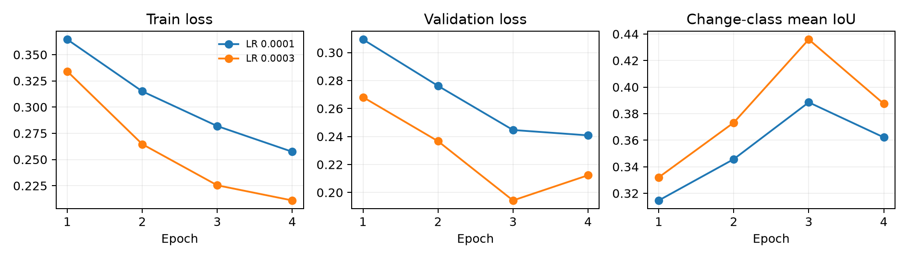

# TerraWatch

**Milestone 4 | Training, model selection and evidence review**

DS & AI Lab Project (BSDA4001) | IIT Madras | Group 7

## 1. Introduction

TerraWatch describes visible building and road changes between aligned satellite images. Milestone 3 selected BIT-ResNet18 for dense localisation, RSCaMa for captioning, an OpenCV witness for crop inspection, and Qwen3-VL for claim decisions. Training concerns BIT and RSCaMa. The visual witness uses fixed rules and the referee uses frozen weights.

## 2. Training data

The strict Milestone 2 LEVIR-MCI package contains **9,544 pairs**: 6,444 for training, 1,242 for validation and 1,858 for test. The prepared pixel shares are **91.24% background, 3.65% road and 5.11% building**. The earlier BIT pilot and RSCaMa subset retraining use distinct raw-release subsets. The M4 comparison reads the strict training and validation manifests and checks selected source bytes against the recorded SHA-256 hashes. Source annotations serve as supervision and evaluation references.

## 3. Model configuration and training

| Component | Training and selection |
|---|---|
| BIT-ResNet18 | ImageNet-initialised shared encoder, four tokens per date, one encoder layer, eight decoder layers and three pixel classes. Inputs are RGB pairs scaled to [-1,1]. Focal and soft Dice losses address change-class imbalance. |
| RSCaMa | CLIP ViT-B/32 features, temporal state-space fusion and Transformer decoder. The subset retrain builds its vocabulary from 1,313 fitting pairs, uses 50 development pairs for checkpoint selection, and trains on reference captions with token cross-entropy. |
| Witness and referee | The witness inspects crop differences, edges, lighting and alignment. The Qwen referee receives a claim, both images and structured evidence, and produces an accept, reject or defer decision. |

## 4. Training environment

The M4 comparison ran on a Colab NVIDIA L4 (22.0 GiB reported), with PyTorch 2.14.1, torchvision 0.29.1 and CUDA 13.0. The learned replay used the same GPU class with separate RSCaMa and Qwen environments. The Qwen worker ran in BF16 with Transformers 5.17.0. Workers run in separate subprocesses to release GPU memory between stages. Run metadata and configuration are retained with the evidence.

<!-- PAGEBREAK -->

## 5. Methodology, optimisation and regularisation

Both M4 arms started from the same ImageNet-initialised BIT weights and kept ResNet18 frozen. Each arm ran four epochs with batches of four, using AdamW, weight decay of 0.01 and a constant learning rate. Paired horizontal flips preserve spatial correspondence across T1, T2 and the mask. The objective gives equal weight to soft Dice and focal loss with gamma 2 and class weights 0.10, 0.45 and 0.45 for background, road and building. Validation road/building mean IoU determines checkpoint selection.

RSCaMa uses Adam at 0.0001 and development BLEU-4 for checkpoint selection in the recorded subset protocol. A training-only vocabulary constrains the retrain to its fitting data. Its fusion and decoder use dropout, and the image geometry stays consistent with spatial caption terms.

## 6. Experiments and checkpoint selection

| Run or benchmark | Measured result | Selection role |
|---|---|---|
| BIT pilot, epoch 1 | 47.1% validation all-class macro-IoU | Best of the two logged pilot epochs |
| BIT pilot, epoch 2 | 44.6% validation all-class macro-IoU | Lower than epoch 1 by 2.5 points |
| BIT vs Otsu, matched 100-pair screen | 45.8% vs 16.7% binary F1 | Detector pilot comparison. BIT false alarms were 31/45, versus 45/45 for Otsu. |
| Released vs subset-trained RSCaMa, local 100-pair screen | 78.69% vs 76.04% strict automatic claim precision. BLEU-4 of 0.6223 vs 0.5793. | The released checkpoint leads both measures on this shared screen. |

The BIT pilot's validation score peaks at epoch 1 within the observed two epochs. Its evaluation road/building mean IoU is 26.8%. Binary IoU of 29.7% compares with 9.1% for Otsu on the same binary target. The captioning comparison measures automatic reference and mask agreement. The released RSCaMa checkpoint retains its pinned revision and matching vocabulary.

<!-- M4_COMPARISON_BEGIN -->

### Matched learning-rate comparison

Both arms used 192 strict training pairs and 64 strict validation pairs on NVIDIA L4. The comparison completed 4 common epochs with identical initial weights, batch size and paired flips.

| Head learning rate | Best epoch | Validation change-class mean IoU |
|---|---:|---:|
| 1e-4 | 3 | 38.85% |
| 3e-4 | 3 | 43.59% |

Learning rate 0.0003 led by **4.74 percentage points** at the best epoch. Its epoch-3 checkpoint reached **42.19% road IoU, 44.99% building IoU and 65.00% binary F1**. Training loss fell from 0.3342 to 0.2109. Validation loss rose from 0.1943 to 0.2123 in epoch 4 as change-class IoU fell to 38.74%, supporting selection of epoch 3. The comparison used the validation split throughout.

<!-- M4_COMPARISON_END -->

<!-- PAGEBREAK -->

## 7. Challenges and trade-offs

Most pixels represent background, so the detector reports road/building overlap and binary change metrics alongside all-class scores. The measured false alarms motivate crop-level inspection and explicit deferral. The referee score is conditional on the three decision tokens. The acceptance policy uses its operating threshold and defers exact counts when independent instance evidence is absent.

## 8. Evidence review and demonstration

The review interface imports the coordinator's claim records and displays both source images, the detector mask, marked regions, corresponding crops, witness observations and the recorded decision. Source image hashes are checked before display. Records link to the report by its SHA-256 and the claim ID. Reviewers can flag a claim, revise its wording or count, add a reason and record a decision. SQLite retains successive review events and the original pipeline outcome. The viewer exports claim records and their review history as JSON.

| LEVIR-MCI pair | Generated RSCaMa caption | Referee and gate |
|---|---|---|
| train_000010 | A house appears at the bottom of the scene. | Qwen deferred. The 19 ? 17 px crop fell below the witness's 24 px minimum, and the count check required independent instance evidence. |
| val_000005 | The scene is the same as before. | Qwen proposed acceptance with a conditional score of 0.6357. The 0.80 operating gate deferred the claim. |

Both image pairs completed BIT prediction, captioning, crop inspection, referee inference and report generation. The executed notebook records upload of the earlier CPU checkpoint `lr_1e-4.pt`. Model selection for M5 uses the separate L4 sweep winner. The viewer opens the two learned runs and supports an explicit reviewer decision on either claim. The browser walkthrough separately exercised acceptance, flagging, correction, reload and export through scripted reviewer actions.

## 9. Milestone 5 handover

The evaluation entry points support checkpoint-specific detector and caption assessment. The evidence viewer provides a separate record of human decisions and corrections, which can be linked to the same run and claim identifiers for the M5 audit. Controlled training uses validation for selection and keeps the test partition outside the learning-rate comparison.

## References

1. [Milestone 2 data preparation and audited cohort](../../reports/Milestone2_Report.md).
2. [Milestone 3 model selection and architecture](../../reports/Milestone3_Report.md).
3. [Historical detector and caption training evidence](../milestone3/sarthak/Benchmark_Report.md).
4. [Model setup and reproducibility](../../docs/models/README.md).
5. [Milestone 4 run instructions and code walkthrough](Walkthrough.md).
6. [Colab training configuration and checkpoint receipt](evidence/colab_comparison/selection.json).
7. [Learned demo outputs and claim-level receipt](evidence/colab_learned_demo/receipt.json).
