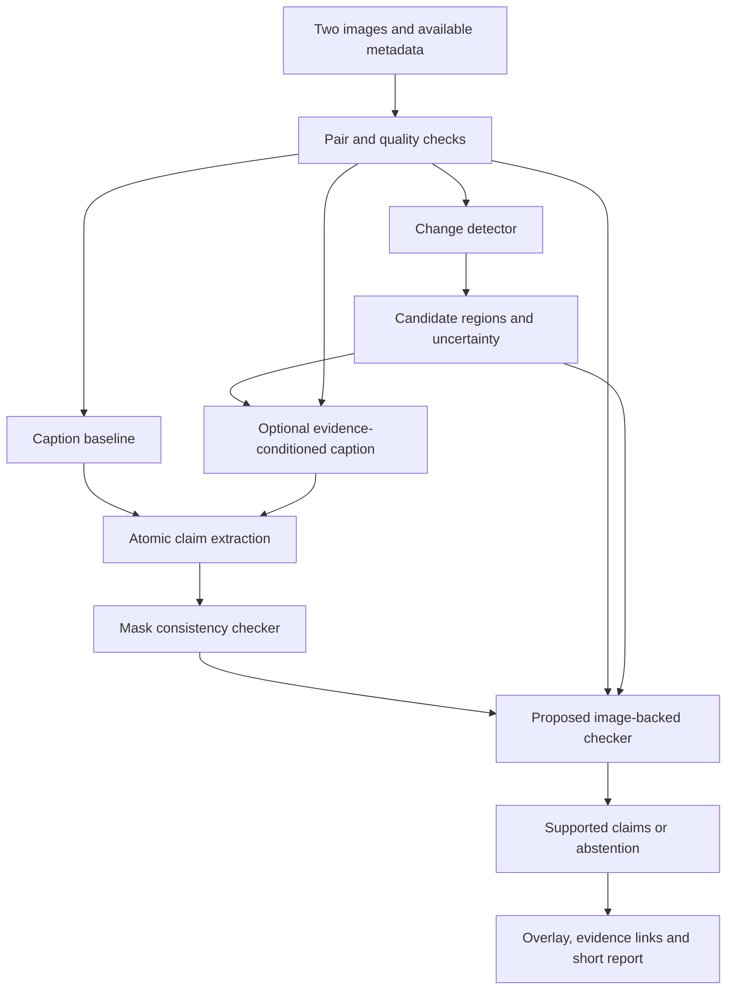

# Proposed POC system

This is a design, not implemented software. The initial system compares two dates; a multi-year time-series product is a later extension.

## Data flow

The evaluation reference follows a separate path: human inspection of the original pair plus available annotations. It must not be defined by whichever mask the pipeline predicts.

## Minimal components and alternatives

| Component | First choice | Why / fallback |
|---|---|---|
| Data handling | Small Python loader and immutable manifest | Transparent paired inputs; geospatial libraries only when actual geographic metadata is needed |
| Detector | One compatible pretrained detector, plus absdiff/Otsu diagnostic | Prefer rapid feasibility. Select checkpoint after label/split audit, not from leaderboard alone |
| Future trainable baseline | Early-fusion U-Net or compact Siamese U-Net | Tests a meaningful simple baseline before ChangeFormer. Use one framework, preferably PyTorch, in an isolated POC environment |
| Caption baseline | One specialist pretrained captioner if runnable | Chg2Cap/MCINet candidates; benchmark contamination and environment requirements must be logged |
| Language fallback | Evidence-limited templates | Useful for integration; not a substitute for evaluating a genuine image-only caption baseline |
| Claim extractor | Restricted schema with rules/manual correction first | Separates extraction mistakes from checking mistakes; an LLM parser can be added later and audited |
| Checker | Mask-only rules, then image-backed checks | Makes the proposed added value measurable |
| Interface | JSON plus saved side-by-side overlay first | Add Streamlit only after useful outputs exist |

Do not install legacy baseline dependencies into the root project's environment. Pin separate dependencies, record upstream commit and checkpoint hash, and wrap inputs/outputs with an adapter rather than modifying the submitted code.

## Evidence contract

Each candidate event should carry: pair ID; region ID and pixel coordinates; mask class with ontology/version; changed-pixel area; connected-region count; quality flags; detector score and its interpretation; evidence paths; and explicit unknown fields.

Each claim should carry: exact text span; object/type; action (`added`, `removed`, `changed`, `unchanged`, `unknown`); location; quantity and units; evidence-region IDs; checker outcome; reason code; and evidence source.

Distinguish `consistent_with_prediction` from `supported_by_image_review`. Proposed automated outcomes are `supported`, `contradicted`, and `unverifiable`, with a separate evidence-source field. These are machine judgments, not guaranteed truth. Human adjudication is stored separately.

Dates, metric area, legal status and object counts default to null. An output example may say “A change region is detected near the upper-right of the image; the object type is uncertain.” It must not turn an untyped binary mask into “three illegal buildings were constructed.” Image-relative “upper-right” is not geographic northeast without orientation metadata.

## Proposed verification mechanism

### Baseline V0: mask consistency

Parse a candidate sentence and compare only quantities/locations/classes that the predicted mask actually encodes. Return agreement or discrepancy. A binary mask cannot resolve building-versus-road type or addition-versus-removal direction. Connected components are **regions**, not verified buildings.

### Candidate V1: image-backed checks with abstention

1. Decompose the sentence into independently judgeable claims. Retain the source span so users can inspect any correction.
2. Locate the proposed region using the mask and a bounded surrounding crop from **both** original images. Include uncropped context to reduce crop-induced ambiguity.
3. For object/action claims, seek time-specific visual evidence using one fixed pretrained model or explicit human annotation in the first diagnostic. A human oracle is labeled as such and is not counted as an automated system.
4. Compare visual evidence with the claim and mask. Disagreement triggers `unverifiable`/review rather than selecting whichever model sounds more confident. Agreement between two models is corroboration, not independence or proof.
5. For numerical claims, allow exact counts only with validated instance-level evidence. Otherwise report a changed region or abstain. Retain pixel-area descriptions only when their scope and units are clear.
6. Reject unsupported causes, ownership and legality. Real legal assessment would need parcel/permit records, jurisdiction-specific rules and human review; those are outside this POC.
7. Produce a constrained revised description from retained claims, preserving original and revised outputs and all rejection reasons. Never silently convert “unverifiable” to “false.”

V1 is a research proposal. Its visual witness may share training data or failure modes with the detector/captioner. The proposed evidence-corruption and human-audit experiments must establish whether it adds useful information.

## Specific hard cases

- Touching roofs merge into one component; a roof may fragment into multiple components. Component-count error therefore cannot stand in for building-count error.
- A changed roof may indicate reconstruction, changed view, illumination or occlusion. Two snapshots rarely establish the complete intervening story.
- A building visible only in T2 could have been occluded in T1. Addition requires adequate visibility at both times.
- A no-change caption on an empty predicted mask can still miss true change. Evaluate omissions and no-change specificity separately.
- A shifted image creates edge bands around unchanged buildings. Flag alignment uncertainty and test boundary tolerance explicitly rather than calling every band construction.
- An external detector trained on generic street imagery may fail on overhead roofs. Treat it as an unverified candidate until a small annotated validation audit supports its use.

## Compute and runtime plan

Before implementation, inventory available GPU/VRAM, storage, CUDA/PyTorch compatibility and access to Colab/Kaggle if relevant. No GPU suitability was measured in this research pass.

Start with 5–10 selected development pairs. Measure cold startup, warm inference by stage, peak allocated/reserved VRAM and output sizes. Cache frozen upstream predictions when comparing checkers so they see identical candidates. Keep cached timing separate from fresh end-to-end timing.

Future small training pilots should have a written estimate and a bounded run budget before launch: proposed maximum two compact detector configurations, one seed initially, a short epoch/step cap, and early stopping. Choose numeric caps after timing a batch. No full detector training, captioner pretraining, large instruction tuning, paid API calls, or paid retries are part of this research pass.

## Later extensions

Promote only evidence-supported capabilities: semantic transitions with suitable labels; geospatial area with verified transforms; three-or-more-date trajectories with consistent registration and uncertainty; external permit/parcel joins for officer review; broader environmental imagery on its own resolution-compatible benchmark. Each adds new data and evaluation requirements rather than inheriting validity from the urban two-date POC.
