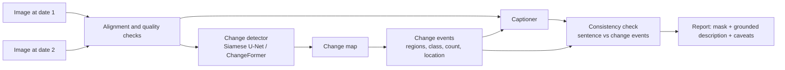

# TerraWatch: Milestone 1 Report

**Problem Definition and Literature Review**

DS & AI Lab Project (BSDA4001), IIT Madras BS in Data Science and Applications · Group 7 · October 2026

| Name | Student email | GitHub |
|---|---|---|
| Priyanshu Agarwal | 23f2003488@ds.study.iitm.ac.in | [23f2003488](https://github.com/23f2003488) |
| Sarthak Saini | 23f2005347@ds.study.iitm.ac.in | [Sarthak-Saini265](https://github.com/Sarthak-Saini265) |
| Sujal Raj Pradhan | 23f2004759@ds.study.iitm.ac.in | [SujalPradhan](https://github.com/SujalPradhan) |
| Shoaib SSM | 24f2000857@ds.study.iitm.ac.in | [shoaib2000857](https://github.com/shoaib2000857) |

The approved problem statement is in [`Problem_Statement.md`](Problem_Statement.md). This report narrows it to a specific, testable problem.

---

## Contents

1. [Problem definition](#1-problem-definition)
2. [Scope and assumptions](#2-scope-and-assumptions)
3. [Stakeholders](#3-stakeholders)
4. [Why this problem matters](#4-why-this-problem-matters)
5. [Objectives](#5-objectives)
6. [How the problem is addressed today](#6-how-the-problem-is-addressed-today)
7. [Benchmarks, metrics and baselines](#7-benchmarks-metrics-and-baselines)
8. [Gaps in current solutions](#8-gaps-in-current-solutions)
9. [Proposed direction and contribution](#9-proposed-direction-and-contribution)
10. [Data availability and feasibility](#10-data-availability-and-feasibility)
11. [Evidence plan: how we will show it works](#11-evidence-plan-how-we-will-show-it-works)
12. [Risks and mitigations](#12-risks-and-mitigations)
13. [References](#13-references)

---

## 1. Problem definition

Satellites photograph the same places again and again. Comparing two images of one place taken months or years apart shows what changed: a new building, a cleared plot, a widened road. Indian cities and government bodies already use this to catch unauthorised construction [3][4].

Today's automated tools mostly stop at a **change map**, a black-and-white mask marking which pixels changed. A person still has to open every flagged spot and work out what changed and whether it matters. Many flags are not real changes at all. Shadows move, the sun angle shifts, and the two images may be slightly misaligned or taken in different seasons.

Newer vision-language models can describe a change in a sentence. But they are known to state things the image does not support, such as wrong counts, objects that are not there, or causes nobody can know from two pictures [7][17].

> **Problem statement.** How can two satellite images of the same place be turned into a localised, plain-language account of what changed, one that only says what the imagery supports, and that holds up when the images differ for reasons that are not real change (lighting, season, alignment)?

We focus on **urban and built-up change** (new or removed buildings, roads, groundwork), because this is where good labelled data exists, where there are real users today, and where a claim can be checked against a label.

## 2. Scope and assumptions

| In scope | Out of scope |
|---|---|
| Pairs of co-registered, high-resolution RGB images (about 0.5 m per pixel) of the same place at two dates | Real-time or nationwide monitoring |
| Building and road change: appearance, removal, groundwork | Deciding legality, ownership or intent |
| A pixel-level change map for each pair | Explaining *why* a change happened (causes cannot be identified from two images) |
| A short description of the change that is grounded in the change map (what, where, roughly how many) | Damage, cost or risk estimates |
| Robustness to nuisance differences: brightness, colour, shadows, small misalignment, compression | Area in m² or map coordinates when the images carry no georeference |
| Evaluation on public benchmarks with fixed splits, plus a human factual audit of descriptions | Validated claims on 10 m Sentinel-2 imagery, forests or disasters (at most a clearly labelled demo) |
| A local demo (upload two images, see the mask and the description) | A production service or a live map of India |

**Assumptions.** The two images are already roughly aligned, which holds for the benchmark datasets. Labels from the datasets are treated as ground truth, while noting that each dataset labels only some kinds of change (for example, LEVIR-CD labels buildings only). Anything a dataset does not label is treated as *unlabelled*, not as "no change".

## 3. Stakeholders

| Stakeholder | Role | What they need | What TerraWatch gives them |
|---|---|---|---|
| **Building and encroachment officers** in urban local bodies (e.g. Mumbai's BMC) | Primary | Find new or unauthorised structures early, then verify on the ground | Change maps plus a one-line description per flagged area, so they know what to look for before a site visit |
| **Defence Estates / cantonment boards** | Primary | Catch encroachment on defence land across 62 cantonments | Same as above; their existing tool already compares Cartosat-3 images from different dates [4] |
| **Urban planners and development authorities** | Secondary | Track where and how fast an area is being built up | Consistent, comparable change reports |
| **Remote-sensing researchers** | Secondary | Reproducible baselines and honest evaluation of change captioning | Code, fixed splits, a factual-accuracy audit protocol and its results |
| **Journalists, NGOs, students** | Secondary | Understand imagery changes without GIS expertise | Plain-language descriptions with stated limits |

## 4. Why this problem matters

**There is far more imagery than people to check it.** One mission alone, Sentinel-2, publishes over 4 TB of new products every day [1]. Commercial and national satellites add much more. Nobody reviews this by hand.

**Users are already paying for flag-and-verify systems.** In July 2026, Mumbai's municipal corporation approved a system that combines AI, drones and satellite images to flag illegal construction and extra floors early [3]. Since 2022, India's Directorate General Defence Estates has run change-detection software in all 62 cantonment boards, comparing Cartosat-3 images from different dates to detect unauthorised construction [4]. In both cases the software raises a flag, and an officer checks it.

**The slow, expensive part is the human check.** Every false flag costs an officer time. Every flag without context ("something changed here") has to be interpreted before anyone can act. A tool that marks real change and says plainly what it is, without overstating, directly reduces that cost.

Typical settings where the problem arises:

- a ward officer reviewing new construction in their area every quarter
- an estate officer checking for encroachment on government land
- a planner comparing growth across neighbourhoods
- a researcher evaluating whether a change-captioning model can be trusted

## 5. Objectives

Each objective has a metric and a comparison fixed in advance. Targets are hypotheses we will test, not promised results.

| # | Objective | Metric | Comparison and target |
|---|---|---|---|
| O1 | **Detect where buildings and roads changed** | Change-class F1, IoU, precision, recall (LEVIR-CD); mIoU (LEVIR-MCI) | Reproduce a Siamese U-Net and ChangeFormer within about 2 F1 points of published results (ChangeFormer reports 90.40 F1 on LEVIR-CD [5]) |
| O2 | **Ignore changes that are not real** | F1 drop under controlled perturbations: brightness/contrast, colour cast, blur, JPEG compression, small misalignment, at 3 severities each | A robustness-trained model loses noticeably less F1 than the plain baseline (target: at least 25% smaller average drop) while staying within 1 F1 point on clean images |
| O3 | **Describe the change without overstating** | (a) BLEU-4, METEOR, ROUGE-L, CIDEr-D; (b) count error against the ground-truth mask; (c) supported-claim precision and hallucination rate from a blinded human audit | Captions conditioned on the change map keep text scores near published baselines (Chg2Cap: 64.39 BLEU-4, 136.61 CIDEr-D on LEVIR-MCI [7]) and raise supported-claim precision by at least 10 percentage points over an image-only captioner |
| O4 | **Make it usable** | End-to-end latency per pair on stated hardware; a working demo | Under 5 s per 256×256 pair on a free Colab T4 GPU; demo runs from the README |

## 6. How the problem is addressed today

### 6.1 Classical change detection

The oldest approach subtracts the two images, or compares spectral vectors (change vector analysis), and thresholds the difference, for example with Otsu's method, then cleans the result with morphology.

> **Limitation.** These methods are fast and easy to explain, but any difference counts as change. Shadows, seasonal colour and small misalignment all light up as false positives. They also say nothing about *what* changed.

### 6.2 Siamese convolutional networks

Deep learning replaced thresholds with learned features. Daudt et al. introduced fully convolutional early-fusion and Siamese networks (FC-EF, FC-Siam-conc, FC-Siam-diff), which encode both images and compare their features [8]. U-Net-style encoders with a difference step remain strong.

> **Limitation.** They need pixel-level labels, and they learn whatever kinds of change the dataset labels. Their output is still only a mask.

### 6.3 Transformer models

BIT models the two dates with a transformer over a few semantic tokens [9]. ChangeFormer uses a hierarchical transformer encoder in a Siamese setup and reports 90.40 F1 on LEVIR-CD [5].

> **Limitation.** Gains over CNNs are small. A 2024 study retrained recent methods under a fixed protocol and found that a plain U-Net "without training tricks or complicated architectural changes is still a top performer" [6]. Detection accuracy on the main benchmarks is close to saturated.

### 6.4 Foundation and zero-shot models

Newer work avoids task-specific training. AnyChange adapts the Segment Anything Model to find changes without training, and reports a new best result for unsupervised change detection on SECOND [10]. RemoteCLIP aligns remote-sensing images with text, enabling zero-shot labelling and retrieval [11].

> **Limitation.** Zero-shot detection still trails supervised models on standard benchmarks, and it also produces masks or labels, not explanations.

### 6.5 Change captioning

Change captioning generates a sentence describing the difference between two images. The LEVIR-CC benchmark has 10,077 image pairs with 50,385 human-written sentences [12]. RSICCformer [12] and Chg2Cap [13] are the standard trained baselines.

> **Limitation.** They are trained and scored with n-gram overlap metrics (BLEU, CIDEr), which reward sounding like the reference rather than being correct. A caption can score well and still get the count or location wrong. The captioner also does not use the change map, even when one exists.

### 6.6 Integrated systems and vision-language models

**Change-Agent** is our closest precedent. Its MCI model has a change-detection branch and a captioning branch trained together on LEVIR-MCI, with an LLM on top for interactive analysis [7]. ChangeChat instruction-tunes a vision-language model for questions about image pairs [14]. CCExpert adds a difference-aware module to a multimodal LLM and pretrains on 200,000 image pairs [15].

> **Limitation.** These systems are judged mostly by the same n-gram scores. Large models can still produce fluent, unsupported statements. Their training data increasingly includes LLM-generated captions, which can carry errors of their own [15]. Ricci et al. (2026) evaluate general vision-language models for change captioning and propose FMScore, an LLM-based check of captions against ground-truth facts [17]. This shows the field recognises the factuality problem but has not solved it.

### 6.7 Operational and commercial tools

| Tool | What it does | Gap for our users |
|---|---|---|
| Google Earth Engine [22] | Cloud platform for analysing satellite archives with code | A platform for experts; no ready-made explanation of a change |
| Copernicus Browser [22] | Browse and compare Sentinel imagery over time | Visual comparison only; 10 m imagery is too coarse for single buildings |
| DGDE change-detection software | Flags changes between Cartosat-3 images for cantonment boards [4] | Flags still need human interpretation and field checks |
| BMC illegal-construction system (approved 2026) | AI + drones + satellite + GIS to flag new structures [3] | Planned; no public accuracy figures |
| Commercial analytics (e.g. Planet, Picterra) | Paid detection and monitoring products | Not evaluated by us; outputs are generally maps and alerts |

### 6.8 Baseline we compare against

The baseline reflects common practice: a **trained change detector** (Siamese U-Net, ChangeFormer) and a **trained change captioner** (Chg2Cap or RSICCformer), each run separately. The captioner sees only the two images. Our work tests whether giving the captioner the change map, and checking its output against that map, gives more truthful descriptions at similar text scores.

## 7. Benchmarks, metrics and baselines

### 7.1 Datasets

| Dataset | What is labelled | Size | Resolution | Role for us |
|---|---|---|---|---|
| **LEVIR-MCI** [7] | Change masks (background, road, building) and 5 captions per pair | 10,077 pairs, 256×256 | 0.5 m | **Primary**: the only set with aligned masks *and* captions |
| **LEVIR-CC** [12] | 5 human captions per pair | 10,077 pairs, 50,385 sentences | 0.5 m | Caption baselines; same images as LEVIR-MCI |
| **LEVIR-CD** [16] | Binary building change, 31,333 change instances | 637 pairs, 1024×1024 | 0.5 m | Detection benchmark |
| **LEVIR-CD+** [18] | Binary building change | 985 pairs (637 train / 348 test) | 0.5 m | Extra detection training and evaluation |
| **S2Looking** [19] | Building change in side-looking, rural images | 5,000 pairs, 1024×1024, 65,920 instances | 0.5–0.8 m | Robustness test: harder viewing angles and lighting |
| **SYSU-CD** [20] | Binary change: buildings, groundwork, vegetation, roads, sea construction | 20,000 pairs, 256×256, Hong Kong 2007–2014 | 0.5 m | Cross-dataset generalisation |
| **SECOND** [21] | Before/after land-cover classes (6 classes, 30 change types) | 4,662 pairs, 512×512; 2,968 openly available | Aerial | Optional: *what* changed beyond buildings |
| **ChangeChat-105k** [14] | About 105k instruction/answer pairs about image pairs | Annotations only; images from LEVIR-CC | n/a | Optional: question answering |

### 7.2 Metrics used in the literature

| Task | Common metrics | How success is defined in existing work |
|---|---|---|
| Binary change detection | Precision, recall, **F1** and **IoU** of the change class; overall accuracy | Higher F1/IoU on a benchmark's fixed test split |
| Multi-class change masks | **mIoU** over classes (LEVIR-MCI: background, road, building) | Higher mIoU |
| Semantic change detection | mIoU, **separated kappa (SeK)** | Higher SeK on SECOND |
| Change captioning | **BLEU-1…4, METEOR, ROUGE-L, CIDEr-D**; sometimes their average | Higher n-gram overlap with reference sentences |
| Factuality of captions | Rarely measured; FMScore (LLM-based fact matching) is recent [17] | No standard yet |

Overall accuracy is not very informative for change detection: most pixels do not change, so a model that predicts "no change" everywhere still scores high. We report change-class F1 and IoU as primary.

### 7.3 Published baselines

**Building change detection, LEVIR-CD** (from the ChangeFormer paper [5]):

| Method | Precision | Recall | F1 | IoU |
|---|---|---|---|---|
| FC-Siam-Diff | 89.53 | 83.31 | 86.31 | 75.92 |
| BIT | 89.24 | 89.37 | 89.31 | 80.68 |
| ChangeFormer | 92.05 | 88.80 | 90.40 | 82.48 |

**Detection and captioning, LEVIR-MCI** (from the Change-Agent paper, Table II [7]):

| Method | Change detection mIoU | BLEU-4 | METEOR | ROUGE-L | CIDEr-D |
|---|---|---|---|---|---|
| FC-Siam-Diff | 84.20 | n/a | n/a | n/a | n/a |
| BIT | 84.16 | n/a | n/a | n/a | n/a |
| RSICCformer | n/a | 60.44 | 38.76 | 72.63 | 130.00 |
| Chg2Cap | n/a | 64.39 | 40.03 | 75.12 | 136.61 |
| MCINet (Change-Agent) | 86.43 | 65.95 | 40.80 | 75.96 | 140.29 |

Scores for the same method vary between papers because of different evaluation scripts [13]. We will compare methods only within one table, and rerun baselines ourselves where possible.

## 8. Gaps in current solutions

1. **Detection is close to saturated.** Top methods are within about 4 F1 points of each other on LEVIR-CD, and a well-trained U-Net is still near the top [5][6]. Another detector is unlikely to be a meaningful contribution.
2. **Descriptions are not checked for truth.** Captioners are scored on n-gram overlap. A sentence with the wrong number of buildings can still score well. Factual evaluation is only now being proposed [17].
3. **Captioners ignore the evidence they could use.** Most captioning models never see the change map. Change-Agent trains both tasks together, but its captions are still scored with n-gram metrics, and nothing checks the sentence against the predicted mask [7].
4. **Robustness to nuisance change is rarely reported.** Methods perform much worse on S2Looking's side-looking images than on near-nadir LEVIR-CD+ [19], yet most papers report only clean in-domain scores.
5. **Large models are hard to run and hard to trust.** VLM-based systems need large GPUs and are increasingly trained on generated captions [15], which makes it harder to know where an error comes from.

**Opportunity.** There is room for a system that keeps a strong, standard detector, uses its change map as explicit evidence for the description, checks the description against that evidence, and reports **how often the description is actually correct**, measured by people, alongside the usual scores.

## 9. Proposed direction and contribution

**Where our contribution lies:** **reliability (factual correctness) and robustness**, not raw detection accuracy.

1. **Detect.** Train standard detectors (O1), with augmentation aimed at nuisance changes (O2).
2. **Turn the mask into evidence.** Convert the predicted change map into a list of change events: each region's class (building or road), size in pixels, rough location in the image (for example "lower left") and count.
3. **Describe with the evidence.** Generate the caption with the change events as an explicit input, alongside the images.
4. **Check.** Compare each claim in the sentence (count, object type, location) with the change events. Remove or soften claims the evidence does not support, and say so in the report.
5. **Measure truthfulness.** Report standard text scores and a human audit of whether each claim is supported.

**How this differs from Change-Agent [7].** Change-Agent shares features between detection and captioning, but its caption is not checked against the mask, and it is evaluated with n-gram scores. We keep detection and captioning as separate, replaceable modules, pass the mask to the captioner as explicit evidence, add a claim-level check, and evaluate with human-judged factual accuracy and count error. We do not claim that combining detection and captioning is new.

**What is out.** The system does not explain causes, judge legality or estimate damage (Section 2).

## 10. Data availability and feasibility

**Is there enough data?** Yes, for the scoped problem. LEVIR-MCI alone gives 10,077 image pairs with aligned masks and 50,385 captions, which is enough to train and evaluate both the detector and the captioner [7][12]. LEVIR-CD+, S2Looking and SYSU-CD add about 26,000 more labelled pairs for detection and robustness tests, and LEVIR-CD (637 pairs) is the standard detection benchmark [16][18][19][20].

**Access.** All candidate datasets are publicly downloadable for academic use. LEVIR-MCI, LEVIR-CC and ChangeChat-105k are on Hugging Face; LEVIR-CD, LEVIR-CD+, S2Looking and SECOND are on Google Drive; SYSU-CD is on OneDrive. We checked that each link works. The team stores one shared copy in a private Google Drive folder.

**Quality and known issues** (to be audited in Milestone 2):

| Issue | Why it matters | Plan |
|---|---|---|
| **Overlap within the LEVIR family.** LEVIR-MCI uses the LEVIR-CC images; ChangeChat-105k reuses LEVIR-CC images | Training on one and testing on another could leak test images | Use one dataset's official split per experiment; hash images to find duplicates across sets |
| **Labels cover only some changes.** LEVIR-CD labels buildings only; LEVIR-MCI adds roads | A real but unlabelled change looks like a false positive | Report results per dataset; call unlabelled changes "unlabelled", not errors |
| **SECOND test labels.** Only 2,968 of 4,662 pairs are openly available [21] | No official test set for semantic change | Re-split the available pairs by scene, or leave SECOND for later |
| **Different sensors and angles.** S2Looking is side-looking and rural; SYSU-CD is Hong Kong aerial | Scores are not comparable across datasets | Use them only as separate robustness and transfer tests |
| **Licence terms.** LEVIR-CD images come from Google Earth and are for academic use only [16] | Limits redistribution | Keep the shared copy private; cite all sources |
| **Resolution gap.** Models trained at 0.5 m do not transfer to 10–30 m Sentinel-2 / HLS imagery [2] | Avoid overclaiming | Any Sentinel-2 example is a labelled demo, not a result |

**Compute.** Detectors at 256×256 train on a single consumer or Colab T4 GPU with mixed precision. Caption baselines (RSICCformer, Chg2Cap) have public code. Large VLMs are optional and used only for inference.

**Timeline fit.** M2 (Oct 29): dataset audit and splits. M3 (Nov 5): end-to-end run on a subset. M4 (Nov 19): training. M5 (Nov 26): evaluation and audit. M6 (Dec 10): demo and documentation.

## 11. Evidence plan: how we will show it works

### 11.1 Experiments

| Question | What we compare | Primary measure |
|---|---|---|
| Can we detect change as well as published work? | Absolute difference + Otsu threshold → Siamese U-Net → ChangeFormer | F1 / IoU (LEVIR-CD), mIoU (LEVIR-MCI) |
| Does robustness training help? | Baseline vs robustness-augmented detector, clean vs perturbed test images | Average F1 drop across perturbations |
| Does it generalise? | Train on LEVIR, test on S2Looking and SYSU-CD | F1 on each target set |
| Does the change map make captions more truthful? | (i) images only, (ii) + predicted change map, (iii) + ground-truth map (upper bound only), (iv) + consistency check | Supported-claim precision, count error, BLEU-4, CIDEr-D |
| Is it practical? | Our pipeline on stated hardware | Latency per pair, GPU memory |

### 11.2 Human factual audit

- A random sample of **at least 100 test pairs** from LEVIR-MCI, the same pairs for every system.
- **Two annotators** per caption, blind to which system wrote it. Each claim is marked *supported*, *unsupported* or *contradicted* by the images and mask.
- Agreement between annotators reported with Cohen's kappa; disagreements resolved by a third team member.
- Reported: supported-claim precision, hallucination rate (unsupported or contradicted claims per caption), omission rate (labelled changes not mentioned) and count accuracy.

### 11.3 Rules that keep results honest

- Splits and primary metrics are fixed before final testing. The test set is used once.
- Thresholds and prompts are chosen on validation data only.
- Three random seeds for the main models where compute allows; confidence intervals by bootstrapping over test pairs.
- The ground-truth-mask setting is reported as an upper bound, never as an achievable result.
- Negative results are reported.

### 11.4 Success criteria

| Objective | We call it a success if |
|---|---|
| O1 | Our Siamese U-Net and ChangeFormer reach within about 2 F1 points of the published LEVIR-CD numbers |
| O2 | The robustness-trained model's average F1 drop under perturbation is at least 25% smaller than the baseline's, with no more than a 1-point loss on clean data |
| O3 | Captions using the change map raise supported-claim precision by at least 10 points over images-only, with BLEU-4 and CIDEr-D within about 2 and 5 points of the Chg2Cap reference |
| O4 | The demo runs end to end from the README in under 5 s per 256×256 pair on a Colab T4 |

## 12. Risks and mitigations

| Risk | Mitigation |
|---|---|
| A dataset link stops working | One shared copy kept in the team Drive; download scripts and checksums in the repo |
| Not enough GPU time | 256×256 crops, mixed precision, smaller backbones; Colab and Kaggle free tiers |
| Our contribution overlaps with Change-Agent | Stated openly; our claim is the evidence check and the factual audit, not the combined pipeline |
| Labels miss real changes | Report per-dataset results; mark unlabelled changes separately in error analysis |
| The factual gain turns out small or zero | Pre-registered comparison; a well-documented negative result is still reported |

## 13. References

1. ESA. *Sentinel-2 images the globe every 5 days.* https://sentinels.copernicus.eu/web/success-stories/-/sentinel-2-images-the-globe-every-5-days
2. NASA. *Harmonized Landsat Sentinel-2 (HLS).* https://hls.gsfc.nasa.gov/
3. Free Press Journal (July 2026). *BMC approves AI, drone, satellite tech to detect illegal constructions and encroachments across Mumbai.* https://freepressjournal.in/mumbai/bmc-approves-ai-drone-satellite-tech-to-detect-illegal-constructions-and-encroachments-across-mumbai
4. *Directorate General Defence Estates*: change detection software in 62 cantonment boards (2022). https://en.wikipedia.org/wiki/Directorate_General_Defence_Estates
5. Bandara, W. G. C., & Patel, V. M. (2022). *A Transformer-Based Siamese Network for Change Detection.* IGARSS. https://arxiv.org/abs/2201.01293
6. Corley, I., Robinson, C., & Ortiz, A. (2024). *A Change Detection Reality Check.* ICLR 2024 ML4RS Workshop. https://arxiv.org/abs/2402.06994
7. Liu, C., Chen, K., Zhang, H., Qi, Z., Zou, Z., & Shi, Z. (2024). *Change-Agent: Towards Interactive Comprehensive Remote Sensing Change Interpretation and Analysis.* IEEE TGRS. https://arxiv.org/abs/2403.19646 · Data: https://huggingface.co/datasets/lcybuaa/LEVIR-MCI
8. Daudt, R. C., Le Saux, B., & Boulch, A. (2018). *Fully Convolutional Siamese Networks for Change Detection.* ICIP. https://arxiv.org/abs/1810.08462
9. Chen, H., Qi, Z., & Shi, Z. (2021). *Remote Sensing Image Change Detection with Transformers (BIT).* IEEE TGRS. https://arxiv.org/abs/2103.00208
10. Zheng, Z., Zhong, Y., Zhang, L., & Ermon, S. (2024). *Segment Any Change.* NeurIPS. https://arxiv.org/abs/2402.01188
11. Liu, F., et al. (2023). *RemoteCLIP: A Vision Language Foundation Model for Remote Sensing.* https://arxiv.org/abs/2306.11029
12. Liu, C., Zhao, R., Chen, H., Zou, Z., & Shi, Z. (2022). *Remote Sensing Image Change Captioning With Dual-Branch Transformers: A New Method and a Large Scale Dataset (LEVIR-CC, RSICCformer).* IEEE TGRS. https://ieeexplore.ieee.org/document/9934924 · Data: https://github.com/Chen-Yang-Liu/LEVIR-CC-Dataset
13. Chang, S., & Ghamisi, P. (2023). *Changes to Captions: An Attentive Network for Remote Sensing Change Captioning (Chg2Cap).* https://arxiv.org/abs/2304.01091 · Comparison of reported scores: Wang, Y., Yu, W., & Ghamisi, P. (2025), *SAT-Cap*, https://arxiv.org/abs/2501.08114
14. Deng, P., Zhou, W., & Wu, H. (2024). *ChangeChat: An Interactive Model for Remote Sensing Change Analysis via Multimodal Instruction Tuning.* https://arxiv.org/abs/2409.08582 · Data: https://huggingface.co/datasets/hlwu/changechat-105k
15. Wang, Z., Wang, M., Xu, S., Li, Y., & Zhang, B. (2024). *CCExpert: Advancing MLLM Capability in Remote Sensing Change Captioning with Difference-Aware Integration and a Foundational Dataset.* https://arxiv.org/abs/2411.11360
16. Chen, H., & Shi, Z. (2020). *A Spatial-Temporal Attention-Based Method and a New Dataset for Remote Sensing Image Change Detection (LEVIR-CD).* Remote Sensing 12(10):1662. https://www.mdpi.com/2072-4292/12/10/1662 · Data: https://justchenhao.github.io/LEVIR/
17. Ricci, R., Bazi, Y., & Melgani, F. (2026). *Remote sensing change captioning meets large language and vision models.* ISPRS Journal of Photogrammetry and Remote Sensing 239:793–807. https://doi.org/10.1016/j.isprsjprs.2026.06.003
18. LEVIR-CD+ dataset (S2Looking authors' repository). https://github.com/S2Looking/Dataset
19. Shen, L., et al. (2021). *S2Looking: A Satellite Side-Looking Dataset for Building Change Detection.* Remote Sensing 13(24):5094. https://arxiv.org/abs/2107.09244
20. Shi, Q., Liu, M., et al. (2021). *A Deeply Supervised Attention Metric-Based Network and an Open Aerial Image Dataset for Remote Sensing Change Detection (SYSU-CD).* IEEE TGRS. https://ieeexplore.ieee.org/document/9467555 · Data: https://github.com/liumency/SYSU-CD
21. Yang, K., Xia, G.-S., et al. (2021). *Asymmetric Siamese Networks for Semantic Change Detection in Aerial Images (SECOND).* IEEE TGRS. https://captain-whu.github.io/SCD/
22. Google Earth Engine. https://earthengine.google.com/ · Copernicus Browser. https://browser.dataspace.copernicus.eu/
