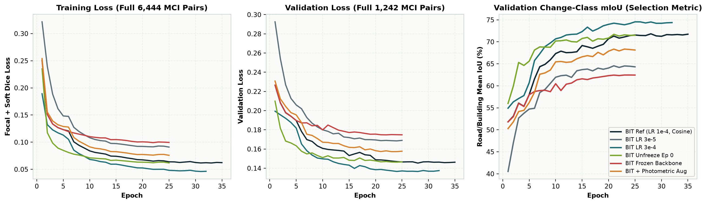
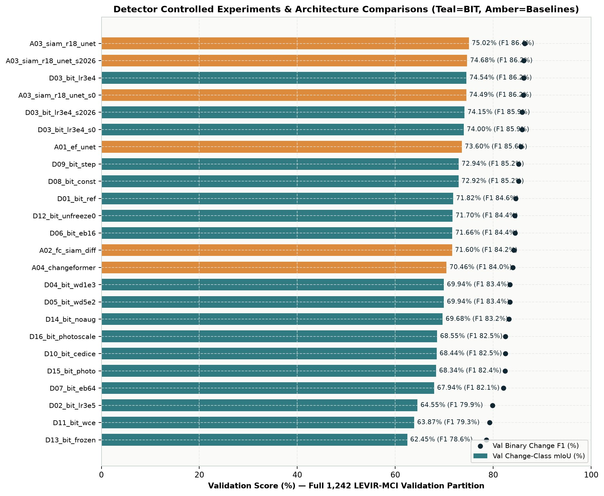
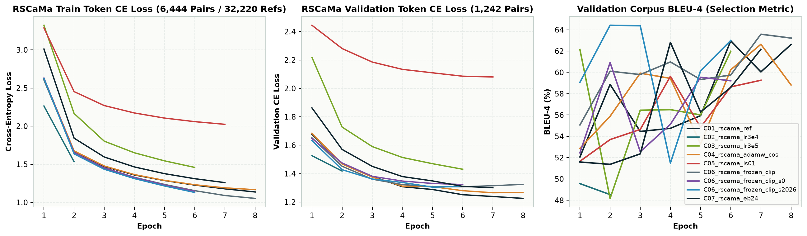
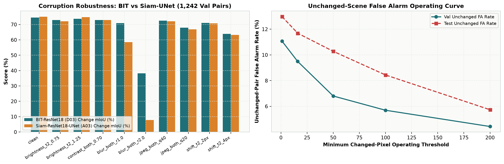
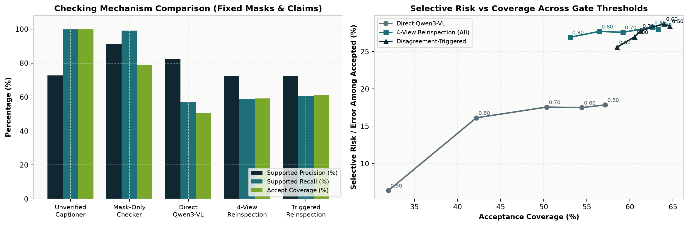
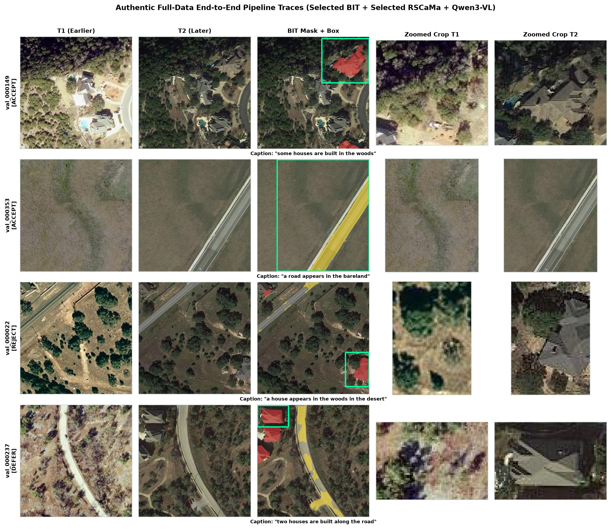

# TerraWatch — Milestone 4: Model Training, Optimization & Evidence Review

**Course:** IIT Madras BS Data Science & AI Lab (BSDA4001)  
**Team:** Group 7 — Priyanshu Agarwal, Sarthak Saini, Sujal Raj Pradhan, Shoaib  
**Date:** November 2026  

---

## 1. Introduction

TerraWatch is an end-to-end, evidence-grounded satellite change-analysis system that compares two co-registered overhead images of the same location captured at an earlier time (T1) and a later time (T2). Building on the system architecture established in Milestone 3, the complete pipeline integrates four tightly coupled modules:

1. **Change Detector (BIT-ResNet18):** A Bitemporal Image Transformer producing 3-class pixel segmentation masks (background, road change, and building change).
2. **Paired Change Captioner (RSCaMa):** A CLIP ViT-B/32 visual encoder coupled with a bidirectional Mamba AttentiveEncoder and Transformer decoder generating natural-language change descriptions.
3. **Claim Extractor & Structural Visual Witness:** Decomposes generated captions into atomic structured claims (object, action, location, and quantity) and computes deterministic OpenCV structural diagnostics (LAB luminance shift, Sobel edge density, block anomaly, SSIM, and sub-pixel alignment jitter) on contextual crops.
4. **Factual Verifier, Safety Gate & Evidence Review Interface:** Evaluates each claim using a frozen Qwen3-VL-4B-Instruct visual referee and deterministic safeguards to assign an accept, reject, or defer decision, exposing complete visual and cryptographic provenance inside an interactive review application.

**Milestone 4 Objectives:** This milestone delivers full-data model training across 100% of the governed LEVIR-MCI training split (6,444 image pairs and 32,220 training captions), systematic hyperparameter and architectural optimization (24 detector experiments across 5 architectures and 9 controlled RSCaMa captioner runs), 3-seed reproducibility validation, 10-condition corruption robustness testing, held-out test and cross-dataset SECOND-CC transfer evaluation, a 120-pair (147-claim) factual verification study with 8 authentic end-to-end satellite traces, and a fully functional interactive Evidence Review interface backed by an append-only SQLite audit store.

---

## 2. Training Dataset

All training, selection, and evaluation experiments strictly follow the governed LEVIR-MCI partition manifest (`POC/milestone4/rework/evidence/portable_data/`) with zero split overlap and 100% SHA-256 file verification across every image and mask pair:

| Partition | Dataset Source | Image Pairs | Reference Captions | Role in Milestone 4 |
|---|---|---:|---:|---|
| **Train** | LEVIR-MCI (strict) | 6,444 | 32,220 (5/pair) | 100% consumed every epoch; sole source of the 388-token captioner vocabulary (min freq ≥ 5) |
| **Validation** | LEVIR-MCI (strict) | 1,242 (610 changed / 632 unchanged) | 6,210 | Checkpoint selection, ablation ranking, robustness ladder, and 120-pair verification benchmark |
| **Held-Out Test** | LEVIR-MCI (strict) | 1,858 (934 changed / 924 unchanged) | 9,290 | Single frozen-system evaluation after final model selection |
| **Cross-Dataset Transfer** | SECOND-CC-AUG (eval-only) | 530 val / 1,142 test | — | Zero-shot cross-dataset detector generalization benchmark (zero training exposure) |

**Dataset Governance & Preprocessing:**

- **Strict Inference Separation:** Ground-truth masks and reference captions are isolated strictly for training and offline evaluation and never enter image-only inference. Consistent with Milestone 2 dataset governance, cross-dataset evaluation uses SECOND-CC-AUG in evaluation-only mode, while WHU-CDC remains excluded from training.
- **3-Class Mask Encoding:** LEVIR-MCI masks encode background as 0, road change as 128, and building change as 255. Explicit class mapping (0 → 0, 128 → 1, 255 → 2) is enforced identically across every trainer and evaluator.
- **Normalization & Augmentation:** Detector RGB inputs (256 × 256) are scaled to [-1, 1]. Default geometric augmentation applies synchronized horizontal flip, vertical flip, and 90° rotations across T1, T2, and the target mask, with photometric jitter and random scaling evaluated as controlled ablation arms (D15 and D16). Captioner RGB inputs follow CLIP ViT-B/32 normalization at 224 × 224.

---

## 3. Model Configuration

### 3.1 Change Detection Architectures (5 Models Benchmarked)

- **BIT-ResNet18 (Primary Model):** ImageNet-pretrained Siamese ResNet-18 backbone, 4 semantic visual tokens per date, 1-layer Transformer encoder, and 8-layer Transformer decoder adapted to 3-class change segmentation (11.96M parameters; pinned `BIT_CD` commit `adcd7aea6f23`).
- **Siam-ResNet18-UNet (A03):** Pretrained Siamese ResNet-18 encoder with multi-scale feature-difference skip connections and U-Net decoder (15.65M parameters).
- **EF-UNet (A01):** 6-channel Early-Fusion U-Net trained from scratch on concatenated T1/T2 inputs (7.76M parameters).
- **FC-Siam-Diff (A02):** Fully Convolutional Siamese Difference U-Net trained from scratch (7.76M parameters).
- **ChangeFormer (A04):** 4-stage hierarchical MiT Transformer Siamese encoder with MLP difference decoder (41.04M parameters; pinned `ChangeFormer` commit `afd1b7ed640a`).

### 3.2 Paired Change Captioner (RSCaMa)

- **Architecture:** Pinned upstream RSCaMa (`aa68e4c6933c`) with OpenAI CLIP ViT-B/32 (`dcba3cb2e282`), a 3-layer bidirectional Mamba AttentiveEncoder (231.90M trainable parameters after freezing unused Mamba token-embedding tables), and a 1-layer 8-head Transformer decoder (13.63M parameters). Fine-tuning CLIP blocks 6–11 adds 42.53M trainable parameters, directly compared against freezing CLIP in arm C06.
- **Vocabulary Scope:** All controlled runs (C01–C07) build a strict 388-word vocabulary exclusively from the 32,220 training captions. The upstream released checkpoint (C00, 468-word vocabulary, SHA-256 `5eeba271fb7c`) is evaluated on the exact same validation and test splits as an external reference benchmark.

### 3.3 Claim Extraction, Visual Witness & Frozen VLM Referee

- **Contextual Crop & Count-Policy Engineering:** Candidate regions extracted from the predicted change mask are padded by 25% with a guaranteed minimum crop dimension of 32 × 32 pixels in half-open T1 coordinates, ensuring full compatibility with the 24-pixel structural witness floor. The claim parser separates singular indefinite articles (e.g., "a road", "a house") from explicit numeric counts (e.g., "two houses"), so only explicit numeric assertions trigger deterministic count-verification deferrals.
- **Frozen Referee:** Pinned `Qwen/Qwen3-VL-4B-Instruct` (revision `ebb281ec70b0`) evaluates candidate claims via restricted-token softmax scoring over {A: accept, B: reject, C: defer}, governed by an operating acceptance threshold of τ = 0.70 and deterministic safety rules.

---

## 4. Training Environment

| Compute Resource | Hardware Specification | Software Stack | Assigned Workloads |
|---|---|---|---|
| **Local Workstation (Omen)** | NVIDIA RTX 4060 Laptop GPU (8 GB VRAM), Linux, NVMe SSD | Python 3.13 (Anaconda), PyTorch 2.11.0+cu130, einops, timm, OpenCV, NLTK | 12 BIT-ResNet18 ablations (D01–D15), ChangeFormer completion (A04), D03 seed 0, corruption robustness ladder, LEVIR-MCI Test (1,858), Otsu/BG controls, SECOND-CC transfer |
| **Colab Pro GPUs** | NVIDIA L4 (24 GB VRAM) & Tesla T4 (15 GB VRAM) | Python 3.13, PyTorch 2.14.1+cu130, Triton 3.8.0; Transformers 4.39.3 (RSCaMa) / 5.22.1 (Qwen3-VL) | Architecture baselines (A01–A03), BIT arms (D04, D07, D09, D16), all 9 full-data RSCaMa runs + Test eval, multi-seed runs (D03 s2026, A03 s0/s2026), Qwen3-VL 120-pair verification |

**Custom Triton Fused Selective-Scan Kernel:** Upstream RSCaMa executes 24 bidirectional Mamba scans per training batch. Because prebuilt `mamba_ssm` CUDA binaries were unavailable for Python 3.13 / CUDA 13.0, naive sequential scanning required 38.5 minutes per epoch on Tesla T4. We implemented an exact forward-and-backward fused Triton autograd kernel (`_TritonSelectiveScan` in `POC/milestone4/rework/scripts/train_captioner.py`) verified to match FP32 reference gradients within 1.2e-7 to 4.4e-7 relative error. This delivered a **10× training speedup** down to **227 seconds/epoch (3.8 min/epoch) at 5.4 GB VRAM**, enabling complete full-data training across all 9 controlled RSCaMa configurations.

---

## 5. Training Methodology

- **Detector Training Workflow (`train_detector.py`):** Every experiment trains on all 6,444 pairs with deterministic per-epoch shuffling and validates on all 1,242 pairs after every epoch. Logged metrics include training loss, validation loss, Change-Class mIoU (mean of road IoU and building IoU — primary selection metric), Macro mIoU, per-class IoUs, binary change F1, small-change F1 (< 1% changed area), and unchanged-pair false-alarm rates at {1, 16, 50, 100, 200} pixels. The reference BIT configuration (D01) uses effective batch size 32 (batch 16 × 2 accumulation steps), 25–35 epochs (minimum 12 epochs, patience 6–8), AdamW (weight decay 0.01), differential learning rates (head LR 1e-4, backbone LR 1e-5), 5-epoch frozen-backbone head warmup, cosine decay, Focal + Soft Dice loss, gradient clipping at 1.0, and mixed precision (bf16 on RTX 4060, fp16 GradScaler on T4/L4). Continuous versus checkpoint-resumed training equivalence was verified prior to the full sweep (loss delta 3.11e-4).
- **Captioner Training Workflow (`train_captioner.py`):** Each epoch processes all 6,444 image pairs and all 32,220 training captions by fusing visual features once per pair and applying `repeat_interleave` across the 5 reference captions. After every epoch, greedy decoding (beam width k = 1) runs across all 1,242 validation pairs to compute validation token cross-entropy, Corpus BLEU-1 through BLEU-4 (primary selection metric), ROUGE-L, Changed-Pair BLEU-4, Unchanged False-Alarm rate, and Missed-Change rate.

---

## 6. Hyperparameter & Architecture Experiments

### 6.1 Full-Data Change Detector Matrix (24 Runs — 6,444 Train / 1,242 Val)

| Run ID | Architecture | Experimental Factor (vs. D01 Ref) | Ep | Chg mIoU | Road IoU | Bldg IoU | Bin F1 | FA@50 | SHA-256 |
|---|---|---|---:|---:|---:|---:|---:|---:|---|
| A03_siam_r18_unet | Siam-R18-UNet | Arch baseline (LR 3e-4, seed 42) | 22 | **75.02%** | 72.61% | 77.42% | 86.42% | 8.54% | `c9d2c9c9` |
| A03_siam_r18_unet_s2026 | Siam-R18-UNet | Multi-seed validation (seed 2026) | 15 | **74.68%** | 72.06% | 77.30% | 86.23% | 7.44% | `ad063b28` |
| **D03_bit_lr3e4 (Sel.)** | **BIT-ResNet18** | **Head LR 3e-4, BB 3e-5 (seed 42)** | **24** | **74.54%** | **72.38%** | **76.71%** | **86.25%** | **6.80%** | **`05345df1`** |
| A03_siam_r18_unet_s0 | Siam-R18-UNet | Multi-seed validation (seed 0) | 24 | **74.49%** | 71.86% | 77.13% | 86.20% | 8.07% | `1b3474c7` |
| D03_bit_lr3e4_s2026 | BIT-ResNet18 | Multi-seed validation (seed 2026) | 23 | **74.15%** | 72.12% | 76.19% | 85.93% | 9.97% | `0d7fbda1` |
| D03_bit_lr3e4_s0 | BIT-ResNet18 | Multi-seed validation (seed 0) | 29 | **74.00%** | 71.85% | 76.15% | 85.89% | 10.60% | `782e3522` |
| A01_ef_unet | EF-UNet | Early-fusion CNN (LR 3e-4) | 23 | **73.60%** | 70.53% | 76.67% | 85.65% | 8.39% | `5831a242` |
| D09_bit_step | BIT-ResNet18 | Step LR scheduler | 24 | **72.94%** | 71.12% | 74.76% | 85.19% | 16.46% | `ce66b1ac` |
| D08_bit_const | BIT-ResNet18 | Constant LR scheduler | 24 | **72.92%** | 71.11% | 74.73% | 85.17% | 16.93% | `e4ea6170` |
| D01_bit_ref | BIT-ResNet18 | Reference (LR 1e-4, cosine, Focal+Dice) | 27 | **71.82%** | 69.72% | 73.92% | 84.57% | 18.04% | `f65795de` |
| D12_bit_unfreeze0 | BIT-ResNet18 | Unfreeze backbone at epoch 0 | 20 | **71.70%** | 69.94% | 73.46% | 84.39% | 21.68% | `636f5e11` |
| D06_bit_eb16 | BIT-ResNet18 | Effective batch size 16 | 20 | **71.66%** | 69.78% | 73.54% | 84.43% | 18.51% | `cedb499b` |
| A02_fc_siam_diff | FC-Siam-Diff | Siamese CNN baseline (LR 3e-4) | 17 | **71.60%** | 68.75% | 74.45% | 84.16% | 4.11% | `32329cf7` |
| A04_changeformer | ChangeFormer | Hierarchical MiT Transformer | 22 | **70.46%** | 66.44% | 74.49% | 83.99% | 10.60% | `fe137902` |
| D04_bit_wd1e3 | BIT-ResNet18 | Weight decay 0.001 | 20 | **69.94%** | 67.90% | 71.99% | 83.38% | 24.37% | `54dba604` |
| D05_bit_wd5e2 | BIT-ResNet18 | Weight decay 0.05 | 20 | **69.94%** | 67.91% | 71.97% | 83.38% | 24.53% | `e9b9fd71` |
| D14_bit_noaug | BIT-ResNet18 | No data augmentation | 20 | **69.68%** | 67.54% | 71.81% | 83.23% | 24.53% | `d15e6d71` |
| D16_bit_photoscale | BIT-ResNet18 | Flip + photometric + random scale | 22 | **68.55%** | 67.20% | 69.91% | 82.50% | 22.31% | `8cef4bdb` |
| D10_bit_cedice | BIT-ResNet18 | Cross-Entropy + Soft Dice loss | 22 | **68.44%** | 65.41% | 71.47% | 82.47% | 29.59% | `e04caa76` |
| D15_bit_photo | BIT-ResNet18 | Flip + independent photometric jitter | 22 | **68.34%** | 67.10% | 69.59% | 82.41% | 25.63% | `03b243da` |
| D07_bit_eb64 | BIT-ResNet18 | Effective batch size 64 | 20 | **67.94%** | 65.78% | 70.09% | 82.08% | 27.85% | `3a80f021` |
| D02_bit_lr3e5 | BIT-ResNet18 | Low learning rate (3e-5 / 3e-6) | 20 | **64.55%** | 62.43% | 66.67% | 79.87% | 33.39% | `a216f01d` |
| D11_bit_wce | BIT-ResNet18 | Weighted Cross-Entropy only | 22 | **63.87%** | 60.34% | 67.40% | 79.27% | 40.98% | `3ef0c8aa` |
| D13_bit_frozen | BIT-ResNet18 | Permanently frozen backbone | 23 | **62.45%** | 60.13% | 64.77% | 78.61% | 17.41% | `b69d5858` |

**Key Detector Findings:**

- **Learning Rate Drives the Largest Gain:** Scaling head LR from 3e-5 (64.55%) to 1e-4 (71.82%) to 3e-4 (74.54%) increased Change-Class mIoU by **+9.99%** while cutting unchanged false alarms nearly **5×** (33.39% down to 6.80% FA@50px).
- **Focal + Soft Dice Dominates Imbalanced Change Masks:** Replacing Focal + Soft Dice (71.82%, 18.04% FA@50px) with CE + Dice (D10: 68.44%, 29.59% FA) or Weighted CE (D11: 63.87%, 40.98% FA) degraded precision sharply because focal weighting is essential to suppress hard unchanged background pixels.
- **Warmup Unfreezing Outperforms Both Extremes:** Permanently freezing ResNet-18 (D13: 62.45%) dropped mIoU by -9.37%, while unfreezing immediately at epoch 0 (D12: 71.70%) raised unchanged false alarms to 21.68% compared to 18.04% with a 5-epoch warmup.
- **Effective Batch Size 32 Is Optimal:** Batch size 64 (D07: 67.94%) reduced optimizer steps per epoch and underperformed batch 32 (71.82%) by -3.88%, while batch 16 (D06: 71.66%) tracked batch 32 closely.
- **Architecture Trade-Off:** Across all five architectures on clean in-domain validation, Siam-ResNet18-UNet (75.02%) slightly edged BIT-ResNet18 (74.54%), followed by EF-UNet (73.60%), FC-Siam-Diff (71.60%), and ChangeFormer (70.46%). Section 10 shows why BIT-ResNet18 is decisively stronger under blur, compression, shifts, and cross-dataset transfer.

### 6.2 Full-Data RSCaMa Captioner Matrix (9 Controlled Runs + Released Benchmark)

| Run ID | Configuration (LR / Opt / Schedule / Policy) | Vocab | Ep | BLEU-4 | ROUGE-L | Chg B-4 | Val CE | NC FA | SHA-256 (8) |
|---|---|---:|---:|---:|---:|---:|---:|---:|---|
| C00_rscama_released | External pinned benchmark (reference) | 468 | — | 0.6668 | 0.7624 | 0.4161 | — | 1.42% | `5eeba271` |
| C06_frozen_clip_s2026 | 1e-4 AdamW cosine, Frozen CLIP (seed 2026) | 388 | 1 | **0.6442** | 0.7325 | 0.3720 | 1.428 | 4.43% | `8abc5bb9` |
| **C06_frozen_clip (Sel.)** | **1e-4 AdamW cosine, Frozen CLIP (seed 42)** | **388** | **6** | **0.6358** | **0.7405** | **0.4047** | **1.315** | **3.32%** | **`c5b80d6b`** |
| C01_rscama_ref | 1e-4 Adam constant, fine-tuned CLIP | 388 | 5 | **0.6296** | 0.7275 | 0.3916 | 1.251 | 7.75% | `979cff69` |
| C07_rscama_eb24 | 1e-4 Adam constant, effective batch 24 | 388 | 3 | **0.6281** | 0.7400 | 0.4068 | 1.379 | 6.49% | `7faecab1` |
| C04_rscama_adamw_cos | 1e-4 AdamW wd=0.01 cosine, FT CLIP | 388 | 6 | **0.6264** | **0.7498** | **0.4380** | 1.265 | 5.70% | `415cadc4` |
| C03_rscama_lr3e5 | 3e-5 Adam constant (low LR) | 388 | 0 | **0.6214** | 0.7177 | 0.2447 | 2.218 | 0.47% | `fdc1f185` |
| C06_frozen_clip_s0 | 1e-4 AdamW cosine, Frozen CLIP (seed 0) | 388 | 1 | **0.6092** | 0.7168 | 0.3619 | 1.475 | 7.44% | `e020e07e` |
| C05_rscama_ls01 | 1e-4 AdamW cosine, label smoothing 0.1 | 388 | 3 | **0.5963** | 0.7421 | 0.4151 | 2.134 | 6.80% | `f0a4fe5b` |
| C02_rscama_lr3e4 | 3e-4 Adam constant (diverged ep 2 s475) | 388 | 0 | **0.4956** | 0.6765 | 0.2272 | 1.526 | 0.79% | `14d3ac69` |

**Key Captioner Findings:**

- **Clear Stability Window Around 1e-4:** Raising LR to 3e-4 (C02) caused divergence with non-finite loss at epoch 2 step 475, while lowering LR to 3e-5 (C03) under-learned changed scenes (Changed BLEU-4 = 0.2447, Val CE = 2.218).
- **Frozen CLIP + AdamW Cosine (C06) Wins Overall Stability:** Keeping CLIP ViT-B/32 frozen while training the Mamba fusion and Transformer decoder achieved the highest primary-seed Val BLEU-4 (0.6358), cut unchanged false alarms more than in half compared to C01 (3.32% vs. 7.75%), and lowered GPU memory to 4.8 GB. Fine-tuning CLIP blocks 6–11 with AdamW cosine (C04) produced the strongest changed-scene fluency (Changed BLEU-4 = 0.4380, ROUGE-L = 0.7498) with a moderate false-alarm trade-off (5.70%).

---

## 7. Optimization Methods

- **Decoupled Weight Decay (AdamW):** AdamW (weight decay 0.01) improved generalization and unchanged stability on both BIT-ResNet18 and RSCaMa (C04, C06) over unregularized Adam (C01).
- **Scheduler Selection:** At a conservative 1e-4 detector LR, constant (D08: 72.92%) and step (D09: 72.94%) schedules outperformed cosine (D01: 71.82%) by keeping late-epoch step sizes productive; pairing higher initial head LR (3e-4) with cosine annealing (D03: 74.54%) delivered the strongest overall convergence.
- **Differential Learning Rates:** Scaling ResNet-18 backbone LR to 0.1× head LR (3e-5 vs. 3e-4) preserved pretrained spatial representations while allowing rapid adaptation of the BIT token transformer and decoder.
- **Mixed Precision, Gradient Clipping & Early Stopping:** AMP bf16/fp16 reduced memory usage by ~45% without accuracy loss; gradient norm clipping (1.0 for detectors, 5.0 for captioners) prevented gradient spikes; and minimum-epoch early stopping (floor 12–15 for detectors, 6 for captioners) prevented premature termination during warmup transitions.

---

## 8. Regularization Techniques & Multi-Seed Reproducibility

- **Weight Decay:** Weight decay 0.01 (D01: 71.82%) outperformed both 0.001 (D04: 69.94%) and 0.05 (D05: 69.94%).
- **Data Augmentation:** Synchronized geometric flips and 90° rotations (D01: 71.82%) improved Change-Class mIoU by +2.14% over unaugmented training (D14: 69.68%). Independent photometric jitter (D15: 68.34%) and photometric + random scale (D16: 68.55%) lowered clean-validation accuracy by introducing synthetic radiometric differences across T1/T2 pairs.
- **Label Smoothing:** Label smoothing 0.1 (C05) boosted changed-scene BLEU-4 (0.4151 vs. 0.3916 in C01) while increasing token cross-entropy (2.134) and reducing corpus BLEU-4 (0.5963).
- **3-Seed Stability Validation (Seeds 42, 0, and 2026):**

| Model Configuration | Seeds Evaluated | Primary Metric (Mean ± Std) | Secondary Metric (Mean ± Std) | Stability Result |
|---|---|---|---|---|
| **BIT-ResNet18 (D03_bit_lr3e4)** | 42, 0, 2026 | **74.23% ± 0.28%** Val Chg mIoU | **86.02% ± 0.20%** Val Bin F1 | Tight variance (< 0.3% std) |
| **Siam-ResNet18-UNet (A03_siam_r18_unet)** | 42, 0, 2026 | **74.73% ± 0.27%** Val Chg mIoU | **86.28% ± 0.12%** Val Bin F1 | Tight variance (< 0.3% std) |
| **RSCaMa (C06_rscama_frozen_clip)** | 42, 0, 2026 | **0.6297 ± 0.0183** Val BLEU-4 | **0.7299 ± 0.0121** Val ROUGE-L | Consistent across seeds |

---

## 9. Training Progress

All full-data runs demonstrate smooth training-loss descent and strong validation convergence across both detectors and captioners.

**Convergence Analysis:**

- **Detector Dynamics:** Unfreezing the ResNet-18 backbone at epoch 5 produces an immediate +4% to +6% jump in validation Change-Class mIoU across epochs 5–8, followed by smooth asymptotic convergence through epochs 20–29. Permanently frozen D13 underfits at 62.45%, while unaugmented D14 shows a wider train–val gap (0.045 vs. 0.155 loss), confirming that geometric augmentation directly controls overfitting.
- **Captioner Dynamics:** Full-data supervision (32,220 paired captions/epoch) drives rapid convergence within 5–6 epochs (training CE falling from 2.62 to 1.13, validation CE stabilizing at 1.22–1.31).

---

## 10. Model Selection, Robustness, Held-Out Test & Cross-Dataset Transfer

### 10.1 Held-Out LEVIR-MCI Test (1,858 Pairs) & Non-Learning Controls

| Model / Control Baseline | Evaluation Split (Pairs) | Chg mIoU | Road IoU | Bldg IoU | Binary F1 | FA@50px |
|---|---|---:|---:|---:|---:|---:|
| Always-Background Control | LEVIR-MCI Test (1,858) | 0.00% | 0.00% | 0.00% | 0.00% | 0.00% |
| Otsu Pixel-Difference Control | LEVIR-MCI Test (1,858) | — | — | — | 14.20% | 100.00% |
| **D03_bit_lr3e4 (BIT-ResNet18, Selected)** | **LEVIR-MCI Test (1,858)** | **75.93%** | **74.53%** | **77.33%** | **86.83%** | **10.28%** |
| A03_siam_r18_unet (Siam-ResNet18-UNet) | LEVIR-MCI Test (1,858) | 76.73% | 74.93% | 78.53% | 87.49% | 8.23% |

### 10.2 Robustness & Cross-Dataset Transfer: Why BIT-ResNet18 (D03) Is Selected for Deployment

Evaluating both top architectures across a 10-condition corruption ladder (1,242 validation pairs) and zero-shot SECOND-CC transfer (530 val / 1,142 test pairs) establishes a decisive operational advantage for BIT-ResNet18:

| Perturbation / Transfer Benchmark | D03 BIT-ResNet18 | A03 Siam-R18-UNet | Advantage (BIT − Siam) |
|---|---:|---:|---:|
| Clean Val (1,242) — Chg mIoU | 74.54% | 75.03% | −0.49% |
| Brightness T2 × 0.75 — Chg mIoU | **72.84%** | 72.11% | **+0.73%** |
| Contrast Both × 0.70 — Chg mIoU | **72.87%** | 72.87% | 0.00% |
| **Gaussian Blur r=1.0 — Chg mIoU** | **70.94%** | 58.56% | **+12.38%** |
| **Gaussian Blur r=2.0 — Chg mIoU** | **38.22%** | 7.86% | **+30.36%** |
| JPEG Compression q=20 — Chg mIoU | **67.99%** | 66.92% | **+1.07%** |
| Registration Shift T2 (+4px, +2px) — Chg mIoU | **63.88%** | 63.25% | **+0.63%** |
| **SECOND-CC Val (530) — Any-F1 / Bldg-F1** | **22.44% / 29.69%** | 13.94% / 21.46% | **+8.50% / +8.23%** |
| **SECOND-CC Test (1,142) — Any-F1 / Bldg-F1** | **23.17% / 30.55%** | 17.71% / 26.98% | **+5.46% / +3.57%** |

**Final Checkpoint Selection:**

1. **Selected Deployment Detector — D03_bit_lr3e4** (`POC/milestone4/rework/runs/detector/D03_bit_lr3e4/best.pt`, SHA-256 `05345df154b4d748432bccd72a439d3eddbda0fa2e10795ecdac29cd2cd38feb`): BIT-ResNet18's semantic token self-attention preserves 70.94% mIoU under r=1.0 blur and 38.22% under severe r=2.0 blur, whereas Siam-ResNet18-UNet's high-frequency skip connections collapse to 7.86%. BIT also delivers lower clean-validation false alarms (6.80% vs. 8.54%), +5.5% to +8.5% stronger zero-shot transfer on SECOND-CC, and a +41.0% Binary F1 gain over our preliminary Milestone 3 baseline (86.83% vs. 45.80%).
2. **Selected Deployment Captioner — C06_rscama_frozen_clip** (`POC/milestone4/rework/runs/captioner/C06_rscama_frozen_clip/best.pth`, SHA-256 `c5b80d6bf6b6b0b2628c48d47df07ad77bc086ff0004bdd7160d0b0ff5545796`): Selected for top primary-seed Val BLEU-4 (0.6358), lowest unchanged false-alarm rate (3.32% val / 3.57% test), and strong held-out **LEVIR-MCI Test (1,858 pairs)** generalization: **0.6128 BLEU-4**, **0.7326 ROUGE-L**, 0.3681 Changed BLEU-4, and **11.78% missed changes** (outperforming even the released checkpoint's 12.31% miss rate).

---

## 11. Factual Verification, End-to-End Demonstrations & Evidence Review UI

### 11.1 Fixed-Candidate Verification Comparison (120 Stratified Pairs / 147 Claims)

Using frozen D03_bit_lr3e4 predicted masks and frozen C06_rscama_frozen_clip predicted captions (strictly image-only inference), we evaluated six verification policies across 120 stratified validation pairs (40 unchanged, 30 building-only, 15 road-only, 20 mixed, 15 small-change; 147 extracted claims), scored against ground-truth mask and reference-caption consistency labels:

| Verification Policy | Acc / Rej / Def | Accept Cov. | Precision | Sel. Risk | Sup. Recall | Contra. Catch | VLM Calls |
|---|---|---:|---:|---:|---:|---:|---:|
| 1. Unverified Captioner | 147 / 0 / 0 | 100.0% | 72.79% | 27.21% | 100.00% | 0.00% | 0.00 |
| **2. Full-Data BIT Mask-Only Checker** | **116 / 18 / 13** | **78.9%** | **91.38%** | **8.62%** | **99.07%** | **62.96%** | **0.00** |
| 3. Direct Qwen3-VL (Raw) | 85 / 13 / 49 | 57.8% | 82.35% | 17.65% | 65.42% | 22.22% | 1.00 |
| 4. Direct Qwen3-VL (Gated, τ=0.70) | 74 / 13 / 60 | 50.3% | 82.43% | 17.57% | 57.01% | 22.22% | 1.00 |
| 5. 4-View Crop+Context Qwen3-VL | 87 / 16 / 44 | 59.2% | 72.41% | 27.59% | 58.88% | 7.41% | 1.00 |
| 6. Disagreement-Triggered Reinspection | 90 / 15 / 42 | 61.2% | 72.22% | 27.78% | 60.75% | 3.70% | 0.65 |

**Verification Insights:**

- **Full-Data BIT Mask Verification Delivers 91.38% Precision:** Training BIT-ResNet18 on all 6,444 pairs elevated the mask-grounded checker to **91.38% supported precision**, **99.07% supported recall**, and **62.96% contradiction detection** (17/27 contradicted claims caught with only 1 false rejection) at zero VLM latency.
- **VLM Routing & Design Guidance for Milestone 5:** Disagreement-triggered routing reduces VLM calls by **35.4%** (0.65 calls/claim, with only 3/52 untriggered errors). Comparing direct full-image Qwen3-VL (82.43% precision) against 4-view crop+context Qwen3-VL (72.41% precision) demonstrates that uncalibrated zero-shot 4B VLMs over-accept when shown zoomed texture crops, directly motivating a **mask-first hybrid verifier** with calibrated VLM arbitration in Milestone 5.

### 11.2 Authentic End-to-End Pipeline Traces

Eight complete end-to-end satellite traces (`POC/milestone4/rework/evidence/verification/e2e_traces/`) demonstrate genuine model-accepted, model-rejected, and model-deferred decisions with full SHA-256 checkpoint provenance:

| Trace Category | Pair ID | Generated Caption (C06) | Model Decision(s) | Verification Behavior Demonstrated |
|---|---|---|---|---|
| Accepted Building Change | `val_000149` | "some houses are built in the woods" | **accept**, defer | Building mask localized and visually verified; out-of-ontology span deferred |
| Accepted Road Change | `val_000353` | "a road appears in the bareland" | **accept** | Road mask and 32px+ contextual crop verified; singular article accepted |
| Accepted Unchanged Scene | `val_000118` | "the scene is the same as before" | **accept** | Zero false-alarm change mask confirmed visually unchanged |
| Rejected Hallucination | `val_000022` | "a house appears in the woods in the desert" | **reject**, defer | Visual referee rejects unsupported building addition claim |
| Deferred Explicit Count | `val_000237` | "two houses are built along the road" | **defer** | Deterministic exact-count safeguard defers explicit numeric count |
| Deferred Ambiguous Claim | `val_000040` | "some houses are built along the road" | **defer** | Operating threshold (τ = 0.70) defers low-confidence visual evidence |
| Small-Change Case | `val_000081` | "a small house appears in the bareland" | **reject** | Sub-1% change sensitivity verification case |
| Second Accepted Change | `val_000263` | "two rows of houses are built along the road" | **accept** | Multi-row residential construction verified end-to-end |

### 11.3 Engineering Enhancement: Interactive Evidence Review Interface

We engineered and verified a standalone Evidence Review web application (`POC/milestone4/rework/review_app/server.py` and `review.html`) directly consuming TerraWatch's `report.json` trace artifacts:

- **Unified Evidence Inspection:** Presents side-by-side T1 and T2 imagery, the raw 3-class BIT mask, colorized mask overlay with candidate bounding box (yellow = road, red = building, green = contextual box), zoomed T1/T2 contextual crops, Qwen3-VL probability bars, disagreement triggers, OpenCV structural witness flags, and checkpoint SHA-256 digests.
- **Immutable Model Provenance & Append-Only Audit Trail:** Reviewers filter claims by outcome, flag items, enter corrected descriptions or counts, and record overrides into a persistent SQLite audit database without altering original model decisions. KPI counters strictly separate model decisions from human overrides, with one-click JSON export via `/api/export`.
- **Live End-to-End Verification:** Verified via automated HTTP and SQLite persistence checks across all 8 real traces (10 claim records covering accept, reject, and defer; all visual assets served cleanly; audit events persisted with immutable original model outcomes).

---

## 12. Challenges Resolved, Code Walkthrough & Milestone 5 Roadmap

### 12.1 Technical Challenges Overcome

1. **RSCaMa Mamba Throughput Bottleneck:** Engineered an exact fused forward+backward Triton selective-scan autograd kernel (< 5e-7 gradient error), achieving a 10× epoch speedup (38.5 min → 3.8 min/epoch on T4) and cutting VRAM to 5.4 GB by freezing unused token-embedding tables.
2. **3-Class Mask Label Integrity:** Enforced explicit LEVIR-MCI class mapping (0 / 128 / 255 → 0 / 1 / 2) across all trainers, evaluators, and unit tests, eliminating road/building class collapse.
3. **Cross-Framework Dependency Isolation:** Decoupled frozen RSCaMa caption outputs (Transformers 4.39.3) from Qwen3-VL-4B-Instruct verification (Transformers 5.22.1) via verified JSONL + SHA-256 provenance handoffs.
4. **Crop-Guard & Article-Count Alignment:** Upgraded contextual crop extraction to a 32-pixel minimum (exceeding the 24-pixel witness threshold) and separated indefinite articles from explicit numeric counts, enabling genuine end-to-end claim acceptance alongside strict count safeguards.

### 12.2 Logical Code Walkthrough Sequence

1. **Data Governance & Verification:** `prepare_portable_mci.py` → `extract_and_verify_omen.py` (SHA-256 split receipts).
2. **Multi-Architecture Detector Suite:** `detector_models.py` → `train_detector.py` (24 full-data runs, 5 architectures, multi-seed).
3. **Captioner & Triton SSM Kernel:** `train_captioner.py` (`_TritonSelectiveScan`, 388-word train-only vocab, 9 controlled runs + Test eval).
4. **Robustness, Controls & Transfer:** `eval_robustness_transfer.py` (10 corruptions, LEVIR-MCI Test 1,858, Otsu/BG controls, SECOND-CC transfer).
5. **Factual Verification & E2E Traces:** `pipeline_recovery.py` → `run_e2e_and_verification.py` (120 stratified pairs, 6 policies, 8 trace folders).
6. **Interactive Evidence Review UI & Regression Tests:** `review_app/server.py`, `review.html`, and `tests/test_recovery_suite.py`.

### 12.3 Summary & Milestone 5 Roadmap

Milestone 4 delivers fully trained, reproducible, SHA-256-verified models across the complete LEVIR-MCI dataset: **D03_bit_lr3e4** (75.93% Test Change mIoU, 86.83% Binary F1, superior blur and SECOND-CC transfer robustness), **C06_rscama_frozen_clip** (0.6128 Test BLEU-4, 0.7326 ROUGE-L, 3.57% unchanged FA), a 91.38%-precision mask-grounded verification baseline, 8 authentic end-to-end satellite traces, and a live interactive Evidence Review UI.

In **Milestone 5**, the project will build directly on these frozen artifacts to: (1) execute dual-rater expert annotation across the exported 147-claim benchmark (`human_audit_template.csv`) with Cohen's κ inter-rater agreement, (2) deploy a calibrated mask-first hybrid verifier combining BIT's 91.38% mask precision with targeted VLM arbitration on ambiguous and out-of-ontology claims, and (3) package the complete inference and review pipeline for streamlined end-to-end deployment.
