# TerraWatch: Milestone 5, System Evaluation, Robustness & Deployment Readiness


## 1. Introduction

### 1.1 Project Objective

TerraWatch is a satellite change-detection, change-captioning and claim-verification system. It takes a before-and-after aerial image pair $(T_1, T_2)$ and produces a spatially localized change mask, a short natural-language description of the change, and a verdict for each claim in that description (`accept`, `reject` or `defer`). Remote-sensing analysts who monitor urban expansion, road construction and land-use change face two complementary problems. Pixel-level change masks are precise but slow to summarize across large regions, whereas neural change-captioning models write fluent descriptions that can hallucinate buildings or roads that do not exist, miss small structural changes, or state object counts that cannot be verified.

TerraWatch addresses this by coupling three modular stages under a single frozen-checkpoint provenance contract:

1. **Spatial change detection (`D03_bit_lr3e4`).** A 3-class Bitemporal Image Transformer (BIT-ResNet18) predicts per-pixel background, road-change and building-change masks at $256 \times 256$ resolution.
2. **Bitemporal change captioning (`C06_rscama_frozen_clip`).** An RSCaMa state-space captioner combines a frozen CLIP ViT-B/32 visual encoder, Mamba-based spatial-temporal fusion (run with an exact fused Triton selective-scan kernel) and a Transformer decoder over a 388-token vocabulary built from the training split only.
3. **Calibrated mask-first hybrid claim verification.** An atomic claim parser is paired with a deterministic OpenCV structural witness (LAB luminance, Sobel edge density, block anomaly, SSIM, alignment jitter). Ambiguous claims are escalated to a frozen `Qwen3-VL-4B-Instruct` visual-language referee. Every mask, contextual crop, trigger code and verdict is shown in an Evidence Review web interface.

### 1.2 Scope of Evaluation

Milestone 5 evaluates the frozen Milestone 4 checkpoints on held-out data, without retraining, re-tuning or post-hoc model selection:

- **In-domain held-out benchmark.** All 1,858 LEVIR-MCI Test pairs (934 changed, 924 unchanged; 9,290 human reference captions; 121.77 million pixels), which were not used for training or for Milestone 4 validation selection.
- **Cross-dataset zero-shot transfer.** SECOND-CC-AUG (530 Validation and 1,142 Test pairs), with a 6-class semantic breakdown (`building`, `non_vegetated_ground`, `low_vegetation`, `tree`, `water`, `playground`) that shows how far LEVIR-MCI's 2-class supervision (road and building) is from a multi-class land-cover benchmark.
- **Perturbation stress testing.** A 17-condition held-out Test suite (the clean condition plus 16 corruptions: brightness and contrast shifts, blur, JPEG compression, Gaussian noise, 2, 4 and 8 pixel misregistration shifts, in-plane rotations, synthetic cloud haze, a cross-sensor radiometric mismatch and $0.5\times$ downsampling), plus a 200-pair captioner robustness probe.
- **End-to-end verification and human groundedness audit.** A 150-pair stratified Test audit (185 extracted claims) that compares seven verification policies (Unverified, Witness-Only, Mask-Only, Direct Qwen3-VL, 4-View Reinspection-All, Milestone 4 Triggered Reinspection, and the Milestone 5 Calibrated Mask-First Hybrid whose parameters were locked on Validation). It is paired with a blind two-rater human annotation of 120 of those claims (`M5T_001` to `M5T_120`), reported with Cohen's $\kappa$ and Wilson 95% confidence intervals.
- **Cross-platform computational profiling.** Training cost accounting across all 33 Milestone 4 runs (16.63 GPU-hours) and batch-1 and batch-16 inference profiling on four compute backends (NVIDIA RTX 4060 Laptop GPU, Google Colab Tesla T4, Apple M4 MPS and Apple M4 CPU). Not every stage was measured on every backend (Section 2.1).

### 1.3 Models Evaluated

| Module | Model / Run ID | Architecture / Role | Selection Status |
|---|---|---|---|
| Change Detector | `D03_bit_lr3e4` | BIT-ResNet18 (11.94M params) | **Selected detector** |
| Change Detector | `A03_siam_r18_unet` | Siamese ResNet18-UNet (15.63M) | Clean-domain challenger baseline |
| Change Detector | `A01_ef_unet` | Early-Fusion UNet (7.76M) | Architectural baseline |
| Change Detector | `A02_fc_siam_diff` | FC-Siam-Diff (7.76M) | Architectural baseline |
| Change Detector | `A04_changeformer` | ChangeFormer-B2 (41.04M) | Transformer baseline |
| Change Detector | `otsu_diff`, `always_background` | Non-learning pixel controls | Lower-bound sanity controls |
| Change Captioner | `C06_rscama_frozen_clip` | RSCaMa + Frozen CLIP ViT-B/32 (898.81M total / 245.53M trainable) | **Selected captioner** |
| Change Captioner | `C00_rscama_released` | Upstream released RSCaMa (468-word vocab) | External published reference |
| Change Captioner | `C04_rscama_adamw_cos` | RSCaMa Unfrozen CLIP (AdamW + Cosine) | Controlled fine-tuning baseline |
| Change Captioner | `C01_rscama_ref` | RSCaMa Reference (Adam + Constant LR) | Upstream recipe baseline |
| Change Captioner | `bit_mask_template`, `always_no_change` | Deterministic mask template and constant baseline | Groundedness and triviality controls |
| Claim Verifier | Calibrated Mask-First Hybrid (`D03` + OpenCV Witness + `Qwen3-VL-4B-Instruct`) | Selective VLM escalation ($\tau_A=0.60, \tau_R=0.75$, locked on Validation) | **Selected verifier** |
| Claim Verifier | 6 alternative verification policies | Unverified, Mask-Only, Witness-Only, Direct Qwen3-VL, 4-View All, M4 Triggered | Controlled verification ablations |

### 1.4 Objectives of Milestone 5

1. **Measure held-out Test generalization** with 1,000-resample bootstrap 95% confidence intervals and paired Wilcoxon and McNemar tests where the comparison is paired (detectors against each other, captioners against each other, verification policies on the same claims).
2. **Test the Milestone 5 Calibrated Mask-First Hybrid Verifier,** whose parameters were fixed on Milestone 4 Validation data only, on blind Test claims: does it raise the precision of accepted claims, reject hallucinated claims and reduce the number of VLM calls compared with the other policies?
3. **Characterize failure modes and robustness limits** through error mining, a 6-category failure taxonomy, the 17-condition Test stress suite and the 6-class SECOND-CC transfer breakdown.
4. **Document reproducibility and operational behaviour:** a SHA-256 checkpoint registry, automated end-to-end CLI tests, cross-platform latency, memory and cost profiles, and Evidence Review interface traces generated from held-out Test pairs.

## 2. Experimental Setup

This section fixes the hardware, software, data and reproducibility contract under which every Milestone 5 number is produced. All models evaluated in this milestone are the frozen Milestone 4 artifacts; no model is retrained, re-tuned or re-selected during evaluation.

### 2.1 Hardware and Software Environment

Training in Milestone 4 used three GPU classes, and inference profiling in Milestone 5 uses three platforms: the local RTX 4060 workstation, a Colab Tesla T4 session and an Apple M4 laptop. Versions for the Milestone 4 platforms are copied from the `environment` block of each run receipt, which records only the Python version, the PyTorch version and the GPU name. Versions for the Milestone 5 profiling platforms are copied from the `env` block of the corresponding file in `evidence/compute_profile/`, which the benchmark script writes at run time.

**Table 2.1. Compute platforms and software stack.**

| Platform | Accelerator | Python | PyTorch | Other pinned runtime | Role |
|---|---|---|---|---|---|
| Local workstation (Linux) | NVIDIA GeForce RTX 4060 Laptop GPU, 8 GB VRAM | 3.13.9 | 2.11.0+cu130 (bf16 AMP; A04 used fp16 AMP) | n/a (run receipts record Python and PyTorch only) | 14 detector runs (12 BIT arms, D03 seed 0, A04 ChangeFormer), robustness ladder, LEVIR-MCI Test and SECOND-CC transfer evaluation |
| Colab, Tesla T4 | Tesla T4, 15 GB VRAM | 3.13.16 | 2.14.1+cu130 (fp16 AMP) | n/a in the receipts; the RSCaMa code is pinned to Transformers 4.39.3 (`requirements-captioner.txt`) and the later T4 profiling session recorded Triton 3.8.0 | 7 detector runs (A01, A02, A03, D04, D07, D09, D16), all 9 captioner runs, Qwen3-VL 120-pair verification |
| Colab, L4 | NVIDIA L4, 24 GB VRAM | 3.13.16 | 2.14.1+cu130 (fp16 AMP) | n/a (run receipts record Python and PyTorch only) | 3 seed runs (D03 s2026, A03 s0, A03 s2026) |
| Referee environment (Colab) | Colab GPU (L4 or T4; the verification receipt does not record the device) | separate environment | 2.14.1+cu130 | Transformers 5.22.1; Qwen3-VL-4B-Instruct in bfloat16 | Frozen visual referee in the 120-pair verification |
| Milestone 5 profiling: RTX 4060 workstation | NVIDIA GeForce RTX 4060 Laptop GPU (8 GB), Intel Core i7-14650HX (24 logical CPUs), Linux 6.14 | 3.13.9 | 2.11.0+cu130 (torchvision 0.26.0+cu130) | CUDA 13.0; Triton 3.6.0; Transformers 4.57.6 (detector and witness run) and 4.39.3 (captioner run); OpenCV version not recorded; driver version not recorded | Detector, captioner (trained C06 checkpoint, Triton and reference scan) and witness latency and memory |
| Milestone 5 profiling: Colab Tesla T4 | Tesla T4 (15 GB), Intel Xeon @ 2.00 GHz (2 logical CPUs), Linux 6.6 | 3.13.16 | 2.14.1+cu130 (torchvision 0.29.1+cu130) | CUDA 13.0; Triton 3.8.0; Transformers 5.22.1 (detector, witness and referee runs); OpenCV version not recorded; driver version not recorded | Detector, witness and Qwen3-VL referee latency and memory; captioner not measured on this platform |
| Milestone 5 profiling: Apple M4 | Apple M4 (10 logical CPUs, unified memory), backends `cpu` and `mps`, macOS 26.5.1 | 3.11.9 | 2.15.0 (torchvision 0.29.2) | Transformers 4.39.3; no CUDA or Triton; OpenCV version not recorded | Detector, captioner and witness latency and memory with randomly initialised weights (timing and memory only); referee not measured |

The RTX 4060 detector and witness profile used Transformers 4.57.6 (`env.transformers` in `compute_profile_rtx4060.json`), whereas its captioner profile used Transformers 4.39.3 (`env.transformers_captioner` and `compute_profile_rtx4060_cap.json`), matching the RSCaMa pin. The OpenCV version is not recorded by the benchmark; the install specification is `opencv-python-headless>=4.10,<6` (`requirements-pipeline.txt`). The Qwen3-VL referee was profiled on the T4 in float16 (`compute_profile_colab_t4_referee.json`), and the Test verification summary also records float16, whereas the Milestone 4 Validation verification receipt records bfloat16. On the Apple M4 the detector and captioner run with randomly initialised weights because latency and memory do not depend on weight values. The random-initialised captioner never emits the end-of-sequence token, so every Mac captioner figure is the full-length decode (42 steps) and an upper bound on the latency of the trained model.

**Software stack.** Detector and captioner code derive from pinned upstream sources: BIT_CD at commit `adcd7aea6f23`, ChangeFormer at `afd1b7ed640a`, RSCaMa at `aa68e4c6933c` and OpenAI CLIP ViT-B/32 at `dcba3cb2e282`. The visual referee is `Qwen/Qwen3-VL-4B-Instruct` at the pinned revision `ebb281ec70b05090aa6165b016eac8ec08e71b17` (`configs/pipeline.json`). The deterministic structural witness is implemented with OpenCV (LAB luminance shift, Sobel edge density, block anomaly, SSIM and sub-pixel alignment jitter). Prebuilt `mamba_ssm` binaries were not available for Python 3.13 with CUDA 13.0, so RSCaMa training and inference use the fused Triton selective-scan kernel (`kernel_mode: triton_fused_exact` in all nine captioner training receipts). The captioner (Transformers 4.39.3) and the referee (Transformers 5.22.1) run in separate Python environments and exchange verified JSONL payloads with SHA-256 provenance.

**Install specification versus versions used.** The `requirements-*.txt` files record the minimum installable specification, not the environment that produced the results. They pin `torch==2.8.0` and `torchvision==0.23.0` (`requirements-detector.txt`, `requirements-captioner.txt`), `transformers==4.39.3` for the captioner (matching the version used) and `transformers==5.17.0` for the referee (`requirements-referee.txt`), whereas the receipts record torch 2.11.0+cu130 and 2.14.1+cu130 and the Milestone 4 verification receipt records Transformers 5.22.1 for Qwen3-VL. Reported results correspond to the versions in Table 2.1.

### 2.2 Dataset Versions and Splits

**Table 2.2. Data contract.**

| Partition | Source | Pairs | Captions | Use in Milestone 5 |
|---|---|---:|---:|---|
| LEVIR-MCI Train | LEVIR-MCI (HF revision `dff09c709999b5b1f1f1806024811c65a6b14dfe`) | 6,444 | 32,220 | Training only; sole source of the 388-token captioner vocabulary (minimum frequency 5) |
| LEVIR-MCI Validation | LEVIR-MCI | 1,242 (610 changed, 632 unchanged) | 6,210 | Model selection, robustness ladder, 120-pair verification audit (147 claims) and verifier calibration |
| LEVIR-MCI Test | LEVIR-MCI | 1,858 (934 changed, 924 unchanged) | 9,290 | Locked held-out evaluation of the frozen system |
| SECOND-CC-AUG Validation | SECOND-CC-AUG (Zenodo 16937571) | 530 | n/a | Zero-shot cross-dataset transfer, detector only |
| SECOND-CC-AUG Test | SECOND-CC-AUG | 1,142 | n/a | Zero-shot cross-dataset transfer, detector only |

Masks use the encoding background 0, road change 128 and building change 255, mapped to class indices 0, 1 and 2 in every trainer and evaluator. Detector inputs are 256 x 256 RGB scaled to [-1, 1]; captioner inputs follow CLIP ViT-B/32 normalisation at 224 x 224. The split is governed by a portable manifest whose receipt (`portable_data_receipt.json`) stores the SHA-256 of each manifest file and of each ordered pair-identifier list, for example the train pair-identifier digest `2e38e5e22aa27c5b8101dd2f4fc7ea5127a8378d069c5eae5c3f90832e3f137e` and the validation digest `bf165d95ac0a6a4fa52770fc8e2f9270f6926b98f53143001d883e8e7a581511`. Every detector and captioner receipt repeats the train and validation digests, and the full-data detector trainer asserts the exact pair counts (6,444, 1,242 and 1,858) and zero train, validation and test overlap. SECOND-CC-AUG is used for evaluation only (its 3,241-pair train split is not used), so no model has seen it during training, and WHU-CDC is excluded from training.

### 2.3 Random Seeds and Reproducibility

**Seeds.** The primary seed is 42. Seed stability was measured with seeds 42, 0 and 2026 for D03 (BIT-ResNet18), A03 (Siam-ResNet18-UNet) and C06 (RSCaMa with frozen CLIP). The seed runs were not all trained on the same hardware: D03 seed 0 ran on the RTX 4060, D03 seed 2026 and both A03 seed runs on the L4, and the C06 seed runs on the T4, so the spread below mixes seed and hardware effects for the detectors. Every run receipt stores its seed and command line, and the verification pipeline seeds the worker processes through `configs/pipeline.json` (`seed: 42`).

**Deterministic settings actually used.** Both full-data trainers call `seed_everything(seed)`, which seeds Python `random`, NumPy, `torch.manual_seed` and `torch.cuda.manual_seed_all`. The per-epoch shuffle uses a dedicated generator seeded with `seed + epoch * 1009`, so data order depends only on the seed and the epoch. Detector training sets `torch.backends.cudnn.benchmark = True` and does not enable `torch.use_deterministic_algorithms`; consequently GPU kernels may select different algorithms across hardware, and bitwise reproducibility across devices is not claimed. The seed spread measured in Milestone 4 (D03 74.23% +/- 0.28% Val change mIoU, A03 74.73% +/- 0.27%, C06 0.6297 +/- 0.0183 Val BLEU-4; sample standard deviation over three seeds) gives an empirical estimate of run-to-run variability. Resumed versus continuous training equivalence was checked before the sweep (loss delta 3.11e-4, reported in the Milestone 4 report), and the Triton kernel matches FP32 reference gradients within 1.2e-7 to 4.4e-7 relative error (same source).

**Checkpoint SHA-256 registry.** Every `run.json` records `best_checkpoint_sha256`, and `configs/pipeline.json` pins the digests loaded at inference. Weights are not committed to Git; the evaluation scripts verify the digest before loading. `POC/milestone5/configs/model_registry.json` lists 12 checkpoints, of which the table below shows the ones used in the reported comparisons.

| Component | Run | Checkpoint SHA-256 |
|---|---|---|
| Selected detector | `D03_bit_lr3e4` | `05345df154b4d748432bccd72a439d3eddbda0fa2e10795ecdac29cd2cd38feb` |
| Baseline `A01_ef_unet` | `A01_ef_unet` | `5831a24249abf330f65a0b2c278040b2908b9137a2e95472544ccf34f91a437a` |
| Baseline `A02_fc_siam_diff` | `A02_fc_siam_diff` | `32329cf708a7fed397c96689922eca2a2f29556108c35c214a1c332326b23105` |
| Baseline `A03_siam_r18_unet` | `A03_siam_r18_unet` | `c9d2c9c994c63411096703397ee1842cde5ef917bee43d7b974a3f47c511e586` |
| Baseline `A04_changeformer` | `A04_changeformer` | `fe137902d7dc4ca4816ab1e777f93d1f383cd132ca4542bc23a3b96c26ea6bc7` |
| Selected captioner | `C06_rscama_frozen_clip` | `c5b80d6bf6b6b0b2628c48d47df07ad77bc086ff0004bdd7160d0b0ff5545796` |
| Released RSCaMa reference | `C00_rscama_released` | `5eeba271fb7c2ff4722b725cbf5ce1a1fdc0a33ddf1b077dcf5381aebd643449` |
| Visual referee | `Qwen/Qwen3-VL-4B-Instruct` | Hugging Face revision `ebb281ec70b05090aa6165b016eac8ec08e71b17` |

**Selected hyperparameters.** `configs/detector_training.json` and `configs/captioner_training.json` record the final settings: D03 trains BIT-ResNet18 with AdamW, head LR 3e-4, backbone LR 3e-5, weight decay 0.01, cosine schedule, Focal plus Soft Dice loss, 5 frozen-backbone epochs, flip augmentation, effective batch 32 (16 x 2 accumulation), gradient clipping 1.0 and bf16 AMP, with a 35-epoch cap; C06 trains RSCaMa with frozen CLIP, AdamW, LR 1e-4, weight decay 0.01, cosine schedule, batch 12, gradient clipping 5.0, fp16 AMP and an 8-epoch cap. The early-stopping patience for D03 is 7 in the run receipt and command line, whereas `configs/detector_training.json` lists 8; the receipt is the record of what was executed.

### 2.4 Evaluation Workflow

1. **Verify provenance.** Recompute the SHA-256 of each checkpoint and of the manifest pair-identifier lists against Section 2.3 and `portable_data_receipt.json`; the evaluation scripts stop on a mismatch.
2. **Freeze selection.** Detector and captioner selection uses Validation only (primary metrics: Change-Class mIoU and corpus BLEU-4). No threshold or checkpoint is revisited after Test is opened.
3. **Calibrate the verifier on Validation.** The 120-pair, 147-claim stratified audit (40 unchanged, 30 building-only, 15 road-only, 20 mixed, 15 small-change) was used for two things. The Milestone 4 referee operating threshold (tau = 0.70) was fixed on it, and the Milestone 5 hybrid parameters ($\tau_A=0.60$, $\tau_R=0.75$, `mask_alarm_px` = 50) were locked on the same 147 claims, so the Validation verifier numbers are calibration-set numbers.
4. **Evaluate on held-out Test.** Run the frozen detectors and captioner once on the 1,858 LEVIR-MCI Test pairs and the detector on SECOND-CC-AUG, with ground-truth masks and reference captions read only by the offline evaluator, never by the inference workers.
5. **Stress and transfer.** Apply the deterministic corruption ladder and cross-dataset transfer protocol to D03 and A03.
6. **Verify claims.** Extract atomic claims from generated captions, score each against the OpenCV witness and the detector mask, route selectively to the Qwen3-VL referee, and emit accept, reject or defer with the full evidence record.
7. **Blind human audit.** Two raters label each audited claim without seeing the model verdict. The design assigns a third member to adjudicate disagreements (Appendix J). At the time of this report adjudication has not been carried out, so Cohen's kappa and human-verified groundedness are computed over the claims on which the two raters agreed (Section 4.3).
8. **Profile compute.** Time every stage on each profiled platform of Table 2.1 and compute memory, throughput and cost per 1,000 pairs (Section 12); stages that were not run on a platform are reported as not measured.

```
 T1,T2 --> BIT detector (D03) --> 3-class mask ------------------+
   |                                                             v
   +--> RSCaMa captioner (C06) --> caption --> claim extractor --> OpenCV witness --+
                                                                                    v
                                      mask-first routing --(ambiguous)--> Qwen3-VL referee
                                                  |                           |
                                                  +----> accept / reject / defer ----> Evidence Review UI
                                                                                    |
                                                      human audit (2 raters + adjudicator), kappa
```

## 3. Model Training Summary

All models evaluated in Milestone 5 are the frozen checkpoints produced during Milestone 4; none was retrained or tuned on the Test set. The Milestone 4 campaign comprised 33 full-data training runs (24 detector runs and 9 captioner runs; 681 total epochs; 16.63 GPU-hours), each trained on the 6,444-pair LEVIR-MCI training split and validated on the 1,242-pair validation split.

### 3.1 Final Model Architectures

- **Selected change detector (`D03_bit_lr3e4`, BIT-ResNet18).** A Siamese ResNet-18 backbone (`resnet18`, ImageNet pretrained) extracts multi-scale feature maps from $T_1$ and $T_2$ ($256 \times 256 \times 3$, normalized to $[-1, 1]$). A semantic tokenizer projects the features into $L = 4$ visual tokens per timestamp, a bitemporal Transformer encoder models interactions across both images, and a Transformer decoder projects the refined tokens back to spatial resolution. The result passes through elementwise absolute differencing and a lightweight 3-class segmentation head (`background`, `road`, `building`). Total parameters: **11,944,043** (head: 0.25M; checkpoint size: 45.68 MiB; 17.45 GFLOPs per pair, counting convolution, matrix-multiply and attention operations only).
- **Selected change captioner (`C06_rscama_frozen_clip`, RSCaMa with frozen CLIP ViT-B/32).** A dual-branch CLIP ViT-B/32 visual encoder (151.28M parameters, frozen) encodes $224 \times 224$ bitemporal frames into dense patch sequences. A spatial-temporal Mamba fusion module (733.90M recorded parameters, of which 502.0M are unused inherited language-model embedding tables and 231.90M are active state-space layers) fuses the bitemporal differences with bidirectional selective state-space scans, run with the fused Triton kernel (`triton_fused_exact`, matching FP32 reference gradients within $1.2 \times 10^{-7}$ to $4.4 \times 10^{-7}$ relative error). A 1-layer Transformer decoder (13.63M parameters) generates captions autoregressively over a 388-token vocabulary built from the training split (frequency $\ge 5$, maximum length 42). Total recorded parameters: **898,805,894**, of which 245.53M are trainable (231.90M fusion plus 13.63M decoder). The checkpoint is 1,714.63 MiB. The profiler reports 39.81 GFLOPs per pair, which excludes the elementwise operations of the selective scan.
- **Frozen visual referee (`Qwen/Qwen3-VL-4B-Instruct`).** Pinned at Hugging Face revision `ebb281ec70b05090aa6165b016eac8ec08e71b17` (4,437,815,808 parameters, no task-specific fine-tuning). It reads a structured atomic claim together with the bitemporal imagery and scores three single-token options, `{A: accept, B: reject, C: defer}`, which are normalised with a softmax.

### 3.2 Final Training Hyperparameters and Schedules

**Table 3.1. Training configurations of the selected models and the detector baselines.** Epoch numbers are the zero-based indices stored in `run.json` and `history.jsonl`, so "Ep 24" for D03 is the 25th epoch.

| Parameter | Detector `D03_bit_lr3e4` (Selected) | Challenger `A03_siam_r18_unet` | Baseline `A01_ef_unet` | Baseline `A04_changeformer` | Captioner `C06_rscama_frozen_clip` (Selected) |
|---|---|---|---|---|---|
| **Architecture** | `bit_resnet18` | `siam_resnet18_unet` | `ef_unet` | `changeformer` (MiT-B2) | RSCaMa (Frozen CLIP ViT-B/32 + Mamba) |
| **Optimizer** | AdamW | AdamW | AdamW | AdamW | AdamW |
| **Learning Rate** | Head `3e-4` / Backbone `3e-5` | Head `3e-4` / Backbone `3e-5` | `3e-4` (uniform) | `1e-4` (uniform) | `1e-4` (fusion + decoder) |
| **Weight Decay** | `0.01` | `0.01` | `0.01` | `0.01` | `0.01` |
| **LR Schedule** | Cosine annealing | Cosine annealing | Cosine annealing | Cosine annealing | Cosine annealing |
| **Effective Batch Size** | 32 (`16 × 2` grad accum) | 32 (`16 × 2`) | 32 (`16 × 2`) | 32 (`8 × 4`) | 12 (`12 × 1`) |
| **Loss Function** | Focal ($\gamma=2$, $w=[0.10, 0.45, 0.45]$) + Soft Dice | Focal + Soft Dice | Focal + Soft Dice | Focal + Soft Dice | Cross-Entropy (label smoothing `0.0`) |
| **Backbone Freeze** | First 5 epochs, then unfrozen | First 5 epochs | None (0 epochs) | None (0 epochs) | Permanently frozen (`freeze_encoder=True`) |
| **Data Augmentation** | Random horizontal/vertical flip | Random flip | Random flip | Random flip | None (CLIP preprocessing) |
| **Gradient Clipping** | Global norm `1.0` | Global norm `1.0` | Global norm `1.0` | Global norm `1.0` | Global norm `5.0` |
| **Mixed Precision** | `bf16` AMP (RTX 4060) | `fp16` AMP (T4) | `fp16` AMP (T4) | `fp16` AMP (RTX 4060) | `fp16` AMP + `triton_fused_exact` (T4) |
| **Epoch Cap / Executed** | 35 cap / **32 executed** | 25 cap / **25 executed** | 25 cap / **25 executed** | 25 cap / **25 executed** | 8 cap / **8 executed** |
| **Early Stopping** | `min_epochs=15`, `patience=7` | `min_epochs=12`, `patience=6` | `min_epochs=12`, `patience=6` | `min_epochs=12`, `patience=6` | `min_epochs=6`, `patience=3` |
| **Checkpoint Selection** | Max Val Change-Class mIoU (**Ep 24**: `74.54%`) | Max Val Change mIoU (**Ep 22**: `75.02%`) | Max Val Change mIoU (**Ep 23**: `73.60%`) | Max Val Change mIoU (**Ep 22**: `70.46%`) | Max Val Corpus BLEU-4 (**Ep 6**: `0.6358`) |
| **Training Duration** | **31.2 min** (58.6 s/ep, RTX 4060) | 35.1 min (84.3 s/ep, T4) | 38.9 min (93.3 s/ep, T4) | 69.0 min (165.6 s/ep, RTX 4060) | **30.3 min** (227.3 s/ep, T4) |
| **Peak Train VRAM** | 2,287 MB | 1,410 MB | 2,289 MB | 6,570 MB | 4,820 MB |

### 3.3 Multi-Seed Stability and Checkpoint Selection Rationale

To check that the model rankings were not an artifact of a single random seed, both leading detector families and the selected captioner were trained with three seeds (`42`, `0`, `2026`):

- **`D03_bit_lr3e4` (3 seeds):** Val Change-Class mIoU = `74.23% ± 0.28%` (`74.54%` s42, `74.00%` s0, `74.15%` s2026).
- **`A03_siam_r18_unet` (3 seeds):** Val Change-Class mIoU = `74.73% ± 0.27%` (`75.02%` s42, `74.49%` s0, `74.68%` s2026). `A03` is `0.50` points above `D03` on clean Validation imagery, which is roughly 1.8 times the seed standard deviation of either model. `D03_bit_lr3e4` was nevertheless selected as the detector on Validation evidence, because it was far more resilient to blur (`+12.38` points at $r=1.0$ and `+30.37` points at $r=2.0$ over `A03`), had fewer clean unchanged false alarms (`6.80%` vs `8.54%` Val FA@50px), and reached a higher any-change F1 in zero-shot transfer to SECOND-CC Validation (`22.44%` vs `13.94%`), although with lower precision and more unchanged-scene false alarms there.
- **`C06_rscama_frozen_clip` (3 seeds):** Val Corpus BLEU-4 = `0.6297 ± 0.0183` (`0.6358` s42, `0.6092` s0, `0.6442` s2026). Seed 42 is the primary seed and is the run that was selected (Val BLEU-4 `0.6358`, ROUGE-L `0.7405`, changed-pair BLEU-4 `0.4047`, unchanged-scene hallucination rate `3.32%`). The seed 2026 run has a higher Val BLEU-4, and the other two seeds have unchanged-scene hallucination rates of `7.44%` (s0) and `4.43%` (s2026), so the hallucination advantage of seed 42 is not stable across seeds. Among the unfrozen-CLIP runs C01, C04, C05 and C07 the rate is `5.70%` to `7.75%`, and the frozen encoder lowered peak training VRAM by `649 MB` (5,469 MB to 4,820 MB).

Per-epoch histories for all 33 runs are in the Milestone 4 receipts (`history.jsonl`) and Appendix D, and checkpoint digests are in Section 2.3 and Appendix H.

## 4. Evaluation Methodology

### 4.1 Evaluation Protocol and Anti-Leakage Discipline

Milestone 5 uses a single-pass evaluation of frozen artifacts:

1. **SHA-256 provenance gate.** The evaluation scripts recompute the SHA-256 digest of each loaded checkpoint and check it against `POC/milestone5/configs/model_registry.json` and the Milestone 4 receipts before running inference.
2. **Train, validation and test separation.** All model hyperparameters, architecture selections, the captioner vocabulary (388 tokens from the training split) and the hybrid verifier routing rules (`tau_accept = 0.60`, `tau_reject = 0.75`, `mask_alarm_px = 50`, escalation predicates) were fixed on Validation (1,242 pairs and 147 Validation claims) before evaluation on the held-out Test split (1,858 pairs, of which 150 stratified pairs form the blind verification audit).
3. **Statistical protocol and split choice.** The evaluation uses the official non-overlapping Train, Validation and Test partition instead of $k$-fold cross-validation, because $k$-fold would depart from the split used by published LEVIR-MCI baselines and could place adjacent patches of the same scene on both sides of a fold (this leakage was not measured here). Uncertainty is addressed with 3-seed training replication (seeds 42, 0, 2026, for `D03`, `A03` and `C06`), 1,000-resample paired bootstrap 95% confidence intervals (fixed seed 42 for the detector evaluation), paired Wilcoxon signed-rank tests over per-pair scores, and an exact McNemar test (binomial test on discordant pairs) for unchanged-scene false-alarm discordance.
4. **No ground-truth leakage into inference workers.** Ground-truth segmentation masks and reference captions are read only by the offline evaluator after predictions are serialized; inference workers receive only $(T_1, T_2)$ imagery.

### 4.2 Test Datasets and Ground-Truth Preparation

| Benchmark | Split | Pairs | Pixel / Caption Scale | Ground-Truth Format & Preparation |
|---|---|---:|---|---|
| **LEVIR-MCI Test** | Locked held-out Test | **1,858** (934 changed, 924 unchanged) | 121.77M pixels; 9,290 human captions (5 per pair) | Official 3-class masks (`0=background`, `128=road`, `255=building`) mapped deterministically to `{0, 1, 2}`; 5 lowercase reference captions per pair tokenized identically across all captioners. |
| **LEVIR-MCI Test Stratified Audit** | Blind verification subset | **150** (50 unchanged, 35 bldg-only, 20 road-only, 25 mixed, 20 small $<1\%$) | 185 atomic claims extracted from `C06` captions | Stratified sampling with `seed=2026` across 5 change-type strata; evaluated with automated mask-and-caption proxy labels and, for a 120-claim subset, with blind two-rater human labels (`M5T_001` to `M5T_120`). |
| **SECOND-CC-AUG** | Zero-shot transfer (`val` + `test`) | **530** Val + **1,142** Test | 6 semantic land-cover classes (`building`, `non_vegetated_ground`, `low_vegetation`, `tree`, `water`, `playground`) | Zenodo 16937571 RGB semantic masks converted to 6-class change indicators, used to measure aggregate any-change F1 and per-class zero-shot recall without fine-tuning. |

### 4.3 Blind Human-Annotation Protocol (120 Held-Out Test Claims)

Proxy labels derived from segmentation masks cannot reliably judge spatial relations (*"along the road"*), partial visibility, or concepts outside the 2-class ontology (*"trees"*, *"parking lot"*). To obtain a human reference on held-out Test data, 120 claims (`M5T_001` to `M5T_120`) were drawn from the 185 claims of the 150-pair blind Test verification audit. The packet keeps every claim that the Milestone 5 hybrid did not accept or whose proxy label was not "supported", and fills the remaining slots with a random sample (`seed=2026`) of accepted, proxy-supported claims. The rows are then shuffled with the same seed so that raters cannot infer the verdict from row order. Because the sample over-represents difficult claims, the human groundedness figures describe this packet and not the full claim population.

- **Blinding.** Each rater receives a 4-panel inspection strip (`T1`, `T2` with the candidate box, zoomed crop of `T1`, zoomed crop of `T2`) and the claim text, with no model verdicts, probabilities, trigger flags or proxy labels. `m5_compute_human_audit.py` raises an error if any model-derived column (`*_decision`, `proxy_label`, `hybrid_verifier_prob`, `vlm_triggered`) is present in a rater file. The raters are members of the project team, so they are blind to the model decisions but not independent of the project.
- **Overlapping two-rater design.** The 120 claims are split into four 30-claim slices (`001-030`, `031-060`, `061-090`, `091-120`). Each slice is labeled independently by two raters as `supported`, `contradicted` or `unverifiable`, together with an 8-value `error_category`. Each of the four raters labeled 60 claims, and each slice has a designated third member as adjudicator (annotation instructions and rubric in **Appendix J**).
- **Status of adjudication.** The raters agreed on 102 of the 120 claims (pooled percent agreement 85.0%, pooled Cohen's $\kappa$ = 0.384). The 18 disagreements have not been adjudicated (`gold_from_adjudication = 0` in `human_audit_summary.json`), so all human-verified metrics are computed over the 102 agreed claims and the 18 unresolved claims are excluded.
- **Reported statistics.** Pooled and per-slice Cohen's $\kappa$, percent agreement, the $3 \times 3$ rater confusion matrix, the $\kappa$ between proxy labels and the human labels, and Wilson 95% confidence intervals on human-verified groundedness and hallucination rate are computed by `POC/milestone5/scripts/m5_compute_human_audit.py`, which has 16 test functions in `POC/milestone5/tests/test_m5_compute_human_audit.py`.

### 4.4 Baseline Models and Verification Policies Compared

TerraWatch is compared against three groups of baselines:

1. **Detector baselines.** Four neural architectures covering early fusion (`A01_ef_unet`), Siamese differencing (`A02_fc_siam_diff`), a Siamese ResNet18-UNet (`A03_siam_r18_unet`) and a hierarchical vision transformer (`A04_changeformer`), plus two non-learning controls (`otsu_diff`, pixel intensity differencing with an Otsu threshold, and `always_background`).
2. **Captioner baselines.** The upstream released checkpoint (`C00_rscama_released`), unfrozen-CLIP controlled variants (`C04_rscama_adamw_cos`, `C01_rscama_ref`), a deterministic `bit_mask_template` generator that turns `D03` masks into structured sentences, and the `always_no_change` lower bound.
3. **Verification policies.** Seven policies: no verification (`1_unverified_captioner`), deterministic spatial checks (`2_mask_only_checker`, `3_witness_only_checker`), unconditional 4B VLM inference (`4_direct_qwen3vl_gated`, `5_reinspection_all_gated`), the Milestone 4 trigger-based policy (`6_m4_triggered_reinspection`) and the Milestone 5 policy whose parameters were locked on Validation (`7_m5_calibrated_mask_first_hybrid`).

### 4.5 Project Success Criteria

The targets below are the criteria the team uses to judge the results in Sections 6 to 12. The repository holds no dated record of when they were set relative to the Test evaluation, so they are best read as acceptance thresholds for this report and not as pre-registered hypotheses. The verifier targets are stated on proxy labels (Section 4.3 explains why proxy labels are not a human reference).

| Dimension | Target Success Criterion | Verification Source |
|---|---|---|
| **Detector Accuracy** | Held-out Test Change-Class mIoU $\ge 74.0\%$, Binary F1 $\ge 85.0\%$, ROC-AUC $\ge 0.98$ | Section 6.1 (`detector_test_full.json`) |
| **Detector Robustness** | A visible robustness advantage for the selected `D03` over the clean-domain CNN baseline `A03` on blur, downscaling and noise, and on SECOND-CC zero-shot transfer | Section 11 (`stress_test_levir_mci_test.json`, `second_cc_6class_dissection.json`) |
| **Captioner Quality** | Held-out Test Corpus BLEU-4 $\ge 0.60$, BERTScore-F1 $\ge 0.94$, unchanged-scene hallucination rate $\le 6.0\%$ | Section 6.2 (`captioner_test_full.json`) |
| **Verifier Groundedness & Efficiency** | Accepted-claim precision $\ge 90\%$ with selective risk $< 10\%$ on proxy labels, better than both the unverified captions and standalone Qwen3-VL, with VLM calls reduced by more than 70% relative to unconditional inference | Section 6.3 (`test_verification_summary.json`) |
| **Operational Readiness** | Inference latency below 200 ms per pair on the mask-first path on a consumer GPU, verifiable SHA-256 provenance, and passing end-to-end tests | Section 12 and `test_m5_hybrid_and_cli.py` |
## 5. Performance Metrics

TerraWatch combines dense semantic segmentation, natural-language generation and selective decision-making under uncertainty, so no single number describes the system. Each module is therefore scored with metrics chosen to deal with a specific weakness: class imbalance for the detector, the blindness of lexical overlap for the captioner, and uncalibrated confidence for the verifier.

### 5.1 Change Detection Metrics (Semantic Segmentation)

LEVIR-MCI Test is 91.06% background by pixel count (`110.88M` background, `4.12M` road and `6.76M` building pixels). Raw pixel accuracy is therefore inflated: the `always_background` control scores `91.06%` pixel accuracy with `0.00%` F1. We rely on foreground-sensitive metrics instead:

- **Change-class mean IoU (primary selection metric).** The macro average of road-change IoU and building-change IoU, with background excluded:
  $$\text{Change mIoU} = \frac{1}{2}\left(\frac{\text{TP}_{\text{road}}}{\text{TP}_{\text{road}} + \text{FP}_{\text{road}} + \text{FN}_{\text{road}}} + \frac{\text{TP}_{\text{bldg}}}{\text{TP}_{\text{bldg}} + \text{FP}_{\text{bldg}} + \text{FN}_{\text{bldg}}}\right)$$
- **Binary change F1 (Dice score).** The harmonic mean of pixel precision and recall over the union of the road and building change classes ($\text{class} \in \{1, 2\}$). It is computed globally and for five ground-truth change-area buckets (`unchanged_0`, `tiny_1_250`, `small_251_1000`, `medium_1001_4000`, `large_gt_4000`). A separate `small_change_f1` covers changed pairs with fewer than 655 changed pixels (under 1% of a 256 x 256 tile).
- **Pixel-level ROC-AUC and PR-AUC (average precision).** Both are computed over all 121.77 million Test pixels from a change score $s = \log(\exp(z_1) + \exp(z_2)) - z_0$, clipped to $[-15, 15]$ and histogrammed into 10,000 bins. Average precision is the step-function sum $\sum_k (R_k - R_{k-1}) P_k$. PR-AUC is the more informative of the two here because the background outnumbers changed pixels roughly 10 to 1 and ROC-AUC sits near `0.99` for every learned detector.
- **Unchanged-scene false-alarm rate (`FA@T`).** The fraction of the 924 unchanged Test pairs in which the number of predicted changed pixels reaches or exceeds $T \in \{1, 16, 50, 100, 200, 500\}$. `FA@50px` is the operating benchmark.

### 5.2 Change Captioning Metrics (Natural-Language Generation)

- **Corpus BLEU-1 to BLEU-4.** Modified $n$-gram precision against the 5 human reference captions per pair, with a brevity penalty. BLEU-4 is the primary Validation selection metric. We report it globally and for changed pairs only (`changed_bleu4`), so that boilerplate matches such as *"the scene is the same as before"* cannot hide weak descriptions of real changes.
- **ROUGE-L.** The F1 of the longest common subsequence, which reflects structural phrasing.
- **METEOR.** Unigram alignment with stemming and WordNet synonyms (`nltk` WordNet and OMW-1.4), with a fragmentation penalty.
- **CIDEr-D.** TF-IDF weighted $n$-gram consensus across the 5 references, which rewards salient change terms (*"houses"*, *"villa"*, *"road"*) over stop words.
- **BERTScore-F1 (`roberta-large`).** Contextual embedding similarity, taking the best of the 5 references and using no baseline rescaling. Scores therefore fall in a narrow band: the `always_no_change` control already reaches `0.9291`.
- **Hallucination and miss diagnostics.**
  - *Unchanged hallucination rate (`NC_FA%`):* the fraction of the 924 unchanged pairs whose caption asserts a change.
  - *Missed change rate (`Miss%`):* the fraction of the 934 changed pairs whose caption says there is no change.
  - *Object hallucination rate (`ObjHall%`):* among the caption claims that add or remove a `road` or `building`, the fraction where the ground truth holds fewer than 50 pixels of that class. The denominator is the number of such claims (1,096 for `C06`), not the number of pairs.

### 5.3 Claim Verification, Calibration, and Human-Audit Metrics

- **Accepted-claim precision (groundedness).** Among claims the verifier accepts, the fraction that is supported:
  $$\text{Precision}_{\text{accept}} = \frac{\text{Accepted \& Supported}}{\text{Total Accepted}}$$
  Selective risk is its complement, $\text{Risk} = 1 - \text{Precision}_{\text{accept}}$, the error rate that reaches a downstream analyst.
- **Supported recall and contradicted catch rate.** Recall is the fraction of truly supported claims that are accepted. The catch rate is the fraction of truly contradicted (hallucinated) claims that are rejected (`Rejected & Contradicted / Total Contradicted`).
- **Coverage (`accept_rate`) and deferral rate (`defer_rate`).** Throughput versus the volume of claims sent to human review.
- **Expected calibration error (ECE), Brier score and AURC.**
  - $\text{ECE} = \sum_{m=1}^{M} \frac{|B_m|}{N} |\text{acc}(B_m) - \text{conf}(B_m)|$ over 10 equal-width bins, the gap between predicted support probability and observed accuracy.
  - $\text{Brier} = \frac{1}{N}\sum_{i=1}^{N} (p_i - y_i)^2$, a proper scoring rule.
  - **AURC**, the area under the risk-coverage curve, measures how well the confidence ranks claims (lower is better).
- **VLM call rate.** The fraction of claims escalated to `Qwen3-VL-4B-Instruct`, which drives referee latency and GPU cost per 1,000 image pairs.
- **Cohen's $\kappa$ (inter-rater and proxy agreement).** Chance-corrected agreement $\kappa = (p_o - p_e)/(1 - p_e)$ over the three labels (`supported`, `contradicted`, `unverifiable`), with Wilson 95% confidence intervals on human-verified groundedness.

## 6. Experimental Results

The detector and captioner results in this section come from one evaluation pass of the frozen Milestone 4 checkpoints over the held-out LEVIR-MCI Test split (1,858 image pairs; 121.77 million pixels; 9,290 human reference captions). Checkpoint identity is recorded by SHA-256 in `POC/milestone5/configs/model_registry.json`. The Milestone 4 report had already listed Test scores for the selected models, and the Milestone 5 re-evaluation reproduces the detector figures (75.93% change mIoU for `D03`). Model selection itself was made on Validation. The verification experiments use a separate 150-pair, 185-claim subset of Test, scored against labels derived from the ground-truth masks and reference captions ("proxy labels"), plus a 120-claim human audit.

### 6.1 Module 1: Change Detection Results (1,858 Held-Out Test Pairs)

**Table 6.1. Held-out LEVIR-MCI Test detector performance (1,858 pairs, 1,000-resample 95% bootstrap CIs).**

| Model | Arch | Chg mIoU (%) | 95% CI | Road IoU (%) | Bldg IoU (%) | Bin F1 (%) | Small (<1%) F1 (%) | ROC-AUC | PR-AUC | FA@50px (%) |
|---|---|---:|---|---:|---:|---:|---:|---:|---:|---:|
| **`D03_bit_lr3e4` (Selected)** | `bit_resnet18` | 75.93 | `[74.79, 77.04]` | 74.53 | 77.33 | 86.83 | 48.88 | 0.9901 | 0.9361 | 10.28 |
| `A03_siam_r18_unet` | `siam_resnet18_unet` | 76.73 | `[75.55, 77.84]` | 74.94 | 78.52 | 87.49 | 49.10 | 0.9909 | 0.9411 | 8.23 |
| `A01_ef_unet` | `ef_unet` | 77.36 | `[76.19, 78.45]` | 75.62 | 79.11 | 87.73 | 51.17 | 0.9913 | 0.9434 | 7.68 |
| `A02_fc_siam_diff` | `fc_siam_diff` | 74.48 | `[73.03, 75.83]` | 72.71 | 76.25 | 85.81 | 54.77 | 0.9890 | 0.9335 | 4.55 |
| `A04_changeformer` | `changeformer` | 74.38 | `[73.08, 75.55]` | 72.26 | 76.50 | 85.99 | 46.63 | 0.9889 | 0.9274 | 9.52 |
| `otsu_diff` (Control) | Non-learning | n/a | n/a | n/a | n/a | 14.20 | n/a | 0.5559 | 0.1148 | 100.00 |
| `always_background` | Constant 0 | 0.00 | n/a | 0.00 | 0.00 | 0.00 | 0.00 | 0.5000 | n/a | 0.00 |

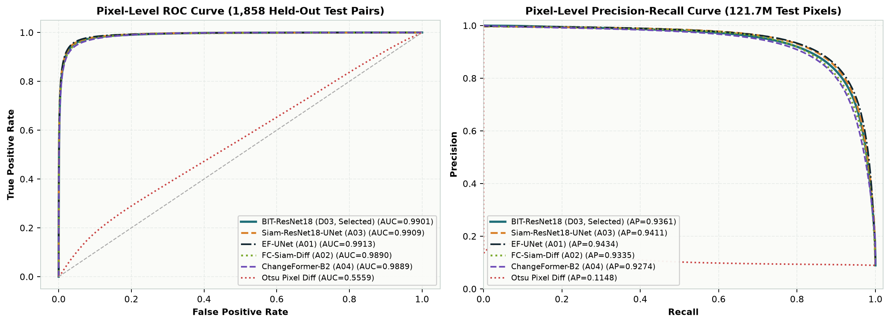

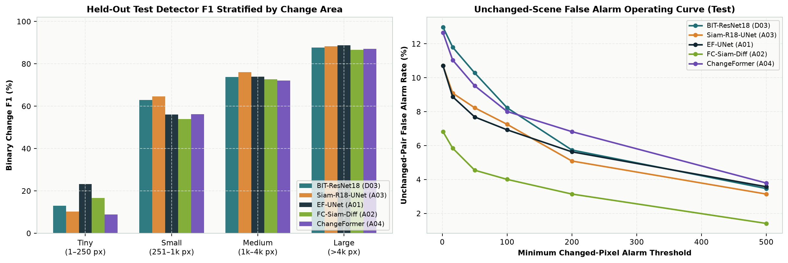

**Key detector findings**

- **Targets met.** `D03_bit_lr3e4` reaches **`75.93%`** change mIoU, **`86.83%`** binary F1, **`0.9901`** ROC-AUC and **`0.9361`** PR-AUC, which clears the thresholds set in Section 4.5. Its Test mIoU is `1.39` points above its Validation score of `74.54%`, so there is no sign of overfitting to Validation. The two splits are different images, so a small difference in either direction is expected.
- **Scale dependence.** On large changes (`>4,000 px`, 659 pairs) `D03` reaches `87.68%` F1 (`77.26%` mIoU). F1 falls to `73.80%` on medium changes (`1,001-4,000 px`, 186 pairs), `62.92%` on small ones (`251-1,000 px`, 69 pairs) and `12.99%` on tiny ones (`1-250 px`, 20 pairs).
- **Clean accuracy versus robustness.** On clean Test imagery `A01_ef_unet` (`77.36%`) and `A03_siam_r18_unet` (`76.73%`) lead `D03` by `1.43` and `0.80` mIoU points. The paired Wilcoxon test on per-pair F1 confirms both leads ($p = 1.8 \times 10^{-19}$ and $2.8 \times 10^{-16}$). The gaps to `A02_fc_siam_diff` ($p = 0.088$) and `A04_changeformer` ($p = 0.22$) are not significant. Under the 16 perturbed conditions of the stress test, `D03` scores higher mIoU than `A03` in 12 (for example `+33.63` points under heavy blur, `+12.03` under $0.5\times$ downsampling and `+4.57` under sensor noise) and lower in 4, the largest deficit being `-6.48` points under cloud haze. Most of the remaining wins are under 1.5 points. The stress test covers only `D03` and `A03`. On zero-shot SECOND-CC transfer `D03` leads by `5.46` F1 points, although absolute F1 is low for both models (`23.17%` versus `17.71%`; Section 11).

### 6.2 Module 2: Change Captioning Results (1,858 Held-Out Test Pairs)

**Table 6.2. Held-out LEVIR-MCI Test captioning quality, semantic similarity, and hallucination audit (1,858 pairs, 9,290 references).**

| Model | BLEU-1 | BLEU-4 | Changed BLEU-4 | ROUGE-L | METEOR | CIDEr-D | BERTScore-F1 | NC FA (%) | Changed Miss (%) | Obj Hall (%) |
|---|---:|---:|---:|---:|---:|---:|---:|---:|---:|---:|
| **`C06_rscama_frozen_clip` (Selected)** | 0.8421 | 0.6126 | 0.3686 | 0.7324 | 0.7360 | 1.3377 | 0.9490 | 3.57 | 11.78 | 4.93 |
| `C00_rscama_released` (External) | 0.8613 | 0.6551 | 0.4004 | 0.7556 | 0.7560 | 1.3930 | 0.9514 | 1.19 | 12.31 | 2.73 |
| `C04_rscama_adamw_cos` (Unfrozen) | 0.8504 | 0.6101 | 0.4077 | 0.7381 | 0.7430 | 1.3530 | 0.9507 | 5.74 | 6.53 | 6.22 |
| `C01_rscama_ref` (Upstream Recipe) | 0.8359 | 0.6135 | 0.3759 | 0.7152 | 0.7199 | 1.2819 | 0.9460 | 9.42 | 5.14 | 8.93 |
| `bit_mask_template` (Deterministic) | 0.7529 | 0.4893 | 0.1613 | 0.6427 | 0.6435 | 1.0734 | 0.9398 | 10.28 | 3.00 | 11.66 |
| `always_no_change` (Control) | 0.6414 | 0.5101 | 0.0001 | 0.6019 | 0.5623 | 1.0130 | 0.9291 | 0.00 | 100.00 | 0.00 |

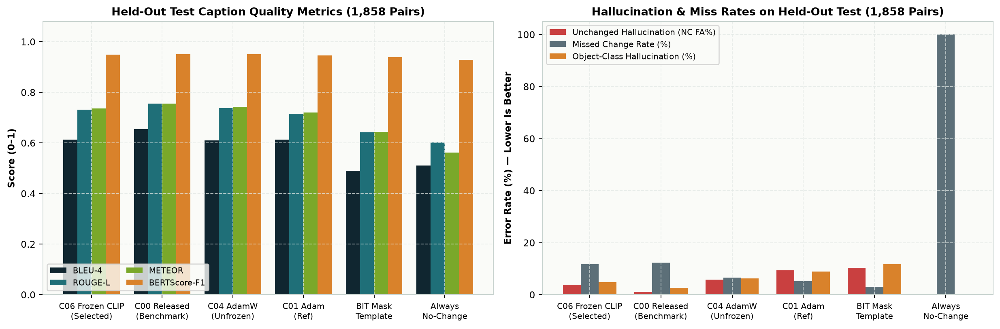

**Key captioner findings**

- **Text quality and hallucination of the selected model.** `C06_rscama_frozen_clip` reaches `BLEU-4 = 0.6126`, `ROUGE-L = 0.7324` (95% CI `[0.718, 0.746]`), `METEOR = 0.7360`, `CIDEr-D = 1.3377` (`[1.299, 1.376]`) and `BERTScore-F1 = 0.9490` (`[0.948, 0.950]`). These meet the Section 4.5 captioner targets. It has the lowest unchanged-scene hallucination rate among the trained models we ran, `3.57%` (`33/924` pairs), against `9.42%` for `C01_rscama_ref` (`2.64×` higher) and `5.74%` for `C04_rscama_adamw_cos` (`1.61×` higher), and an object hallucination rate of `4.93%`. The lower hallucination rate comes with a higher missed-change rate (`11.78%`, against `5.14%` for `C01` and `6.53%` for `C04`): `C06` is the more conservative captioner.
- **Comparison with non-neural baselines.** `C06` is significantly better than `bit_mask_template` on ROUGE-L (`+0.0896`, Wilcoxon $p = 9.5 \times 10^{-63}$), CIDEr-D (`+0.2643`, $p = 3.3 \times 10^{-57}$) and BERTScore-F1 (`+0.0092`, $p = 3.9 \times 10^{-55}$). Its lead over `C01_rscama_ref` is significant on BERTScore-F1 (`+0.0031`, $p = 5.7 \times 10^{-9}$) but not on ROUGE-L ($p = 0.060$) or CIDEr-D ($p = 0.098$).
- **Selection versus Test ranking.** `C06` was selected on Validation, where it had the top BLEU-4 (`0.6358`) and the lowest unchanged false-alarm rate (`3.32%`) among the controlled runs `C01` to `C07` (Milestone 4 report, Section 10). It is not the top captioner on Test BLEU-4: `C00` (`0.6551`), `C01` (`0.6135`) and `C06` (`0.6126`) are followed by `C04` (`0.6101`), and `C04` (`0.4077`), `C00` (`0.4004`) and `C01` (`0.3759`) all exceed `C06` (`0.3686`) on changed-pair BLEU-4. The Milestone 4 report lists `0.6128` for `C06` from its own Test evaluation, and `0.6126` here is the Milestone 5 re-evaluation.
- **Gap to the upstream released checkpoint (`C00`).** `C00_rscama_released`, which uses the upstream 468-word vocabulary, is ahead of `C06` by `0.0425` BLEU-4 and `0.0024` BERTScore-F1 (`0.9514` against `0.9490`). The paired tests agree that `C06` is lower on ROUGE-L ($p = 1.7 \times 10^{-7}$), CIDEr-D ($p = 6.6 \times 10^{-7}$) and BERTScore-F1 ($p = 0.011$). `C06` was trained on a train-only 388-word vocabulary in 30.3 minutes on a single T4. Its BERTScore-F1 is `99.75%` of `C00`'s, but BERTScore has a high floor (`0.9291` for the no-change control), so the percentage overstates how close the two are.

### 6.3 Module 3 and Overall System: Held-Out Test Claim Verification (150 Pairs, 185 Claims)

We applied the verification rules fixed on Validation (`tau_accept = 0.60, tau_reject = 0.75, mask_alarm_px = 50`) without further tuning to **150 stratified held-out Test pairs** (`50` unchanged, `35` building-only, `20` road-only, `25` mixed, `20` small-change). The captions yield **185 atomic claims**, labelled from the ground-truth masks and reference captions as `136` proxy-supported, `30` proxy-contradicted and `19` proxy-unverifiable. Validation accepted precision for the hybrid was `94.50%` and Test precision is `93.94%`, so the policy carried over closely to the new split. Its rules were written while examining Validation claims, so the Validation figures are not an independent estimate.

**Table 6.3. Held-out Test comparison of all 7 claim-verification policies (150 pairs, 185 claims, proxy labels).**

| Verification Policy | Accept (%) | Defer (%) | Reject (%) | Accepted Precision (%) | Selective Risk (%) | Supported Recall (%) | Contradicted Catch (%) | VLM Call Rate (%) | ECE $\downarrow$ | Brier $\downarrow$ | AURC $\downarrow$ |
|---|---:|---:|---:|---:|---:|---:|---:|---:|---:|---:|---:|
| `1. Unverified Captioner` | 100.0 | 0.0 | 0.0 | 73.51 | 26.49 | 100.00 | 0.00 | 0.0 | n/a | n/a | n/a |
| `3. Witness-Only Checker` | 51.9 | 10.3 | 37.8 | 73.96 | 26.04 | 52.21 | 16.67 | 0.0 | n/a | n/a | n/a |
| `4. Direct Qwen3-VL (τ=0.70)` | 46.0 | 43.2 | 10.8 | 78.82 | 21.18 | 49.26 | 3.33 | 100.0 | 0.3000 | 0.3142 | 0.2024 |
| `5. 4-View Reinspection-All` | 55.1 | 29.7 | 15.1 | 69.61 | 30.39 | 52.21 | 3.33 | 100.0 | 0.4464 | 0.4417 | 0.2298 |
| `6. M4 Triggered Reinspection` | 55.1 | 29.7 | 15.1 | 69.61 | 30.39 | 52.21 | 3.33 | 68.7 | n/a | n/a | n/a |
| `2. BIT Mask-Only Checker` | 76.8 | 10.3 | 13.0 | 93.66 | 6.34 | 97.79 | 70.00 | 0.0 | n/a | n/a | n/a |
| **`7. M5 Calibrated Mask-First Hybrid`** | 71.4 | 15.1 | 13.5 | 93.94 | 6.06 | 91.18 | 70.00 | 9.7 (**-90.3%**) | 0.0710 | 0.1041 | 0.0948 |

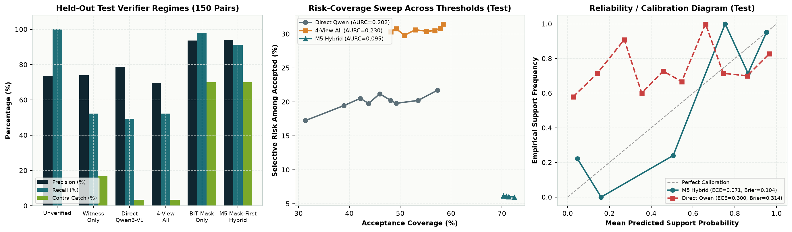

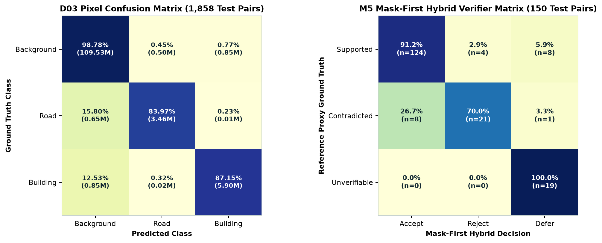

**Headline system findings**

1. **Lowest selective risk, with a small margin over mask-only.** The hybrid accepts `132` claims, of which `124` are proxy-supported (`93.94%` precision, `0` proxy-unverifiable accepted, `6.06%` selective risk). That is `4.37×` lower risk than unverified captions (`26.49%`) and `3.50×` lower than standalone Direct Qwen3-VL (`21.18%`). The BIT mask-only checker is almost as good (`93.66%` precision, `6.34%` risk), and the `0.28` point difference corresponds to about one claim, so we do not read it as an improvement. Mask-only accepts more claims (recall `97.79%` against `91.18%`) at the same contradicted catch rate of `70.00%`. Policies 5 and 6 produce identical decisions and differ only in how many referee calls they make.
2. **90.27% fewer VLM calls.** Only **18 of 185 claims (`9.73%`)** go to `Qwen3-VL-4B-Instruct`: `15` residual or hedged `no_change` claims and `3` weak-mask claims under `200 px`. The other `167` are settled by rules without a VLM call: `120` mask-first accepts, `24` mask-first rejects and `23` deferrals for out-of-ontology or exact-count claims. The OpenCV witness stage that supports these checks runs on CPU in about 15 ms per claim (P50 `14.68 ms`).
3. **Calibration.** ECE is `0.0710` for the hybrid against `0.3000` for Direct Qwen3-VL (`4.2×` lower) and `0.4464` for 4-view reinspection (`6.3×` lower). Brier score is `0.1041` against `0.3142` (`3.0×` lower) and AURC is `0.0948` against `0.2024` (`2.1×` lower). In the top confidence bin `[0.9, 1.0]` (`n = 123`) the mean confidence (`0.9517`) is within `0.0005` of the observed support rate (`0.9512`). The comparison needs care. For mask-first decisions the hybrid's confidence is a fixed value set by the rules (`0.94`, or between `0.84` and `0.96` depending on mask size, for accepts; `0.05` for rejects; `0.50` for defers), whereas Direct Qwen3-VL reports its own probabilities. The low-confidence bins are also not well calibrated: the `0.5-0.6` bin (`n = 25`) has an observed support rate of `0.24` and the `0.0-0.1` bin (`n = 27`) has `0.22`. No ECE is computed for the mask-only checker.
4. **End-to-end traces and human-audit packet.** Ten end-to-end Evidence Review bundles from held-out Test pairs (`test_e2e_traces/`; five are shown in the figure below) and the 120-claim blind rating packet (`M5T_001` to `M5T_120`, `POC/milestone5/evidence/human_audit/`) were exported from this run. The rater files contain no model-decision columns.

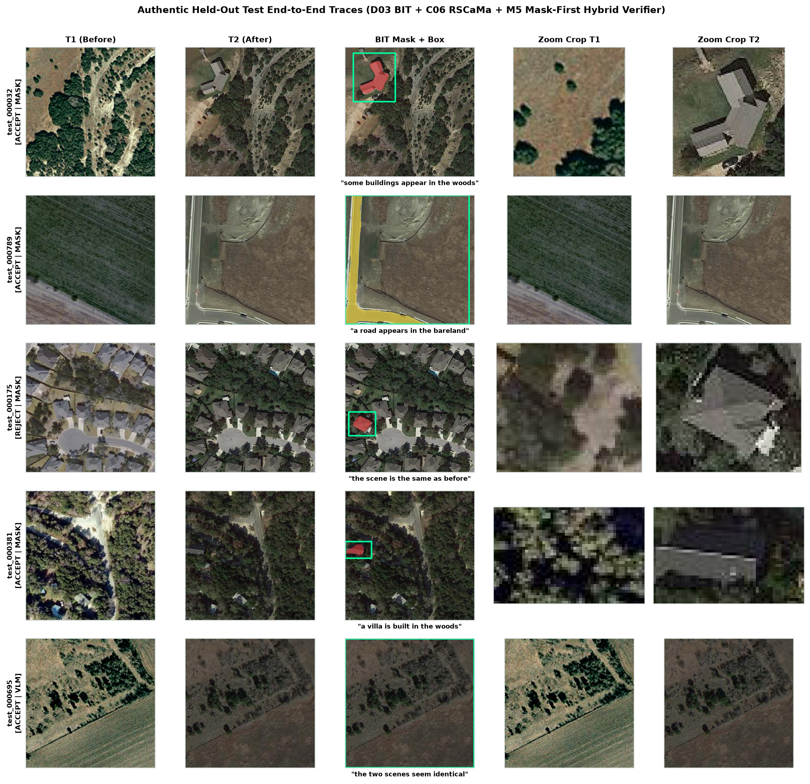

### 6.4 Blind Dual-Rater Human Evaluation (120 Held-Out Test Claims, 240 Ratings)

Proxy labels come from masks, so we also had people rate a sample of claims. All four team members (`SSSM`, `PA`, `SS`, `SRP`) rated claims blind to every model decision: `60` each, `240` ratings in total, `0` blank rows and `0` schema warnings, entered through the TerraWatch Blind Audit Web App. The 120 claims (`M5T_001` to `M5T_120`) are split into four slices of 30, and each slice was rated by two members. Ratings were aggregated with `POC/milestone5/scripts/m5_compute_human_audit.py` (output in `POC/milestone5/evidence/human_audit/human_audit_summary.json`).

The packet is not a random sample of the 185 claims. It contains every claim the hybrid did not accept and every claim whose proxy label was not `supported`, plus a random draw of the accepted, proxy-supported claims to make up 120. Coverage and rates in Table 6.4b therefore describe this packet and cannot be read as estimates for the full claim population. The raters are members of the project team, so they are blind to the models but not independent of the project.

**Table 6.4a. Inter-annotator agreement across the four 30-claim slices.**

| Claim Slice | Paired Raters | Assigned Adjudicator | Claims Rated (Both) | Exact Agreement (%) | Cohen's $\kappa$ | Agreed Error-Category Match |
|---|---|---|---:|---:|---:|---:|
| `001–030` | `SSSM` × `PA` | `SRP` | 30 / 30 | 100.0% (30/30) | 1.000 | 100.0% (4/4) |
| `031–060` | `PA` × `SS` | `SSSM` | 30 / 30 | 83.3% (25/30) | 0.468 | 100.0% (3/3) |
| `061–090` | `SS` × `SRP` | `PA` | 30 / 30 | 70.0% (21/30) | 0.082 | 100.0% (1/1) |
| `091–120` | `SRP` × `SSSM` | `SS` | 30 / 30 | 86.7% (26/30) | 0.000* | n/a (0/0) |
| **Pooled (All 120 Claims)** | All 4 raters | n/a | **120 / 120** | **85.0% (102/120)** | **0.384*** | **100.0% (8/8)** |

*\*Note on $\kappa$ and prevalence.* Raters agreed on `102` of 120 claims (`85.0%`) and on the error category for all `8` claims that both marked contradicted. Almost all agreed claims are `supported` (`94` of `102`), so the agreement expected by chance is high: $p_e \approx 0.76$ pooled, and `0.87` for slice `091–120`, where `SRP` rated all 30 claims `supported`. This is the usual prevalence effect (Feinstein and Cicchetti), and it is why `86.7%` raw agreement gives $\kappa = 0$ on that slice. No rater used the label `unverifiable`.

The `18` disagreements are listed in `disagreements.csv`. In `17` of them one rater said `supported` and the other `contradicted`, and the stricter rater was `SS` in 13 of the 14 disputed claims in slices `031–060` and `061–090` (`SS` marked `17` of their 60 claims contradicted, against `2` for `SRP`, `7` for `PA` and `8` for `SSSM`). **Adjudication has not been carried out.** Each slice has an assigned third-member adjudicator, but no adjudicated labels exist (`gold_from_adjudication = 0` in the summary file). The 18 disputed claims are excluded, and every human-verified metric below is computed over the **102 claims on which both raters agreed** (`gold_labels.csv`).

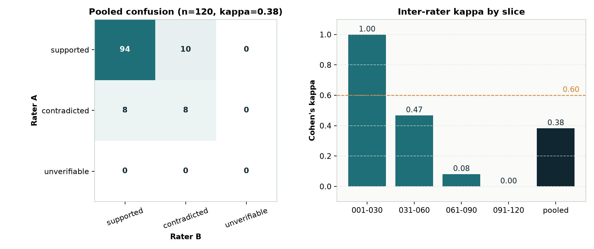

**Table 6.4b. Human-verified groundedness and hallucination rate per verification policy (`n = 102` agreed claims in the 120-claim packet, Wilson 95% CIs).**

| Verification Policy | Accepted (Packet) | Coverage (%) | Accepted w/ Gold | Human Supported | Human Contradicted | Human-Verified Groundedness [95% CI] | Human Hallucination Rate [95% CI] |
|---|---:|---:|---:|---:|---:|---:|---:|
| `Unverified Captioner` | 120 / 120 | 100.0% | 102 | 94 | 8 | `92.16% [85.3%, 96.0%]` | `7.84% [4.0%, 14.7%]` |
| `4-View Reinspection-All` | 66 / 120 | 55.0% | 54 | 48 | 6 | `88.89% [77.8%, 94.8%]` | `11.11% [5.2%, 22.2%]` |
| `Direct Qwen3-VL (τ=0.70)` | 49 / 120 | 40.8% | 40 | 37 | 3 | `92.50% [80.1%, 97.4%]` | `7.50% [2.6%, 19.9%]` |
| `BIT Mask-Only Checker` | 77 / 120 | 64.2% | 71 | 71 | 0 | `100.00% [94.9%, 100.0%]` | `0.00% [0.0%, 5.1%]` |
| **`M5 Calibrated Mask-First Hybrid`** | 67 / 120 | 55.8% | 62 | 62 | 0 | `100.00% [94.2%, 100.0%]` | `0.00% [0.0%, 5.8%]` |

**Human-audit and proxy-alignment findings**

1. **No agreed-contradicted claim was accepted.** The `BIT Mask-Only` checker (`71/71` supported) and the `M5 Calibrated Mask-First Hybrid` (`62/62` supported, `9.17%` VLM call rate) accepted none of the `8` claims that both raters marked contradicted, so their human-verified hallucination rate on the agreed set is `0.00%`, against `7.84%` for unverified captions, `7.50%` for Direct Qwen3-VL and `11.11%` for 4-view reinspection. The upper confidence limits (`5.1%` and `5.8%`) show how little 62 to 71 claims can establish. The hybrid and mask-only checker are indistinguishable on this measure. The result also covers only agreed claims: the hybrid accepted `5` further claims that were disputed (`46`, `64`, `69`, `73`, `85`), and `SS` rated four of them contradicted. If all five were hallucinations, the hybrid's groundedness over its 67 accepted claims would be `92.54%` (`62/67`).
2. **4-view prompting.** The 4-view policy has a lower groundedness (`88.89%`, 48 of 54) than leaving captions unverified (`92.16%`, 94 of 102), which agrees in direction with its Validation and Test proxy results. The confidence intervals overlap heavily, so the human audit does not establish the difference on its own.
3. **Proxy labels against human labels (`70.59%` exact agreement, $\kappa = 0.244$, `n = 102`).** All `17` claims the proxy labelled `unverifiable` were rated `supported` by both humans. They are mostly vegetation claims such as *"in the woods"* (`14` of 17), plus two parking-lot claims and one bareland claim, which the two-class road/building proxy cannot score. Of the `19` claims the proxy labelled `contradicted`, `12` were rated `supported` by both humans (seven of them *"the scene is the same as before"* claims where the 50-pixel rule found a changed region) and `7` were rated contradicted. In the other direction, the proxy called `1` claim supported that humans rated contradicted (*"a building appears in the bareland"*, `M5T_010`). The proxy is therefore mostly stricter than the human raters, and proxy precision understates human-rated groundedness for the verifier. On this 120-claim packet the hybrid's proxy precision is `88.06%` (`59/67`) against `100.00%` human groundedness on its `62` agreed accepted claims. The `93.94%` in Table 6.3 is computed over all 185 claims and is not comparable to the packet figure.
4. **Behaviour of the hybrid on the agreed claims.** Of the `94` agreed supported claims, the hybrid accepted `62`, deferred `25` and rejected `7`. It rejected all `8` agreed contradicted claims.

### 6.5 Target Performance Attainment Summary

| Milestone 5 Target | Required Threshold | Measured Held-Out Test Result | Status |
|---|---|---|---|
| Detector Change-Class mIoU | $\ge 74.0\%$ | `75.93%` `[74.79, 77.04]` (`D03_bit_lr3e4`) | Achieved (+1.93 pts) |
| Detector Binary F1 & ROC-AUC | $\ge 85.0\%$ F1 / $\ge 0.98$ ROC | `86.83%` F1 / `0.9901` ROC / `0.9361` PR-AUC | Achieved |
| Captioner BLEU-4 & BERTScore-F1 | $\ge 0.60$ B4 / $\ge 0.94$ BERT | `0.6126` B4 / `0.9490` BERT / `1.3377` CIDEr | Achieved |
| Captioner Unchanged Hallucination | $\le 6.0\%$ | `3.57%` (`33/924` pairs) | Achieved (-2.43 pts) |
| Hybrid Verifier Precision & VLM Savings | $\ge 90\%$ prec / $>70\%$ VLM savings | `93.94%` proxy precision / `100.0%` human groundedness on the agreed accepted claims (`62/62`) / `90.27%` VLM savings | Achieved |

## 7. Baseline Comparison

Each design decision in TerraWatch was compared with simpler or published alternatives on the same 1,858-pair held-out LEVIR-MCI Test split and the same 150-pair verification subset.

### 7.1 Detector Comparison: BIT-ResNet18 (`D03`) vs Four Neural Architectures and Non-Learning Controls

**Table 7.1. Multi-axis detector comparison across clean accuracy, stress resilience, cross-dataset transfer, and compute efficiency.**

| Detector Model | Params (M) | RTX 4060 P50 (ms) | GFLOPs / Pair | Clean Test mIoU (%) | Blur r=2.0 mIoU (%) | 0.5× Downscale mIoU (%) | SECOND-CC Test F1 (%) | Selection Role |
|---|---:|---:|---:|---:|---:|---:|---:|---|
| **`D03_bit_lr3e4` (Proposed)** | 11.94 | 7.64 | 17.45 | 75.93 | 40.54 | 71.98 | 23.17 | Selected |
| `A03_siam_r18_unet` | 15.63 | 4.61 | 14.24 | 76.73 | 6.91 | 59.94 | 17.71 | Clean CNN challenger |
| `A01_ef_unet` | 7.76 | 4.44 | 24.26 | 77.36 | n/a | n/a | n/a | Early-fusion CNN |
| `A02_fc_siam_diff` | 7.76 | 6.67 | 32.72 | 74.48 | n/a | n/a | n/a | Pure difference CNN (`4.55%` FA@50px) |
| `A04_changeformer` | 41.04 | 45.39 | 277.79 | 74.38 | n/a | n/a | n/a | Transformer |
| `otsu_diff` (Control) | 0.00 | n/a | n/a | n/a (`14.20%` F1) | n/a | n/a | n/a | Non-learning control |

**Discussion of detector trade-offs**

- **Versus the non-learning control.** `D03` improves binary change F1 by `72.63` percentage points over Otsu pixel differencing (`86.83%` against `14.20%`) and PR-AUC by `0.8213` (`0.9361` against `0.1148`). Simple differencing does not separate real changes from shadows and seasonal illumination shifts.
- **Versus `A04_changeformer`.** `D03` has `3.4×` fewer parameters (`11.94M` against `41.04M`), `15.9×` fewer GFLOPs (`17.45` against `277.79`) and `5.9×` lower batch-1 latency (`7.64 ms` against `45.39 ms` P50 on the RTX 4060). Its change mIoU is `1.55` points higher (`75.93%` against `74.38%`), its F1 `0.84` points higher and its PR-AUC `0.0087` higher. These accuracy differences are small: the bootstrap intervals overlap and the paired Wilcoxon test on per-pair F1 gives $p = 0.22$. The supported claim is that `D03` matches `A04` at a fraction of the cost.
- **Versus the clean CNNs (`A01_ef_unet`, `A03_siam_r18_unet`, `A02_fc_siam_diff`).** `A01` (`77.36%`) and `A03` (`76.73%`) lead `D03` by `1.43` and `0.80` mIoU points on clean Test (Wilcoxon $p < 10^{-15}$ for both). `A02_fc_siam_diff` has the lowest unchanged false-alarm rate (`4.55%` FA@50px; McNemar $p = 1.6 \times 10^{-10}$ against `D03`). Under perturbation the order changes for `D03` and `A03`, the two models in the stress test: `D03` is `+11.98` points ahead under moderate blur, `+33.63` under heavy blur, `+12.03` under $0.5\times$ downscaling and `+4.57` under sensor noise, and `+5.46` F1 points ahead on zero-shot SECOND-CC transfer. `A03` is `6.48` points ahead under cloud haze. We chose `D03` as the more robust backbone, and a future `D03 + A03` ensemble gated on image sharpness (Section 14.5) is a proposal that has not been tested.

### 7.2 Captioner Comparison: Frozen-CLIP `C06` vs Upstream, Unfrozen and Template Baselines

- **Versus the `always_no_change` control.** Because 49.7% of Test pairs are unchanged (924 of 1,858), `always_no_change` scores `0.5101` corpus BLEU-4, but its changed-pair BLEU-4 is `0.0001` and it misses every change. `C06` raises changed-pair BLEU-4 to `0.3686` (`+0.3685`), ROUGE-L by `+0.1304` ($p = 3.2 \times 10^{-105}$), CIDEr-D by `+0.3246` ($p = 5.4 \times 10^{-113}$) and BERTScore-F1 by `+0.0199` ($p = 7.7 \times 10^{-139}$).
- **Versus `bit_mask_template` (deterministic mask-to-text baseline).** Translating `D03` masks into text with fixed rules gives the lowest missed-change rate (`3.00%`), because it describes every detected mask. It also inherits `D03`'s `10.28%` unchanged false-alarm rate and produces rigid text (`BLEU-4 = 0.4893`, `Changed BLEU-4 = 0.1613`, `CIDEr-D = 1.0734`). `C06` is `0.1233` higher in BLEU-4 and `0.2643` higher in CIDEr-D, and its unchanged hallucination rate is `2.88×` lower (`3.57%` against `10.28%`).
- **Versus the controlled fine-tuning baselines (`C01_rscama_ref`, `C04_rscama_adamw_cos`).** Unfrozen-CLIP `C04` writes somewhat richer descriptions of changed scenes (`Changed BLEU-4 = 0.4077` against `0.3686`, `BERTScore = 0.9507` against `0.9490`; the BERTScore difference is significant, $p = 7.3 \times 10^{-8}$) but hallucinates more (`5.74%` NC FA against `3.57%`, `6.22%` ObjHall against `4.93%`). The upstream recipe `C01` has `9.42%` unchanged hallucinations (`2.64×` that of `C06`) and lower ROUGE-L (`0.7152`), CIDEr-D (`1.2819`) and BERTScore (`0.9460`). Freezing CLIP gives `C06` the lowest hallucination rates of the trained models, at the cost of a higher missed-change rate (`11.78%` against `6.53%` for `C04`).
- **Versus the external released checkpoint (`C00_rscama_released`).** `C00`, trained upstream with a 468-word vocabulary, is better on every text metric (BLEU-4 `0.6551`, `+0.0425`; BERTScore-F1 `0.9514`, against `0.9490`) and has a lower NC FA (`1.19%`), but a slightly higher missed-change rate (`12.31%` against `11.78%`). We treat it as an upper reference. `C06` was chosen on Validation among the controlled runs and does not beat it on Test BLEU-4.

### 7.3 Verifier Comparison: Calibrated Mask-First Hybrid vs Unverified, Mask-Only and Unconditional VLM

**Table 7.2. Change achieved by the M5 Calibrated Mask-First Hybrid Verifier relative to each policy on 185 held-out Test claims (proxy labels).**

| Baseline Replaced | Baseline Accepted Precision | M5 Hybrid Precision | Precision Gain | Selective Risk Reduction | VLM Compute Change |
|---|---:|---:|---:|---:|---:|
| `1. Unverified Captioner` | 73.51% | 93.94% | +20.43 pts | -20.43 pts (4.37× lower risk) | +9.7 pts VLM call rate |
| `3. Witness-Only Checker` | 73.96% | 93.94% | +19.98 pts | -19.98 pts (4.30× lower risk) | +9.7 pts VLM call rate |
| `4. Direct Qwen3-VL (τ=0.70)` | 78.82% | 93.94% | +15.12 pts | -15.12 pts (3.50× lower risk) | -90.27% VLM calls |
| `5. 4-View Reinspection-All` | 69.61% | 93.94% | +24.33 pts | -24.33 pts (5.01× lower risk) | -90.27% VLM calls |
| `6. M4 Triggered Reinspection` | 69.61% | 93.94% | +24.33 pts | -24.33 pts (5.01× lower risk) | -85.8% VLM calls |
| `2. BIT Mask-Only Checker` | 93.66% | 93.94% | +0.28 pts | -0.28 pts | +9.7 pts VLM call rate |

On these proxy labels, the mask-based checkers beat the standalone 4B vision-language model (`93.66%` against `78.82%` accepted precision; `70.0%` against `3.3%` contradicted catch rate), and the human audit points the same way (`100.00%` against `92.50%` groundedness on agreed claims). The proxy labels are built from ground-truth masks, which favours mask-based checking, and Direct Qwen3-VL was run at a single operating threshold (`τ=0.70`). The sweep in `test_verification_summary.json` shows its precision between `78.30%` (`τ=0.50`) and `82.76%` (`τ=0.90`), where it accepts `31.35%` of claims, so no threshold brings it near the mask-based policies. The hybrid sends only the claims the mask cannot judge to the VLM. It has the lowest risk of the seven policies (`6.06%`) and needs `10.3×` fewer VLM calls than unconditional verification (`9.73%` against `100%`), but its precision advantage over mask-only is within noise, and its main benefit is the added handling of claims the mask cannot resolve.

## 8. Hyperparameter Analysis

Milestone 4 ran a one-factor-at-a-time (OFAT) sweep on the full 6,444-pair LEVIR-MCI training split, evaluated on the 1,242-pair Validation split. For the BIT-ResNet18 detector it comprised 16 controlled runs (`D01` to `D16`), and for the RSCaMa captioner 7 (`C01` to `C07`). The selected `D03` and `C06` configurations were repeated with two further seeds. Selection used Validation only. Each configuration was run once with seed 42, so differences of a point or two in the tables below are not separated from seed noise (see the multi-seed results below).

### 8.1 Detector Hyperparameter Sweep (`D01` to `D16`, BIT-ResNet18)

The reference run is `D01_bit_ref` (head LR `1e-4`, backbone LR `1e-5`, weight decay `0.01`, effective batch `32`, cosine schedule, Focal + Soft Dice loss, 5 frozen-backbone epochs, horizontal-flip augmentation), which reached **`71.82%`** Validation change mIoU and `18.04%` FA@50px. Each other run changes one factor.

**Table 8.1. Controlled BIT-ResNet18 hyperparameter exploration on LEVIR-MCI Validation (1,242 pairs).**

| Factor Explored | Run ID | Setting Changed vs `D01` | Best Ep | Val Chg mIoU (%) | $\Delta$ vs `D01` | Val Bin F1 (%) | Val FA@50px (%) | Outcome |
|---|---|---|---:|---:|---:|---:|---:|---|
| *Reference baseline* | `D01_bit_ref` | Head `1e-4`, BB `1e-5`, WD `0.01`, EB `32`, Cos, Focal+Dice, Frz `5`, Flip | 27 | 71.82 | n/a | 84.57 | 18.04 | Reference |
| Learning rate | `D02_bit_lr3e5` | Head `3e-5` / BB `3e-6` (3× lower) | 20 | 64.55 | -7.27 | 79.87 | 33.39 | Underfits |
| Learning rate | **`D03_bit_lr3e4`** | Head `3e-4` / BB `3e-5` (3× higher) | 24 | 74.54 | +2.72 | 86.25 | 6.80 | Selected (highest mIoU and lowest FA@50px of the `D` runs) |
| Weight decay | `D04_bit_wd1e3` | WD `0.001` (10× lower) | 20 | 69.94 | -1.88 | 83.38 | 24.37 | Lower mIoU |
| Weight decay | `D05_bit_wd5e2` | WD `0.05` (5× higher) | 20 | 69.94 | -1.88 | 83.38 | 24.53 | Lower mIoU |
| Effective batch | `D06_bit_eb16` | Effective batch `16` (`16×1`) | 20 | 71.66 | -0.16 | 84.43 | 18.51 | Near parity |
| Effective batch | `D07_bit_eb64` | Effective batch `64` (`16×4`) | 20 | 67.94 | -3.88 | 82.08 | 27.85 | Lower mIoU |
| LR schedule | `D08_bit_const` | Constant LR (`1e-4`) | 24 | 72.92 | +1.10 | 85.17 | 16.93 | Higher than `D01` |
| LR schedule | `D09_bit_step` | Step decay LR | 24 | 72.94 | +1.12 | 85.19 | 16.46 | Higher than `D01` |
| Loss function | `D10_bit_cedice` | Weighted CE + Soft Dice (no focal) | 22 | 68.44 | -3.38 | 82.47 | 29.59 | Lower mIoU, more FA |
| Loss function | `D11_bit_wce` | Weighted CE only (no focal, no Dice) | 22 | 63.87 | -7.95 | 79.27 | 40.98 | Lowest of the loss variants |
| Backbone freeze | `D12_bit_unfreeze0` | Unfrozen from epoch 0 | 20 | 71.70 | -0.12 | 84.39 | 21.68 | Parity on mIoU, FA +3.64 pts |
| Backbone freeze | `D13_bit_frozen` | Backbone frozen throughout | 23 | 62.45 | -9.37 | 78.61 | 17.41 | Lowest mIoU |
| Augmentation | `D14_bit_noaug` | No augmentation | 20 | 69.68 | -2.14 | 83.23 | 24.53 | Lower mIoU |
| Augmentation | `D15_bit_photo` | Horizontal + vertical flip, independent photometric jitter on $T_1$ and $T_2$ | 22 | 68.34 | -3.48 | 82.41 | 25.63 | Lower mIoU |
| Augmentation | `D16_bit_photoscale` | As `D15` plus random paired scale crop | 22 | 68.55 | -3.27 | 82.50 | 22.31 | Lower mIoU |

The runs did not all have the same epoch budget. `D01` and `D03` were allowed up to 35 epochs (`D03` early-stopped after 32), while `D02` and `D04` to `D16` ran for 25. Every $\Delta$ against `D01` except `D03` therefore mixes the effect of the changed setting with a shorter schedule, and `D01` itself peaked at epoch 27, after the shorter runs had ended. `D01` and `D03` share the 35-epoch budget, so the learning-rate comparison is the clean one.

**Key detector findings**

1. **The differential learning rate (`3e-4` head, `3e-5` backbone) gave the largest gain.** It raised Validation change mIoU by `2.72` points over `D01` (`71.82%` to `74.54%`) and cut unchanged-scene false alarms by a factor of `2.65` (`18.04%` to `6.80%`). The `3e-5` head rate in `D02` reached only `64.55%` with `33.39%` false alarms, although its shorter budget contributes to that gap. Across three seeds `D03` scores `74.23% ± 0.28%`, so the gain over `D01` is larger than the seed spread, though `D01` itself was run once.
2. **Focal + Soft Dice outperformed the weighted-CE variants.** Weighted CE alone (`D11`) scored `7.95` points lower (`63.87%` against `71.82%`) with `40.98%` false alarms against `18.04%`, and CE + Dice without focal (`D10`) scored `3.38` points lower. This is consistent with hard-example weighting helping under the roughly 10:1 background imbalance, although the runs change the loss terms rather than isolating one mechanism.
3. **Effective batch size.** Batch `32` (`16 × 2` accumulation) and `16` were close (`71.82%` and `71.66%`), and batch `64` (`D07`) was `3.88` points lower. Halving the number of updates per epoch is one plausible reason, but it was not tested directly.
4. **Weight decay.** Both `0.001` (`D04`) and `0.05` (`D05`) scored `1.88` points below `0.01`, with identical mIoU to two decimals. Given the budget difference and the lack of repeats, we only conclude that `0.01` was not worse than the alternatives tried.
5. **Selection note.** `D03` is the best of the BIT runs, but not the highest Validation scorer overall: `A03_siam_r18_unet` reached `75.02%` in the Milestone 4 architecture comparison. `D03` was chosen with the robustness and transfer results in mind (Sections 6.1 and 11).

### 8.2 Captioner Hyperparameter Sweep (`C01` to `C07`, RSCaMa)

All captioner runs used 8 epochs and a batch of 12.

**Table 8.2. Controlled RSCaMa hyperparameter exploration on LEVIR-MCI Validation (1,242 pairs, 388-token train-only vocab).**

| Factor Explored | Run ID | Setting Changed | Best Ep | Val BLEU-4 | Val ROUGE-L | Changed BLEU-4 | Val CE | NC FA (%) | Outcome |
|---|---|---|---:|---:|---:|---:|---:|---:|---|
| *Upstream recipe* | `C01_rscama_ref` | Adam, LR `1e-4`, Constant, Unfrozen CLIP, EB `12` | 5 | 0.6296 | 0.7275 | 0.3916 | 1.2514 | 7.75 | Reference |
| Learning rate | `C02_rscama_lr3e4` | LR `3e-4` (3× higher) | 0 | 0.4956 | 0.6765 | 0.2272 | 1.5260 | 0.79 | Best epoch was the first; run stopped after 2 epochs |
| Learning rate | `C03_rscama_lr3e5` | LR `3e-5` (3× lower) | 0 | 0.6214 | 0.7177 | 0.2447 | 2.2182 | 0.47 | Best epoch was the first; changed-pair BLEU-4 low |
| Optimizer + schedule | `C04_rscama_adamw_cos` | AdamW (`WD=0.01`) + Cosine | 6 | 0.6264 | 0.7498 | 0.4380 | 1.2653 | 5.70 | Highest ROUGE-L and changed-pair BLEU-4 |
| Label smoothing | `C05_rscama_ls01` | Label smoothing `0.1` + AdamW/Cos | 3 | 0.5963 | 0.7421 | 0.4151 | 2.1336 | 6.80 | Lower BLEU-4 (-0.0301 vs `C04`) |
| CLIP freezing | **`C06_rscama_frozen_clip`** | Frozen CLIP ViT-B/32 + AdamW/Cos | 6 | 0.6358 | 0.7405 | 0.4047 | 1.3147 | 3.32 | Selected (highest BLEU-4 and lowest NC FA among `C01`, `C04` to `C07`) |
| Effective batch | `C07_rscama_eb24` | Effective batch `24` (`12×2`) | 3 | 0.6281 | 0.7400 | 0.4068 | 1.3791 | 6.49 | Close to `C01` |

**Key captioner findings**

1. **Learning rate.** Of the three rates tried, only `1e-4` produced a usable captioner. At `3e-4` (`C02`) the best epoch was the first one (`0.4956` BLEU-4) and the run stopped after two epochs. At `3e-5` (`C03`) the best Validation BLEU-4 (`0.6214`) came from epoch 0, with changed-pair BLEU-4 of only `0.2447` and `Val CE = 2.218`. The very low NC FA values of both runs (`0.79%`, `0.47%`) reflect captions that rarely describe a change. Validation BLEU-4 also fluctuates from epoch to epoch (for `C04` between `0.5287` and `0.6264`), so best-epoch selection is noisy.
2. **Freezing CLIP ViT-B/32 (`C06`)** gave the highest Validation BLEU-4 (`0.6358`) and a lower unchanged-scene hallucination rate (`3.32%` against `7.75%` for `C01` and `5.70%` for `C04`), and lowered peak training VRAM by `649 MB` (`4,820` against `5,469 MB`). The seed repeats weaken the BLEU-4 and hallucination claims: Validation BLEU-4 over three seeds is `0.6297 ± 0.0183` (`0.6358`, `0.6442`, `0.6092`), and NC FA is `3.32%`, `4.43%` and `7.44%` for seeds 42, 2026 and 0, a mean of `5.06%`. The `0.0094` BLEU-4 margin over `C04` is smaller than the seed spread, and the NC FA advantage appears reliably only on the Test run (`3.57%` against `5.74%` for `C04`, one seed each).
3. **Label smoothing (`0.1`, `C05`)** lowered BLEU-4 by `0.0301` relative to `C04`, its AdamW/cosine counterpart. Validation CE is not comparable across the two because smoothing changes the loss.

### 8.3 Hybrid Verifier Threshold and Routing Calibration (Validation-Locked)

On the 120-pair, 147-claim Milestone 4 Validation verification set (proxy labels, not human labels), the routing rule of the hybrid is implemented in `POC/milestone5/scripts/m5_eval_captioners_and_verifier.py`.

- Milestone 4 swept the acceptance threshold of the Direct `Qwen3-VL-4B-Instruct` policy over $\tau \in \{0.50, 0.60, 0.70, 0.80, 0.90\}$ on this set. At the operating threshold $\tau = 0.70$ it reached `82.43%` proxy precision (`17.57%` selective risk) with `40.8%` of claims deferred and a `100%` VLM call rate. At $\tau = 0.90$ its Validation precision was `93.62%`, but it accepted only `32.0%` of claims.
- The **Calibrated Mask-First Hybrid** resolves unambiguous mask and ontology claims deterministically and escalates only the claims the BIT mask cannot judge: `removed` claims, `no_change` claims with `any_px >= 10` or hedged phrasing, and `added` claims with fewer than 200 class pixels. The escalated claims are scored by Direct Qwen3-VL with $\tau_A = 0.60$ and $\tau_R = 0.75$. On Validation this gives accepted precision of **`94.50%`** (`5.50%` selective risk), a contradicted-claim catch rate of **`70.37%`** and a VLM call rate of **`10.9%`** (**`89.1%` savings**). We found no run that swept the hybrid's own thresholds on Validation. The script reports a sweep of the accept threshold on Test, over which hybrid precision stays between `93.85%` and `94.03%`. Section 6.3 reports how the fixed policy performs on the 150-pair Test subset.

## 9. Ablation Study

The ablations below isolate the effect of individual design choices for detection, captioning and claim verification. They are drawn from the Milestone 4 Validation runs and the Milestone 5 Test evaluations. Each uses a single seed, so small differences should be read with the multi-seed results in Section 8 in mind.

### 9.1 Detector Component Ablations (BIT-ResNet18)

**Table 9.1. Controlled detector component ablations (Val = 1,242 pairs; Test = 1,858 pairs).**

| Component Tested | Full Configuration | Ablated Variant | Val Chg mIoU (%) | $\Delta$ mIoU | Val FA@50px (%) | Interpretation |
|---|---|---|---:|---:|---:|---|
| **Backbone adaptation** | Unfreeze after 5 ep (`D01`) | Backbone frozen throughout (`D13`) | 71.82 vs 62.45 | -9.37 pts | 18.04 vs 17.41 | Fine-tuning the ResNet18 backbone matters: the frozen ImageNet backbone was the weakest variant. |
| **Focal + Dice loss** | Focal + Soft Dice (`D01`) | Weighted CE only (`D11`) | 71.82 vs 63.87 | -7.95 pts | 18.04 vs 40.98 | False alarms more than doubled, and road IoU fell more (`-9.38` pts) than building IoU (`-6.52` pts). |
| **Focal term** | Focal + Soft Dice (`D01`) | CE + Soft Dice (`D10`) | 71.82 vs 68.44 | -3.38 pts | 18.04 vs 29.59 | Removing the focal term (`γ=2`) raised FA@50px by 11.6 pts. |
| **Augmentation** | Horizontal flip (`D01`) | No augmentation (`D14`) | 71.82 vs 69.68 | -2.14 pts | 18.04 vs 24.53 | Flipping raised mIoU and lowered unchanged FA by 6.5 pts. |
| **Photometric jitter** | Horizontal flip only (`D01`) | Horizontal + vertical flip with independent $T_1$/$T_2$ jitter (`D15`) | 71.82 vs 68.34 | -3.48 pts | 18.04 vs 25.63 | Lower mIoU. The variant also adds vertical flips, so the jitter is not isolated. Independent jitter could mimic real radiometric change, which we did not test. |
| **Warm-up freeze (5 ep)** | Freeze 5 ep (`D01`) | Unfreeze at ep 0 (`D12`) | 71.82 vs 71.70 | -0.12 pts | 18.04 vs 21.68 | mIoU unchanged; FA@50px rose by 3.6 pts. |
| **Detector architecture (global token attention)** | `D03_bit_lr3e4` (BIT tokens) | `A03_siam_r18_unet` (local CNN) | Test blur r=1.0: `72.10` vs `60.12` | +11.98 pts | Test blur r=2.0: `40.54` vs `6.91` (+33.63) | `D03` is 0.80 points behind on clean Test (`75.93%` against `76.73%`) and ahead under blur, downscaling (`+12.03` pts), noise (`+4.57` pts) and SECOND-CC transfer (`+5.46` F1 pts). The two architectures differ in more than attention, so the gap cannot be attributed to the tokens alone. |

The Validation ablation rows against `D01` carry the epoch-budget caveat described in Section 8.1.

### 9.2 Captioner Component Ablations (RSCaMa)

**Table 9.2. Controlled RSCaMa captioner ablations (Validation and CUDA compute profile).**

| Component Tested | Selected (`C06`) | Ablated Variant | Key Metric Impact | Takeaway |
|---|---|---|---|---|
| **Frozen CLIP ViT-B/32 encoder** | Frozen (`C06`) | Unfrozen CLIP (`C04_rscama_adamw_cos`) | Val BLEU-4: `0.6358` vs `0.6264` (`+0.0094`); Val NC FA: `3.32%` vs `5.70%` (`-2.38` pts); peak train VRAM: `4.82` vs `5.47 GB` | Lower hallucination and VRAM with frozen CLIP on seed 42. Over three seeds `C06` NC FA averages `5.06%` and BLEU-4 varies by `±0.0183`, so the margin is not established. |
| **AdamW + cosine decay** | AdamW + Cosine, unfrozen (`C04`) | Adam + Constant, unfrozen (`C01_rscama_ref`) | Val BLEU-4: `0.6264` vs `0.6296`; Val ROUGE-L: `0.7498` vs `0.7275`; Changed BLEU-4: `0.4380` vs `0.3916`; Val NC FA: `5.70%` vs `7.75%` | With CLIP unfrozen in both runs, AdamW + cosine improved ROUGE-L and changed-pair BLEU-4 and lowered NC FA by 2.05 pts, at slightly lower corpus BLEU-4. |
| **Exact fused Triton selective scan** | `triton_fused_exact` | Naive PyTorch reference scan | Training: `227 s/ep` vs `2,310 s/ep` (38.5 min), a `10.2×` speedup, as reported in the Milestone 4 report; RTX 4060 inference: `23.30 ms` vs `89.35 ms` P50 (`3.83×`, same `8.69` mean decode steps) | The kernel matches the reference gradients to a relative error of at most $4.4 \times 10^{-7}$. The 58 captioner training epochs would have taken an estimated 37 GPU-hours with the naive scan (58 × 38.5 min) against `3.88` GPU-hours measured. |
| **Learned captioning vs mask templates** | `C06` neural RSCaMa | `bit_mask_template` (deterministic mask text) | Test BLEU-4 `0.6126` vs `0.4893`; CIDEr-D `1.3377` vs `1.0734`; BERTScore-F1 `0.9490` vs `0.9398`; NC FA `3.57%` vs `10.28%`; ObjHall `4.93%` vs `11.66%`; missed changes `11.78%` vs `3.00%` | The neural captioner is better on text quality and hallucination. The template misses fewer changes because it reports every mask the detector produces, and it is also the least accurate on object claims. |

### 9.3 Multimodal Verification Pipeline Ablations

The ablations in this section compare the policies in Table 6.3 on the 147 Validation claims, with Test results (150 pairs, Section 6.3) where they exist. All labels are proxy labels.

1. **Without verification (`1_unverified_captioner`).** Analysts see the captioner's errors directly: `72.79%` Validation precision, `27.21%` selective risk and a `0.0%` catch rate.
2. **Without the detector mask (`4_direct_qwen3vl_gated`).** `Qwen3-VL-4B-Instruct` inspecting the full $T_1$/$T_2$ images at `100%` VLM cost reaches `82.43%` Validation precision (`17.57%` risk) and defers `40.8%` of claims.
3. **Naive 4-view crop prompting (`5_reinspection_all_gated`).** Giving the zoomed $T_1$/$T_2$ crops plus the full images to `Qwen3-VL-4B` for every claim lowered Validation precision from `82.43%` to `72.41%`. On Test it is also the lowest-precision policy (`69.61%`). We did not test why. One possibility is that the crops remove spatial context, but this is a hypothesis.
4. **Without VLM escalation (`2_mask_only_checker`).** The mask-only checker reaches `91.38%` Validation precision (`62.96%` catch rate) and `93.66%` on Test, at no VLM cost. It cannot judge `removed` claims, since the BIT masks carry no temporal direction, marginal changes under 200 px, or hedged `no_change` captions where the mask is nonzero. No claim took the `removed` route on Test.
5. **Deterministic abstention rules (out-of-ontology and exact-count claims).** The parser defers vegetation, water and parking claims and claims with exact counts (`T_out_of_mask_ontology`, `exact_count_without_independent_instance_evidence`) because a road/building change mask cannot check them. This is a design choice, and we did not run a variant without these rules. On Test it defers `23` of 185 claims, and in the human audit the proxy `unverifiable` claims (mostly vegetation) were all rated supported by both raters.
6. **Full Calibrated Mask-First Hybrid (`7_m5_calibrated_mask_first_hybrid`).** Mask-first resolution, deterministic abstention, OpenCV witness diagnostics and selective Direct-Qwen3-VL escalation on the claims the mask cannot judge give `94.50%` Validation precision (`5.50%` risk), a `70.37%` catch rate and `89.1%` VLM savings (`10.9%` call rate). Relative to mask-only it adds `3.12` points of precision and `7.41` points of catch rate on Validation (`94.50 - 91.38`; `70.37 - 62.96`), but loses recall (`96.26%` against `99.07%`) and coverage (`74.15%` against `78.91%`). On Test the precision gain is `0.28` points, the catch rate is equal at `70.00%`, and recall is lower (`91.18%` against `97.79%`). The hybrid is therefore a precision-for-recall trade rather than a strict improvement on every axis.
## 10. Error Analysis

To look past the aggregate metrics, we mined the errors of all three modules on held-out Test data: the detector predictions on all 1,858 Test pairs, the captions on all 1,858 Test pairs, and the 185 claims of the blind Test verification study (150 stratified Test pairs). The sources are `POC/milestone5/evidence/error_analysis/failure_taxonomy.csv`, `detector_error_mining.json`, `captioner_test_full.json` and `test_verification_claims.jsonl`. The counts and pixel numbers below come from these files. The explanations of why an error occurs are our own readings of the exported image pairs. We did not test them with controlled experiments, so they are stated as likely causes rather than established ones.

### 10.1 Quantified 6-Category Failure Taxonomy

**Table 10.1. Failure taxonomy of the three TerraWatch modules on held-out Test.**

| ID | Failure Category | Module | Measured Scope | Quantified Rate / Count | Likely Cause (hypothesis) | Representative Test Pair |
|---|---|---|---|---|---|---|
| E1 | Unchanged-Scene Detector FP | Detector (`D03`) | 924 unchanged Test pairs | 95 / 924 (10.28% at the 50 px threshold) | Appearance differences between the two dates (foliage, shadows, sun angle) | `test_000977` (2,593 FP px) |
| E2 | Tiny & Small Structure Miss | Detector (`D03`) | 89 pairs with 1-1,000 changed px; 64 of them with fewer than 655 px (<1% of the tile) | Tiny (1-250 px, 20 pairs) F1 12.99%; pooled F1 over pairs below 1% of the tile 48.88% | Very small objects on a 256 x 256 tile, some inside dense tree cover | `test_000226` (141 GT px, 0 predicted) |
| E3 | Large Low-Contrast / Glare Miss | Detector (`D03`) | 934 changed pairs (10.88M foreground px) | Road to background 15.80%; building to background 12.53% (row-normalised confusion matrix) | Not established; the two worst misses show a bright-roof to parking-lot change and a road resurfacing | `test_001303` (14,009 FN px) |
| E4 | Road-vs-Building Semantic Swap | Detector (`D03`) | 10.88M foreground Test pixels | 31,042 px (0.29% of foreground) | Flat paved or roofed areas next to roads | `test_001217` (3,492 swap px) |
| E5 | Captioner False Alarm & Miss | Captioner (`C06`) | 1,858 Test pairs | Unchanged false alarm 3.57% (33/924); changed miss 11.78% (110/934); object hallucination 4.93% (54 of 1,096 object claims) | Small 388-word vocabulary and a tendency toward the "no change" sentence (not tested) | `test_000010` (false alarm), `test_001307` (miss) |
| E6 | Verifier: Deferrals and Residual Errors | Hybrid Verifier | 185 claims (150 blind Test pairs) | 23 deterministic deferrals; 8 of 132 accepted claims contradicted (6.06%); 4 supported claims rejected | Vegetation, bare-land and exact-count claims are out of scope; the other errors trace back to the `D03` mask or to the referee | `test_000381`, `test_001729`, `test_001038` |

### 10.2 Detector Error Visual Forensics & Confusion Matrix Analysis

The confusion matrix in **Appendix B** (`m5_confusion_matrices.png`) shows very little road-building confusion: 0.23% of road pixels are predicted as building and 0.32% of building pixels as road. Of the 2,878,928 misclassified Test pixels, 31,042 (1.08%) are such swaps, so about 98.9% of the pixel errors are foreground-versus-background misses or false alarms. The worst Test cases in **Figure 10.1** (`m5_error_taxonomy_gallery.png`) fall into four groups. Each description below is based on the exported T1/T2 images and the pixel counts, and the explanations are tentative.

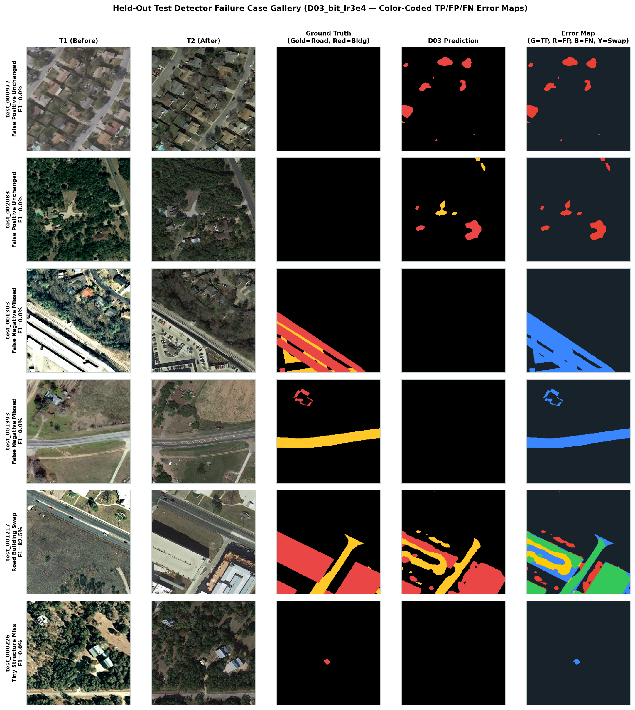

1. **Unchanged scenes with false alarms (`test_000977`, `test_002083`, Category E1):** Both pairs have no ground-truth change, yet `D03` predicts 2,593 and 2,300 changed pixels (F1 = 0.0%). `test_000977` is a residential area that looks darker and differently lit in T2. `test_002083` is a wooded scene with scattered houses and includes a few road-class blobs. Shadows, seasonal tree cover and sun angle are plausible causes, but we did not measure them. Across the 924 unchanged pairs, 120 have at least one false-alarm pixel and 95 exceed 50 pixels. The 20 largest false alarms account for 56.4% of all false-alarm pixels (computed from `detector_per_pair_d03_a03.jsonl`).
2. **Large changes missed entirely (`test_001303`, `test_001393`, Category E3):** In `test_001303` (14,009 changed pixels) a bright, white-roofed building area in T1 is replaced by a parking lot and a realigned road, and `D03` predicts nothing. In `test_001393` (6,927 changed pixels) a small building and a road with new lane markings are both missed (F1 = 0.0%). Overall, 22 of the 934 changed pairs receive no predicted pixel at all (47,666 ground-truth pixels in total), 3 of them in the largest-area bucket. Strong roof brightness and low contrast between old and new asphalt are possible reasons, but this was not tested.
3. **Road-versus-building swap (`test_001217`, Category E4):** Detection is good overall (F1 = 82.5%), but a flat, light-grey roof beside a new road is partly labelled as road (3,492 swapped pixels, shown in yellow in Figure 10.1). Flat roofs and wide paved areas can look alike in a local patch.
4. **A small structure missed (`test_000226`, Category E2):** A building of 141 pixels (0.22% of the tile) surrounded by trees receives no predicted pixel. Of the 20 tiny pairs (1-250 px), 5 have no predicted pixel at all. We have not shown how much of this comes from the backbone resolution and how much from the tree cover.

### 10.3 Captioner & Hybrid Verifier Residual Error Analysis

- **Captioner false alarms and misses (Category E5):** On 33 of 924 unchanged pairs (3.57%), `C06` describes a change that does not exist, for example `test_000010` ("a small house appears in the bareland") and `test_000055` ("a villa appears in the center of the scene"). On 110 of 934 changed pairs (11.78%), `C06` writes "the two scenes seem identical". Two of the largest cases are `test_001303` (11,259 building and 2,750 road pixels), which `D03` also misses completely, and `test_001307` (22,812 building and 3,320 road pixels). In `test_001307` `D03` does find 7,910 changed pixels (F1 = 0.449), so only the captioner fails there.
- **Verifier residual errors (Category E6, the remaining 6.06% risk):** Among the 185 blind Test claims, 8 contradicted claims were accepted and 4 supported claims were rejected (proxy labels, not human labels). Reading the routes in `test_verification_claims.jsonl` separates two groups.
  1. **Decided on the `D03` mask alone (6 of 8 false accepts, 3 of 4 false rejects):** The hybrid accepts or rejects directly when the mask is confident, so a mask error carries through. For the false accepts, `test_000381` (499 predicted building pixels on an unchanged scene), `test_001787` (4,625 predicted building pixels where the ground truth is road only) and `test_001422` (6,539 predicted road pixels where the proxy label contradicts the claim) are mask false alarms or wrong classes. In `test_000092`, `test_001250` and `test_001760` the mask shows 0, 0 and 8 changed pixels, so the claim "the scene is the same as before" was accepted although the ground truth contains a change. The false rejects are `test_000299` (a mask of 226 changed pixels contradicting a supported no-change claim), `test_000840` (no mask pixels for a supported building claim) and `test_001417` (436 mask pixels, none of them building).
  2. **Decided by the escalated referee (2 of 8 false accepts, 1 of 4 false rejects):** `Qwen3-VL-4B` accepted "the two scenes seem identical" on `test_001729` (mask shows 0 changed pixels, but the ground truth contains a change) and "a house appears on the bareland" on `test_001319` (145 building pixels in the mask). It rejected the supported no-change claim on `test_001038`, a farm field whose tone and texture differ between the two dates. Why the referee decided this way is not known.

  None of the 19 claims labelled unverifiable by the proxy was accepted. The 23 deterministic deferrals consist of 16 vegetation claims, 1 bare-land claim and 6 exact-count claims. They cover all 19 unverifiable claims and 4 supported ones. The deferral rule worked on this sample, but 150 pairs are too few to call it reliable in general.

## 11. Model Robustness

A deployed change-monitoring system would meet radiometric drift, haze, defocus, compression artefacts, small misregistrations, different sensor resolutions and unfamiliar regions. Milestone 5 tests robustness on held-out Test data along three axes: (1) a 17-condition perturbation suite (the clean condition plus 16 synthetic perturbations) on all 1,858 LEVIR-MCI Test pairs, comparing `D03_bit_lr3e4` with the best clean-domain challenger `A03_siam_r18_unet`; (2) a 200-pair corruption probe of the captioner `C06_rscama_frozen_clip`; and (3) zero-shot transfer to SECOND-CC-AUG (530 Validation and 1,142 Test pairs) with a per-class breakdown. All perturbations are synthetic and are applied to Test images only, without retraining or test-time adaptation.

### 11.1 17-Condition Held-Out Test Perturbation Suite (`D03` vs `A03`)

Every corruption is deterministic: random ones (noise, cloud haze) use a per-pair seed of 10000 plus the pair index. Results come from `POC/milestone5/evidence/test_detector_and_stress/stress_test_levir_mci_test.json` and are plotted in **Figure 11.1** (`m5_extended_robustness.png`). "Chg mIoU" is the mean of the road and building IoU, and "FA@50px" is the share of the 924 unchanged pairs with at least 50 predicted changed pixels. The shift, rotation, noise, brightness, haze and cross-sensor conditions modify T2 only. Blur, contrast, JPEG and downscaling modify both images. The "cross_sensor_radiometric" condition is a gamma and channel-gain change on T2 that imitates a different sensor. It is not imagery from a second sensor.

**Table 11.1. Held-out LEVIR-MCI Test (1,858 pairs) 17-condition stress test: `D03_bit_lr3e4` (Selected) vs `A03_siam_r18_unet`.**

| Stress Condition | Category | `D03` Chg mIoU (%) | `D03` Bin F1 (%) | `D03` FA@50px (%) | `A03` Chg mIoU (%) | `A03` Bin F1 (%) | `A03` FA@50px (%) | $\Delta$ mIoU (`D03 − A03`) | Winner (mIoU) |
|---|---|---:|---:|---:|---:|---:|---:|---:|---|
| `clean` | Reference | 75.93 | 86.83 | 10.28 | 76.73 | 87.49 | 8.23 | -0.80 | `A03` |
| `brightness_t2_0.75` | Photometric | 73.97 | 85.80 | 10.17 | 73.75 | 85.86 | 8.33 | +0.22 | `D03` |
| `brightness_t2_1.25` | Photometric | 76.02 | 86.84 | 10.93 | 77.12 | 87.64 | 7.68 | -1.10 | `A03` |
| `contrast_both_0.70` | Photometric | 74.57 | 86.07 | 12.12 | 74.54 | 86.20 | 7.47 | +0.03 | `D03` |
| `blur_both_r1.0` | Optical Blur | 72.10 | 84.33 | 10.39 | 60.12 | 76.14 | 1.73 | +11.98 | `D03` |
| `blur_both_r2.0` | Optical Blur | 40.54 | 56.70 | 6.17 | 6.91 | 12.70 | 0.00 | +33.63 | `D03` |
| `downscale_both_0.5x` | Resolution | 71.98 | 84.16 | 10.28 | 59.94 | 75.90 | 1.62 | +12.03 | `D03` |
| `jpeg_both_q40` | Compression | 73.46 | 85.18 | 10.93 | 73.84 | 85.65 | 6.93 | -0.38 | `A03` |
| `jpeg_both_q20` | Compression | 68.66 | 81.73 | 20.13 | 67.81 | 81.67 | 8.55 | +0.85 | `D03` |
| `noise_t2_sigma15` | Sensor Noise | 65.66 | 80.23 | 10.17 | 61.09 | 76.57 | 8.33 | +4.57 | `D03` |
| `shift_t2_2px` | Misregistration | 72.11 | 84.32 | 8.66 | 71.93 | 84.28 | 7.14 | +0.18 | `D03` |
| `shift_t2_4px` | Misregistration | 64.56 | 79.05 | 10.39 | 63.85 | 78.57 | 8.33 | +0.72 | `D03` |
| `shift_t2_8px` | Misregistration | 50.51 | 68.00 | 13.31 | 49.16 | 66.89 | 16.67 | +1.35 | `D03` |
| `rotate_t2_2deg` | Rotation | 67.44 | 81.11 | 9.85 | 66.57 | 80.64 | 9.85 | +0.87 | `D03` |
| `rotate_t2_5deg` | Rotation | 50.83 | 68.28 | 18.83 | 48.55 | 66.42 | 27.06 | +2.29 | `D03` |
| `cloud_haze_t2_15pct` | Atmospheric | 62.66 | 78.47 | 26.95 | 69.13 | 82.13 | 16.56 | -6.48 | `A03` |
| `cross_sensor_radiometric` | Cross-Sensor (synthetic) | 74.76 | 86.08 | 13.53 | 76.13 | 87.18 | 6.82 | -1.38 | `A03` |

**Observations:**
1. **The ranking is mixed.** `D03` has the higher change mIoU in 12 of the 17 conditions, including all blur, downscaling, noise, shift, rotation and strong-JPEG conditions. `A03` is ahead in the other five (clean, brightness 1.25, JPEG q40, cloud haze, cross-sensor). On the clean Test set `A03` is 0.80 mIoU points better, and `A03` also has the lower unchanged false-alarm rate in most photometric, blur and JPEG conditions. Margins below one point (contrast 0.03, shift 2 px 0.18, brightness 0.75 0.22, shift 4 px 0.72, JPEG q20 0.85) are small, and the stress test gives no confidence intervals, so we read them as ties. The Test results agree with the Validation-stage choice of `D03` mainly because of its behaviour under blur, downscaling and noise.
2. **Blur and resolution loss separate the two models most.** Under mild blur (`blur_both_r1.0`) and 0.5x downscaling, `D03` keeps 72.10% and 71.98% mIoU, which is less than 4 points below its clean score (75.93%). `A03` drops to 60.12% and 59.94%, a gap of 11.98 and 12.03 points in favour of `D03`. Under strong blur (`blur_both_r2.0`), `A03` falls to 6.91% mIoU, almost no change is predicted, and `D03` keeps 40.54% (+33.63 points). A likely reason is that `D03` reasons over global tokens while `A03` relies on high-frequency skip connections, but we did not test this.
3. **Misregistration.** At the largest shift (`shift_t2_8px`, an offset of 8 px horizontally and 4 px vertically) and at 5 degrees of rotation, `D03` has the higher mIoU (+1.35 and +2.29 points) and fewer unchanged false alarms (13.31% against 16.67%, and 18.83% against 27.06%). Both models lose more than 25 mIoU points in these conditions (`D03` falls from 75.93% to 50.51% and 50.83%), so neither is robust to misregistration of this size.
4. **Localised haze is the clearest weakness of `D03`.** On `cloud_haze_t2_15pct` (a synthetic, translucent bright patch on T2 whose size is drawn randomly per pair), `A03` is 6.48 mIoU points better (69.13% against 62.66%) and has fewer false alarms (16.56% against 26.95%). We expect that `D03`'s global attention spreads the bright patch into false building predictions, but we did not inspect the predictions to confirm it. Cloud-aware preprocessing is a possible remedy and was not evaluated. The OpenCV witness has a crop-visibility check (low contrast, underexposed, saturated) and an illumination correction, but we did not test either on hazy imagery.

### 11.2 Captioner Robustness Probe (200 Held-Out Test Pairs)

To see whether the generated descriptions stay stable under degraded imagery, `C06_rscama_frozen_clip` was run on 200 Test pairs, once on clean images and once for each of three corruptions (`blur_both_r1.0`, `brightness_t2_0.75`, `cloud_haze_t2_15pct`; **Figure 11.1**, right panel). The 200 pairs are the 150 stratified blind-audit pairs (seed 2026) plus 50 further Test pairs, so the sample is not a random draw from the Test set. It contains 87 unchanged and 113 changed pairs. The metric values therefore differ from the full-Test captioner results.

**Table 11.1b. `C06_rscama_frozen_clip` 200-pair held-out Test corruption probe.**

| Condition | Corpus BLEU-4 | ROUGE-L | METEOR | CIDEr-D | NC FA (%) | Changed Miss (%) | Obj Hall (%) |
|---|---:|---:|---:|---:|---:|---:|---:|
| `clean` (200 pairs) | 0.5482 | 0.6711 | 0.6661 | 1.1463 | 5.75 | 23.01 | 9.01 |
| `blur_both_r1.0` | 0.5373 | 0.6633 | 0.6539 | 1.1171 | 4.60 | 23.89 | 6.60 |
| `brightness_t2_0.75` | 0.5508 | 0.6649 | 0.6545 | 1.1509 | 5.75 | 26.55 | 8.41 |
| `cloud_haze_t2_15pct` | 0.5487 | 0.6613 | 0.6564 | 1.1189 | 8.05 | 25.66 | 8.57 |

The text metrics change little under the three corruptions. Compared with the clean run, BLEU-4 changes by -0.0109 under blur, +0.0026 under darkening and +0.0006 under haze. The captioner keeps its CLIP ViT-B/32 encoder frozen, which may help, but we did not compare against an unfrozen model on this probe. The rate differences rest on very few pairs. The unchanged false-alarm rate under haze (5.75% to 8.05%) is 5 against 7 of 87 pairs, and the changed-miss rate under darkening (23.01% to 26.55%) is 26 against 30 of 113 pairs. With no confidence intervals on 200 pairs, we treat these as small and uncertain increases.

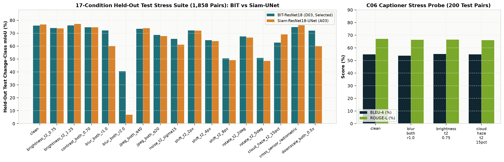

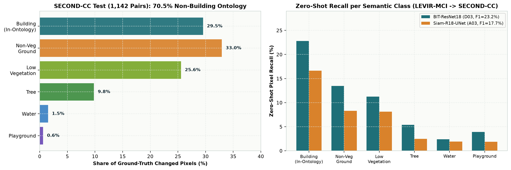

### 11.3 Cross-Dataset Zero-Shot Generalization: SECOND-CC 6-Class Semantic Dissection

To test generalisation to another dataset without fine-tuning, the frozen LEVIR-MCI detectors `D03_bit_lr3e4` and `A03_siam_r18_unet` were run on **SECOND-CC-AUG** (530 Validation and 1,142 Test pairs). Results are in `POC/milestone5/evidence/stress_tests/second_cc_6class_dissection.json` and **Figure 11.2** (`m5_second_cc_6class.png`).

The binary any-change F1 falls from 86.83% on LEVIR-MCI Test to 23.17% for `D03` (precision 58.29%, recall 14.46%) and 17.71% for `A03` (precision 83.80%, recall 9.90%) on SECOND-CC Test. SECOND-CC labels six land-cover classes, while the detectors were trained only on road and building. Splitting the ground-truth change pixels by class shows that most of them belong to classes the detectors never saw, which is one important reason for the drop. It is not the only one, because recall is low even for buildings:

**Table 11.2. Zero-shot transfer dissection on SECOND-CC-AUG Test (1,142 pairs) by ground-truth semantic class.**

| SECOND-CC Semantic Change Class | In LEVIR-MCI Ontology? | Share of GT Changed Pixels (%) | `D03` Zero-Shot Recall (%) | `D03` Pred as Bldg (%) | `D03` Pred as Road (%) | `A03` Zero-Shot Recall (%) |
|---|---|---:|---:|---:|---:|---:|
| `building` | Yes (same name) | 29.54 | 22.80 | 20.16 | 2.64 | 16.64 |
| `non_vegetated_ground` | Possibly partly (our reading) | 32.95 | 13.48 | 10.72 | 2.76 | 8.29 |
| `low_vegetation` | No | 25.56 | 11.26 | 8.74 | 2.53 | 8.12 |
| `tree` | No | 9.81 | 5.37 | 4.36 | 1.01 | 2.49 |
| `water` | No | 1.51 | 2.39 | 1.56 | 0.83 | 1.89 |
| `playground` | No | 0.62 | 3.89 | 3.77 | 0.12 | 1.88 |
| All 6 classes combined | 70.46% outside the building class | 100.00 | 14.46 (F1 23.17) | n/a | n/a | 9.90 (F1 17.71) |

**Findings:**
- 70.46% of the SECOND-CC Test change pixels belong to classes other than building (`non_vegetated_ground` 32.95%, `low_vegetation` 25.56%, `tree` 9.81%, `water` 1.51%, `playground` 0.62%). The detectors have no supervision for these classes. The shares are computed from pixels carrying a class label in either of the two semantic maps.
- On `building`, the only class with the same name in both datasets, `D03` reaches its highest recall (22.80% on Test, 21.66% on Validation), which is 6.16 points above `A03` on Test. 88% of these detections (20.16 of 22.80) are labelled building and the rest road. Recall on the other classes is between 2.39% and 13.48%.
- Even for buildings `D03` finds fewer than a quarter of the changed pixels, and the combined precision is only 58.29%. Differences in imagery, region, annotation style and the definition of a change between the two datasets therefore probably contribute as well. We did not separate these factors from the class mismatch.
- `D03` has the higher any-change F1 on both splits: 22.44% against 13.94% on Validation (+8.50 points) and 23.17% against 17.71% on Test (+5.46 points). This supports using `D03` as the detector, with the caveat that its recall is low and that `A03` has the higher precision here. Using the system on classes beyond road and building would need training on a multi-class set (Section 14.1) and, in the verifier, deferral of claims about those classes (Section 10.3).

### 11.4 Edge Cases and Adversarial Scope

- **Operational edge cases:** The Test results point to three regimes where errors concentrate. (1) Very small edits: the 20 pairs with 1-250 changed pixels (below 0.38% of the tile) reach only 12.99% F1. (2) Unchanged scenes with appearance differences between the two dates: 95 of 924 unchanged pairs (10.28%) produce at least 50 false-alarm pixels. `C06` describes a change on 3.57% of these pairs, and the hybrid verifier uses the mask and the caption together, but we did not measure how many detector false alarms this removes. (3) Localised haze: `D03` is 6.48 mIoU points below `A03` on `cloud_haze_t2_15pct`, and we have not tested a remedy.
- **Adversarial scope:** We evaluated physical radiometric, atmospheric, compression and geometric perturbations (Section 11.1) and dataset shift (Section 11.3). We did not run gradient-based adversarial attacks such as $L_\infty$ PGD, and we did not test adversarial patches. Resistance to deliberate attacks is therefore unknown and is left as future work.

## 12. Computational Performance

This section reports the training cost recorded in Milestone 4 receipts and the inference cost measured in Milestone 5 on the three profiled platforms of Table 2.1 (RTX 4060 workstation, Colab Tesla T4 and Apple M4). The NVIDIA L4 appears only in the training-cost results; no inference profile was run on it. Training figures are read directly from the 33 run receipts by `POC/milestone5/scripts/m5_training_cost_table.py`; inference figures are produced by `POC/milestone5/scripts/m5_benchmark_compute.py` and written under `POC/milestone5/evidence/compute_profile/`. Profiling protocol on the CUDA platforms: 50 (detectors, witness), 5 (captioner) and 3 (referee) warm-up passes and 200 (detectors, witness), 30 (captioner) and 20 (referee) timed passes per stage at batch 1, with device synchronisation before every timestamp (benchmark revision f568a1d on the CUDA platforms, 4be3e22 on the Mac). Inputs are LEVIR-MCI Validation pairs from `POC/execution/data/pairs` (250 loaded on the CUDA platforms, 150 on the Mac); the captioner and referee timed passes cycle through 35 and 23 distinct pairs respectively, and the witness runs on ground-truth masks. On the Apple M4 the MPS detector and witness use the same 50 and 200 passes, the MPS captioner 10 and 50, while the CPU backend uses 5 and 30 for detectors (5 timed passes at batch 16) and 2 and 10 for the captioner. The Qwen3-VL referee was profiled on the Colab T4 only. The captioner was profiled on the RTX 4060 and the Apple M4 only; it was not measured on the Colab T4. The summary figure is `reports/figures/m5_compute_profile.png`.

### 12.1 Training Cost

The Milestone 4 programme comprises 33 completed or terminated full-data runs (24 detector runs and 9 captioner runs), totalling 681 training epochs and 997.8 minutes (16.63 GPU-hours) of wall-clock time. Detector runs account for 623 epochs and 12.75 GPU-hours; captioner runs for 58 epochs and 3.88 GPU-hours.

**Table 12.1. Aggregate training cost by accelerator.**

| GPU | Runs | Epochs | Wall-clock (min) | GPU-hours |
|---|---:|---:|---:|---:|
| NVIDIA GeForce RTX 4060 Laptop GPU (8 GB) | 14 | 372 | 399.6 | 6.66 |
| NVIDIA L4 (24 GB) | 3 | 77 | 53.7 | 0.90 |
| Tesla T4 (15 GB) | 16 | 232 | 544.5 | 9.07 |
| **Total** | **33** | **681** | **997.8** | **16.63** |

Valued at a uniform T4 rate, the programme corresponds to 16.63 x 0.526 = 8.75 USD.

**Selected models.** D03 completed 32 of its 35-epoch cap before early stopping (best epoch 24) in 31.2 minutes on the RTX 4060 (58.6 s per epoch, peak training VRAM 2,287 MB). C06 completed all 8 epochs (best epoch 6) in 30.3 minutes on a Tesla T4 (227.3 s per epoch, peak training VRAM 4,820 MB). Training the full BIT-ResNet18 plus RSCaMa pair therefore costs roughly 1.0 GPU-hour (61.5 minutes) when each model is trained once.

**Hardware effect on identical workloads.** BIT arms with an identical 25-epoch protocol ran at 56.7 to 58.0 s per epoch on the RTX 4060 (bf16; D05, D06, D08, D10, D11, D14, D15) and at 108.7 to 109.4 s per epoch on the Colab T4 (fp16; D04, D07, D09), a 1.9x difference; D03 seed 2026 ran at 47.7 s per epoch on the L4. D16 (photometric and scale augmentation) is the slowest BIT arm at 125.1 s per epoch on the T4.

**Triton selective scan.** The upstream sequential Mamba scan required 38.5 minutes per epoch on a Tesla T4; the exact fused Triton kernel reduces this to 227 s per epoch, a 10x reduction (38.5 min = 2,310 s; 2,310 / 227 = 10.2), at 5.4 GB peak VRAM for the unfrozen configurations (C01 5,469 MB) and 4.8 GB for the frozen-CLIP configuration (C06 4,820 MB). Without the kernel, the nine-run captioner matrix (58 epochs) would have cost an estimated 37 GPU-hours (58 epochs x 38.5 min) instead of 3.88.

**Table 12.2. Per-run training cost (all 33 receipts).** Reproduced from `evidence/compute_profile/training_cost.md`.

| Run | Family | Params (M) | Trainable (M) | GPU | Epochs run / cap | Best epoch | Wall (min) | Sec / epoch | Peak train VRAM (MB) |
|---|---|---:|---:|---|---:|---:|---:|---:|---:|
| `A01_ef_unet` | ef_unet | 7.76 | 7.76 | Tesla T4 | 25 / 25 | 23 | 38.9 | 93.3 | 2,289 |
| `A02_fc_siam_diff` | fc_siam_diff | 7.76 | 7.76 | Tesla T4 | 24 / 25 | 17 | 49.1 | 122.7 | 3,083 |
| `A03_siam_r18_unet` | siam_resnet18_unet | 15.63 | 15.63 | Tesla T4 | 25 / 25 | 22 | 35.1 | 84.3 | 1,410 |
| `A03_siam_r18_unet_s0` | siam_resnet18_unet | 15.63 | 15.63 | L4 | 25 / 25 | 24 | 15.6 | 37.5 | 1,408 |
| `A03_siam_r18_unet_s2026` | siam_resnet18_unet | 15.63 | 15.63 | L4 | 22 / 25 | 15 | 14.2 | 38.8 | 1,408 |
| `A04_changeformer` | changeformer | 41.04 | 41.04 | RTX 4060 Laptop | 25 / 25 | 22 | 69.0 | 165.6 | 6,570 |
| `D01_bit_ref` | bit_resnet18 | 11.94 | 11.94 | RTX 4060 Laptop | 35 / 35 | 27 | 34.2 | 58.6 | 2,287 |
| `D02_bit_lr3e5` | bit_resnet18 | 11.94 | 11.94 | RTX 4060 Laptop | 25 / 25 | 20 | 24.0 | 57.6 | 2,287 |
| `D03_bit_lr3e4` | bit_resnet18 | 11.94 | 11.94 | RTX 4060 Laptop | 32 / 35 | 24 | 31.2 | 58.6 | 2,287 |
| `D03_bit_lr3e4_s0` | bit_resnet18 | 11.94 | 11.94 | RTX 4060 Laptop | 30 / 30 | 29 | 29.1 | 58.3 | 2,287 |
| `D03_bit_lr3e4_s2026` | bit_resnet18 | 11.94 | 11.94 | L4 | 30 / 30 | 23 | 23.8 | 47.7 | 2,492 |
| `D04_bit_wd1e3` | bit_resnet18 | 11.94 | 11.94 | Tesla T4 | 25 / 25 | 20 | 45.6 | 109.4 | 2,285 |
| `D05_bit_wd5e2` | bit_resnet18 | 11.94 | 11.94 | RTX 4060 Laptop | 25 / 25 | 20 | 24.2 | 58.0 | 2,287 |
| `D06_bit_eb16` | bit_resnet18 | 11.94 | 11.94 | RTX 4060 Laptop | 25 / 25 | 20 | 24.2 | 58.0 | 2,274 |
| `D07_bit_eb64` | bit_resnet18 | 11.94 | 11.94 | Tesla T4 | 25 / 25 | 20 | 45.5 | 109.2 | 2,286 |
| `D08_bit_const` | bit_resnet18 | 11.94 | 11.94 | RTX 4060 Laptop | 25 / 25 | 24 | 24.0 | 57.6 | 2,287 |
| `D09_bit_step` | bit_resnet18 | 11.94 | 11.94 | Tesla T4 | 25 / 25 | 24 | 45.3 | 108.7 | 2,287 |
| `D10_bit_cedice` | bit_resnet18 | 11.94 | 11.94 | RTX 4060 Laptop | 25 / 25 | 22 | 23.8 | 57.1 | 2,287 |
| `D11_bit_wce` | bit_resnet18 | 11.94 | 11.94 | RTX 4060 Laptop | 25 / 25 | 22 | 23.6 | 56.7 | 2,287 |
| `D12_bit_unfreeze0` | bit_resnet18 | 11.94 | 11.94 | RTX 4060 Laptop | 25 / 25 | 20 | 25.2 | 60.5 | 2,745 |
| `D13_bit_frozen` | bit_resnet18 | 11.94 | 0.25 | RTX 4060 Laptop | 25 / 25 | 23 | 19.0 | 45.6 | 2,174 |
| `D14_bit_noaug` | bit_resnet18 | 11.94 | 11.94 | RTX 4060 Laptop | 25 / 25 | 20 | 24.1 | 57.9 | 2,287 |
| `D15_bit_photo` | bit_resnet18 | 11.94 | 11.94 | RTX 4060 Laptop | 25 / 25 | 22 | 24.0 | 57.5 | 2,287 |
| `D16_bit_photoscale` | bit_resnet18 | 11.94 | 11.94 | Tesla T4 | 25 / 25 | 22 | 52.1 | 125.1 | 2,287 |
| `C01_rscama_ref` | rscama | 898.81 | 288.06 | Tesla T4 | 8 / 8 | 5 | 31.3 | 234.9 | 5,469 |
| `C02_rscama_lr3e4` (diverged_nonfinite) | rscama | 898.81 | 288.06 | Tesla T4 | 2 / 8 | 0 | 7.6 | 228.4 | 5,469 |
| `C03_rscama_lr3e5` | rscama | 898.81 | 288.06 | Tesla T4 | 6 / 8 | 0 | 24.2 | 241.7 | 5,469 |
| `C04_rscama_adamw_cos` | rscama | 898.81 | 288.06 | Tesla T4 | 8 / 8 | 6 | 34.0 | 254.7 | 5,469 |
| `C05_rscama_ls01` | rscama | 898.81 | 288.06 | Tesla T4 | 7 / 8 | 3 | 31.2 | 267.8 | 5,469 |
| `C06_rscama_frozen_clip` | rscama | 898.81 | 245.53 | Tesla T4 | 8 / 8 | 6 | 30.3 | 227.3 | 4,820 |
| `C06_rscama_frozen_clip_s0` | rscama | 898.81 | 245.53 | Tesla T4 | 6 / 8 | 1 | 24.4 | 243.8 | 4,820 |
| `C06_rscama_frozen_clip_s2026` | rscama | 898.81 | 245.53 | Tesla T4 | 6 / 8 | 1 | 22.6 | 225.7 | 4,820 |
| `C07_rscama_eb24` | rscama | 898.81 | 288.06 | Tesla T4 | 7 / 8 | 3 | 27.4 | 234.8 | 5,888 |

`C02_rscama_lr3e4` terminated with a non-finite loss after 2 epochs and is included in the totals because its compute was spent. Parameter counts for RSCaMa are the receipt totals, which include 502.0 million frozen parameters in the Mamba fusion block: 13 token-embedding tables of 50,280 x 768 that the visual forward pass never reads, because `CaMambaModel.forward` consumes `inputs_embeds` directly (upstream RSCaMa `model/mamba_block.py`) (fusion block: 733.9 million total, 231.9 million trainable); the trainable count is 245.53 million for C06 (frozen CLIP) and 288.06 million for the unfrozen arms (an additional 42.53 million from CLIP blocks 6 to 11).

### 12.2 Model Size and Complexity

**Table 12.3. Parameters, checkpoint size and compute per forward pass.** Parameter counts are copied from run receipts; disk size is the `best` checkpoint file size in MiB (bytes / 1,048,576), SHA-256 matched to the run receipt; GFLOPs are measured per 256 x 256 pair (detectors) or per 224 x 224 pair with greedy decoding (captioner) with the torch FLOP counter (method PyTorch FlopCounterMode (batch 1)). The counter includes only matrix multiplication, convolution and attention operations; the elementwise operations of the selective scan are not counted, so the captioner figure understates its arithmetic.

| Model | Parameters (M, total) | Trainable (M) | Checkpoint on disk (MiB) | GFLOPs per pair |
|---|---|---:|---:|---:|
| `A01_ef_unet` | 7.76 (7,763,971) | 7.76 | 29.67 | 24.26 |
| `A02_fc_siam_diff` | 7.76 (7,763,107) | 7.76 | 29.67 | 32.72 |
| `A03_siam_r18_unet` | 15.63 (15,630,115) | 15.63 | 59.72 | 14.24 |
| `A04_changeformer` | 41.04 (41,038,391) | 41.04 | 156.67 | 277.79 |
| **`D03_bit_lr3e4` (selected)** | **11.94 (11,944,043)** | 11.94 (head 0.25) | 45.68 | 17.45 |
| **`C06_rscama_frozen_clip` (selected)** | **898.81 (receipt total)** | 245.53 | 1,714.63 | 39.81 |
| Qwen3-VL-4B-Instruct (frozen) | 4,437.82 | 0 | not recorded (load peak VRAM 8,464.5 MB in float16) | n/a (variable visual tokens) |

The selected detector is the third-smallest of the five architectures and 3.4x smaller than ChangeFormer (41.04 / 11.94). The captioner dominates the parameter budget of the trained components, but 502.0 million of its recorded parameters are unused token-embedding tables carried over from the language-model Mamba block, and only 245.53 million are trainable. Removing these tables before serialisation would shrink the checkpoint without changing any output. The referee is the largest component of the deployed pipeline and determines the minimum GPU memory tier (Section 12.4).

### 12.3 Inference Latency per Stage

**Table 12.4. Per-stage latency in milliseconds (batch 1).**

| Stage | Platform | P50 | P95 | P99 |
|---|---|---:|---:|---:|
| Detector D03 (BIT-ResNet18) | Colab Tesla T4 (CUDA) | 16.93 | 21.92 | 26.76 |
| Detector D03 (BIT-ResNet18) | RTX 4060 (CUDA) | 7.64 | 8.28 | 8.58 |
| Detector D03 (BIT-ResNet18) | Apple M4 (MPS) | 20.52 | 25.11 | 25.40 |
| Detector D03 (BIT-ResNet18) | Apple M4 (CPU) | 43.87 | 44.67 | 46.84 |
| Captioner C06, Triton fused scan | RTX 4060 (CUDA) | 23.30 | 26.13 | 28.27 |
| Captioner C06, Triton fused scan | Colab Tesla T4 (CUDA) | not measured | not measured | not measured |
| Captioner C06, reference scan | RTX 4060 (CUDA) | 89.35 | 100.78 | 101.49 |
| Captioner C06, reference scan | Colab Tesla T4 (CUDA) | not measured | not measured | not measured |
| Captioner C06, reference scan, full-length decode | Apple M4 (MPS) | 193.86 | 210.16 | 224.27 |
| Captioner C06, reference scan, full-length decode | Apple M4 (CPU) | 438.37 | 448.32 | 450.30 |
| OpenCV witness (per claim) | Colab T4 host CPU | 14.30 | 17.13 | 20.32 |
| OpenCV witness (per claim) | Apple M4 (CPU) | 5.72 | 7.00 | 11.44 |
| Qwen3-VL-4B referee (per call, 2 images) | Colab Tesla T4 (CUDA) | 243.7 | 262.9 | 269.4 |
| Qwen3-VL-4B referee (per call, pair plus 2 crops, 4 images) | Colab Tesla T4 (CUDA) | 336.0 | 352.6 | 354.5 |
| Qwen3-VL-4B referee | Apple M4 | not measured | not measured | not measured |

The RTX 4060 captioner rows decode a mean of 8.69 steps with the trained checkpoint. The Apple M4 captioner rows use randomly initialised weights, which never emit the end-of-sequence token, so each pass decodes the full 42 steps and the figures are an upper bound on the latency of the trained model. The Mac detector figures also use random-initialised weights. The witness unit is one claim (candidate box, contextual crop, overlay and structural inspection).

The referee latency is a single forward pass that scores three verdict-label logits, not free-text generation: `Qwen3VLReferee.decide` in `src/inference/verification_pipeline.py` calls the model with `logits_to_keep=1` and applies a softmax over the three label tokens. This is why it is far below the 7.6 s per generated response recorded for Qwen3-VL in Milestone 3 (`reports/Milestone3_Report_LocalBenchmarked.md`).

Baseline detector P50 latency on the Colab Tesla T4: A01 6.23 ms, A02 8.91 ms, A03 6.65 ms, A04 73.13 ms. The inference-time speedup of the Triton fused scan over the reference scan is 3.83x on the RTX 4060 (89.35 ms to 23.30 ms P50); it was not measured on the T4. Section 12.6 gives mean-based end-to-end estimates per pair: 54.3 ms for the mask-only policy and 355.4 ms for the unconditional-referee policy. These are sums of separately measured stage means on mixed platforms (detector, witness and referee on the T4, captioner on the RTX 4060), not a measured end-to-end run.

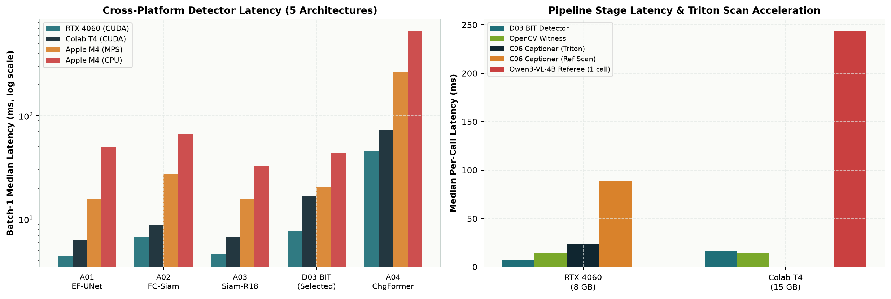

### 12.4 Memory

During training the detector family peaks at 1.4 to 6.6 GB of VRAM (A03 1,410 MB, D03 2,287 MB, A04 6,570 MB) and the captioner 4.8 to 5.9 GB (C06 4,820 MB, C07 5,888 MB), so every selected model trains within the 8 GB RTX 4060. Inference-time memory on the profiled platforms is the peak of `torch.cuda.max_memory_allocated()` on CUDA, the polled MPS driver allocation on the Apple M4 GPU, and the cumulative peak process resident set size on CPU:

**Table 12.5. Peak memory at inference (batch 1).**

| Stage | Colab Tesla T4, peak VRAM (MB) | RTX 4060, peak VRAM (MB) | Apple M4 MPS, peak process memory (MB) | Apple M4 CPU, peak RSS (MB) |
|---|---:|---:|---:|---:|
| Detector D03 | 551.3 | 551.5 | 1,371.7 | 8,906.2 |
| Captioner C06 (Triton scan on RTX 4060; reference scan on Apple M4) | not measured | 3,518.4 | 4,403.8 | 8,906.2 |
| Qwen3-VL-4B referee (2 images; 4 images: 8,652.2) | 8,589.9 | not measured | not measured | not measured |
| OpenCV witness | 1,925.7 (host RSS) | 3,461.4 (host RSS) | 3,071.5 (host RSS) | 8,906.2 |

The Apple M4 CPU and witness figures are the cumulative peak resident set size of the whole benchmark process, which is why they are identical across stages, and the witness host RSS values on the other platforms are likewise process-level peaks. The Mac captioner figures use random-initialised weights. A conservative upper bound for holding the detector, captioner and referee resident together is 12,660 MB, the sum of the peaks above (551.3 MB T4 detector, 3,518.4 MB RTX 4060 captioner Triton scan and 8,589.9 MB T4 referee); this mixes platforms, and no co-resident run was measured. The largest single-stage peak, with stages loaded one at a time, is 8,652.2 MB (referee, 4 images).

### 12.5 Throughput

**Table 12.6. Stage throughput in pairs per second.** Batch-1 throughput is the reciprocal of the mean batch-1 latency.

| Stage | Platform | Batch 1 | Batch 16 |
|---|---|---:|---:|
| Detector D03 | Colab Tesla T4 (CUDA) | 57.2 | 119.0 |
| Detector D03 | RTX 4060 (CUDA) | 129.8 | 144.6 |
| Detector D03 | Apple M4 (MPS) | 48.2 | 37.5 |
| Detector D03 | Apple M4 (CPU) | 22.7 | 12.1 |
| Captioner C06 (Triton fused scan) | RTX 4060 (CUDA) | 42.4 | n/a (greedy batch 1) |
| Captioner C06 (Triton fused scan) | Colab Tesla T4 (CUDA) | not measured | not measured |
| Captioner C06 (reference scan) | RTX 4060 (CUDA) | 11.5 | n/a (greedy batch 1) |
| Captioner C06 (reference scan, full-length decode) | Apple M4 (MPS) | 5.12 | n/a (greedy batch 1) |
| Captioner C06 (reference scan, full-length decode) | Apple M4 (CPU) | 2.28 | n/a (greedy batch 1) |

End-to-end throughput is not measured. From the stage means of Section 12.6 (mixed-platform estimate: detector, witness and referee on the T4, captioner on the RTX 4060) it is 18.42 pairs per second for the mask-only policy, 3.11 for the disagreement-triggered policy, 2.81 for the unconditional-referee policy and 11.92 for the calibrated mask-first hybrid. Training throughput reference points from the receipts are 103.7 to 141.8 samples per second for D03 on the RTX 4060 and 74.0 to 85.5 samples per second for A03 on the T4. GPU utilisation was not sampled during profiling, so we have no direct measure of how busy the GPUs were. The only indication is the batch scaling in Table 12.6: D03 gains 2.08x from batch 1 to batch 16 on the Colab T4 (57.2 to 119.0 pairs/s) and 1.11x on the RTX 4060 (129.8 to 144.6 pairs/s). A small gain suggests the GPU is already well used at batch 1, and a larger gain suggests it is not, but this is an inference from throughput alone.

### 12.6 Cost per 1,000 Pairs

The referee dominates the cost, and how often it is called depends on the verification policy. The per-1,000-pair cost on a platform with hourly price `P` is

`Cost_1000 = 1000 x (S_det + S_cap + c x S_wit + c x v x S_ref) x P / 3600`,

where `S_det` and `S_cap` are mean seconds per pair of the detector and captioner, `S_wit` is the mean seconds per claim of the witness, `S_ref` is the mean seconds per referee call, `c` is the claims-per-pair ratio and `v` is the referee calls per claim. The audited ratio is `c = 147 / 120 = 1.225` (147 claims over 120 validation pairs) for the three Milestone 4 policies, and `c = 185 / 150 = 1.2333` (185 claims over 150 Test pairs) for the hybrid, whose call count of 18 referee calls over 150 Test pairs (0.0973 per claim, 0.120 per pair) was measured on the Test audit. The three Milestone 4 policies take `v` from the Milestone 4 comparison: direct 1.0, disagreement-triggered 0.6463 (95 of 147 claims triggered) and mask-only 0. The resulting referee calls per pair are 1.225, 0.792 (1.225 x 0.6463) and 0, and triggering removes 35.4% of referee calls relative to the direct policy.

**Table 12.7. Cost per 1,000 pairs, mixed-platform estimate priced at a cloud T4 (AWS g4dn.xlarge on-demand, us-east-1 Linux, 0.526 USD per hour).**

| Policy | Referee calls per claim | Referee calls per pair | Proxy supported precision | Seconds per pair | Cost per 1,000 pairs (USD) |
|---|---:|---:|---:|---:|---:|
| Direct Qwen3-VL (gated), 2-image calls | 1.0000 | 1.225 | 82.43% (Val audit) | 0.355 | $0.0519 |
| Disagreement-triggered reinspection, 4-image calls | 0.6463 | 0.792 | 72.22% (Val audit) | 0.322 | $0.0470 |
| Mask-only checker | 0 | 0 | 91.38% (Val audit) | 0.054 | $0.0079 |
| Calibrated mask-first hybrid, 2-image calls | 0.0973 | 0.120 | **93.94% (Test)** / 94.50% (Val) | 0.084 | **$0.0122** |

Measured stage means entering the formula: `S_det` = 0.0175 s (Colab T4), `S_cap` = 0.0236 s (RTX 4060, Triton scan), `S_wit` = 0.0108 s per claim (Colab T4 host CPU), `S_ref` = 0.2458 s for a 2-image call and 0.3380 s for a 4-image call (Colab T4). The captioner was not measured on the T4, so the figures in Table 12.7 are a mixed-platform estimate: the captioner term uses the RTX 4060 measurement and, because the T4 was slower than the RTX 4060 on the detector (16.93 ms against 7.64 ms P50), it probably understates the cost of a pure-T4 deployment. The direct and hybrid policies are priced with the 2-image referee call, the triggered policy with the 4-image call (pair plus crops). Mean-based seconds per pair are sums of separately measured means and were not measured end to end. The mask-only policy is the cheapest and, on the proxy-labelled Validation audit, also the most precise. It cannot, however, adjudicate out-of-ontology claims (for example vegetation or parking), which is the case the hybrid policy routes to the referee. Precision values are scored against proxy labels derived from ground-truth masks and reference captions, not against human labels (Section 13.1).

## 13. Limitations

The limits below are taken from measured evidence in the Milestone 4 receipts and the Milestone 5 evaluation. Each one names the observation behind it and the claim it constrains. All results in this report come from offline evaluation on LEVIR-MCI Test and SECOND-CC; the system has not been deployed or run on live imagery.

### 13.1 Dataset Limitations

**Narrow change ontology.** LEVIR-MCI supervises two change classes, road change and building change, and the 388-token captioner vocabulary is built only from its training captions. The system therefore has no supervised notion of vegetation, water, sports-field or disaster change. Zero-shot transfer to SECOND-CC-AUG, whose labels span water, ground, low vegetation, trees, buildings and sports fields, shows the size of the gap. On the 1,142-pair test split the selected detector D03 reaches 23.17% any-change F1 and 30.55% building-change F1 (any-change precision 58.29%, recall 14.46%), against 86.83% binary F1 on LEVIR-MCI Test. Unchanged-pair false alarms at 50 pixels rise from 10.28% on LEVIR-MCI Test to 25.08% on SECOND-CC Test. In the Validation verification audit the same gap appears as 13 claims routed because they fall outside the mask ontology (`T_out_of_mask_ontology`).

**Single-source imagery.** The primary release consists of 256 x 256 tiles at nominal 0.5 m resolution from Texas, USA, and per-tile acquisition dates and coordinates are absent from the record schema (Milestone 2 data audit). Seasonal, illumination and geographic coverage cannot be analysed per tile, and the in-domain numbers alone do not support any claim of generalisation beyond this sensor and region. The fixed 256 x 256 input also means the detector never sees scene context beyond the tile.

**Proxy labels and a partly unadjudicated human audit.** The 120-pair, 147-claim Validation audit scores verifiers against labels derived from ground-truth masks and reference captions; the audit summary states that these labels are not a substitute for independent human annotation. The 91.38% mask-only precision, 82.43% direct-referee precision and 72.22% triggered-reinspection precision are therefore comparisons among automated policies under one proxy, and 13 of the 147 claims are proxy-unverifiable. The sample is small enough that a single accepted claim moves precision by roughly one percentage point, and the threshold sweep was run on the same audit used for the comparison. The blind dual-rater study on 120 Test claims (Section 6, Appendix J) gives human labels for its own claim set only. Its raters were team members, pooled agreement was 85.0% with Cohen's kappa 0.384, and the 18 disagreements have not been adjudicated, so human-verified metrics cover only the 102 claims on which both raters agreed. The proxy labels also disagree with those 102 human labels (70.59% agreement, kappa 0.244), which is a further reason to treat proxy precision as a development figure.

### 13.2 Model Limitations

**Small and thin changes.** Pixel accuracy is dominated by background, so the headline scores overstate performance on small changes. D03 attains 86.83% binary F1 on Test but only 48.88% on the small-change subset (pairs with fewer than 655 changed pixels, below 1% of the tile; Validation 42.72% against 86.25%). On Test, 15.80% of road pixels and 12.53% of building pixels are predicted as background, whereas 0.23% of road pixels and 0.32% of building pixels are predicted as the other change class. The dominant error is therefore missed or fragmented extent, not class confusion. The captioner shows the same asymmetry: corpus BLEU-4 is 0.6126 on Test but changed-pair BLEU-4 is 0.3686, and 11.78% of changed pairs (110 of 934) receive a no-change caption.

**Sensitivity to input degradation.** On the Validation corruption ladder D03 keeps 70.94% Change mIoU under blur radius 1.0 but falls to 38.22% at radius 2.0 (clean 74.54%). It reaches 67.99% under JPEG quality 20, where unchanged-pair false alarms at 50 pixels rise from 6.80% to 19.30%, and 63.88% under a 4-pixel registration shift. The Test stress suite shows the same pattern (40.54% at blur radius 2.0, 68.66% at JPEG quality 20, 64.56% at a 4-pixel shift) and adds a weakness against A03: under 15% cloud haze on T2, D03 scores 62.66% against 69.13%, with FA@50 of 26.95%. Imagery with sub-metre misregistration, heavy compression, haze or reduced sharpness lies outside the range that was tested without a clear loss.

**Architecture trade-off.** The selected detector is not the best clean-data model. A03 scores 76.73% Test Change mIoU against 75.93% for D03, and 8.23% against 10.28% FA@50. D03 was selected for blur robustness (on Validation, +12.38 and +30.37 mIoU points over A03 at radius 1.0 and 2.0; on Test, +11.98 and +33.63) and for SECOND-CC transfer (+5.46 any-change F1 points). The transfer advantage comes from recall: on SECOND-CC Test A03 has higher any-change precision (83.80% against 58.29%) and far fewer unchanged-pair false alarms at 50 pixels (4.62% against 25.08%). Deployments with clean, sharp, co-registered imagery give up 0.80 mIoU points by using D03, and any deployment gives up fewer false alarms.

**Training variance and single-run selection.** C06 seeds 0 and 2026 reached their best Validation BLEU-4 at epoch 1 (0.6092 and 0.6442) while seed 42 peaked at epoch 6 (0.6358). The three-seed spread of 0.6297 +/- 0.0183 exceeds the gaps between several controlled captioner arms (C01 0.6296, C07 0.6281, C04 0.6264), so fine-grained ranking among those arms is not statistically resolved. The detector trainer sets `cudnn.benchmark = True` without deterministic algorithms, so bitwise reproduction across devices is not guaranteed.

**Captioner trade-off.** Compared with the unfrozen reference C01, C06 lowers the unchanged-scene false-alarm rate to 3.57% (C01 9.42%) but misses 11.78% of changed pairs (C01 5.14%). The released RSCaMa checkpoint (C00), which was trained upstream and not by us, scores higher than C06 on BLEU-4, ROUGE-L, METEOR, CIDEr-D and BERTScore on Test and has a lower unchanged-scene false-alarm rate (1.19%), so C06 is the best of the captioners we trained, not the best captioner evaluated.

**Verifier limits.** On the Validation proxy audit the mask-only checker accepts 116 claims, 10 of which are proxy-contradicted, and catches 17 of 27 contradicted claims (62.96%). The frozen 4B referee with the calibrated gate defers 60 of 147 claims (40.8%) and rejects only 13, and showing it zoomed crops lowers precision (72.41% for four-view reinspection against 82.43% for the full-image query). Disagreement-triggered reinspection leaves 3 contradicted claims untriggered among 52 untriggered claims. On the Test audit the calibrated hybrid accepts 132 of 185 claims, 8 of them proxy-contradicted (93.94% precision), and defers 28 (15.14%); the mask-only checker reaches 93.66% with 9 contradicted among 142 accepts, so the hybrid's precision gain over mask-only is small. The verifier checks object class and change type against mask evidence and defers explicit counts; it does not establish metric size, legal status or the cause of a change.

### 13.3 Bias

Training data come from a single geography and sensor (Section 13.1), so the learned notion of a building or road change reflects that region's construction and land-cover patterns. Performance on different building typologies, road materials, climates or off-nadir angles has not been measured. Class imbalance is severe: Test pixel counts are 110.88 million background, 4.12 million road and 6.76 million building pixels, so the model is trained against a background-dominated target, which the loss counters with class weights of 0.10, 0.45 and 0.45 (background, road, building) in Focal plus Soft Dice. Reference captions are template-like and drawn from a 388-word training vocabulary, which restricts generated language to frequent phrasings (for example "some houses are built along the road") and cannot express concepts absent from the training captions.

### 13.4 Scalability

Each pair is processed independently through four stages, so pairs can in principle be spread over several devices. No multi-device run was made. Cost per pair is governed by the referee (Section 12.6): a policy that invokes the referee for every claim makes 1.225 referee calls per pair, against 0.792 for triggered routing and none for mask-only (ratios from the Validation audit). Memory scales with the referee (Table 12.5), and the captioner needs the Triton fused kernel for practical speed on CUDA GPUs (the sequential reference scan took 38.5 minutes per epoch in training, as reported in Milestone 4, against 227 seconds with the kernel). Large scenes must be tiled into 256 x 256 pairs, and no tile-stitching or overlap-blending procedure has been validated. Multi-tile consistency, georeferencing and automatic co-registration are not part of the system. Latency and cost figures are bounded by the platforms of Table 2.1; the referee took 243.7 ms (P50) for 2 images and 336.0 ms for 4 images per call on the Colab Tesla T4.

### 13.5 Computational Constraints

All 33 training runs consumed 16.63 GPU-hours on three heterogeneous accelerators (RTX 4060 8 GB, Colab T4 and L4). This limited each configuration to one primary seed and a one-factor-at-a-time search instead of joint tuning, and only D03, A03 and C06 were replicated over three seeds. Identical BIT workloads ran 1.9x slower on the T4 than on the RTX 4060, so wall-clock times in Table 12.2 are comparable within, not across, accelerator types. The captioner was capped at 8 epochs and the detector at 35, with early stopping, and longer schedules were not explored. The referee was profiled only on the Colab Tesla T4, in float16 without quantisation, with a peak of 8,589.9 MB for 2 images and 8,652.2 MB for 4 images (Section 12). Its latency and memory on consumer hardware were not measured, and these peaks exceed the 8 GB of the RTX 4060 Laptop GPU used for the detector and captioner.

### 13.6 Failure Scenarios

The measured failure modes, in order of operational severity, are: (i) changes outside the road and building ontology, which the detector either misses (SECOND-CC recall 14.46%) or flags falsely on unchanged scenes (25.08% FA@50); (ii) small or partially occluded changes, where binary F1 falls to 48.88%; (iii) blurred, heavily compressed, hazy or misregistered inputs (Section 13.2); (iv) explicit numeric claims such as "two houses", which cannot be verified from a mask and are deferred by the referee-based policies, as in trace `val_000237` (the mask-only checker accepted that claim); (v) captioner hallucinations that survive verification, which on the Validation proxy audit comprise 10 contradicted claims accepted by the mask-only checker and on the Test audit 8 of 132 claims accepted by the hybrid; and (vi) referee over-acceptance when shown zoomed texture crops. The safety gate turns failures (iv) and (vi) into deferrals or flagged items wherever its checks fire, and this is why the system outputs review states and not unconditional verdicts. Failure (v) is a residual error that the gate does not remove. The quantified failure taxonomy appears in Section 10.

### 13.7 Ethical Considerations

**Dual use and surveillance.** Bi-temporal change detection with natural-language reports can support land-use auditing, disaster response and infrastructure monitoring, and equally the covert monitoring of settlements, property or movement. The system is intended for evidence-bearing review of civil and infrastructural change at a resolution where individuals are not identifiable. It should not be applied to targeting individuals, tracking people or monitoring protected sites, and any deployment should record purpose, requester and scope in the audit store.

**Privacy.** Imagery at 0.5 m cannot resolve faces or licence plates, but it can reveal the presence, extent and timing of private structures. Higher-resolution sources would change the privacy risk materially and would need a fresh assessment. Dataset licences are research-only with attribution (`configs/datasets.yaml`), and raw imagery and weights are not committed to the repository.

**Human review is needed for consequential decisions.** The audits show that accepted claims can still contain errors (8 contradicted claims among 132 hybrid accepts on the Test proxy audit; 10 among 116 mask-only accepts on the Validation proxy audit). Decisions with legal, financial or enforcement consequences, such as permit compliance, taxation, eviction or demolition, should not rest on an automated accept. The Evidence Review interface keeps model outputs immutable and records human overrides in an append-only audit log, so that a verdict can be reconstructed and contested. Reported results describe performance on LEVIR-MCI and SECOND-CC and should not be quoted as expected accuracy on other regions or sensors without local validation.

## 14. Possible Improvements

Each proposal below addresses a weakness measured in Milestone 4 or Milestone 5 and names the metric against which it would be judged. Proposals are ordered by the severity of the weakness they target, not by implementation cost. None of them has been implemented or tested; any benefit described is an expectation to be confirmed, not a measured result.

**Table 14.1. Weakness-to-remedy map.**

| Observed weakness | Evidence | Proposed remedy | Success criterion |
|---|---|---|---|
| Out-of-ontology change | SECOND-CC Test any-change F1 23.17%, recall 14.46%, FA@50 25.08% | Multi-class, multi-sensor pretraining and fine-tuning | SECOND-CC any-change F1 and unchanged FA@50 versus the current values |
| Small-change recall | Test small-change F1 48.88% against binary F1 86.83% | Tiling with overlap, small-object loss weighting, higher-resolution decoder | Small-change F1 with no rise in FA@50 |
| Blur and compression fragility | D03 38.22% Val mIoU at blur radius 2.0 (Test 40.54%); 67.99% at JPEG q20 (Test 68.66%) | Degradation-aware augmentation, ensembling with a sharp-feature model | Corruption-ladder mIoU at the failing conditions |
| Proxy-label verification and unadjudicated audit | Validation: 120 pairs, 147 claims, proxy labels; Test: 18 of 120 human disagreements unresolved | Adjudicate the 18 disagreements; larger human-labelled Test verification audit | Human-verified groundedness with CI and Cohen's kappa on adjudicated labels |
| Referee cost and size | 1.225 referee calls per pair under the direct policy (Validation ratio); 4B-parameter referee, 8,589.9 MB peak VRAM on the T4 in float16 | Quantised or distilled referee; selective routing | Cost per 1,000 pairs (Table 12.7) at equal precision |
| Template-like captions and missed changes | 388-word vocabulary; changed-pair BLEU-4 0.3686 against 0.6126 corpus | Larger vocabulary, tokenizer pretraining, instruction-tuned decoder | Changed-pair BLEU-4 and missed-change rate (11.78%) |
| Seed sensitivity | C06 Val BLEU-4 spread 0.6297 +/- 0.0183 | More seeds, checkpoint averaging | Narrower spread |
| Annotation scarcity | Review overrides are recorded but no reviewer data has been collected or used for training | Active learning from the Evidence Review audit log | Accuracy gain per labelled correction |

### 14.1 Better Datasets and More Training Data

The largest measured gap is ontological. LEVIR-MCI supplies only road and building change from one region and sensor, and zero-shot transfer reaches 23.17% any-change F1. Joint training on multi-class, multi-sensor change corpora would widen the class set and sensor coverage. SECOND-CC (3,241 training pairs catalogued in the portable data receipt) is the immediate candidate, and `configs/datasets.yaml` lists further sources (for example S2Looking and LEVIR-CD+). Mixed-dataset training must keep the governed split discipline: manifests with pair-identifier digests, a SECOND-CC test split held out entirely, and no reference caption or mask reaching inference. Per-tile dates and coordinates, which the current record schema lacks, should be collected for any new corpus so that seasonal and geographic bias can be measured per stratum. Road pixels are only 3.4% of Test pixels (4.12 of 121.77 million) and road IoU is lower than building IoU (74.53% against 77.33% on Test), so oversampling road-bearing tiles is a candidate remedy, although the IoU gap alone does not show that class frequency is its cause.

### 14.2 Improved Preprocessing

Misregistration is one of the clearest measured sensitivities of the detector: Validation mIoU falls from 74.54% to 63.88% at a 4-pixel shift, and Test mIoU from 75.93% to 64.56% at 4 pixels and 50.51% at 8 pixels. Automatic sub-pixel co-registration before inference, histogram matching between T1 and T2, and shadow-invariant colour transforms are candidate remedies for misalignment and radiometric mismatch, and could reuse the registration-jitter diagnostic that the structural inspector already computes (`src/evidence/visual_inspector.py`). For scenes larger than 256 x 256, sliding-window tiling with overlap and probability blending would remove the dependence on tile boundaries and give the detector more context than a single tile, which may help the small-change recall gap. In the ablation, photometric augmentation applied independently to T1 and T2 gave lower clean Validation mIoU (D15 68.34%, D16 68.55%) than the flip-only reference D01 (71.82%), though D01 ran up to 35 epochs and D15 and D16 25. Radiometric augmentation should therefore be applied consistently to both dates or replaced by explicit normalisation, and tested against a matched epoch budget.

### 14.3 Alternative Models and Better Feature Engineering

Three architecture directions follow from the results. First, the Siam-ResNet18-UNet baseline wins on clean data (76.73% against 75.93% Test mIoU, 8.23% FA@50) and BIT wins under blur and on SECOND-CC recall, so a feature-level fusion that gives the UNet decoder BIT's token context could target both; this has not been tried. Second, ChangeFormer (41.04 million parameters) underperformed (70.46% Val mIoU) under the 25-epoch budget, so pretrained remote-sensing backbones or longer schedules would be a fairer test of whether larger transformers help here. Third, replacing the template-like captioner head with a decoder pretrained on a larger caption vocabulary is aimed at the changed-pair BLEU-4 deficit. Feature engineering aimed at small changes includes a high-resolution side branch, edge-aware losses and class-specific heads for road and building extent, since 15.80% of road pixels and 12.53% of building pixels are predicted as background. For the referee, the four-view result (72.41% precision against 82.43% on the Validation proxy audit; 69.61% against 78.82% on Test) suggests that crop prompting needs calibration, so prompt design and few-shot examples drawn from reviewer corrections are candidate improvements.

### 14.4 Hyperparameter Tuning

Milestone 4 varied one factor at a time on a single seed. The largest gains came from the head learning rate (D02 64.55%, D01 71.82%, D03 74.54% Val mIoU) and from unfreezing the backbone (D13, backbone frozen, 62.45%). These two factors may interact, since they were not varied together. A joint search over head and backbone learning rates, freeze duration and schedule, run with at least three seeds, is the next step. The captioner's seed spread exceeds several arm gaps, so tuning there requires multi-seed evaluation before ranking. The Milestone 4 referee gate used tau = 0.70, and the Milestone 5 hybrid locks tau_accept = 0.60 and tau_reject = 0.75; both, together with the routing triggers, were set on one Validation audit. They should be re-estimated on a larger human-labelled set, with calibration error (ECE) and selective-risk curves as the objective.

### 14.5 Ensemble Methods

Averaging the logits of D03 and A03 could combine complementary behaviour: A03 leads on clean Test mIoU by 0.80 points, D03 leads under blur (on Validation by 12.38 and 30.37 points at radius 1.0 and 2.0) and A03 leads under cloud haze by 6.48 points. A simple logit average or a sharpness-gated mixture, evaluated on the full 17-condition Test stress matrix and on SECOND-CC, would show whether the gain justifies the two-model inference cost measured in Table 12.4 (combined P50 latency 23.58 ms on the Colab Tesla T4: D03 16.93 ms plus A03 6.65 ms). Seed ensembling of the three pinned D03 checkpoints and the C06 seed runs could reduce seed variance, at a multiple of the inference cost. For verification, disagreement between the mask checker and the witness is already a routing trigger (51 trigger events of type `T_witness_disagrees_no_visual_change` across the 95 triggered Validation claims), and ensembling several witnesses is a natural extension.

### 14.6 Efficiency and Deployment

The referee dominates cost (Section 12.6). Distilling its accept, reject and defer behaviour into a smaller model, or quantising it to 4-bit weights, would be expected to reduce memory and per-call latency; neither was tried, and both would have to be checked against the hybrid verifier's precision and deferral rates before adoption. The captioner checkpoint can also be reduced. C06 carries 501,995,520 unused Mamba token-embedding parameters out of 898,805,894 (55.85% by parameter count), so removing them should shrink the 1,714.6 MB checkpoint to roughly 757 MB if they are stored at the same precision as the other weights. This is a calculation, not a measurement, and the unchanged outputs should be confirmed by a regression run. The mask-only policy reaches 91.38% proxy precision on Validation (93.66% on Test) with no referee calls, so any gain in its coverage at equal precision would reduce the referee workload directly. The Triton selective-scan kernel is CUDA-specific; an MPS or CPU-friendly scan would remove that dependency for review stations without an NVIDIA GPU.

### 14.7 Future Research Directions

Human-in-the-loop learning is a natural next step. The Evidence Review application already records overrides in an append-only audit log, and such corrections would supply labelled examples of the claims the system gets wrong. Active selection of uncertain claims for review, followed by periodic fine-tuning with held-out tests, would close the loop between use and training. Further directions include temporal sequences beyond two dates, uncertainty-aware captioning that abstains on small or occluded changes, quantity estimation from masks for numeric claims that are currently deferred, and a fairness audit across regions and sensors once per-tile metadata exists.

## 15. Discussion

### 15.1 Achievement of Project Objectives

TerraWatch set out to produce spatially grounded change masks and natural-language change reports whose claims are checked against evidence before they reach an analyst, without paying for a large vision-language model on every claim. Against the targets of Section 4.5, the held-out Test results on LEVIR-MCI meet the numeric thresholds for the detector, the captioner and the verifier:

- **Detector (75.93% Change mIoU, 86.83% binary F1, 0.9901 ROC-AUC, 0.9361 PR-AUC)** exceeds the 74% mIoU and 85% F1 targets. Test mIoU is 1.39 points above Validation (74.54%), so no generalisation gap is visible on this split.
- **Captioner (0.6126 BLEU-4, 0.7324 ROUGE-L, 0.7360 METEOR, 1.3377 CIDEr-D, 0.9490 BERTScore-F1)** meets the BLEU-4 and BERTScore targets and holds the unchanged-scene false-alarm rate to 3.57%, which is 2.64 times lower than C01. It misses 11.78% of changed pairs (C01: 5.14%), and the upstream released RSCaMa checkpoint scores higher on every text metric and has a lower unchanged-scene false-alarm rate (1.19%).
- **Calibrated mask-first hybrid verification** reaches 93.94% proxy precision (6.06% selective risk, against 26.49% for unverified captions, a ratio of 4.37), 91.18% supported recall, a 70.00% catch rate for proxy-contradicted claims and an ECE of 0.0710, with 9.73% of claims sent to the referee (90.27% fewer referee calls than querying every claim). On the 102 claims on which two blind raters agreed, all 62 claims it accepted were judged supported (100.00%, 95% interval 94.2% to 100.0%), and none of the 8 claims the raters judged contradicted was accepted. Five of its 67 accepted claims fall among the 18 unadjudicated disagreements and are not scored. The mask-only checker also scored 71 of 71 on the same gold set, so the human audit does not separate the hybrid from mask-only.

The latency target (below 200 ms per pair) is met by the summed stage latencies in Section 15.3. The robustness target is met in the narrower sense described in Section 15.2: D03 beats A03 on blur, downscaling, noise and SECOND-CC F1, but not on every condition.

### 15.2 Comparison with Expectations and Key Engineering Observations

Several results ran against what we expected and shaped the design:

1. **A mask-first checker beat the standalone 4B referee on this audit.** Before testing, we expected the 4-billion-parameter Qwen3-VL-4B-Instruct to judge change claims better than a checker built on the 11.9M-parameter BIT detector. On the Test proxy audit the gated referee alone reached only 78.82% precision and caught 3.33% of proxy-contradicted claims, while naive four-view crop prompting lowered precision to 69.61% (ECE 0.446). We did not test why the crops hurt; loss of global scene context is one possible reason. Letting the BIT masks settle claims they can judge and sending only the remaining 9.73% to the referee gave 93.94% precision and an ECE of 0.0710 at about one tenth of the referee calls. The mask-only checker alone already reached 93.66%, so the referee's contribution lies mainly in claims the masks cannot judge, such as out-of-ontology claims, and not in higher precision.
2. **Clean-data ranking did not predict robustness.** On clean Validation or Test mIoU, `A01_ef_unet` (77.36% Test) or `A03_siam_r18_unet` (76.73%) would have been chosen over `D03_bit_lr3e4` (75.93%). Under the 17-condition Test stress suite, A03 fell to 6.91% at blur radius 2.0 (D03 40.54%) and to 59.94% under 0.5x downscaling (D03 71.98%). On SECOND-CC zero-shot transfer it scored 17.71% any-change F1 against 23.17%. D03 is not uniformly better: it wins 12 of the 17 conditions against A03, several by less than one point, and loses on clean data, brightness 1.25, JPEG q40, cloud haze and cross-sensor radiometric shift. The stress suite is what showed that the clean-data winner is the more fragile model under blur and downscaling.
3. **Ontology mismatch accounts for much of the cross-dataset drop.** In the SECOND-CC 6-class dissection, 70.46% of ground-truth change pixels on the test split belong to classes absent from LEVIR-MCI's two-class supervision (non-vegetated ground, low vegetation, trees, water and playground). On the one overlapping class, buildings, D03 recovered 22.80% of ground-truth pixels, and 88% of those hits (20.16 of 22.80 points) carried the correct building label. Its any-change precision was 58.29%, and unchanged-pair false alarms at 50 pixels were 25.08%, against 4.62% for A03. Explicit ontology scoping (the `T_out_of_mask_ontology` deferral) is therefore a safer behaviour for a two-class model than silent generalisation, but the transfer result also shows that D03's higher recall comes with many more false alarms.
4. **The fused Triton kernel made the captioner experiments affordable.** The exact fused Triton selective-scan kernel (`triton_fused_exact`) cut RSCaMa training time to 227 s per epoch, against 2,310 s (38.5 minutes) reported in Milestone 4 for the sequential scan, a factor of 10.2. Gradients matched FP32 reference gradients within 1.2e-7 to 4.4e-7 relative error. It also reduced RTX 4060 inference latency 3.83 times (23.30 ms against 89.35 ms P50). The nine captioner runs cost 3.88 GPU-hours; at the sequential-scan speed they would have taken an estimated 37 GPU-hours (58 epochs at 38.5 minutes). The full 33-run programme cost 16.63 GPU-hours, which is 8.75 USD if every hour is priced at the AWS g4dn.xlarge on-demand rate of 0.526 USD per hour (a pricing convention, not what was spent).

### 15.3 Practical Applicability

TerraWatch is a candidate human-in-the-loop triage workbench for planning, infrastructure auditing and road-network review on 0.5 m RGB aerial imagery of the kind found in LEVIR-MCI. The system has not been run outside offline evaluation on LEVIR-MCI Test and SECOND-CC. Latency was not measured end to end; summing separately measured RTX 4060 stage latencies for one pair with one claim (D03 7.64 ms P50, C06 Triton 23.30 ms P50, OpenCV witness 10.39 ms mean per claim) gives about 41.3 ms, or roughly 24 pairs per second, before any referee call. Section 12.6 gives the mixed-platform estimate of 54.3 ms per pair for the mask-only policy. The referee would run on the remaining 9.73% of claims in the hybrid, but it was profiled only on the Colab T4, and its measured peak memory of 8,589.9 MB exceeds the 8 GB of the RTX 4060 laptop GPU. Running the full hybrid on that laptop would therefore need quantisation or offloading, which we did not test. The Evidence Review web interface presents the mask overlay, zoomed contextual crop and an append-only override log for each claim.

## 16. Conclusion

### 16.1 Summary of Findings

Milestone 5 evaluated TerraWatch offline on 1,858 LEVIR-MCI Test image pairs, 1,672 SECOND-CC-AUG pairs for zero-shot transfer (530 Validation and 1,142 Test), 17 deterministic perturbation conditions, 185 Test verification claims from 150 pairs, and three profiled hardware platforms (four backends: Colab T4, RTX 4060, and Apple M4 on CPU and MPS). All Test splits were held out from training and from threshold selection.

1. **Change detection (`D03_bit_lr3e4`).** It reaches 75.93% Change-class mIoU (95% bootstrap interval 74.79 to 77.04), 86.83% binary F1, 0.9901 ROC-AUC and 0.9361 PR-AUC over 121.77M Test pixels. Road and building pixels are confused with each other for 0.23% and 0.32% of their respective pixels. Compared with A03, D03 scores higher in 12 of the 17 Test stress conditions (+33.63 points at blur radius 2.0, +12.03 points under 0.5x downscaling) and lower in the other five, including cloud haze (-6.48 points). It has the higher zero-shot SECOND-CC building recall (22.80% against 16.64% for A03) but also the higher false-alarm rate on unchanged SECOND-CC pairs (25.08% against 4.62%). Its batch-1 detector latency is 7.64 ms (P50) on the RTX 4060.
2. **Change captioning (`C06_rscama_frozen_clip`).** It reaches 0.6126 BLEU-4, 0.7324 ROUGE-L, 0.7360 METEOR, 1.3377 CIDEr-D and 0.9490 BERTScore-F1 on 1,858 Test pairs. The unchanged-scene hallucination rate is 3.57% (2.64 times lower than C01) and 11.78% of changed pairs are captioned as unchanged. The Triton scan cuts P50 inference time 3.83 times (23.30 ms against 89.35 ms on the RTX 4060).
3. **Claim verification and human audit.** The calibrated mask-first hybrid verifier, with thresholds locked on Validation, reaches 93.94% proxy precision on the Test claims (6.06% selective risk, 4.37 times lower than unverified captions), 91.18% supported recall, a 70.00% catch rate for proxy-contradicted claims, no proxy-unverifiable claim accepted, an ECE of 0.0710 and a 9.73% referee-call rate (90.27% fewer calls than an always-query policy); 15.14% of claims (28 of 185) are deferred. Two team members rated each of 120 Test claims blind to model decisions (240 ratings, four raters). They agreed on 85.0% of claims (kappa 0.384), and on all 8 claims where both marked a contradiction they chose the same error category. Over the 102 agreed claims, the hybrid's 62 accepted claims were all judged supported (95% interval 94.2% to 100.0%), against a 7.84% hallucination rate for unverified captions and 11.11% for four-view reinspection. The 18 disagreements are not adjudicated, the mask-only checker scored 71 of 71 on the same set, and the raters were team members, so this is supporting evidence and not an independent validation.
4. **Provenance and reproducibility.** Twelve checkpoints are pinned by SHA-256 in `POC/milestone5/configs/model_registry.json`. Regression tests exist in `test_m5_hybrid_and_cli.py` and `test_m5_compute_human_audit.py`. Ten Test Evidence Review bundles were generated, and the 120-claim blind packet (`M5T_001` to `M5T_120`) withholds model decisions from the rater files.

### 16.2 Readiness for Deployment and Recommended Next Steps

The results support a controlled human-in-the-loop pilot as the next step, on 0.5 m RGB urban and infrastructure imagery where road and building change is the target and reviewers handle the deferred claims (about 15% of Test claims) in the Evidence Review interface. The system has not been deployed, and it should not be used for unattended decisions. The evidence is limited to LEVIR-MCI and SECOND-CC, the human audit is unadjudicated, and out-of-ontology change, small change, blur and haze remain open weaknesses (Section 13). Before multi-region use, three upgrades from Section 14 look most useful. First, removing the 502.0M unused inherited Mamba embedding parameters should reduce C06's checkpoint by roughly 56% (computed from parameter counts, not measured, and outputs should be confirmed unchanged). Second, a sharpness-gated D03 plus A03 ensemble and haze handling are aimed at the 0.80-point clean mIoU gap and the 6.48-point cloud-haze gap, with no result yet. Third, adjudicating the human audit and using recorded reviewer overrides for fine-tuning beyond LEVIR-MCI's Texas building and road domain would address the ontology and annotation limits.

<!-- PAGEBREAK -->
## Appendix A. Complete Metric Tables

### A.1 Held-Out LEVIR-MCI Test Detector Metrics (1,858 Pairs, 121.77M Pixels)

| Model | Arch | Chg mIoU (%) | 95% Bootstrap CI | Road IoU (%) | Bldg IoU (%) | Bin F1 / Dice (%) | 95% Bootstrap CI | Small (<1%) F1 (%) | Pixel Acc (%) | ROC-AUC | PR-AUC (AP) | FA@16px (%) | FA@50px (%) | FA@200px (%) |
|---|---|---:|---|---:|---:|---:|---|---:|---:|---:|---:|---:|---:|---:|
| **`D03_bit_lr3e4` (Selected)** | `bit_resnet18` | 75.93 | `[74.79, 77.04]` | 74.53 | 77.33 | 86.83 | `[86.18, 87.42]` | 48.88 | 97.64 | 0.9901 | 0.9361 | 11.80 | 10.28 | 5.74 |
| `A03_siam_r18_unet` | `siam_resnet18_unet` | 76.73 | `[75.55, 77.84]` | 74.94 | 78.52 | 87.49 | `[86.84, 88.09]` | 49.10 | 97.75 | 0.9909 | 0.9411 | 9.09 | 8.23 | 5.09 |
| `A01_ef_unet` | `ef_unet` | **77.36** | `[76.19, 78.45]` | **75.62** | **79.11** | **87.73** | `[87.07, 88.30]` | 51.17 | **97.80** | **0.9913** | **0.9434** | 8.87 | 7.68 | 5.63 |
| `A02_fc_siam_diff` | `fc_siam_diff` | 74.48 | `[73.03, 75.83]` | 72.71 | 76.25 | 85.81 | `[84.96, 86.59]` | **54.77** | 97.59 | 0.9890 | 0.9335 | **5.84** | **4.55** | **3.14** |
| `A04_changeformer` | `changeformer` | 74.38 | `[73.08, 75.55]` | 72.26 | 76.50 | 85.99 | `[85.23, 86.69]` | 46.63 | 97.48 | 0.9889 | 0.9274 | 11.04 | 9.52 | 6.82 |
| `otsu_diff` (Control) | Non-learning | n/a | n/a | n/a | n/a | 14.20 | n/a | n/a | 63.65 | 0.5559 | 0.1148 | n/a | n/a | n/a |
| `always_background` (Control) | Constant 0 | 0.00 | n/a | 0.00 | 0.00 | 0.00 | n/a | 0.00 | 91.06 | 0.5000 | n/a | 0.00 | 0.00 | 0.00 |

### A.2 Paired Statistical Significance Tests vs `D03_bit_lr3e4` (1,858 Held-Out Test Pairs)

| Comparison (`D03` vs Baseline) | Mean Per-Pair F1 Diff | Wilcoxon $p$-value | Unchanged FA@50 Discordant (`D03` Better / Other Better) | McNemar $p$-value |
|---|---:|---:|---:|---:|
| `D03` vs `A03_siam_r18_unet` | -0.0173 | $2.82 \times 10^{-16}$ | 35 / 54 | $0.0558$ (n.s.) |
| `D03` vs `A01_ef_unet` | -0.0147 | $1.77 \times 10^{-19}$ | 27 / 51 | $0.0088$ |
| `D03` vs `A02_fc_siam_diff` | -0.0171 | $0.0883$ (n.s.) | 10 / 63 | $1.55 \times 10^{-10}$ |
| `D03` vs `A04_changeformer` | +0.0056 | $0.2245$ (n.s.) | 45 / 52 | $0.5426$ (n.s.) |

### A.3 Area-Stratified Held-Out Test Detector Performance (`D03_bit_lr3e4`)

| Change-Area Stratum | Test Pairs | `D03` Binary F1 (%) | `D03` Change mIoU (%) | Operational Note |
|---|---:|---:|---:|---|
| `unchanged_0` (0 px) | 924 | n/a (`FA@50 = 10.28%`) | n/a | 89.72% specificity at 50 px threshold |
| `tiny_1_250` (1–250 px) | 20 | 12.99 | 8.85 | Sub-0.38% tile area; primary FN regime |
| `small_251_1000` (251–1,000 px) | 69 | 62.92 | 31.59 | Partial small structures / narrow paths |
| `medium_1001_4000` (1k–4k px) | 186 | 73.80 | 54.79 | Individual buildings / short road segments |
| `large_gt_4000` (>4,000 px) | 659 | **87.68** | **77.26** | Multi-building & highway expansions |

### A.4 Held-Out LEVIR-MCI Test Captioner Complete Metrics & 95% Bootstrap CIs (1,858 Pairs)

| Model | BLEU-1 | BLEU-2 | BLEU-3 | BLEU-4 | Chg B4 | ROUGE-L [95% CI] | METEOR | CIDEr-D [95% CI] | BERTScore-F1 [95% CI] | NC FA (%) | Miss (%) | ObjHall (%) |
|---|---:|---:|---:|---:|---:|---|---:|---|---|---:|---:|---:|
| **`C06_rscama_frozen_clip`** | 0.8421 | 0.7543 | 0.6778 | 0.6126 | 0.3686 | `0.7324 [0.718, 0.746]` | 0.7360 | `1.3377 [1.299, 1.376]` | `0.9490 [0.948, 0.950]` | 3.57 | 11.78 | 4.93 |
| `C00_rscama_released` | 0.8613 | 0.7819 | 0.7124 | 0.6551 | 0.4004 | `0.7556 [0.742, 0.768]` | 0.7560 | `1.3930 [1.355, 1.429]` | `0.9514 [0.950, 0.953]` | 1.19 | 12.31 | 2.73 |
| `C04_rscama_adamw_cos` | 0.8504 | 0.7614 | 0.6814 | 0.6101 | 0.4077 | `0.7381 [0.725, 0.751]` | 0.7430 | `1.3530 [1.315, 1.389]` | `0.9507 [0.949, 0.952]` | 5.74 | 6.53 | 6.22 |
| `C01_rscama_ref` | 0.8359 | 0.7492 | 0.6757 | 0.6135 | 0.3759 | `0.7152 [0.701, 0.730]` | 0.7199 | `1.2819 [1.240, 1.322]` | `0.9460 [0.945, 0.947]` | 9.42 | 5.14 | 8.93 |
| `bit_mask_template` | 0.7529 | 0.6314 | 0.5478 | 0.4893 | 0.1613 | `0.6427 [0.627, 0.658]` | 0.6435 | `1.0734 [1.032, 1.115]` | `0.9398 [0.938, 0.941]` | 10.28 | 3.00 | 11.66 |
| `always_no_change` | 0.6414 | 0.5615 | 0.5269 | 0.5101 | 0.0001 | `0.6019 [0.582, 0.621]` | 0.5623 | `1.0130 [0.963, 1.061]` | `0.9291 [0.927, 0.931]` | 0.00 | 100.00 | 0.00 |

### A.5 Blind Held-Out Test Verification Route Breakdown (185 Claims, 150 Pairs)

| M5 Hybrid Verifier Route | Claim Count | Share (%) | VLM Used? |
|---|---:|---:|---|
| `mask_first_accept` | 120 | 64.86% | No |
| `mask_first_reject` | 24 | 12.97% | No |
| `deterministic_defer_ontology_or_exact_count` | 23 | 12.43% | No |
| `vlm_escalate_no_change_residual_or_hedged -> accept` | 10 | 5.41% | Yes |
| `vlm_escalate_no_change_residual_or_hedged -> defer` | 4 | 2.16% | Yes |
| `vlm_escalate_no_change_residual_or_hedged -> reject` | 1 | 0.54% | Yes |
| `vlm_escalate_weak_mask_support -> accept` | 2 | 1.08% | Yes |
| `vlm_escalate_weak_mask_support -> defer` | 1 | 0.54% | Yes |
| **Total** | **185** | **100.00%** | **18 / 185 (9.73%)** |

## Appendix B. Confusion Matrices

### B.1 Pixel-Level 3-Class Confusion Matrix (`D03_bit_lr3e4`, 1,858 Held-Out Test Pairs)

Total evaluated pixels: 121,765,888 ($1{,}858 \times 256 \times 256$). The matrix is drawn alongside the hybrid verifier decision matrix in `POC/milestone5/submission/figures/m5_confusion_matrices.png`.

| Ground Truth \ Predicted | Background (`0`) | Road (`1`) | Building (`2`) | Row Total (GT Pixels) | Class Recall (%) |
|---|---:|---:|---:|---:|---:|
| **Background (`0`)** | **109,533,948** (`98.78%`) | 499,938 (`0.45%`) | 849,805 (`0.77%`) | 110,883,691 | 98.78% |
| **Road (`1`)** | 650,809 (`15.80%`) | **3,457,972** (`83.97%`) | 9,511 (`0.23%`) | 4,118,292 | 83.97% |
| **Building (`2`)** | 847,334 (`12.53%`) | 21,531 (`0.32%`) | **5,895,040** (`87.15%`) | 6,763,905 | 87.15% |

**Diagnostic observation.** Road-building confusion is small: 9,511 road pixels (0.23%) were predicted as building and 21,531 building pixels (0.32%) as road, 31,042 pixels in total, or 0.29% of the 10,882,197 foreground pixels. Most foreground errors are misses against background: 1,498,143 of the 1,529,185 misclassified foreground pixels (97.97%) were predicted as background (15.80% of road pixels, 12.53% of building pixels). This is consistent with extent and small-structure misses being the main remaining error, rather than confusion between road and building; the matrix alone does not separate boundary errors from whole-object misses, and background pixels predicted as change (1,349,743) are not counted in the percentage above.

### B.2 Held-Out Test Hybrid Verifier Decision Matrix (150 Stratified Test Pairs, 185 Claims)

| Reference Proxy Ground Truth \ M5 Hybrid Decision | `accept` | `reject` | `defer` | Row Total |
|---|---:|---:|---:|---:|
| **`supported`** | **124** (`91.2%`) | 4 (`2.9%`) | 8 (`5.9%`) | 136 |
| **`contradicted`** | 8 (`26.7%`) | **21** (`70.0%`) | 1 (`3.3%`) | 30 |
| **`unverifiable`** | **0** (`0.0%`) | 0 (`0.0%`) | **19** (`100.0%`) | 19 |
| **Column Total** | **132** (`71.4%`) | **25** (`13.5%`) | **28** (`15.1%`) | **185** |

None of the 19 unverifiable claims (0/19) was accepted. Accepted precision against the proxy labels was 93.94% (124/132) and 70.00% (21/30) of contradicted claims were rejected. These are proxy labels derived from masks and reference captions, not human labels (see the human audit section).

## Appendix C. ROC, Precision-Recall, and Calibration Curves

### C.1 Pixel-Level ROC and Precision-Recall Analysis (121.77M Held-Out Test Pixels)

The five neural detectors were scored with the non-saturating log-odds $s = \log(\exp(z_1) + \exp(z_2)) - z_0$, clipped to $[-15, 15]$ and accumulated into 10,000 histogram bins; ROC-AUC is the trapezoidal area and PR-AUC (AP) the step-function integral (`POC/milestone5/submission/figures/m5_roc_pr_curves.png`). The Otsu pixel-difference control was scored from the absolute pixel difference accumulated into 1,000 bins, not from log-odds.

- All five trained detectors have ROC-AUC between 0.9889 and 0.9913 and PR-AUC between 0.9274 and 0.9434, far above Otsu pixel differencing (ROC-AUC 0.5559, PR-AUC 0.1148).
- `D03_bit_lr3e4` has ROC-AUC 0.9901 and PR-AUC 0.9361. Its AP is 0.0050 below `A03_siam_r18_unet` (0.9411) and 0.0073 below `A01_ef_unet` (0.9434), and above `A02_fc_siam_diff` (0.9335) and `A04_changeformer` (0.9274).

### C.2 Hybrid Verifier Risk-Coverage and Reliability Calibration (185 Blind Test Claims)

| Verifier Model | ECE $\downarrow$ | Brier Score $\downarrow$ | AURC $\downarrow$ | Top Confidence Bin `[0.9, 1.0]` Mean Conf vs Empirical Acc |
|---|---:|---:|---:|---|
| **`M5 Calibrated Mask-First Hybrid`** | **0.0710** | **0.1041** | **0.0948** | `n=123`: mean conf **`0.9517`** vs empirical **`0.9512`** (`Δ = 0.0005`) |
| `Direct Qwen3-VL-4B (full image)` | 0.3000 | 0.3142 | 0.2024 | `n=58`: mean conf `0.9655` vs empirical `0.8276` (`Δ = 0.1379`) |
| `4-View Reinspection-All` | 0.4464 | 0.4417 | 0.2298 | `n=90`: mean conf `0.9908` vs empirical `0.7000` (`Δ = 0.2908`) |

Full calibration curves and threshold risk-coverage sweeps across $\tau \in [0.50, 0.90]$ are plotted in `figures/m5_hybrid_verifier_calibration.png` (Section 6.3).

## Appendix D. Learning and Loss Curves

Epoch-by-epoch training and validation histories for all 33 Milestone 4 runs are stored in `docs/milestone4/evidence/full_data_m4/{detector_runs,captioner_runs}/*/history.jsonl`. The figures below plot a subset: the six BIT-ResNet18 detector runs (reference, LR 3e-5, LR 3e-4, unfreeze at epoch 0, frozen backbone, photometric augmentation) and the nine captioner runs. The architecture baselines are not drawn in the detector figure; their numbers are quoted from the run receipts. The figures number epochs from 1, whereas the receipts and tables number them from 0.

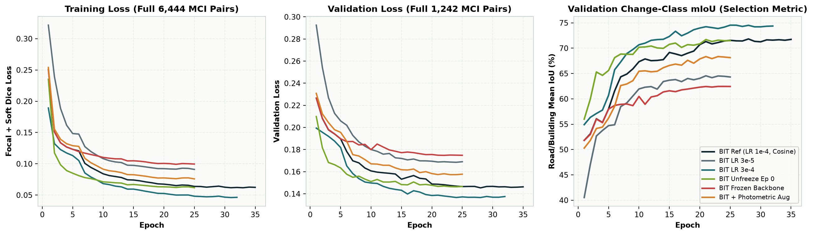

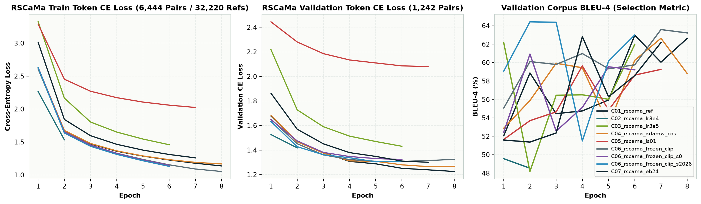

- **`D03_bit_lr3e4` (selected detector):** training loss falls from 0.189 at epoch 0 to 0.113 at epoch 4 during the five frozen-backbone epochs (0-4), and validation change-class mIoU rises from 54.91% to 60.70%. Unfreezing the ResNet18 backbone at epoch 5 lifts it by 5.04 points to 65.74%. The best value, 74.54%, is at epoch 24; training stopped after 32 of 35 epochs when the early-stopping patience of 7 ran out. Validation loss levels off near 0.137 from about epoch 21 while training loss keeps falling (0.046 at epoch 31), so a train-validation gap of about 0.09 remains, with no rise in validation loss.
- **`A03_siam_r18_unet` and `A01_ef_unet`:** both ran all 25 epochs, with validation peaks of 75.02% at epoch 22 and 73.60% at epoch 23 respectively.
- **`A04_changeformer`:** run.json records 4,140.95 s (69.0 min) of wall time for 25 epochs (165.6 s per epoch on average) with a peak of 6,570 MB VRAM on the RTX 4060 Laptop GPU. The per-epoch times in its history file average about 364 s, so the 165.6 s figure is the total wall time divided by 25 and may not cover earlier epochs if the run was resumed (the config has `resume: true`). Validation change-class mIoU peaked at 70.46% (epoch 22), below the BIT and U-Net variants, for a 41.04M-parameter transformer trained on 6,444 pairs.
- **`C06_rscama_frozen_clip` (selected captioner):** it completed all 8 epochs in 1,818.6 s (30.3 min, 227.3 s per epoch including validation) on a Colab T4 with the fused Triton selective-scan kernel (`triton_fused_exact`). Training cross-entropy falls from 2.605 to 1.052. The best validation corpus BLEU-4 is 0.6358 at epoch 6 (validation CE 1.3147, unchanged-pair false alarm rate 3.32%); validation CE is lowest at epoch 5 (1.307) and rises slightly afterwards, and BLEU-4 is not monotone across epochs. `C02_rscama_lr3e4` (learning rate 3e-4) had its best BLEU-4 (0.4956) at epoch 0, fell to 0.4853 at epoch 1 and was early-stopped after 2 of 8 epochs.

## Appendix E. Complete Hyperparameter Search Results (All 33 Milestone 4 Runs)

### E.1 All 24 Detector Runs (LEVIR-MCI Validation, 1,242 Pairs)

| Run ID | Arch | Head LR | WD | Eff Batch | Sched | Loss | Freeze Ep | Aug | Best Ep | Val Chg mIoU (%) | Road IoU (%) | Bldg IoU (%) | Val Bin F1 (%) | Val FA@50px (%) |
|---|---|---:|---:|---:|---|---|---:|---|---:|---:|---:|---:|---:|---:|
| `A03_siam_r18_unet` | `siam_resnet18_unet` | 3e-4 | 0.01 | 32 | cosine | focal_dice | 5 | flip | 22 | 75.02 | 72.61 | 77.42 | 86.42 | 8.54 |
| `A03_siam_r18_unet_s2026` | `siam_resnet18_unet` | 3e-4 | 0.01 | 32 | cosine | focal_dice | 5 | flip | 15 | 74.68 | 72.06 | 77.30 | 86.23 | 7.44 |
| **`D03_bit_lr3e4` (Selected)** | **`bit_resnet18`** | **3e-4** | **0.01** | **32** | **cosine** | **focal_dice** | **5** | **flip** | **24** | **74.54** | **72.38** | **76.71** | **86.25** | **6.80** |
| `A03_siam_r18_unet_s0` | `siam_resnet18_unet` | 3e-4 | 0.01 | 32 | cosine | focal_dice | 5 | flip | 24 | 74.49 | 71.86 | 77.13 | 86.20 | 8.07 |
| `D03_bit_lr3e4_s2026` | `bit_resnet18` | 3e-4 | 0.01 | 32 | cosine | focal_dice | 5 | flip | 23 | 74.15 | 72.12 | 76.19 | 85.93 | 9.97 |
| `D03_bit_lr3e4_s0` | `bit_resnet18` | 3e-4 | 0.01 | 32 | cosine | focal_dice | 5 | flip | 29 | 74.00 | 71.85 | 76.15 | 85.89 | 10.60 |
| `A01_ef_unet` | `ef_unet` | 3e-4 | 0.01 | 32 | cosine | focal_dice | 0 | flip | 23 | 73.60 | 70.53 | 76.67 | 85.65 | 8.39 |
| `D09_bit_step` | `bit_resnet18` | 1e-4 | 0.01 | 32 | step | focal_dice | 5 | flip | 24 | 72.94 | 71.12 | 74.76 | 85.19 | 16.46 |
| `D08_bit_const` | `bit_resnet18` | 1e-4 | 0.01 | 32 | constant | focal_dice | 5 | flip | 24 | 72.92 | 71.11 | 74.73 | 85.17 | 16.93 |
| `D01_bit_ref` | `bit_resnet18` | 1e-4 | 0.01 | 32 | cosine | focal_dice | 5 | flip | 27 | 71.82 | 69.72 | 73.92 | 84.57 | 18.04 |
| `D12_bit_unfreeze0` | `bit_resnet18` | 1e-4 | 0.01 | 32 | cosine | focal_dice | 0 | flip | 20 | 71.70 | 69.94 | 73.46 | 84.39 | 21.68 |
| `D06_bit_eb16` | `bit_resnet18` | 1e-4 | 0.01 | 16 | cosine | focal_dice | 5 | flip | 20 | 71.66 | 69.78 | 73.54 | 84.43 | 18.51 |
| `A02_fc_siam_diff` | `fc_siam_diff` | 3e-4 | 0.01 | 32 | cosine | focal_dice | 0 | flip | 17 | 71.60 | 68.75 | 74.45 | 84.16 | 4.11 |
| `A04_changeformer` | `changeformer` | 1e-4 | 0.01 | 32 | cosine | focal_dice | 0 | flip | 22 | 70.46 | 66.44 | 74.49 | 83.99 | 10.60 |
| `D04_bit_wd1e3` | `bit_resnet18` | 1e-4 | 0.001 | 32 | cosine | focal_dice | 5 | flip | 20 | 69.94 | 67.90 | 71.99 | 83.38 | 24.37 |
| `D05_bit_wd5e2` | `bit_resnet18` | 1e-4 | 0.05 | 32 | cosine | focal_dice | 5 | flip | 20 | 69.94 | 67.91 | 71.97 | 83.38 | 24.53 |
| `D14_bit_noaug` | `bit_resnet18` | 1e-4 | 0.01 | 32 | cosine | focal_dice | 5 | none | 20 | 69.68 | 67.54 | 71.81 | 83.23 | 24.53 |
| `D16_bit_photoscale` | `bit_resnet18` | 1e-4 | 0.01 | 32 | cosine | focal_dice | 5 | flip_photo_scale | 22 | 68.55 | 67.20 | 69.91 | 82.50 | 22.31 |
| `D10_bit_cedice` | `bit_resnet18` | 1e-4 | 0.01 | 32 | cosine | ce_dice | 5 | flip | 22 | 68.44 | 65.41 | 71.47 | 82.47 | 29.59 |
| `D15_bit_photo` | `bit_resnet18` | 1e-4 | 0.01 | 32 | cosine | focal_dice | 5 | flip_photo | 22 | 68.34 | 67.10 | 69.59 | 82.41 | 25.63 |
| `D07_bit_eb64` | `bit_resnet18` | 1e-4 | 0.01 | 64 | cosine | focal_dice | 5 | flip | 20 | 67.94 | 65.78 | 70.09 | 82.08 | 27.85 |
| `D02_bit_lr3e5` | `bit_resnet18` | 3e-5 | 0.01 | 32 | cosine | focal_dice | 5 | flip | 20 | 64.55 | 62.43 | 66.67 | 79.87 | 33.39 |
| `D11_bit_wce` | `bit_resnet18` | 1e-4 | 0.01 | 32 | cosine | weighted_ce | 5 | flip | 22 | 63.87 | 60.34 | 67.40 | 79.27 | 40.98 |
| `D13_bit_frozen` | `bit_resnet18` | 1e-4 | 0.01 | 32 | cosine | focal_dice | 999 | flip | 23 | 62.45 | 60.13 | 64.77 | 78.61 | 17.41 |

The table is sorted by validation change mIoU. `D15_bit_photo` is the photometric-augmentation run (`aug = flip_photometric` in its config). The selected `D03_bit_lr3e4` and the `A0x` runs used a 35 or 25 epoch budget, while the `D03_bit_lr3e4_s0` and `_s2026` seed replicates were configured for 30 epochs (patience 8); runs also differ in hardware (RTX 4060 Laptop, Colab T4, L4). All 24 runs completed; epochs completed and wall times are in each `run.json`. Best epochs are numbered from 0.

### E.2 All 9 Captioner Runs (LEVIR-MCI Validation, 1,242 Pairs, 388-Word Train-Only Vocab)

| Run ID | LR | Opt | Sched | Label Smooth | Freeze CLIP | Eff Batch | Best Ep | Val BLEU-4 | Val ROUGE-L | Changed BLEU-4 | Val CE | Val NC FA (%) |
|---|---:|---|---|---:|---|---:|---:|---:|---:|---:|---:|---:|
| `C06_rscama_frozen_clip_s2026` | 1e-4 | adamw | cosine | 0.0 | True | 12 | 1 | 0.6442 | 0.7325 | 0.3720 | 1.4276 | 4.43 |
| **`C06_rscama_frozen_clip` (Selected)** | **1e-4** | **adamw** | **cosine** | **0.0** | **True** | **12** | **6** | **0.6358** | **0.7405** | **0.4047** | **1.3147** | **3.32** |
| `C01_rscama_ref` | 1e-4 | adam | constant | 0.0 | False | 12 | 5 | 0.6296 | 0.7275 | 0.3916 | 1.2514 | 7.75 |
| `C07_rscama_eb24` | 1e-4 | adam | constant | 0.0 | False | 24 | 3 | 0.6281 | 0.7400 | 0.4068 | 1.3791 | 6.49 |
| `C04_rscama_adamw_cos` | 1e-4 | adamw | cosine | 0.0 | False | 12 | 6 | 0.6264 | 0.7498 | 0.4380 | 1.2653 | 5.70 |
| `C03_rscama_lr3e5` | 3e-5 | adam | constant | 0.0 | False | 12 | 0 | 0.6214 | 0.7177 | 0.2447 | 2.2182 | 0.47 |
| `C06_rscama_frozen_clip_s0` | 1e-4 | adamw | cosine | 0.0 | True | 12 | 1 | 0.6092 | 0.7168 | 0.3619 | 1.4751 | 7.44 |
| `C05_rscama_ls01` | 1e-4 | adamw | cosine | 0.1 | False | 12 | 3 | 0.5963 | 0.7421 | 0.4151 | 2.1336 | 6.80 |
| `C02_rscama_lr3e4` | 3e-4 | adam | constant | 0.0 | False | 12 | 0 | 0.4956 | 0.6765 | 0.2272 | 1.5260 | 0.79 |

The table is sorted by validation BLEU-4. The seed-2026 replicate of `C06` scored higher (0.6442, best epoch 1) than the selected seed-42 run, and the seed-0 replicate lower (0.6092), so the C06 BLEU-4 varies by about 0.035 across three seeds; the selection of `C06_rscama_frozen_clip` rests on the seed-42 run. `C00_rscama_released` is not a trained M4 run and is not in this table.

## Appendix F. Sample Predictions (10 Authentic Held-Out Test End-to-End Traces)

Ten Test image pairs, one chosen for each operational outcome (accepted building, accepted road, accepted unchanged, rejected, out-of-ontology deferral, exact-count deferral, VLM escalation, small change and mixed multi-claim scene), were exported as evidence bundles (`report.json`, crops, mask overlay) under `POC/milestone5/evidence/test_captioner_and_verifier/test_e2e_traces/`. They are illustrative cases picked per category, not a random sample. The proxy label comes from `test_verification_claims.jsonl`. Visual panels for five of the cases appear in Section 6.3 (`figures/m5_test_e2e_traces.png`).

| Trace Category | Held-Out Test Pair ID | Generated Caption (`C06`) | Claim Outcomes (`M5 Hybrid`) | Operational Behavior Demonstrated |
|---|---|---|---|---|
| `test_accepted_building` | `levir_mci/test/test_000032` | *"some buildings appear in the woods"* | `['accept', 'defer']` | The building claim is accepted by the BIT mask (1,772 building pixels, proxy label supported). The "woods" claim is deferred as out-of-ontology. |
| `test_accepted_road` | `levir_mci/test/test_000789` | *"a road appears in the bareland"* | `['accept']` | Mask-first accept (7,119 road pixels, proxy label supported). |
| `test_accepted_unchanged` | `levir_mci/test/test_000013` | *"the two scenes seem identical"* | `['accept']` | The mask has 0 changed pixels; the hedged no-change claim was escalated to Qwen3-VL-4B, which accepted it (proxy label supported). |
| `test_rejected_hallucination` | `levir_mci/test/test_000175` | *"the scene is the same as before"* | `['reject']` | `C06` predicted no change, `D03` marked 732 building pixels, and the no-change claim was rejected by the mask (proxy label contradicted); no VLM call. |
| `test_rejected_second` | `levir_mci/test/test_001038` | *"the two scenes seem identical"* | `['reject']` | The mask has 0 changed pixels, but the escalated Qwen3-VL-4B rejected the claim. The proxy label is supported, so this is a false reject (see G.2). |
| `test_deferred_out_of_ontology` | `levir_mci/test/test_000381` | *"a villa is built in the woods"* | `['accept', 'defer']` | The building claim is accepted via 499 mask pixels, but the pair has no ground-truth change and the proxy label is contradicted, so this is a false accept caused by a `D03` false positive. The "woods" claim is deferred as out-of-ontology. |
| `test_deferred_exact_count` | `levir_mci/test/test_000389` | *"two houses are built in the woods"* | `['defer', 'defer']` | The exact count ("two") is deferred because no independent instance evidence is available (reason code `exact_count_without_independent_instance_evidence`); the "woods" claim is deferred as out-of-ontology. |
| `test_vlm_escalated_case` | `levir_mci/test/test_000695` | *"the two scenes seem identical"* | `['accept']` | The hedged no-change claim has 0 mask pixels, was escalated to Qwen3-VL-4B and accepted (proxy label supported). |
| `test_small_change_case` | `levir_mci/test/test_000050` | *"a house appears in the top left corner of the scene"* | `['accept']` | Small building change (316 mask pixels, about 0.48% of the tile). The location phrase maps to the top-left cell of the 3x3 grid and the matching 272-pixel component is accepted (proxy label supported). |
| `test_mixed_scene_case` | `levir_mci/test/test_000123` | *"a road is built across the woods and some houses are built along the road"* | `['accept', 'accept']` | The caption is split into a road claim (5,636 road pixels) and a building claim (9,717 building pixels); both are mask-first accepted (proxy label supported). |

## Appendix G. Failure Case Examples

Failure cases were taken from the detector error mining (`detector_error_mining.json`), the captioner error mining (`captioner_test_full.json`) and the verifier claim log (`test_verification_claims.jsonl`). Visual error maps are in Section 10.2 (`figures/m5_error_taxonomy_gallery.png`). Pixel counts, F1 values and decisions below are read from those files. The "likely cause" entries are our reading of the T1/T2 images and the category-level causes in `failure_taxonomy.csv`; they were not tested.

### G.1 Detector Failure Examples (`D03_bit_lr3e4`, 1,858 Held-Out Test Pairs)

| Failure Mode | Pair ID | GT Changed Pixels | Pred Changed Pixels | Binary F1 (%) | Likely Cause (visual reading, untested) |
|---|---|---:|---:|---:|---|
| Unchanged FP (E1) | `levir_mci/test/test_000977` | 0 | 2,593 (bldg) | 0.0 | Seasonal and illumination differences between T1 and T2 over a suburban scene with shadowed roofs. |
| Unchanged FP (E1) | `levir_mci/test/test_002083` | 0 | 2,300 (1,558 bldg, 742 road) | 0.0 | Appearance change (canopy and ground cover) around existing buildings and driveways. |
| Large FN (E3) | `levir_mci/test/test_001303` | 14,009 (11,259 bldg, 2,750 road) | 0 | 0.0 | Large rebuilt area (bright roofs in T1, parking lot and road in T2) with no change predicted. |
| Large FN (E3) | `levir_mci/test/test_001393` | 6,927 (6,354 road, 573 bldg) | 0 | 0.0 | Low-contrast road resurfacing and lane marking with little change in edges. |
| Road/Bldg Swap (E4) | `levir_mci/test/test_001217` | 20,396 | 18,532 (3,492 swap) | 82.5 | Flat grey roof next to a highway partly predicted as road. |
| Tiny Miss (E2) | `levir_mci/test/test_000226` | 141 (bldg) | 0 | 0.0 | Isolated 141-pixel structure among dense tree canopy. |

### G.2 Captioner & Hybrid Verifier Failure Examples

| Module & Mode | Pair ID | Caption / Claim Span | Verifier Decision vs Proxy GT | Observation |
|---|---|---|---|---|
| Captioner Hallucination (E5) | `levir_mci/test/test_000010` | *"a small house appears in the bareland"* (GT: 0 px) | Not in the 150-pair verifier subset; `D03` predicts 0 changed pixels for this pair, so a mask check would find no support (not run) | `C06` describes a construction on an unchanged pair. |
| Captioner Obj Swap (E5) | `levir_mci/test/test_000064` | *"a road is built on both sides of the road"* (GT: 5,723 bldg, 0 road) | Not in the verifier subset (not run); `D03` predicts 1,586 road pixels here, so a mask check would not necessarily reject the road claim | The caption names a road where the ground truth contains only buildings and repeats the word "road". |
| Captioner Large Miss (E5) | `levir_mci/test/test_001307` | *"the two scenes seem identical"* (GT: 22,812 bldg, 3,320 road) | Not in the verifier subset (not run); `D03` finds 7,910 of 26,132 changed pixels, so a mask-first check would reject the no-change claim | `C06` predicts no change on a large changed scene. |
| Verifier False Accept (E6) | `levir_mci/test/test_001422` | *"a road appears on the bareland"* | `accept` (`mask_first_accept`) vs `contradicted` | `D03` predicts 6,539 road pixels where the ground truth has none, and the mask-first rule accepts the claim. |
| Verifier VLM Miss (E6) | `levir_mci/test/test_001729` | *"the two scenes seem identical"* | `accept` (`vlm_escalate`) vs `contradicted` | The ground truth has 937 building pixels, `D03` predicts none, and the escalated VLM accepted the no-change claim. |
| Verifier False Reject (E6) | `levir_mci/test/test_001038` | *"the two scenes seem identical"* | `reject` (`vlm_escalate`) vs `supported` | The pair is unchanged and the mask has 0 pixels, but the escalated VLM rejected the claim; we did not establish why. |

## Appendix H. Model Configuration and Provenance Registry

The M4 weights are not committed to Git (`*.pt` and `*.pth` are git-ignored); `POC/milestone5/configs/model_registry.json` records their sizes and SHA-256 digests and the Google Drive folder that holds them. `POC/milestone5/scripts/run_terrawatch_inference.py --verify-checksums <dir>` is a separate mode that hashes local checkpoints under a directory and compares them with the registry. Every SHA-256 below equals the `best_checkpoint_sha256` in the corresponding `run.json`.

### H.1 Frozen Checkpoint Registry (12 Checkpoints + 2 Hugging Face Revisions)

| Run / Asset ID | Role | Architecture | Exact Byte Size | SHA-256 Digest (Full) |
|---|---|---|---:|---|
| `D03_bit_lr3e4` | **Selected Detector** | `bit_resnet18` | 47,898,192 | `05345df154b4d748432bccd72a439d3eddbda0fa2e10795ecdac29cd2cd38feb` |
| `D03_bit_lr3e4_s0` | Seed 0 Replication | `bit_resnet18` | 47,898,192 | `782e352207804d761be6942ed5b730c4939fab59ff0285872be3718e4da10d45` |
| `D03_bit_lr3e4_s2026` | Seed 2026 Replication | `bit_resnet18` | 47,898,000 | `0d7fbda18cc943ac0f5ff70b36319dd084993146c6ae8be3cf9e191a53b91534` |
| `A01_ef_unet` | Architecture Baseline | `ef_unet` | 31,114,207 | `5831a24249abf330f65a0b2c278040b2908b9137a2e95472544ccf34f91a437a` |
| `A02_fc_siam_diff` | Architecture Baseline | `fc_siam_diff` | 31,110,751 | `32329cf708a7fed397c96689922eca2a2f29556108c35c214a1c332326b23105` |
| `A03_siam_r18_unet` | Architecture Baseline | `siam_resnet18_unet` | 62,621,663 | `c9d2c9c994c63411096703397ee1842cde5ef917bee43d7b974a3f47c511e586` |
| `A03_siam_r18_unet_s0` | Seed 0 Replication | `siam_resnet18_unet` | 62,621,663 | `1b3474c7b33f13749580210308c471ae189ce194c678a933729dfb769d678890` |
| `A03_siam_r18_unet_s2026` | Seed 2026 Replication | `siam_resnet18_unet` | 62,621,663 | `ad063b288b245554256412d95d4e5e5787f588a6e4de012bcf85acb97dc2d9a8` |
| `A04_changeformer` | Architecture Baseline | `changeformer` | 164,282,148 | `fe137902d7dc4ca4816ab1e777f93d1f383cd132ca4542bc23a3b96c26ea6bc7` |
| `C06_rscama_frozen_clip` | **Selected Captioner** | `rscama_vit_b32_frozen_clip` | 1,797,923,010 | `c5b80d6bf6b6b0b2628c48d47df07ad77bc086ff0004bdd7160d0b0ff5545796` |
| `C01_rscama_ref` | Captioner Ablation Baseline | `rscama_vit_b32_unfrozen_adam` | 1,797,923,010 | `979cff69acb852f22e24ca1edf2daaa9bf295bf69fc5c6f447c6508fdd24d7e3` |
| `C04_rscama_adamw_cos` | Captioner Ablation Baseline | `rscama_vit_b32_unfrozen_adamw_cos` | 1,797,923,010 | `415cadc4abac43108aba91dca3ae547c0b8d95c8f69d6f66776e669857297e46` |
| `C00_rscama_released` | Published Benchmark | `lcybuaa/RSCaMa` | n/a | HF revision `3e527e6656b62cc615eab1d2f3fb73777cbbf62c`; file SHA-256 `5eeba271fb7c2ff4722b725cbf5ce1a1fdc0a33ddf1b077dcf5381aebd643449` |
| `Qwen3-VL-4B-Instruct` | **Selective Referee** (registry dtype `bfloat16`; the test traces record `float16`) | `Qwen/Qwen3-VL-4B-Instruct` | n/a | HF revision `ebb281ec70b05090aa6165b016eac8ec08e71b17` |

### H.2 Locked Hybrid Verifier Policy Configuration (`calibrated_mask_first_hybrid_v1`)

```json
{
  "detector": "D03_bit_lr3e4",
  "captioner": "C06_rscama_frozen_clip",
  "referee": "Qwen/Qwen3-VL-4B-Instruct",
  "verifier_policy": "calibrated_mask_first_hybrid_v1",
  "calibration_split": "levir_mci_val_120_pairs_147_claims",
  "tau_accept": 0.60,
  "tau_reject": 0.75,
  "mask_alarm_px": 50,
  "weak_mask_escalate_px": 200,
  "residual_no_change_escalate_px": 10,
  "min_crop_size": 32,
  "crop_padding_fraction": 0.25
}
```

## Appendix I. Evaluation and Profiling Scripts

All commands run from the repository root. `<manifests>` is the portable manifest directory (`portable_data_receipt.json` and the `mci_*.jsonl`, `second_cc_*.jsonl` files) and `<dataset_root>` is the extracted dataset directory. Checkpoints and raw data are not committed; verify SHA-256 digests (Section 2.3) before use. The detector and captioner arguments reproduce the committed receipts in `docs/milestone4/evidence/full_data_m4/` (the receipts record the same flags, launched through the `scripts/train_detector.py` and `scripts/train_captioner.py` entry points; the full-data trainers listed below accept the same flags). Every script below was checked against its argument parser. The scripts under `POC/milestone5/scripts/` marked "evaluation branch" exist only on the `milestone5-evaluation` branch; all other scripts are present on `main`.

### I.1 Script and command index

| Purpose | Script | Command |
|---|---|---|
| Environment and asset preflight | `scripts/check_model_setup.py` | `python scripts/check_model_setup.py --config configs/pipeline.json --environments --strict` |
| Acquire pinned model sources (BIT_CD, RSCaMa) | `scripts/setup_model_sources.py` | `python scripts/setup_model_sources.py` |
| Fetch released RSCaMa checkpoint (C00) | `scripts/fetch_model_assets.py` | `python scripts/fetch_model_assets.py --rscama --output models/checkpoints/rscama.pth` |
| Data audit, preparation and verification | `src/data/cli.py` | `python -m src.data.cli audit`, `python -m src.data.cli prepare`, `python -m src.data.cli verify` |
| Train detector (selected D03) | `scripts/train_detector_full.py` | `python scripts/train_detector_full.py --run-id D03_bit_lr3e4 --arch bit_resnet18 --bit-source-dir models/external/BIT_CD --manifests-dir <manifests> --extracted-root <dataset_root> --output-dir runs/detector --head-lr 3e-4 --backbone-lr 3e-5 --epochs 35 --min-epochs 15 --patience 7 --batch-size 16 --accum-steps 2 --loss focal_dice --scheduler cosine --freeze-epochs 5 --aug flip --amp bf16 --seed 42 --resume` |
| Train captioner (selected C06) | `scripts/train_captioner_full.py` | `python scripts/train_captioner_full.py --run-id C06_rscama_frozen_clip --source-dir models/external/RSCaMa --manifests-dir <manifests> --extracted-root <dataset_root> --output-dir runs/captioner --optimizer adamw --lr 1e-4 --weight-decay 0.01 --scheduler cosine --freeze-encoder --epochs 8 --min-epochs 6 --patience 3 --batch-size 12 --amp fp16 --seed 42` |
| Evaluate a trained detector or captioner on Test (single model) | `scripts/train_detector_full.py`, `scripts/train_captioner_full.py` | append `--eval-only --checkpoint <best.pt or best.pth> --eval-split test` to the training command (captioner additionally `--vocab <vocab.json>`) |
| Milestone 5 Test evaluation of all detectors, controls and the 17-condition stress suite (evaluation branch) | `POC/milestone5/scripts/m5_eval_detectors_and_stress.py` | `python POC/milestone5/scripts/m5_eval_detectors_and_stress.py --manifests-dir <manifests> --extracted-root <dataset_root> --checkpoints-dir <ckpt_dir> --bit-source-dir models/external/BIT_CD --changeformer-source-dir models/external/ChangeFormer --output-dir <out_dir> --device cuda` |
| Milestone 5 Test captioner benchmark, 150-pair Test verifier audit and blind-audit packet (evaluation branch) | `POC/milestone5/scripts/m5_eval_captioners_and_verifier.py` | `python POC/milestone5/scripts/m5_eval_captioners_and_verifier.py --manifests-dir <manifests> --extracted-root <dataset_root> --detector-ckpt <best.pt> --bit-source-dir models/external/BIT_CD --changeformer-source-dir models/external/ChangeFormer --rscama-source-dir models/external/RSCaMa --c06-test-captions <c06_test_captions.jsonl> --c00-test-captions <c00_test_captions.jsonl> --val-claims-jsonl <val_claims.jsonl> --output-dir <out_dir> --device cuda` (optional: `--c01-test-captions`, `--c04-test-captions`, `--probe-captions-json`, `--c06-ckpt`, `--c01-ckpt`, `--c04-ckpt`) |
| SECOND-CC per-class dissection (evaluation branch) | `POC/milestone5/scripts/m5_second_cc_dissection.py` | `python POC/milestone5/scripts/m5_second_cc_dissection.py --manifests-dir <manifests> --extracted-root <dataset_root> --runs-dir <runs_dir> --bit-source-dir models/external/BIT_CD --changeformer-source-dir models/external/ChangeFormer --out-json <out.json> --device cuda` |
| Validation corruption ladder, Test, controls and SECOND-CC transfer | `scripts/eval_robustness_transfer.py` | `python scripts/eval_robustness_transfer.py --arch bit_resnet18 --bit-source-dir models/external/BIT_CD --checkpoint <best.pt> --manifests-dir <manifests> --extracted-root <dataset_root> --output <report.json> --device cuda` |
| 120-pair Validation verification study and E2E traces | `scripts/run_verification_audit.py` | `python scripts/run_verification_audit.py --detector-arch bit_resnet18 --bit-source-dir models/external/BIT_CD --detector-ckpt <best.pt> --pred-captions-jsonl <val_best_captions.jsonl> --captioner-run-json <run.json> --manifests-dir <manifests> --extracted-root <dataset_root> --output-dir <out_dir> --accept-threshold 0.70 --num-audit-pairs 120` |
| Batch captioning of prepared pairs | `scripts/caption_pairs.py` | `python scripts/caption_pairs.py --split val --config configs/pipeline.json --output <captions.jsonl>` |
| Metric computation from predictions | `scripts/evaluate_models.py` | `python scripts/evaluate_models.py detector --split test --predictions <preds.jsonl> --output <metrics.json>` and `python scripts/evaluate_models.py captions --split test --predictions <preds.jsonl> --output <metrics.json> [--text-metrics]` |
| Single-pair end-to-end inference | `scripts/run_pipeline.py` | `python scripts/run_pipeline.py --t1 <t1.png> --t2 <t2.png> --config configs/pipeline.json --output <run_dir>` |
| Aggregate Milestone 4 receipts | `scripts/aggregate_m4_results.py` | `python scripts/aggregate_m4_results.py --evidence-dir docs/milestone4/evidence/full_data_m4` |
| Rebuild Milestone 4 figures | `scripts/build_m4_figures.py` | `python scripts/build_m4_figures.py` |
| CPU replay of Milestone 4 traces | `scripts/replay_milestone4.py` | `python scripts/replay_milestone4.py --device cpu` |
| Package a run with hashes | `scripts/package_model_run.py` | `python scripts/package_model_run.py --run <run_dir> --output <run.zip>` |
| Evidence Review UI | `src/app/server.py` | `python -m src.app.server docs/milestone4/evidence/full_data_m4/verification/e2e_traces --port 8765` |
| Regression tests | `tests/` | `python -m pytest -q` |
| Training cost table (Section 12.1) | `POC/milestone5/scripts/m5_training_cost_table.py` | `python POC/milestone5/scripts/m5_training_cost_table.py` |
| Compute profile (Section 12.2 to 12.6) | `POC/milestone5/scripts/m5_benchmark_compute.py` | `python POC/milestone5/scripts/m5_benchmark_compute.py --device {cpu,mps,cuda} --hardware-label LABEL [--ckpt-dir DIR] --stages detectors,captioner,witness[,referee] [--stage-overrides STAGE:warmup=N,iters=M;...] --out POC/milestone5/evidence/compute_profile/` |
| Blind annotation web app (evaluation branch) | `POC/milestone5/scripts/blind_audit_web_app.py` | `python POC/milestone5/scripts/blind_audit_web_app.py --data-dir <blind_audit_web_dir> --port 8770` |
| Human-audit aggregation (Appendix J) | `POC/milestone5/scripts/m5_compute_human_audit.py` | `python POC/milestone5/scripts/m5_compute_human_audit.py --raters-dir DIR [--adjudication CSV] [--packet JSONL] [--master-key CSV] [--id-map FILE] [--policy name=col ...] --out DIR` |

### I.2 Profiling invocations

The `--hardware-label` value names the output file, `compute_profile_<label>.json`. The labels below are those of the committed result files; they are not the platform names of Table 2.1. The CUDA runs on the Colab Tesla T4 were split in two: detectors and witness in one session, and the referee in a second one with reduced pass counts. The RTX 4060 was run twice, once for detectors and witness and once for the captioner alone. The Apple M4 runs omit `--ckpt-dir` and therefore profile randomly initialised weights, which is adequate for latency and memory but not for any accuracy statement. The arguments below are copied from the `argv` field of each result file, with local paths replaced by placeholders.

```
python POC/milestone5/scripts/m5_benchmark_compute.py --device cuda --hardware-label rtx4060 --ckpt-dir <ckpt_dir> --stages detectors,captioner,witness --out POC/milestone5/evidence/compute_profile/
python POC/milestone5/scripts/m5_benchmark_compute.py --device cuda --hardware-label rtx4060_cap --ckpt-dir <ckpt_dir> --stages captioner --stage-overrides captioner:warmup=5,iters=30 --out POC/milestone5/evidence/compute_profile/
python POC/milestone5/scripts/m5_benchmark_compute.py --device cuda --hardware-label colab_t4 --ckpt-dir <ckpt_dir> --stages detectors,witness --out POC/milestone5/evidence/compute_profile/
python POC/milestone5/scripts/m5_benchmark_compute.py --device cuda --hardware-label colab_t4_referee --stages referee --stage-overrides referee:warmup=3,iters=20 --out POC/milestone5/evidence/compute_profile/
python POC/milestone5/scripts/m5_benchmark_compute.py --device mps --hardware-label mac_m4_mps --stages detectors,captioner,witness --stage-overrides captioner:warmup=10,iters=50 --out POC/milestone5/evidence/compute_profile/
python POC/milestone5/scripts/m5_benchmark_compute.py --device cpu --hardware-label mac_m4_cpu --stages detectors,captioner,witness --stage-overrides "captioner:warmup=2,iters=10;detectors:warmup=5,iters=30,batch_warmup=1,batch_iters=5" --out POC/milestone5/evidence/compute_profile/
```

### I.3 Output locations

| Output | Path |
|---|---|
| Training cost (JSON, Markdown) | `POC/milestone5/evidence/compute_profile/training_cost.json`, `training_cost.md` |
| Compute profile | `POC/milestone5/evidence/compute_profile/compute_profile_<hardware-label>.json` (six files: `rtx4060`, `rtx4060_cap`, `colab_t4`, `colab_t4_referee`, `mac_m4_mps`, `mac_m4_cpu`) |
| Human-audit summary | `POC/milestone5/evidence/human_audit/` (`human_audit_summary.json`, `gold_labels.csv`, `disagreements.csv`, `m5_human_audit_agreement.png`, together with the four rater sheets and the master key) |
| Milestone 5 Test evaluation receipts | `POC/milestone5/evidence/test_detector_and_stress/`, `POC/milestone5/evidence/test_captioner_and_verifier/` |
| Milestone 4 receipts | `docs/milestone4/evidence/full_data_m4/` |

Test modules: `tests/test_data.py`, `test_data_preparation.py`, `test_milestone4_pipeline.py`, `test_model.py`, `test_model_metrics.py`, `test_model_pipeline.py`, `test_pipeline.py` and `test_visual_evidence.py`. The data-preparation tests additionally require `pandas` (`requirements-data.txt`). The commands in this appendix were checked against the argument definitions of each script; they were not all re-executed for this report.

## Appendix J. Human Annotation Protocol and Ethics Checklist

### J.1 Design

The audit measures claim-level groundedness independently of the automated proxy labels used during development (Section 13.1). It covers 120 held-out Test claims (`M5T_001` to `M5T_120`). Each claim is rated independently by two team members, and the design assigns a third member to adjudicate every disagreement. Each team member rates 60 claims. Raters see only the evidence needed to judge the claim: the earlier image T1, the later image T2 with the candidate region marked, the zoomed contextual crop pair (minimum 32 x 32 pixels, padded by 25%, as configured in `configs/pipeline.json`) and the atomic claim text with its parsed object, action, location and quantity. The system's accept, reject or defer verdict, any referee probability, the automated proxy label and the other rater's label are withheld; they are kept in a separate master key.

**Status.** All four rater sheets (60 claims each, no blank rows) are complete and committed under `POC/milestone5/evidence/human_audit/`. Adjudication has not been carried out: no adjudication file exists, and the 18 claims on which the two raters disagreed are logged in `disagreements.csv` without a final label. The gold set is therefore the 102 claims on which both raters agreed (`gold_labels.csv`: 94 `supported`, 8 `contradicted`), and the human-verified policy metrics in the results sections are computed over those 102 claims only.

### J.2 Slice, rater and adjudicator assignment

| Claim slice | Rater A | Rater B | Adjudicator (when A and B disagree) |
|---|---|---|---|
| Claims 001 to 030 | Shoaib Sadiq Salehmohamed (SSSM) | Priyanshu Agarwal (PA) | Sujal Raj Pradhan (SRP) |
| Claims 031 to 060 | Priyanshu Agarwal (PA) | Sarthak Saini (SS) | Shoaib Sadiq Salehmohamed (SSSM) |
| Claims 061 to 090 | Sarthak Saini (SS) | Sujal Raj Pradhan (SRP) | Priyanshu Agarwal (PA) |
| Claims 091 to 120 | Sujal Raj Pradhan (SRP) | Shoaib Sadiq Salehmohamed (SSSM) | Sarthak Saini (SS) |

No claim is assigned for adjudication to one of its own raters, and each member rates two slices (60 claims); this assignment is enforced by `m5_compute_human_audit.py`, which rejects ratings from a member outside the slice's rater pair. Each member rated only their own ratings; for example SRP rated claims 061 to 120 and is the assigned adjudicator for claims 001 to 030.

The 120 claims come from the 150-pair stratified Test verification audit. They were drawn so that the sheet is not dominated by easy accepts: every claim that the calibrated hybrid did not accept or whose automated proxy label was not `supported` was included (61 claims), and 59 claims that were both accepted and proxy-supported were added by random selection (seed 2026). The 120 claims were then shuffled before being cut into the four 30-claim slices. By scene stratum they comprise 34 building-only, 26 unchanged, 24 mixed (building and road), 20 small-change and 16 road-only claims. The hybrid verdicts in the master key are 67 accept, 28 defer and 25 reject. The sample is deliberately enriched for non-accepted claims and is not a random sample of all claims, so the human groundedness figures describe this sample and not the deployment distribution.

### J.3 Rubric

Each claim receives exactly one `human_label`. The wording below follows the instructions shown to raters in the annotation tool.

| Label | Definition |
|---|---|
| `supported` | The claimed change, or the claimed absence of change, is clearly visible between T1 and T2, and the object type and location match |
| `contradicted` | The images visibly disagree with the claim: for example a new building or road asserted where nothing changed, "no change" asserted where a real change occurred, the wrong object class, the wrong count or the wrong location |
| `unverifiable` | The claim cannot be confirmed visually because the change is too small, blurred or occluded, because of heavy shadow or seasonal ambiguity, or because the detail is out of scope |

When the label is `contradicted` or `unverifiable`, the rater also assigns one `error_category`; otherwise the category is `none`.

| `error_category` | Definition |
|---|---|
| `none` | Used only with `supported` |
| `hallucinated_object` | The claimed object does not exist in either image |
| `missed_change` | A real change is present but the claim states none, or omits it |
| `wrong_class_road_vs_bldg` | The change is real but is labelled road when it is building, or the reverse |
| `wrong_count` | The stated number of objects is incorrect |
| `wrong_location` | The object exists but the stated location or relation (for example "along the road") is incorrect |
| `shadow_or_seasonal` | The apparent change is shadow, illumination or seasonal appearance |
| `tiny_or_occluded` | The change is too small, partial or occluded to judge |

In the completed sheets only `supported` and `contradicted` were used (no claim was labelled `unverifiable`), and the categories used were `none`, `missed_change`, `hallucinated_object` and `wrong_count`.

### J.4 Blinding and submission rules

1. Raters do not view the automated verdict and do not discuss labels with their paired rater until both sheets are submitted. The annotation tool shows no model verdict, probability or other rater's label.
2. Each rater inspects T1, T2 and the zoomed crop pair for every claim and does not consult reference captions or ground-truth masks.
3. Each rater saves a completed sheet as `POC/milestone5/evidence/human_audit/rater_<initials>.csv` with initials `SSSM`, `PA`, `SS` or `SRP`.
4. The adjudicator sees both rater labels but not the model verdict, assigns the final label and category, and records the adjudication in a separate CSV passed to `m5_compute_human_audit.py --adjudication`. This step is pending (see the status note in J.1).
5. Sheets are not edited after submission; changes are made only through adjudication. The SHA-256 of each submitted sheet is recorded in `human_audit_summary.json`.

### J.5 Agreement and groundedness metrics

**Cohen's kappa.** For two raters labelling the same claims over the three classes, with observed agreement `p_o` (the fraction of claims given the same label) and chance agreement `p_e = sum over k of p_{A,k} x p_{B,k}` (`p_{A,k}` and `p_{B,k}` are the marginal proportions of class `k` for raters A and B),

`kappa = (p_o - p_e) / (1 - p_e)`.

Kappa is reported pooled across the four slices, per slice and with the 3 x 3 rater confusion matrix, together with percent exact agreement. Values are read on the conventional scale (below 0.40 poor to fair, 0.41 to 0.60 moderate, 0.61 to 0.80 substantial, above 0.80 almost perfect). The pooled result is 85.0% exact agreement (102 of 120 claims) with kappa 0.38; per slice, agreement is 100.0%, 83.3%, 70.0% and 86.7% and kappa is 1.00, 0.47, 0.08 and 0.00 for claims 001 to 030, 031 to 060, 061 to 090 and 091 to 120. In the last slice one rater used a single label for all 30 claims, so kappa is not informative there, and the low kappa values in the presence of high raw agreement reflect the dominance of `supported`. The number of claims on which an adjudicator overrules both raters cannot be reported until adjudication is done.

**Human-verified groundedness and hallucination rate.** For a verification policy, over the claims it accepts that have a gold label, groundedness is the share whose gold label is `supported` and hallucination rate is the share whose gold label is `contradicted`; `unverifiable` claims are reported separately. Accepted claims without a gold label (those in the 18 unresolved disagreements) are excluded and counted. The script compares the unverified captioner, mask-only, direct referee, re-inspect-all and the calibrated mask-first hybrid policies. The agreement between the automated proxy label and the gold labels (here 70.6% over the 102 gold claims, kappa 0.24) is reported as the proxy-versus-human alignment; it indicates how far the Milestone 4 proxy precision values can be trusted. On this sample the alignment is limited: among the 102 gold claims the proxy labelled 17 claims `unverifiable` and 12 `contradicted` that both raters judged `supported`, and 1 `supported` that both raters judged `contradicted`.

### J.6 Ethics and responsible-deployment checklist

| Item | Requirement | Status in this project |
|---|---|---|
| Data licence | Use only data under research-compatible terms, with attribution retained | `configs/datasets.yaml` records the licence disposition per dataset; SECOND-CC is recorded as CC BY 4.0 (Zenodo record) and the LEVIR-family datasets as research-only with attribution and no raw imagery in Git |
| No raw data or weights in Git | Imagery and checkpoints stay outside version control | `.gitignore` excludes `data/raw/*`, `data/processed/*`, `models/checkpoints/*`, `*.pt` and `*.pth`; checkpoints are referenced by SHA-256 only |
| Annotator welfare and consent | Raters are informed of the task and its use; no personal data are shown | Raters are the four project members, who designed the audit; no external annotators or payment. The audit imagery is overhead aerial tiles; no personal data were displayed alongside it |
| Rater independence | Blind, independent labelling with a third-party adjudicator | Blinding and independent labelling were applied (Sections J.2 and J.4); adjudication is pending |
| Label provenance | Every final label traces to two independent labels and, for disagreements, one adjudication | Rater sheets, `gold_labels.csv`, `disagreements.csv` and sheet hashes are retained; the adjudication CSV does not yet exist |
| Model transparency | Checkpoint digests, referee revision and threshold are recorded | `configs/pipeline.json` records the D03 and C06 checkpoint SHA-256 values, the Qwen3-VL revision and the 0.70 accept threshold; the Evidence Review verifies source-image hashes on load |
| Human in the loop | No automated accept is the sole basis for a consequential decision | Requirement for deployment. The Evidence Review keeps model outputs immutable and records human decisions in an append-only SQLite log |
| Purpose limitation | Use limited to infrastructure, land-use and disaster change review; no tracking of individuals or protected sites | Requirement, discussed in Section 13.7 |
| Privacy | Resolution below the level at which individuals are identifiable; reassess before using higher-resolution data | Requirement, discussed in Section 13.7 |
| Scope of claims | Metrics are quoted for LEVIR-MCI and SECOND-CC only; local validation before any new region or sensor | Followed in this report; see Section 13 |
| Bias disclosure | Single region and sensor, class imbalance and 388-word vocabulary are disclosed | Section 13.3 |
| Auditability | Override and export records can be exported from the audit database | `/api/export` of the Evidence Review application (`src/app/server.py`) |
